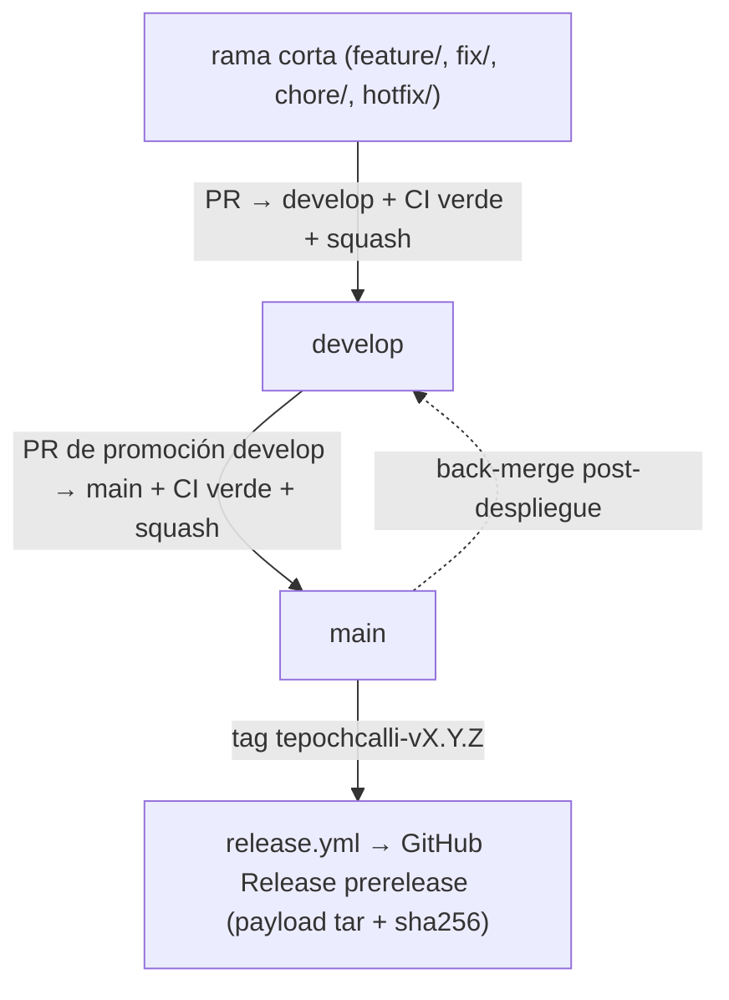

# Contribuir a Tepochcalli

> Guía del contribuidor para el flujo de CI/CD de la versión `0.1.0-beta.2`.
> Prosa en español; comandos, rutas y nombres técnicos en English.
> Reglas del repo: [AGENTS.md](AGENTS.md) · estilo: [docs/CODE_STYLE.md](docs/CODE_STYLE.md) ·
> seguridad: [docs/SECURITY.md](docs/SECURITY.md) · plan: [docs/WORKFLOW.md](docs/WORKFLOW.md).

## 1. Preparación del entorno

1. **Comandos vía `just` solamente** (Justfile-first): nunca invoques `uv`, `pytest`, `cargo`
   o `npx` crudos — el `Justfile` exporta `UV_PROJECT_ENVIRONMENT=venv` y fija
   `CARGO_TARGET_DIR`; un `uv` a mano crea un `.venv` paralelo con deriva impredecible.
   Si falta una receta, añádela al `Justfile` en el mismo cambio que la usa.
2. Instala el hook de commit rápido (ruff only, ~1.2 s):

   ```bash
   just hooks-install   # activa .githooks/pre-commit vía core.hooksPath
   just hooks-uninstall # lo desinstala
   ```

   En este montaje fuseblk/NTFS-3G el bit ejecutable no se puede fijar con `chmod` (es un
   no-op): al versionarlo usa `git add --chmod=+x .githooks/pre-commit`.
3. Sincroniza las etiquetas del repo (idempotente, muta el remoto bajo demanda, **no** corre
   en ningún gate): `just labels-sync` → crea `hotfix`, `release`, `ci`, `dependencies`
   vía `scripts/create-labels.sh`.
4. **Rust:** en este machine `cargo` muere con `Permission denied (os error 13)` si
   `CARGO_TARGET_DIR` cae en el NTFS. `just rust-ci` ya fija el default bajo
   `/tmp/opencode/` (única ruta externa aprobada, regla del dueño 2026-11-16); no lo cambies.

## 2. Flujo de ramas

Ramas **cortas** (`feature/…`, `fix/…`, `chore/…`, `hotfix/…`; convención de
[docs/CODE_STYLE.md](docs/CODE_STYLE.md) §Nomenclatura — se acepta la variante `feat/…` que
usa la rama actual). **Todo el trabajo pasa por una PR hacia `develop`**, con el CI gate en
verde y **squash merge** (historial lineal — requisito explícito del dueño; un contribuidor
único ⇒ sin conflictos de merge).



* **Nunca** se hace PR directo a `main`: `main` solo recibe la promoción desde `develop`.
* `ci.yml` dispara en `pull_request` (todas las ramas) y en `push` solo a `develop`/`main`.
  Es el **único** gate del repo: los dos workflows provisionales creados durante el
  desarrollo se eliminaron el 2026-11-24 (nunca corrieron en GitHub Actions); sus jobs
  `network`/`smoke` siguen disponibles solo como recetas locales (`just rust-test-nonet`,
  `just rust-smoke`).

## 3. Flujos paso a paso

### 3.1 Rama normal (otras ramas: feature, fix, chore, docs, test)

1. Crear la rama desde `develop`: `git switch -c feature/<descripción> develop`.
2. Commit(s) Conventional Commits (§4) + `just quality` en verde.
3. Abrir PR hacia **`develop`** con [`.github/PULL_REQUEST_TEMPLATE.md`](.github/PULL_REQUEST_TEMPLATE.md).
4. Esperar el CI gate verde (`ci.yml`, <10 min, §5).
5. **Squash merge** en `develop`; borrar la rama.
6. Repetir hasta acumular la preparación de una release (§3.3) si aplica.

### 3.2 Hotfix (camino más corto)

1. Crear `hotfix/<descripción>` desde `develop`.
2. Corregir + `just quality` verde.
3. PR → **`develop`**, CI verde, **squash merge**.
4. PR de promoción `develop` → **`main`** (squash), CI verde.
5. Si el hotfix corrige algo ya publicado: publicar según §6 (tag sobre `main`) o, para una
   corrección inmediata sin release, detener aquí — `main` ya está actualizado.

### 3.3 Release

1. Preparación en `develop` mediante PRs normales (§3.1); cada PR en verde.
2. **Requisito del dueño (#3): ANTES de lanzar, correr la suite COMPLETA local
   `just ci`** (20:58–45m49s medidos) — CI **nunca** la corre; el gate de CI es una
   porción <10 min. Si `just ci` falla, no se lanza.
3. PR → `develop`, CI verde, squash merge.
4. PR de promoción `develop` → **`main`** (squash), CI verde — cero fricción.
5. Tag en `main`: `tepochcalli-v<version>`, lo que dispara el **`release.yml` existente**.
   Guard de integridad: `tag == crates/tepochcalli/Cargo.toml version ==
   CHANGELOG.md section ## [<version>]` — los tres deben coincidir, si no el job falla.
6. `release.yml` crea el GitHub Release `--prerelease` con el tar del payload +
   sidecar sha256, en el environment `release` (self-approval permitido hoy).
7. Sincronizar `develop` con `main` (§6 paso 6) — obligatorio tras publicar.

## 4. Convención de commits

Fuente: [docs/CODE_STYLE.md](docs/CODE_STYLE.md) §Commits + checklist de [AGENTS.md](AGENTS.md).

* Formato: `type: resumen` — **≤72 columnas**, subject en español permitido.
* Tipos: `docs` `feat` `fix` `refactor` `test` `chore`.
* Un commit = una decisión lógica (atómico); nada de "megapatch".
* Trailer **obligatorio**: `Co-Authored-By: …`.
* Opcional: cuerpo que explique el **por qué**, no el qué.

## 5. Gates: local vs CI

| Gate | Dónde | Composición | Tiempo medido |
| --- | --- | --- | --- |
| `just quality` | local (tactical) | `lint → fmt-check → typecheck → python-test-unit` | 707 tests Python / **69,45 s** (docs/WORKFLOW.md §Phase 6.6) |
| **CI gate** (hard <10 min) | `.github/workflows/ci.yml` en PR + push a develop/main | job `gitleaks` + job `python` (`just python-lint python-fmt-check python-typecheck python-test-unit test-acceptance md-lint`) + job `rust` (`just rust-ci`); **`timeout-minutes: 10` en cada job** | componentes: unit 702 tests 52–76 s (AGENTS.md), `test-acceptance` 10 tests 4 s, `rust-ci` 2m45s caliente, `md-lint` 0 issues/63 ficheros (docs/WORKFLOW.md) |
| `just ci` | **SOLO local** (cierre de fase / preparación de release) | `python-sync → quality → test-mcp-tools → test-mcp-wire → test-engine → test-converter → test-acceptance → bench-smoke → rust-ci` | **20:58–45m49s** medidos (AGENTS.md / BACKLOG §8) — **PROHIBIDO en CI** por regla del dueño |
| `just coverage` | **SOLO local**, una vez al cierre de fase | suite completa instrumentada | 50m46s / 97 % (2026-11-16) — nunca por tarea ni commit |

Notas honestas del gate de CI (cabecera de `ci.yml`): la primera corrida sin caches (modelos
~1.6 GB + torch) queda **fuera** del envelope medido y el timeout de 10 min la corta — el
presupuesto es duro, no maquillado.

## 6. Despliegue (deploy)

No hay servicio runtime que desplegar: el "despliegue" = **merge a `main` + tag**, que
publica el payload como GitHub Release.

1. Completar §3.3 pasos 1–4 (preparación local `just ci` incluida).
2. Merge squash de la promoción `develop` → `main` con CI verde.
3. En `main`: crear y empujar el tag

   ```bash
   git tag tepochcalli-v<version>
   git push origin tepochcalli-v<version>
   ```

4. `release.yml` (trigger `tepochcalli-v[0-9]*`) valida guard → sube
   `tepochcalli-workspace-<version>.tar.gz` + sha256 como `--prerelease` (environment
   `release`; ese environment tiene reviewer requerido —Fisherk2, con auto-revisión
   permitida—, así que la run espera en `waiting` hasta una aprobación explícita (UI
   «Review deployments» o API
   `POST /repos/{owner}/{repo}/actions/runs/{run_id}/pending_deployments`, con
   `state=approved` y `comment` obligatorio); sin aprobación la petición expira a los
   30 días). Las
   notas de la Release son ahora la sección `## [<version>]` de `CHANGELOG.md`, que
   `release.yml` extrae con `--notes-file`.
5. Verificar la Release y el asset en GitHub.
6. **Sincronizar `develop` con `main` — obligatorio al terminar cada despliegue**
   (regla del dueño 2026-11-24): el squash de la promoción deja `main` con un commit
   que `develop` no tiene — mismo árbol, historial divergente (medido tras el squash de
   beta.1: `develop` 35 commits vs `main` 1, árboles idénticos, 2026-11-24). Sin este
   back-merge la divergencia se acumula en cada release y los hotfix hechos en `main`
   nunca vuelven a `develop`.

   Restricción: el push directo a `develop` está prohibido por el ruleset
   `protect-develop` («Changes must be made through a pull request» + required checks
   `gitleaks`/`python`/`rust`, `bypass_actors: []` — sin bypass, ni siquiera para
   admins; intentarlo falla con `GH013`), así que la sincronización entra por PR como
   todo lo demás (§2).

   ```bash
   git fetch origin
   git switch develop
   git merge origin/main   # árboles idénticos tras el squash ⇒ merge auto-limpio
   # si hubiera conflictos: resolver hacia el contenido de `develop` (es el
   # superconjunto — `main` no aporta contenido nuevo) y verificar que el árbol
   # resultante no cambia (`git diff HEAD` vacío tras `git add`) antes del commit
   git switch -c sync/post-deploy
   git push -u origin sync/post-deploy
   gh pr create --base develop --head sync/post-deploy
   gh pr checks <n> --watch --fail-fast   # gitleaks/python/rust en verde
   gh pr merge <n> --merge                 # método merge, NUNCA squash
   git branch -d sync/post-deploy
   ```

   El merge (no squash) conserva los dos padres: con squash el commit resultante
   aplana la historia y `main` dejaría de quedar contenido en `develop`.
   Resultado: `main` queda contenido en `develop`, el commit etiquetado vive en el
   historial de `develop` y la próxima promoción `develop` → `main` sale limpia.

Aclaraciones: la publicación a PyPI (`uvx tepochcalli`) forma parte del flujo desde
`0.1.0-beta.1` (`0.1.0b1` publicado; `0.1.0-beta.2` sigue el mismo camino: tag →
`release.yml` + `publish.yml`, ambos con environment `release`) — ver
`docs/BACKLOG.md` §8 (filas 2026-11-24). Queda como deuda la migración de `publish.yml`
del token estático a Trusted Publishing/OIDC.

## 7. Rollback

No hay servicio runtime que revertir: rollback del artefacto publicado.

1. **Revert de la PR de promoción** (si el problema está en el contenido de `main`):
   revert del squash en `main`, y si hace falta revertir también en `develop`.
2. **Tag/Release:** si el tag ya se publicó, borrar o mover el tag
   (`git push origin :refs/tags/tepochcalli-v<version>`) y eliminar/rectificar la GitHub
   Release; los usuarios siempre bajan por tag fijo (`releases/latest` no apunta a
   prereleases).
3. Re-ejecutar §6 con la versión corregida (nueva sección en `CHANGELOG.md`).

## 8. Seguridad de secretos

Regla dura ([docs/SECURITY.md](docs/SECURITY.md), §Security Rules de [AGENTS.md](AGENTS.md)):

* **Nunca commitear:** API keys, `.env*`, ni el contenido de
  `.tepochcalli/{config,db,models,venv,bin}`.
* Claves de servicios externos solo vía env var `{env:VAR}` en `opencode.json` o en
  `tepochcalli.toml` local (gitignored).
* El job **`gitleaks`** del CI escanea **todo el historial** (`fetch-depth: 0`) en cada PR:
  un secreto commiteado rompe el gate, y limpiar el historial es costoso — revisa el diff
  antes de commitear (`git diff --staged`).

## 9. PRs e issues

* **PR:** usa [`.github/PULL_REQUEST_TEMPLATE.md`](.github/PULL_REQUEST_TEMPLATE.md) —
  *Type of change*, *Branch target* (`develop` obligatorio; `main` solo vía promoción) y
  *Checklist*: Conventional Commit ≤72 col, `just quality` verde local, **`just ci` completo
  obligatorio al preparar release/hotfix**, sin secretos, specs/docs actualizadas si cambió un
  contrato, entrada en `docs/BACKLOG.md` §8 (+ ADR/enmienda si es decisión).
* **Issues:** dos forms en `.github/ISSUE_TEMPLATE/` — `bug_report.yml` y
  `feature_request.yml`.
* Etiquetas disponibles vía `just labels-sync`: `hotfix`, `release`, `ci`, `dependencies`.

## 10. Comandos `just` de apoyo

| Receta | Para qué |
| --- | --- |
| `just quality` | Gate táctico local (lint + fmt + types + unit) |
| `just ci` | Suite completa local — solo cierre de fase o prep. de release |
| `just md-lint` | Markdownlint sobre `docs specs AGENTS.md SPEC.md README.md CHANGELOG.md` |
| `just coverage` | Cobertura Python (95 %), una vez al cierre de fase |
| `just hooks-install` / `just hooks-uninstall` | Activa/desactiva el hook `.githooks/pre-commit` |
| `just labels-sync` | Sincroniza etiquetas del repo (`scripts/create-labels.sh`) |
| `just rust-ci` | fmt + clippy + tests de Rust (fija `CARGO_TARGET_DIR` en `/tmp/opencode/`) |
| `just test-file <patrón>` | Un test suelto cuando la suite entera es demasiado |

> **Nota de cobertura:** `just md-lint` (Justfile:527-528) corre sobre
> `docs specs AGENTS.md SPEC.md README.md CHANGELOG.md` — **`CONTRIBUTING.md` NO está en su
> ruta**, así que este fichero no queda verificado por ese gate (el Justfile está fuera del
> alcance de este cambio; queda como mejora futura añadirlo).
