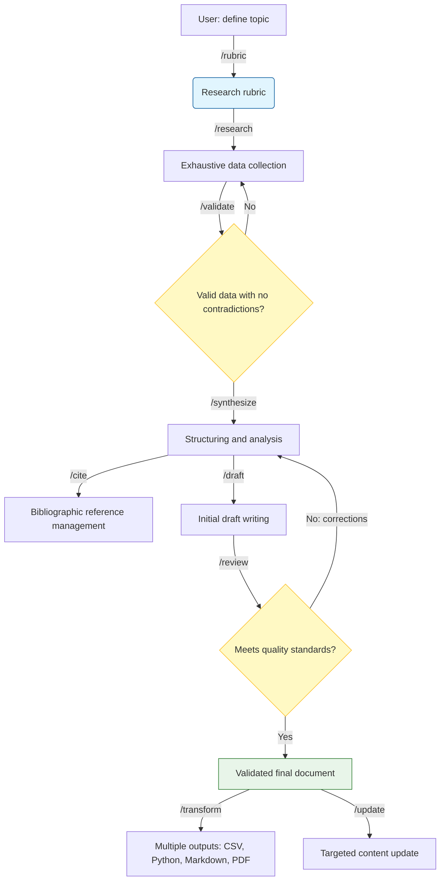
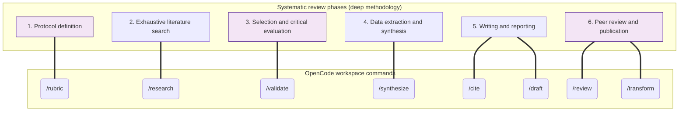

# Tepochcalli: Obsidian workspace

<p align="center">
  
</p>

<h3 align="center">Distributed Obsidian workspace using OpenCode with local RAG engine powered by CocoIndex, Markitdown and LanceDB.</h3>

<p align="center">
  <a href="https://github.com/Fisherk2/tepochcalli-opencode">
    
  </a>
  <a href="https://github.com/Fisherk2/tepochcalli-opencode/actions/workflows/ci.yml">
    
  </a>
  <a href="https://pypi.org/project/tepochcalli/">
    
  </a>
  <a href="https://github.com/Fisherk2/tepochcalli-opencode/releases">
    
  </a>
  <a href="LICENSE">
    
  </a>
</p>

<p align="center">
  <a href="https://opencode.ai">
    
  </a>
  <a href="https://www.rust-lang.org">
    
  </a>
  <a href="https://www.python.org">
    
  </a>
  <a href="https://docs.astral.sh/uv/">
    
  </a>
  <a href="https://github.com/Fisherk2/tepochcalli-opencode/actions">
    
  </a>
  <a href="https://github.com/casey/just">
    
  </a>
  <a href="https://semver.org">
    
  </a>
  <a href="https://gitdiagram.com/fisherk2/tepochcalli-opencode?utm_source=readme&utm_medium=badge">
    
  </a>
</p>

<p align="center">
A production-grade workspace integrating researching and learning skills organized in slash commands and specialized agents to accelerate AI-assisted researching with RAG and semantic search approaches. Designed for students, researchers, and professionals who want consistent quality in AI-assisted Obsidian vaults.
</p>

---

## Features

<table width="100%">
  <tr>
    <td width="33%" valign="top" align="center">
      <br>
      <h3 align="center">&nbsp; Skills</h3>
      <p align="center"><b>39</b> installed in the vault, including the dedicated <code>tepochcalli-mcp</code> decision catalogue.</p>
      <br>
    </td>
    <td width="33%" valign="top" align="center">
      <br>
      <h3 align="center">&nbsp; Commands</h3>
      <p align="center"><b>9</b> commands covering the full research methodology.</p>
      <br>
    </td>
    <td width="33%" valign="top" align="center">
      <br>
      <h3 align="center">&nbsp; Agents</h3>
      <p align="center"><b>5</b> primary agents + <b>164</b> subagents = <b>169</b> in the payload.</p>
      <br>
    </td>
  </tr>
</table>

---

<details>
  <summary>Table of Contents</summary>
  <ol>
    <li><a href="#features">Features</a></li>
    <li><a href="#main-agents">Main Agents</a></li>
    <li><a href="#install--update--uninstall">Install / Update / Uninstall</a></li>
    <li><a href="#configuration">Configuration</a></li>
    <li><a href="#workflow">Workflow</a></li>
    <li><a href="#commands">Commands</a></li>
    <li><a href="#mcp">MCP</a></li>
    <li><a href="#performance">Performance</a></li>
    <li><a href="#troubleshooting">Troubleshooting</a></li>
    <li><a href="#acknowledgments">Acknowledgments</a></li>
  </ol>
</details>

---

## Main Agents

Five primary agents, named after figures from Mexican mythology, orchestrate the research cycle; each owns a fixed set of commands and permissions.

> **Model configuration:** Run `opencode models` to list available LLMs, or `/connect` inside the OpenCode TUI to add providers ([providers docs](https://opencode.ai/v2/docs/providers/)). The recommended models below are optional swaps (the defaults stay as shipped in `opencode.json`).

### Itzamná — General Orchestrator

<table>
  <tr>
    <td width="30%" align="center" valign="top">
      
      <br><sub><i>Keeper of interaction and routing.</i></sub>
    </td>
    <td width="70%" valign="top">
      Itzamná is the general orchestrator and the main interface with the user: it resolves general questions, offers contextual suggestions, explains the state of the workspace and routes requests to the specialized agents without executing the research pipeline. Named after the supreme Maya deity, patron of knowledge, writing and wisdom, it may read and review the general workspace context.
    </td>
  </tr>
  <tr><td colspan="2"><b>Role:</b> <code>General orchestrator — interaction and routing</code></td></tr>
  <tr><td colspan="2"><b>Prompt:</b> <a href="obsidian-workspace/.opencode/agents/itzamna.md"><code>.opencode/agents/itzamna.md</code></a></td></tr>
  <tr><td colspan="2"><b>Default Model:</b> <code>opencode/big-pickle</code></td></tr>
  <tr><td colspan="2"><b>Recommended Models:</b> <code>big-pickle</code> <code>hy4-flash</code> <code>deepseek-v4.1-flash</code> <code>glm-5.3-flash</code> <code>qwen3.8-flash</code> <code>nemotron-3.5-lightning</code></td></tr>
  <tr><td colspan="2"><b>Model Guide:</b> Keep free <code>big-pickle</code> for trivial greeting/routing; for latency-sensitive orchestration prefer <code>hy4-flash</code> or <code>deepseek-v4.1-flash</code>, and use <code>qwen3.8-flash</code> or the low-cost <code>glm-5.3-flash</code> when the router must obey a strict tool/schema contract. A router benchmark found routed calls did not beat one strong single model; <code>big-pickle</code>/<code>hy4-flash</code>/<code>nemotron-3.5-lightning</code> are catalog defaults with specs unverified.</td></tr>
</table>

### Nezahualcóyotl — The Architect

<table>
  <tr>
    <td width="30%" align="center" valign="top">
      
      <br><sub><i>Designer of the research plan and outline.</i></sub>
    </td>
    <td width="70%" valign="top">
      Nezahualcóyotl defines the scope of the research, designs the methodology and structures the logical outline of the knowledge before execution. Named after the poet-king of Texcoco, known for strategic vision and hydraulic engineering, it can create and modify planning documents (rubrics, outlines, structure plans) but has no web access and does not write the final draft.
    </td>
  </tr>
  <tr><td colspan="2"><b>Role:</b> <code>Architect — rubric, methodology and outline</code></td></tr>
  <tr><td colspan="2"><b>Prompt:</b> <a href="obsidian-workspace/.opencode/agents/nezahualcoyotl.md"><code>.opencode/agents/nezahualcoyotl.md</code></a></td></tr>
  <tr><td colspan="2"><b>Default Model:</b> <code>opencode/nemotron-3.5-lightning-free</code></td></tr>
  <tr><td colspan="2"><b>Recommended Models:</b> <code>nemotron-3.5-lightning</code> <code>gemini-4-neon</code> <code>qwen3.8-max</code> <code>kimi-k3.1-pro</code> <code>deepseek-v4-pro</code> <code>glm-5.3</code></td></tr>
  <tr><td colspan="2"><b>Model Guide:</b> Keep the free Nemotron for short rubric skeletons; escalate to <code>gemini-4-neon</code> (1M context) or <code>kimi-k3.1-pro</code> when the outline must hold many sources, and use <code>qwen3.8-max</code>, <code>deepseek-v4-pro</code> or <code>glm-5.3</code> for long, cost-controlled specs. The exact Nemotron variant is catalog-only with specs unverified.</td></tr>
</table>

### Pochteca — The Explorer

<table>
  <tr>
    <td width="30%" align="center" valign="top">
      
      <br><sub><i>Collector of evidence from external sources.</i></sub>
    </td>
    <td width="70%" valign="top">
      Pochteca navigates the web, searches for information and extracts raw data from external sources under the strict parameters defined by Nezahualcóyotl. Named after the long-distance Mexica merchants who also served as the ruler's eyes and ears, it has full access to MCPs, search tools, browsers and document readers, with strictly no write permissions in the user's workspace.
    </td>
  </tr>
  <tr><td colspan="2"><b>Role:</b> <code>Web explorer — read-only workspace, external navigation</code></td></tr>
  <tr><td colspan="2"><b>Prompt:</b> <a href="obsidian-workspace/.opencode/agents/pochteca.md"><code>.opencode/agents/pochteca.md</code></a></td></tr>
  <tr><td colspan="2"><b>Default Model:</b> <code>opencode/mimo-v2.6-flash-free</code></td></tr>
  <tr><td colspan="2"><b>Recommended Models:</b> <code>mimo-v2.6-flash</code> <code>gemini-4-neon</code> <code>qwen3.8-flash</code> <code>claude-sonnet-5.5</code> <code>perplexity/sonar-pro-search</code> <code>google/deep-research-preview-04-2026</code></td></tr>
  <tr><td colspan="2"><b>Model Guide:</b> Keep the free default for routine lookups; use <code>gemini-4-neon</code>/<code>qwen3.8-flash</code> when many pages must fit in one pass, and for evidence that must survive citation checking use <code>claude-sonnet-5.5</code> or retrieval-native <code>perplexity/sonar-pro-search</code> / <code>google/deep-research-preview-04-2026</code>. A well-formatted cited report is not proof — sampled studies found unreachable citations and snippets that did not contain the attached fact; the exact Google deep-research catalog ID is spec-unverified.</td></tr>
</table>

### Chilam — The Auditor

<table>
  <tr>
    <td width="30%" align="center" valign="top">
      
      <br><sub><i>Auditor of quality, citations and peer review.</i></sub>
    </td>
    <td width="70%" valign="top">
      Chilam evaluates the quality of the data, detects contradictions, formats bibliographic citations and peer-reviews the content to ensure its veracity and coherence. Named after the Maya Chilam Balam sages who compiled and validated knowledge, it reads all data and drafts and writes only to audit logs, citation databases and review notes.
    </td>
  </tr>
  <tr><td colspan="2"><b>Role:</b> <code>Auditor — validation, citations and peer review</code></td></tr>
  <tr><td colspan="2"><b>Prompt:</b> <a href="obsidian-workspace/.opencode/agents/chilam.md"><code>.opencode/agents/chilam.md</code></a></td></tr>
  <tr><td colspan="2"><b>Default Model:</b> <code>opencode/hy4-flash-free</code></td></tr>
  <tr><td colspan="2"><b>Recommended Models:</b> <code>hy4-flash</code> <code>gemini-4-neon</code> <code>glm-5.3</code> <code>kimi-k3.1-pro</code> <code>qwen3.8-flash</code> <code>claude-sonnet-5.5</code></td></tr>
  <tr><td colspan="2"><b>Model Guide:</b> <code>hy4-flash</code> is fine for fast sanity checks but has no published independent score; for real citation audits use <code>gemini-4-neon</code> or <code>claude-sonnet-5.5</code>, which lead claim-support/groundedness evaluations. Use <code>glm-5.3</code>/<code>kimi-k3.1-pro</code> when the hard part is missing evidence and <code>qwen3.8-flash</code> for rubric adherence, but same-case pinpoint mismatches are still missed often, so "verified" must require opening the source; GLM/Kimi evidence is family-level, not exact-variant.</td></tr>
</table>

### Tlacuilo — The Engineer

<table>
  <tr>
    <td width="30%" align="center" valign="top">
      
      <br><sub><i>Writer of final drafts and output formats.</i></sub>
    </td>
    <td width="70%" valign="top">
      Tlacuilo materializes the research: it writes the final text, formats the documents and transforms the data into the requested technical artifacts (Markdown, CSV, Python notebooks). Named after the Nahua scribe-artisan (tlacuiloa: writing by painting), it has read/write access to the final workspace files and no web navigation.
    </td>
  </tr>
  <tr><td colspan="2"><b>Role:</b> <code>Writer — drafting, transformation and updates</code></td></tr>
  <tr><td colspan="2"><b>Prompt:</b> <a href="obsidian-workspace/.opencode/agents/tlacuilo.md"><code>.opencode/agents/tlacuilo.md</code></a></td></tr>
  <tr><td colspan="2"><b>Default Model:</b> <code>opencode/deepseek-v4.1-flash</code></td></tr>
  <tr><td colspan="2"><b>Recommended Models:</b> <code>opencode/deepseek-v4.1-flash</code> <code>opencode/kimi-k3.1-pro</code> <code>opencode/glm-5.3</code> <code>muse-wonder-1.0</code> <code>opencode/gemini-4-neon</code> <code>claude-sonnet-5.5</code></td></tr>
  <tr><td colspan="2"><b>Model Guide:</b> Keep the free default for first drafts; for final long-form polish use <code>kimi-k3.1-pro</code>, <code>muse-wonder-1.0</code> or <code>gemini-4-neon</code>, and for structured documents/explanatory prose use <code>claude-sonnet-5.5</code> or the cheap 1M <code>glm-5.3</code>. Exact-variant evidence for <code>muse-wonder-1.0</code>/<code>deepseek-v4.1-flash</code> is family-level.</td></tr>
</table>

Alongside them, **164 subagents** ship in the payload (**169 agent files** total), invoked via `task()` from a primary agent.

<p align="right">(<a href="#tepochcalli-obsidian-workspace">back to top</a>)</p>

---

## Install / Update / Uninstall

**Tepochcalli** is a Rust CLI that materializes the Obsidian workspace into a target vault atomically.

### Quick install

Requires [uv](https://docs.astral.sh/uv/getting-started/installation/) on the host and Python ≥ 3.11; the wizard bootstraps the pinned `uv` and a managed CPython.

```bash
uvx tepochcalli
```

> **Note:** preflight cancels before the first write with rollback if user are offline; exit **41** = cancelled, **42** = failure with leftovers.

From source (Rust 1.99.1):

```bash
cargo install --path crates/tepochcalli --locked
```

### Subcommands

| Command | Effect |
| --- | --- |
| `install` | Install the payload into the target vault |
| `update` | Overwrite payload files, saving each replaced file as `<file>.bak` |
| `config embedder` | Pick provider / model / device; `--confirm` required; rebuilds the index |
| `reindex` | Full re-index; `--confirm` required |
| `uninstall` | Remove the installer artifacts; `--confirm` required |

### Flags

| Flag | Meaning |
| --- | --- |
| `--vault <dir>` | Vault directory (default: current directory) |
| `--payload <dir>` | Local payload tree (dev/tests) |
| `--payload-url <url>` + `--payload-sha256 <hex>` | Override the release asset URL and its expected digest |
| `--non-interactive` | Never prompt; a missing answer is a typed error |
| `--skip-model` | Preselect "configure later" (degraded, no index) |
| `--resume` | Skip phases already done |
| `--offline` | No network: local payload + cached model only |
| `--confirm` | Mandatory for destructive operations (`config embedder`, `reindex`, `uninstall`) |
| `--keep-previous` | Retain the previous model cache after a swap |
| `--help` / `--version` | Usage / version |

Docs: [spec-installer-wizard](specs/spec-installer-wizard.md)

<p align="right">(<a href="#tepochcalli-obsidian-workspace">back to top</a>)</p>

---

## Configuration

The RAG is configured in two non-overlapping places: the **harness environment** (`opencode.json` → `mcp.servers.tepochcalli-rag.environment`) and **`tepochcalli.toml`** in `.tepochcalli/config/`.

### MCP environment

| Variable | Default | Effect |
| --- | --- | --- |
| `TEPOCHCALLI_ROOT` | `.` (falls back to the process `cwd` if missing) | Vault root. Every path in the contract is validated against it. |
| `INDEXER_DIR` | `00-resources` | **Complete set** of index roots: the only thing that decides what is indexed. `index_refresh()` accepts no arguments and the MCP never modifies the variable. Multi-value separated by **commas**; changing it requires restarting the MCP. |
| `TEPOCHCALLI_TOP_K` | `5` | Default `top_k` in `search`; the agent may override it per call. |

Exact snippet from the payload (`opencode.json`):

```json
"tepochcalli-rag": {
  "type": "local",
  "command": [".tepochcalli/venv/bin/python", "-m", "tepochcalli_mcp"],
  "cwd": ".",
  "environment": {
    "TEPOCHCALLI_ROOT": ".",
    "INDEXER_DIR": "00-resources",
    "TEPOCHCALLI_TOP_K": "5"
  }
}
```

> `INDEXER_DIR` accepts several roots: `"INDEXER_DIR": "00-resources,09-materials"` (comma split, `strip`, empty entries discarded — not `os.pathsep`: `:` collides with `C:\`). Paths are **relative to the vault**; an absolute path is accepted only if it falls **inside** the vault. A root may be a **loose file**, and overlaps are deduplicated. Outside the vault, containing `..`, or non-existent ⇒ `VALIDATION_ERROR` with `details.suggestions` and `vault_dirs`. Changing the variable requires **restarting the MCP** (the process receives its `environment` at startup).

- **`INDEXER_DIR` is the complete index set, not an addition to the default.** If you declare `"09-materials/"`, `00-resources/` stops being indexed unless you include it: `"00-resources,09-materials"`. The agent **cannot** add or remove roots per call — `index_refresh()` has no arguments and the MCP never touches the variable.
- **`add_source` requires `00-resources` to be declared.** It writes there, so if it is not in `INDEXER_DIR` it rejects with `VALIDATION_ERROR` **before writing** (`details: {requested, allowed, hint}`): add it to the variable, or use `convert_document` with an `output_path` inside an indexed root.
- **Empty `INDEXER_DIR`** (`""` or only commas) ⇒ `00-resources` is used.
- **`TEPOCHCALLI_TOP_K` is read at MCP process startup**: changing it requires **restarting the server** (the `search` schema `default` reflects the startup value). Useful range 1–8 — the effective cap truncates to 8 —; a non-integer or ≤0 value falls back to 5.
- **If something is misspelled, `rag_status()` says so** before indexing anything: `config.valid` becomes `false` and `config.problems` / `config.unknown_env` name the failure (non-existent root, misspelling such as `INDEXER_DRI`). No guessing about why the index is not changing.

### Changing model or provider

```bash
tepochcalli config embedder     # menu of 5 outputs; atomic swap with re-index
```

> ⚠️ **Reinstalling does not erase your configuration**: The wizard's F8 phase **preserves** `environment` keys it does not manage and only imposes `TEPOCHCALLI_ROOT`, so your `INDEXER_DIR` and `TEPOCHCALLI_TOP_K` edits survive reinstalling.

For `device` or `chunking`, edit `.tepochcalli/config/tepochcalli.toml` directly (chunking forces re-index; device does not).

| Key | Section | How it is changed |
| --- | --- | --- |
| `provider`, `model`, `revision`, `api_key_env` / `api_key` | `[embedding]` | `tepochcalli config embedder` (never by hand) |
| `device` | `[embedding]` | edit the TOML |
| `max_chunk_size`, `overlap` | `[chunking]` | edit the TOML — **forces re-index** (changes chunking) |

> `provider`/`model`/`revision`/`device` are written **atomically** by `tepochcalli config embedder`, and the server **re-reads the TOML on every call** (no caching), invalidating the backend when config changes. A copy in `environment` would be read **once at startup** and **shadow the swap**: a new-model index with old-model queries ⇒ `E_MODEL_INVALID` (or different dimensions if the provider changes).

The `[search]` section of the TOML is **retired**: an old TOML that still has it only gets the unknown-section warning and the value is ignored — `top_k` is declared in `environment`.

<p align="right">(<a href="#tepochcalli-obsidian-workspace">back to top</a>)</p>

---

## Workflow

Nine commands implement a research methodology — define, collect, evaluate, analyze, cite, draft, review, disseminate, maintain. Rejected validation loops back to collection; a review that needs rework loops back to synthesis.





<p align="right">(<a href="#tepochcalli-obsidian-workspace">back to top</a>)</p>

---

## Commands

| Phase | Command | Agent | What it does | Main skills |
| --- | --- | --- | --- | --- |
| Definition | `/rubric` | nezahualcoyotl | Builds the research rubric: central question, objectives, scope, inclusion/exclusion criteria and method | `interview-me`, `idea-refine`, `planning-and-task-breakdown`, `what-if-oracle` |
| Collection | `/research` | pochteca | Collects evidence against the rubric, recording per-source provenance | `research-search-protocol`, `research-grants`, `tepochcalli-mcp`, `osint-skills` |
| Critical evaluation | `/validate` | chilam | Audits contradictions, bias and every claim against the index | `scholar-evaluation`, `tepochcalli-mcp`, `peer-review` |
| Analysis | `/synthesize` | nezahualcoyotl | Turns validated evidence into thematic axes and the outline | `doc-coauthoring`, `tepochcalli-mcp`, `obsidian-markdown` |
| Bibliography | `/cite` | chilam | Compiles and formats references behind a deterministic provenance gate | `tepochcalli-mcp`, `citation-management` |
| Writing | `/draft` | tlacuilo | Writes the draft from the outline and the compiled citations | `tepochcalli-mcp`, `scientific-writing`, `obsidian-markdown` |
| Refinement | `/review` | chilam | Peer-reviews spelling, argument, clarity and evidence, then writes the next revision | `tepochcalli-mcp`, `peer-review`, `scholar-evaluation` |
| Dissemination | `/transform` | tlacuilo | Produces Markdown, spreadsheets, posters, HTML, PDFs or plots | `spreadsheet-analysis`, `posters-generator`, `pdf`, `data-plotting`, `tepochcalli-mcp` |
| Maintenance | `/update` | tlacuilo | Injects new information or corrects specific data without restarting the workflow | `tepochcalli-mcp`, `osint-skills`, `obsidian-markdown` |

<p align="right">(<a href="#tepochcalli-obsidian-workspace">back to top</a>)</p>

---

## MCP

Every index query and every conversion goes through one local stdio MCP server, **`tepochcalli-rag`**, with **7 tools**. The [`tepochcalli-mcp` skill](obsidian-workspace/.opencode/skills/tepochcalli-mcp/SKILL.md) is the single decision catalogue for when to use each one. `markitdown` runs **in process**.

| Tool | When to use it |
| --- | --- |
| `search(query, top_k=5, path_filter=None)` | Answer with citations over already-indexed material; not to read a whole file or unindexed material |
| `index_refresh()` | Bring new or modified material into the index; walks exactly the set declared in `INDEXER_DIR` |
| `add_source(uri, subdir=None)` | Ingest a URL or a vault `file:` in one step: convert, write with traceability frontmatter, index |
| `convert_document(path, output_path=None, format=None)` | Get a readable `.md` on disk from a document already in the vault |
| `convert_base64(data, output_path=None, format=None, filename=None)` | Convert bytes already in context, given a `format` or `filename` hint |
| `list_formats()` | Check whether an extension can be converted or indexed before promising it |
| `rag_status()` | Diagnose any `E_*`, an empty index, the configured roots or the last refresh |

<p align="right">(<a href="#tepochcalli-obsidian-workspace">back to top</a>)</p>

---

## Performance

What it costs to ingest material into the index, by size. **First ingestion** = extraction to Markdown + chunking + embeddings + upsert into LanceDB. Afterwards, refresh is incremental: only what changed is reprocessed.

| PDF | Pages | Text extracted | Extraction (p50) | Indexing (p50) | First ingestion | ms/page |
| --- | --- | --- | --- | --- | --- | --- |
| small book | 16 | 53 568 chars | 3,5 s | 6,4 s | **9,9 s** | 221 |
| document | 30 | 51 761 chars | **3,1 s** | ≈5,4 s (derived) | **≈8,5 s** | 105 |
| book | 335 | 1 000 523 chars | 50,6 s | 108,5 s | **≈159 s** | 151 |
| book | 444 | 527 068 chars | 95,1 s | — | — | 214 |
| book | 952 | 2 278 941 chars | 121,5 s | — | — | 128 |
| book | 1 313 | 3 344 734 chars | 128,0 s | — | — | 98 |

`.md`/`.txt` notes are not measured per page: the Δ benchmark touches/creates 50 notes and refreshes in **4,3 s p95**, with embeddings included.

- **Benchmark hardware:** Intel Core i7-8750H @ 2.20 GHz (6C/12T, 12 vCPU), 15.5 GiB RAM, zram swap 7.9 GB, CPython **3.12.14** from the payload venv, Linux 7.3.1. Reference filesystem **btrfs / NVMe** (`/dev/nvme0n1p3`, `/tmp/opencode`); the NTFS-3G mount is a declared limitation, not the measuring target ([protocol](docs/acceptance/protocol.md) §1, [method](docs/acceptance/documents.md) §1). This is the development host, not the clean 8 GB SSD VM in `docs/TRD.md` — the deviation is declared, not hidden.
- **Embedding model:** the shipped default local **`paraphrase-multilingual-MiniLM-L12-v2`** (384 dimensions, CPU), used for both indexing and queries; the indexing RSS figures below include loading it (~1.3-1.8 GiB). Exact variant and dimensions are recorded in [no-interference.md](docs/acceptance/no-interference.md).
- **Method:** n=3 per row, nearest-rank percentile, monotonic clock, `VmHWM` peak of the child process (markitdown 190-255 MiB; indexing ≈1,5-1,8 GiB because it loads the model). Details and raw JSON in [docs/acceptance/documents.md](docs/acceptance/documents.md).
- **Do not extrapolate per page.** Cost per page falls from 221 ms to 98 ms as the document grows (startup is amortized) and **is not monotonic**: a 444-page PDF with 527 k chars takes longer than a 335-page one with 1 M, because PDF composition rules, not page count. The figure that matters is the measurement, not multiplication.
- **Large documents:** above ~300 pages the first ingestion exceeds 30 s, and v1 **does not cap pages**. `index_refresh` reports progress per document on `stderr`; refreshing such a book takes minutes, not seconds.

<p align="right">(<a href="#tepochcalli-obsidian-workspace">back to top</a>)</p>

---

## Troubleshooting

| Problem | Solution |
| --- | --- |
| `uvx tepochcalli` runs an old version | `uvx --refresh tepochcalli` (or `uvx tepochcalli@latest`) |
| PyPI shows `0.1.0b2` but the CLI prints `0.1.0-beta.2` | Same release, PEP 440 normalization — not a mismatch |
| No network during install / update / embedder change | Preflight cancels before the first write with rollback; there is no degraded installation |
| Cancellation vs phase failure | Exit **41** = user cancellation; **42** = failure with leftovers (rollback incomplete) |
| `rag_status().config.valid == false` | Read `config.problems` / `config.unknown_env` in `opencode.json`; fix typos such as `INDEXER_DRI` and restart the MCP |
| Index looks empty after changing `INDEXER_DIR` | `INDEXER_DIR` is the **whole** index set, not additive; restart the MCP, then call `index_refresh()` |
| `add_source` rejected with `VALIDATION_ERROR` | `00-resources` must be declared in `INDEXER_DIR`; add it and restart, or use `convert_document` with an `output_path` inside an indexed root |
| macOS / Windows: `uvx tepochcalli` fails | Only a Linux x86_64 wheel is published; build from source with `cargo install --path crates/tepochcalli --locked` |
| `uv` bootstrap fails on `HOME`/XDG | The OS state dir must be exec-capable for the downloaded `uv` |
| GitHub Release has no `install.sh` binary assets | Those scripts only work when binary assets exist; use the PyPI wheel |

<p align="right">(<a href="#tepochcalli-obsidian-workspace">back to top</a>)</p>

---

### Top contributors

<a href="https://github.com/Fisherk2/tepochcalli-opencode/graphs/contributors">
  
</a>

<p align="right">(<a href="#tepochcalli-obsidian-workspace">back to top</a>)</p>

---

## Acknowledgments

This project builds on the work of:

- **[CocoIndex](https://github.com/cocoindex-io/cocoindex)** — the incremental RAG engine behind the index.
- **[LanceDB](https://github.com/lancedb/lancedb)** — embedded vector store, no daemon and no port.
- **[markitdown](https://github.com/microsoft/markitdown)** — in-process conversion of documents to Markdown.
- **[Codice-opencode](https://github.com/Fisherk2/codice-opencode)** — reference architecture and inspiration for the Rust installer.

Thanks to their authors and contributors.

<p align="right">(<a href="#tepochcalli-obsidian-workspace">back to top</a>)</p>
