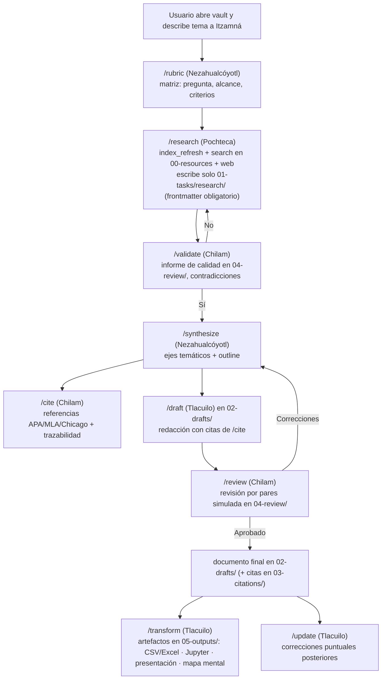
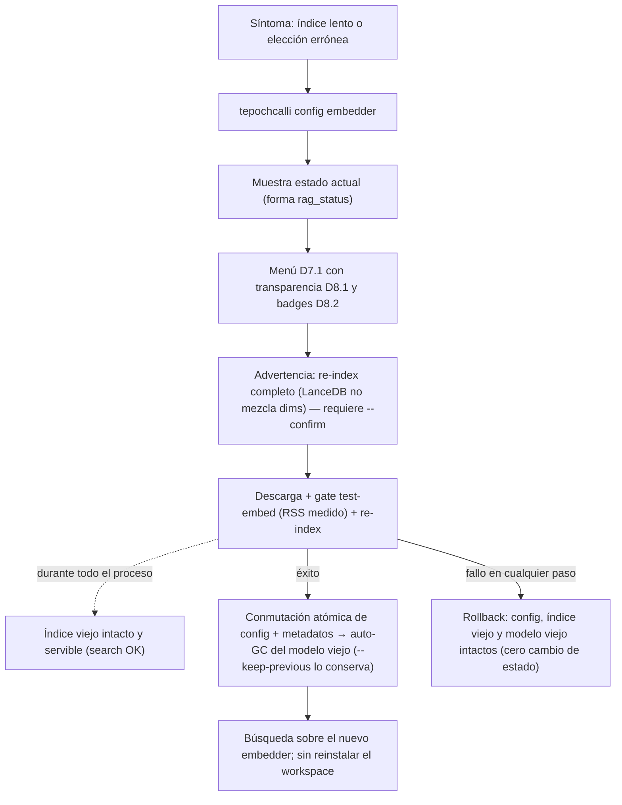

# Navigation Flow — Tepochcalli v1

**Date:** 2026-10-21 | **Author:** Arquitecto (entrevista /spec)

## 1. Actores y roles

| Rol | Descripción | Superficies | Inicial |
| --- | --- | --- | --- |
| Investigador (humano) | Dueño del vault | Obsidian (notas/PDFs) + terminal OpenCode | abrir vault |
| Itzamná | Orquestador del workspace | enrutamiento, estado, sugerencias | conversación |
| Especialistas | Nezahualcóyotl · Pochteca · Chilam · Tlacuilo | comandos `/rubric…/update` | vía Itzamná |
| tepochcalli-rag | MCP tools (7) | `search`, `index_refresh()`, `add_source`, `rag_status`, `convert_document`, `convert_base64`, `list_formats` | tool-call del agente |
| markitdown | biblioteca en proceso | conversión a Markdown dentro de `tepochcalli-rag` (motor + tools del conversor) | `add_source` / `convert_*` |

Nota: la UI del producto es Obsidian + OpenCode; no hay pantallas propias (out of scope PRD §5).

## 2. Journey (a) — flujo diario de investigación (9 comandos)



Regla transversal: todo paso que consulte material propio pasa primero por `search`
(MCP-first, spec-agent-workflow §AGENTS.md); los resultados citan `source_path`+`heading`.

## 3. Journey (b) — "añado un PDF y pregunto 30s después"

1. Usuario arrastra `paper.pdf` a `00-resources/lit/` en Obsidian (o por gestor de archivos).
2. Pregunta en OpenCode: "¿qué dice paper.pdf sobre X?"
3. El agente (regla AGENTS.md) invoca `tepochcalli-rag.index_refresh()` →
   respuesta `{scanned, indexed:1, skipped, elapsed_ms}` (Δ<30s para material típico;
   PDF grande puede tardar más — progreso visible).
4. Agente invoca `search("X", path_filter="00-resources/lit/**")` (<500ms).
5. Respuesta generada con citas: `00-resources/lit/paper.pdf » 2.3 Medidas de resultado (chars 4120-5088)`.
6. Usuario navega en Obsidian al PDF y ve el pasaje exacto — bucle completo sin salir del vault.

## 4. Journey (c) — "convierte esta URL a mis fuentes"

1. Usuario: "guarda https://…/informe como fuente en `lit-clima/`".
2. Agente: `add_source(uri="https://…/informe", subdir="lit-clima/")`.
3. Server `add_source`: markitdown **en proceso** convierte el URI a Markdown; escribe
   `00-resources/lit-clima/informe.md` con frontmatter `source_uri`/`converted_at`; ejecuta
   `index_refresh` y devuelve `{ok, written_to, indexed}`.
4. Agente confirma ruta citable; la fuente ya entra en futuras `search`.
5. (Conversión sin indexar: `convert_document`/`convert_base64` escriben el `.md` dentro del
   vault y devuelven **solo el resumen de 5 claves** — nunca el cuerpo; el `index_refresh` se
   pide aparte cuando el usuario quiera buscar en él.)

## 5. Journey (d) — primer arranque con wizard

1. Usuario (VM/host limpio): `curl -L https://github.com/Fisherk2/…/install.sh | sh`
   (o `cargo binstall tepochcalli`). El instalador descarga el binario de la release,
   verifica su SHA-256 y lo ejecuta — inspecciona el script antes de ejecutarlo.
2. Ejecuta `tepochcalli install` → TUI line-based (`dialoguer`, sin TTY con
   `--non-interactive`): detección de prereqs F1 (SO/arch, RAM ≥ 8 GB, disco ≥ 4 GB;
   Obsidian y OpenCode V2 solo se detectan, no se instalan) → F2 elige/crea el
   directorio del vault (reutiliza si existe, nunca borra).
3. F3 extrae el payload versionado (`tepochcalli-workspace-<ver>.tar.gz` + `.sha256`,
   asset de la misma release — **regla one-version**: el binario v0.3.x instala siempre
   el payload v0.3.x, nunca un `latest` suelto) con merge sin sobreescribir
   (lo existente queda intacto y se anota), sin tocar `.obsidian/`; crea `00-resources/`
   con 2 placeholders (1 `.md` + 1 `.pdf` válido) y escribe `.install-intent`.
4. F4 bootstrap de `uv` en `.tepochcalli/bin/` (SHA-256 verificado, sin scripts remotos)
   → F5 `uv venv` + `uv sync --frozen` en `.tepochcalli/venv/` → F6 menú
   "Embedding provider" (5 salidas, default
   `paraphrase-multilingual-MiniLM-L12-v2` preseleccionado; cada fila con
   💾/🧠/🎮 y etiqueta `medido`/`estimado`/`declarado` + badges; gate test-embed con
   RSS pico medido) → F7 indexa `00-resources/` vía `python -m tepochcalli_flow`
   (chunks + `model`/`dims` en metadatos; 2.ª corrida ⇒ `indexed: 0`) → F8 merge
   conservador de `mcp.servers` (con `.bak`, comando portable por SO, sin registrar
   `markitdown`, verificación `rag_status`).
5. Fin: "abre Obsidian en `<ruta>`, ejecuta `opencode`, prueba /rubric". El usuario NO
   instaló Python/Node ni tecleó comandos de dependencias.
6. Smoke: usuario añade una nota a `00-resources/` → journey (b) funciona.

**Windows está soportado con verificación pendiente (decisión firmada, 2026-11-13,
etiqueta `declarado`).** El journey anterior asume Linux o macOS. En el repo existen el target
`x86_64-pc-windows-msvc` (`dist.toml` y `release.yml`), el `install.ps1`, el layout
`venv/Scripts/python.exe` (D20) y las ramas `cfg!(windows)` del wizard, pero **nada de ese camino
se ejecutó nunca en Windows**: ni el instalador, ni el smoke path-5, ni la matriz CI
(`phase3.yml` es ubuntu+macos; `release.yml` no ha corrido — M6). **Consecuencia para el
usuario:** puede instalarlo en Windows por ese camino, pero nadie ha verificado que funcione; si
falla, no hay soporte comprometido.
La coletilla «verificación pendiente» cae con un smoke path-5 (`--non-interactive --skip-model`)
ejecutado en un runner `windows-latest` sobre una release real, el layout `Scripts/` verificado en
el vault instalado, la evidencia archivada y una fila de Windows en la matriz CI. Detalle:
[docs/TRD.md](TRD.md) §2 y [docs/TECH_DEBT.md](TECH_DEBT.md) §D-b.

Flags: `--offline` (re-instalación con cachés; sin red), `--skip-model` = salida
"Configurar después" del menú de embedder (ADR-007 D7.1-5): el vault se instala completo, la
indexación inicial se omite y el RAG queda en estado `degraded`;
`search`/`index_refresh`/`add_source` devuelven `E_NO_EMBEDDER` con `fix_hint`, y `rag_status()`
reporta `degraded` con la solución; re-entrada vía `tepochcalli config embedder` (flujo D8.4).

## 6. Journey (e) — fallo y recuperación

1. Caída de red durante fase 5 (venv sync): el wizard detecta fallo, **rollback compensado**
   (`rm -rf .tepochcalli/venv/`), panel en stderr con: fase fallida, causa, comando de
   reintento (`tepochcalli install --resume`) y ruta del log — el log vive en
   `$XDG_STATE_HOME/tepochcalli/install-<ts>.log` (o `%LOCALAPPDATA%` en Windows),
   **nunca** dentro del vault; códigos de salida por rangos (10-19 prereqs, 20-29
   red — `E_OFFLINE_NO_CACHE` = exit 21 —, 30-39 validación, 40+ interno).
   La clave de API de la salida 4 nunca aparece en log, panel ni `opencode.json`.
2. Usuario restaura red → `--resume` reanuda desde la fase correcta (artefactos +
   marker `.tepochcalli/.install-state`), sin re-descargar lo ya válido → completa.
   `--offline` sin caché ⇒ fallo limpio `E_OFFLINE_NO_CACHE` **antes** de tocar el vault.
3. Fallo de fase 8 (merge opencode.json): se revierte desde `.bak` byte a byte; el vault ya instalado es
   usable sin MCP hasta reintentar. La compensación de F6 cae a **salida 5**
   (instalación COMPLETA degradada), no a "instalación fallida".
4. Usuario borra el runtime a mano o `tepochcalli uninstall --vault <ruta>` → `.tepochcalli/`
   eliminado (runtime: `venv/`, `bin/`, `db/`, `models/`, `config/`); notas, payload y
   `opencode.json` intactos — `00-resources/` nunca se borra.
5. Índice corrupto o cambio de modelo: `tepochcalli reindex --confirm` borra y reconstruye
   con el modelo actual (sin `--confirm` no hace nada); `E_MODEL_MISMATCH` explica el
   desajuste dims del modelo vs índice.

Regla maestra de journeys e): **ningún fallo pierde datos del usuario** — solo artefactos
derivados/installables se deshacen. Ver diagrama de fases en
[../specs/spec-installer-wizard.md](../specs/spec-installer-wizard.md).

## 7. Journey (f) — "Elegí el modelo equivocado" — cambio sin reinstalar (D8.4/ADR-008)

Síntomas típicos: índice lento o con picos de memoria en un host de 4 GB (se ignoró el badge
`no recomendado` de `BAAI/bge-m3`), o simplemente "cambié de opinión" tras la instalación.

1. Usuario (terminal, fuera de Obsidian): `tepochcalli config embedder`.
2. El wizard muestra el estado actual (modelo, dims, filas, tamaño de db — lectura local con forma `rag_status`) y el menú D7.1 con transparencia D8.1 (💾 disk · 🧠 RAM · 🎮 GPU, etiquetado `medido`/`estimado`/`declarado`) y badges D8.2.
3. Usuario elige el nuevo embedder → advertencia explícita: re-index completo requerido (LanceDB no puede mezclar dims), tiempo estimado; confirma con `--confirm` obligatorio (sin él no hace nada).
4. Descarga + gate test-embed (RSS pico medido por el flow Python, D25) + re-index con el índice viejo **siguiendo servible** (las `search` del agente responden contra las filas viejas durante todo el proceso).
5. Éxito → conmutación atómica de `config.model` + metadatos; el modelo viejo se purga de `models/` (auto-GC; `--keep-previous` lo conserva). Fallo en cualquier paso → rollback con cambio de estado cero (config, índice y modelo idénticos). El workspace NO se reinstaló.



Variante de higiene (futura, no existe en v1): `tepochcalli models list` /
`tepochcalli models prune` para inventariar y limpiar caches de modelos huérfanos
tras varios swaps.

## 8. Mapa de navegación del vault (referencia rápida del usuario)

Zonas de propiedad (D9.1, specs/spec-vault-structure.md): bandejas del agente = leer/extraer/borrar OK, **no depositar ni editar**; biblioteca personal = carpetas tuyas (no indexadas v1).

```text
00-resources/       → # ENTRADA del usuario — meter aquí todo lo consultable (única fuente indexable; libre subniveles)
01-tasks/           → # bandeja del agente (Nezahualcóyotl: /rubric, /synthesize) — no depositar/editar; leer/extraer/borrar OK
01-tasks/research/  → # bandeja del agente (Pochteca: /research) — evidencia con frontmatter {agent, timestamp, fuentes, método}
02-drafts/          → # bandeja del agente (Tlacuilo: /draft, /update) — no depositar/editar; leer/extraer/borrar OK
03-citations/       → # bandeja del agente (Chilam: /cite) — no depositar/editar; leer/extraer/borrar OK
04-review/          → # bandeja del agente (Chilam: /validate, /review) — informes de calidad y revisión por pares
05-outputs/         → # bandeja del agente (Tlacuilo: /transform) — CSV/Excel, notebooks, presentaciones, mapas mentales
10+ / 20+ / 30+     → # biblioteca personal del usuario — organiza resultados extraídos; NO indexada v1 (copia a 00-resources/ para buscarla)
.opencode/          → # agentes/comandos/skills del harness (no tocar sin plan)
.tepochcalli/       → # runtime RAG (borrable/desinstalable, ver SECURITY/TRD)
opencode.json       → # config del harness (el wizard administra solo mcp.servers)
```
