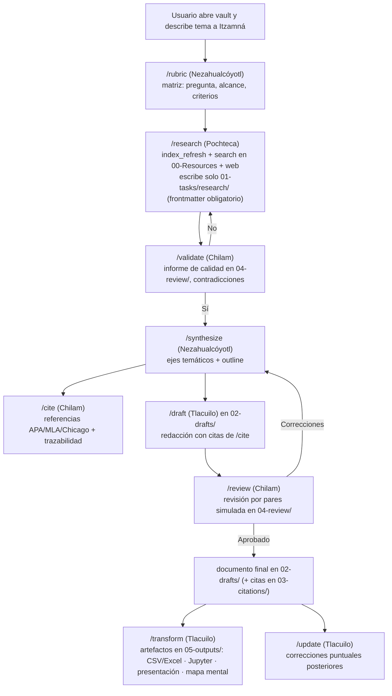
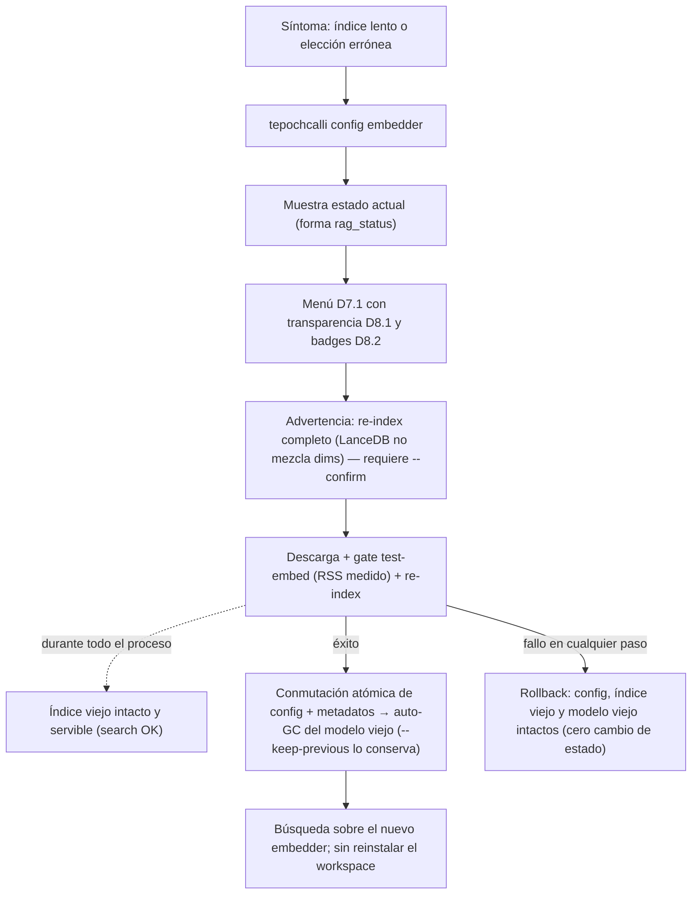

# Navigation Flow — Tepochcalli v1
**Date:** 2026-10-21 | **Author:** Arquitecto (entrevista /spec)

## 1. Actores y roles

| Rol | Descripción | Superficies | Inicial |
|---|---|---|---|
| Investigador (humano) | Dueño del vault | Obsidian (notas/PDFs) + terminal OpenCode | abrir vault |
| Itzamná | Orquestador del workspace | enrutamiento, estado, sugerencias | conversación |
| Especialistas | Nezahualcóyotl · Pochteca · Chilam · Tlacuilo | comandos `/rubric…/update` | vía Itzamná |
| tepochcalli-rag | MCP tools | `search`, `index_refresh`, `add_source`, `rag_status` | tool-call del agente |
| markitdown | MCP conversor | `convert_to_markdown` | vía `add_source` o agente |

Nota: la UI del producto es Obsidian + OpenCode; no hay pantallas propias (out of scope PRD §5).

## 2. Journey (a) — flujo diario de investigación (9 comandos)



Regla transversal: todo paso que consulte material propio pasa primero por `search`
(MCP-first, spec-agent-workflow §AGENTS.md); los resultados citan `source_path`+`heading`.

## 3. Journey (b) — "añado un PDF y pregunto 30s después"

1. Usuario arrastra `paper.pdf` a `00-Resources/lit/` en Obsidian (o por gestor de archivos).
2. Pregunta en OpenCode: "¿qué dice paper.pdf sobre X?"
3. El agente (regla AGENTS.md) invoca `tepochcalli-rag.index_refresh()` →
   respuesta `{scanned, indexed:1, skipped, elapsed_ms}` (Δ<30s para material típico;
   PDF grande puede tardar más — progreso visible).
4. Agente invoca `search("X", path_filter="00-Resources/lit/**")` (<500ms).
5. Respuesta generada con citas: `00-Resources/lit/paper.pdf » 2.3 Medidas de resultado (chars 4120-5088)`.
6. Usuario navega en Obsidian al PDF y ve el pasaje exacto — bucle completo sin salir del vault.

## 4. Journey (c) — "convierte esta URL a mis fuentes"

1. Usuario: "guarda https://…/informe como fuente en `lit-clima/`".
2. Agente: `add_source(uri="https://…/informe", subdir="lit-clima/")`.
3. Server: markitdown `convert_to_markdown(uri)` → markdown; escribe
   `00-Resources/lit-clima/informe.md` con frontmatter `source_uri`/`converted_at`; ejecuta refresh.
4. Agente confirma ruta citable; la fuente ya entra en futuras `search`.
5. (Si el usuario prefiriera conversión manual: la herramienta markitdown está expuesta
   directamente; el resultado sigue requiriendo `index_refresh` — o `add_source` de un `file:` URI.)

## 5. Journey (d) — primer arranque con wizard

1. Usuario (VM/host limpio): `curl -L https://github.com/Fisherk2/…/install.sh | sh`
   (o `cargo binstall tepochcalli`).
2. Ejecuta `tepochcalli` → TUI: bienvenida → detección de prereqs (Obsidian, OpenCode V2;
   si falta algo: instrucciones y salida limpia).
3. Elige/crea directorio del vault → el wizard materializa el payload (carpetas numeradas,
   `.opencode/`, `opencode.json`, `AGENTS.md`, muestras en `00-Resources/`).
4. Barra de progreso por fases: bootstrap `uv` → `uv venv` + `uv sync` (1-2GB wheels,
   requiere internet) → descarga MiniLM (~470MB) → indexación inicial de muestras →
   merge/validación de `mcp.servers`.
5. Fin: "abre Obsidian en `<ruta>`, ejecuta `opencode`, prueba /rubric". El usuario NO
   instaló Python/Node ni tecleó comandos de dependencias.
6. Smoke: usuario añade una nota a `00-Resources/` → journey (b) funciona.

Flags: `--offline` (re-instalación con cachés; sin red), `--skip-model` = salida
"Configurar después" del menú de embedder (ADR-007 D7.1-5): el vault se instala completo, la
indexación inicial se omite y el RAG queda en estado `degraded`;
`search`/`index_refresh`/`add_source` devuelven `E_NO_EMBEDDER` con `fix_hint`, y `rag_status()`
reporta `degraded` con la solución; re-entrada vía `tepochcalli config embedder` (flujo D8.4).

## 6. Journey (e) — fallo y recuperación

1. Caída de red durante fase 5 (venv sync): el wizard detecta fallo, **rollback compensado**
   (`rm -rf .tepochcalli/venv/`), panel rojo con: fase, causa, comando de reintento
   (`tepochcalli install --resume`), ruta de log (fuera del vault).
2. Usuario restaura red → `--resume` reutiliza fases previas válidas (bin/, payload) → completa.
3. Fallo de fase 8 (merge opencode.json): se revierte desde `.bak`; el vault ya instalado es
   usable sin MCP hasta reintentar.
4. Usuario borra el runtime a mano o `tepochcalli uninstall --vault <ruta>` → vault vuelve a
   estado pre-instalación; sus notas intactas.
5. Índice corrupto (ej. copia de vault entre plataformas): `search` → INTERNAL/INDEX_* con
   guía "borra .tepochcalli/db/ y index_refresh()"; reconstrucción desde fuentes (índice derivado).

Regla maestra de journeys e): **ningún fallo pierde datos del usuario** — solo artefactos
derivados/installables se deshacen. Ver diagrama de fases en
[../specs/spec-installer-wizard.md](../specs/spec-installer-wizard.md).

## 7. Journey (f) — "Elegí el modelo equivocado" — cambio sin reinstalar (D8.4/ADR-008)

Síntomas típicos: índice lento o con picos de memoria en un host de 4 GB (se ignoró el badge
`no recomendado` de `BAAI/bge-m3`), o simplemente "cambié de opinión" tras la instalación.

1. Usuario (terminal, fuera de Obsidian): `tepochcalli config embedder`.
2. El wizard muestra el estado actual (model, dims, filas del índice, tamaño de db — lectura local con forma `rag_status`) y el menú D7.1 con transparencia D8.1 (💾 disk · 🧠 RAM · 🎮 GPU, etiquetado `medido`/`estimado`/`declarado`) y badges D8.2.
3. Usuario elige el nuevo embedder → advertencia explícita: re-index completo requerido (LanceDB no puede mezclar dims), tiempo estimado; confirma con `--confirm`.
4. Descarga + gate test-embed (RSS medido) + re-index con el índice viejo **siguiendo servible** (las `search` del agente responden contra las filas viejas durante todo el proceso).
5. Éxito → conmutación atómica de config + metadatos; el modelo viejo se purga de `models/` (auto-GC; `--keep-previous` lo conserva). El workspace NO se reinstaló.



Variante de higiene (P2): `tepochcalli models list` / `tepochcalli models prune` para inventariar
y limpiar caches de modelos huérfanos tras varios swaps.

## 8. Mapa de navegación del vault (referencia rápida del usuario)

Zonas de propiedad (D9.1, specs/spec-vault-structure.md): bandejas del agente = leer/extraer/borrar OK, **no depositar ni editar**; biblioteca personal = carpetas tuyas (no indexadas v1).

```text
00-Resources/       → # ENTRADA del usuario — meter aquí todo lo consultable (única fuente indexable; libre subniveles)
01-tasks/           → # bandeja del agente (Nezahualcóyotl: /rubric, /synthesize) — no depositar/editar; leer/extraer/borrar OK
01-tasks/research/  → # bandeja del agente (Pochteca: /research) — evidencia con frontmatter {agent, timestamp, fuentes, método}
02-drafts/          → # bandeja del agente (Tlacuilo: /draft, /update) — no depositar/editar; leer/extraer/borrar OK
03-citations/       → # bandeja del agente (Chilam: /cite) — no depositar/editar; leer/extraer/borrar OK
04-review/          → # bandeja del agente (Chilam: /validate, /review) — informes de calidad y revisión por pares
05-outputs/         → # bandeja del agente (Tlacuilo: /transform) — CSV/Excel, notebooks, presentaciones, mapas mentales
10+ / 20+ / 30+     → # biblioteca personal del usuario — organiza resultados extraídos; NO indexada v1 (copia a 00-Resources/ para buscarla)
.opencode/          → # agentes/comandos/skills del harness (no tocar sin plan)
.tepochcalli/       → # runtime RAG (borrable/desinstalable, ver SECURITY/TRD)
opencode.json       → # config del harness (el wizard administra solo mcp.servers)
```
