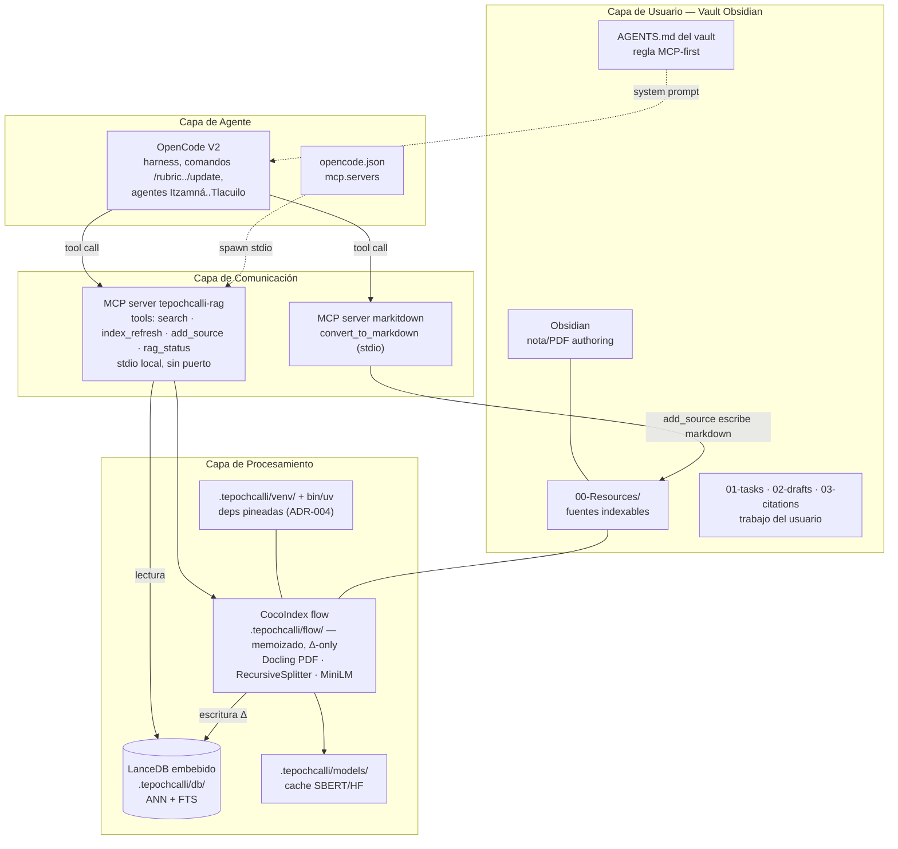
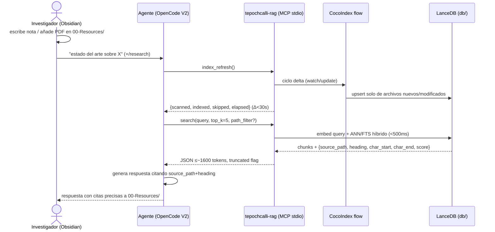
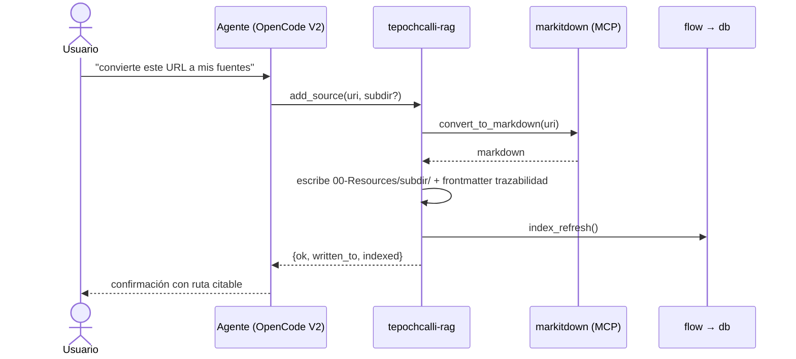
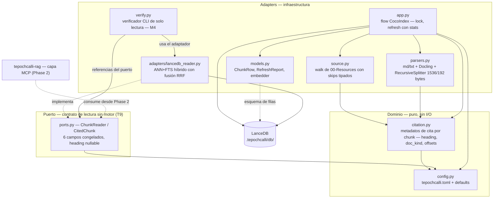
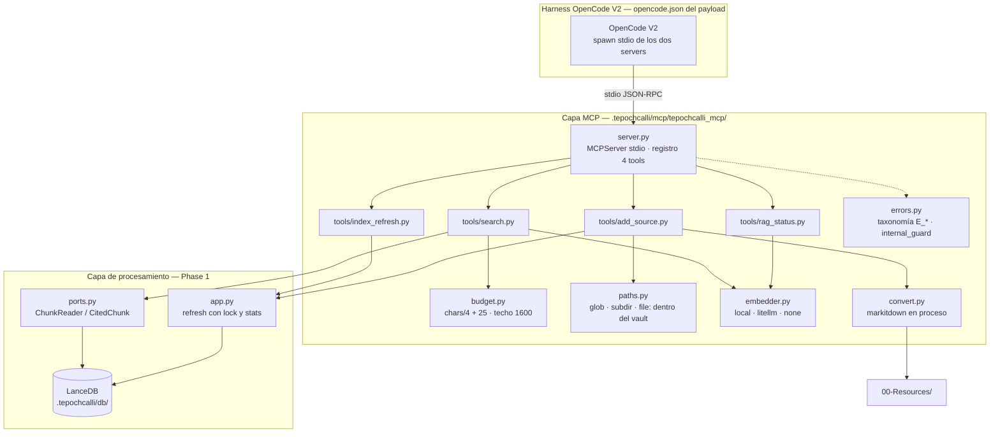

# Architecture — Tepochcalli

> Índice ejecutivo de las decisiones de arquitectura. Cada decisión significativa está
> registrada como ADR en [`specs/adr/`](../specs/adr/) siguiendo el formato MADR.
> Requisitos: [docs/UH.md](UH.md) · Especificación: [SPEC.md](../SPEC.md)

## Sistema en una frase

Un vault de Obsidian distribuible donde el harness **OpenCode V2** obtiene respuestas citadas
sobre el material de investigación del usuario (`00-Resources/`) consultando —vía **MCP
stdio local**— un índice vectorial **incremental** construido por **CocoIndex + LanceDB** con
embeddings **locales** (MiniLM multilingüe), entregado por un **wizard Rust** sin requerir
Python ni Node en el host.

## Diagrama de contenedores (C4 nivel 2)

Regla de dependencias: el flujo va SIEMPRE usuario→agente→MCP→engine→storage. El harness no
importa CocoIndex; el motor no conoce OpenCode. Único punto de contacto: los contratos de
herramienta de [specs/spec-mcp-server.md](../specs/spec-mcp-server.md) (ADR-005).

## Diagrama de secuencia — consulta citada

## Flujo de ingesta externa (URL → índice)

## Component inventory

| Componente | Capa | Ubicación | Spec/ADR |
| --- | --- | --- | --- |
| Vault numerado (00-Resources, 01-tasks…) | Usuario | `obsidian-workspace/` (payload) | spec-vault-structure |
| AGENTS.md del vault (MCP-first) | Usuario/Agente | `<vault>/AGENTS.md` | spec-agent-workflow |
| OpenCode V2 + agentes/comandos/skills | Agente | `<vault>/.opencode/` | spec-agent-workflow |
| `opencode.json` (`mcp.servers`) | Agente | `<vault>/opencode.json` | spec-markitdown §config |
| `tepochcalli-rag` (search/index_refresh/add_source/rag_status) | Comunicación | `.tepochcalli/mcp/tepochcalli_mcp/` — **entregado (Phase 2, T1-T8)** | spec-mcp-server, ADR-005 |
| `markitdown-mcp` | Comunicación | venv del vault — registrado en `opencode.json` del payload (T9) | spec-markitdown |
| **Paquete `tepochcalli_mcp` (Phase 2):** `server.py` (MCPServer stdio, registro de las 4 tools, `CallToolResult` explícito — nunca `ToolError`), `tools/{search,index_refresh,add_source,rag_status}.py` (handlers + validación de borde), `errors.py` (taxonomía `E_*` + `internal_guard`), `budget.py` (estimador `chars/4 + 25`, techo 1600), `paths.py` (glob/`subdir`/`file:` dentro del vault — D16), `embedder.py` (fábrica `local`/`litellm`/`none` — D15), `convert.py` (markitdown en proceso — D-b), `__main__.py` (entrypoint `python -m tepochcalli_mcp` — D17) | Comunicación | `obsidian-workspace/.tepochcalli/mcp/tepochcalli_mcp/` | spec-mcp-server, ADR-005 |
| **Contract tests + e2e golden (Phase 2):** `tests/e2e/test_mcp_contract.py` (shapes en el wire, 5 `E_*`, instalación degradada, globs de `path_filter`), `tests/e2e/test_mcp_journey.py` (pregunta → tool-call → JSON citado), fixture grabada `tests/fixtures/golden_vault/` (md+PDF) | Verificación | repo `tests/e2e/`, `tests/fixtures/` | CP-C, CP-D, spec-mcp-server §Testing |
| **Soporte de tests y bench (Phase 2):** `tests/support/mcp_server.py` (ayudantes de arranque/env compartidos — residuo R4 pagado en T8), `tests/benchmarks/bench_search.py` (p95 <500 ms con n y método publicados — M2) | Verificación | repo `tests/support/`, `tests/benchmarks/` | T7, T8 |
| **Flow `tepochcalli_flow` (Phase 1, T2–T8):** `app.py` (entrada CocoIndex, lock de proceso + refresh con stats), `source.py` (walk de `00-Resources/` con skips tipados), `parsers.py` (md/txt + Docling + RecursiveSplitter 1536/192 bytes), `models.py` (cache de modelos) | Procesamiento | `.tepochcalli/flow/tepochcalli_flow/` | spec-rag-engine, ADR-001 |
| **Dominio puro (sin I/O):** `citation.py` (metadatos de cita por chunk, `heading` nullable), `config.py` (`tepochcalli.toml` con fallbacks a defaults) | Procesamiento | `.tepochcalli/flow/tepochcalli_flow/` | spec-rag-engine §Target, D13 |
| **Puerto `ChunkReader` (T9):** 6 campos congelados, engine-free — contrato de lectura para Phase 2 | Procesamiento | `.tepochcalli/flow/tepochcalli_flow/ports.py` | spec-mcp-server, ADR-005 |
| **Adaptador de lectura (T9):** `adapters/lancedb_reader.py` (ANN+FTS híbrido con fusión RRF) + `verify.py` (verificador CLI de solo lectura, M4) | Procesamiento | `.tepochcalli/flow/tepochcalli_flow/adapters/`, `verify.py` | ADR-002, ADR-005 |
| Estado del engine (LMDB) — D14 | Procesamiento | `.tepochcalli/db/cocoindex/` | D14, spec-vault-structure |
| LanceDB (ANN+FTS) | Procesamiento | `.tepochcalli/db/` | ADR-002 |
| Embeddings MiniLM multilingüe | Procesamiento | `.tepochcalli/models/` | ADR-006, spec-embeddings |
| venv + uv bootstrap | Runtime | `.tepochcalli/venv/`, `bin/` | ADR-004 |
| `tepochcalli.toml` | Config | `.tepochcalli/config/` (gitignored) | spec-embeddings |
| **Suite Phase 1 (T2–T11):** `tests/unit/` + `tests/integration/` — 137 tests en T11, **164 al cierre de Phase 1 (2026-10-23)**; `bench_delta.py` en `tests/benchmarks/` (M1, p95 sobre 20 ciclos) | Verificación | repo `tests/{unit,integration,benchmarks}/` | WORKFLOW §Phase 1, TRD §6.2 |
| **CI Phase 1:** `phase1.yml` (ruff → suite → smoke Δ) | Verificación | `.github/workflows/phase1.yml` — **solo verificación local; nunca corrió en GitHub Actions (M6)** | T11, WORKFLOW §Phase 1 |
| Wizard TUI Rust + cargo-dist | Distribución | repo `crates/` (Phase 3) + Releases | ADR-003, spec-installer-wizard |

## Engine components (hexagonal view)

Vista hexagonal del motor tal como quedó en Phase 1: dominio puro en el centro, `ports.py`
como contrato de lectura, adapters de infraestructura alrededor. **Las flechas indican
dirección de dependencia** (`importa` / `implementa`) — nunca al revés: el dominio no importa
infraestructura y `ports.py` no importa ningún motor (test de arquitectura, `tests/unit/test_architecture.py`).

* **Write path (indexación):** `app` orquesta `source` (walk) → `parsers` (extracto + chunking, cita derivada en `citation`) → embedder → LanceDB — sin pasar por el puerto.
* **Read path (búsqueda citada):** el puerto `ChunkReader` lo implementa `lancedb_reader` y lo consumen `tepochcalli-rag` (Phase 2, desde `search`) y `verify` (CLI de desarrollo) — el único contrato que cruza capas (ADR-005).

## MCP layer components (Phase 2)

Detalle de la capa de comunicación tal como quedó tras Phase 2 (T1-T8): el harness solo ve
JSON-RPC por stdio; cada handler construye el `CallToolResult` explícito con
`content[0].text` = JSON canónico (nunca `ToolError`, que metería texto libre — omen H4).
**Flechas = dirección de dependencia** (`importa` / `consume`), con la misma regla que el
diagrama hexagonal: `tepochcalli_mcp` importa el puerto `ChunkReader` y el flow; nunca al
revés, y el server **no** importa `cocoindex` ni `lancedb` (test de arquitectura).

* **Write path (`index_refresh`/`add_source`):** `app` (Phase 1) orquesta walk → parsers →
  embedder → LanceDB — la capa MCP solo lo invoca y serializa su `RefreshReport`.
* **Read path (`search`):** query → `embedder` + puerto `ChunkReader` → `budget` (truncado a
  1600) → JSON canónico; sin red y sin LLM.
* **`file:` (D16):** `paths.py` es la única puerta que decide qué `file:` entra — fuera del
  vault ⇒ `VALIDATION_ERROR` antes de que markitdown toque el disco.
* `markitdown` (server independiente) y `convert.py` (biblioteca **en proceso** de
  `add_source`, D-b) comparten el mismo venv; ver [spec-markitdown](../specs/spec-markitdown.md).

## Decision Index

| ADR | Título | Status | Date |
| --- | --- | --- | --- |
| [ADR-001](../specs/adr/adr-001-motor-rag-cocoindex.md) | Motor RAG: CocoIndex (vs LEANN/LightRAG/RAG-Anything/PageIndex) | Accepted | 2026-10-21 |
| [ADR-002](../specs/adr/adr-002-lancedb-embebido.md) | LanceDB embebido (vs pgvector/Qdrant/ChromaDB/SQLite) | Accepted | 2026-10-21 |
| [ADR-003](../specs/adr/adr-003-distribucion-cargo-dist.md) | Distribución cargo-dist + GitHub Releases (no bunx) | Accepted | 2026-10-21 |
| [ADR-004](../specs/adr/adr-004-uv-venv-aislado.md) | uv + venv local de proyecto (usuario sin Python) | Accepted | 2026-10-21 |
| [ADR-005](../specs/adr/adr-005-mcp-ports-adapters.md) | MCP `tepochcalli-rag` como capa ports/adapters | Accepted | 2026-10-21 |
| [ADR-006](../specs/adr/adr-006-minilm-multilingue-default.md) | MiniLM multilingüe como embedding default (elección del modelo default; el comportamiento del wizard en §4.1 queda reemplazado por ADR-007) | Accepted | 2026-10-21 |
| [ADR-007](../specs/adr/adr-007-seleccion-embedder-instalacion.md) | Selección de embedder en instalación (menú D7.1-D7.4) | Accepted | 2026-10-21 |
| [ADR-008](../specs/adr/adr-008-transparencia-hardware-cambio-modelo.md) | Transparencia de hardware y swap atómico de modelo (refina ADR-007 capa UX) | Accepted | 2026-10-21 |

## Key decisions summary

1. **CocoIndex** (ADR-001) — incrementalismo memoizado, live-watch y cero LLM por índice: los tres requisitos que ningún otro candidato cumplía a la vez.
2. **LanceDB sin daemon** (ADR-002) — el índice es archivos bajo `.tepochcalli/db/`; Obsidian y la nube del usuario solo ven una carpeta más.
3. **stdio MCP = frontera** (ADR-005) — contratos `search/index_refresh/add_source` congelados; motor y almacén intercambiables sin tocar el harness.
4. **Distribución Rust one-liner** (ADR-003/004) — `curl | sh` o `cargo binstall`; el wizard hace bootstrap de `uv`, que a su vez instala un CPython gestionado: el investigador no instala nada.
5. **MiniLM local default** (ADR-006) — ES+EN, CPU, 8GB, $0; upgrades bge-m3/LiteLLM por config.

## Engine-migration contingency

Si ADR-001 se revisita (triggers en su §8): el payload del motor vive íntegramente en
`.tepochcalli/flow/`; los contratos MCP (ADR-005) permanecen. Rutas documentadas:
(a) mismo flow, otro target (pgvector/Qdrant/ChromaDB/SQLite — soportados por CocoIndex);
(b) motor nuevo (p.ej. LEANN vía `leann_mcp`): re-implementaría flow + adaptador de lectura,
conservando db schema lógico `{source_path, heading, char_start, char_end, text, vector}`;
(c) el directorio `.tepochcalli/` es engine-neutral precisamente para sobrevivir ese cambio.
Coste conocido: re-index completo y re-validación de los benchmarks <30s/<500ms/<2000 tokens.

## References

* [C4 model](https://c4model.com/) · [MADR](https://adr.github.io/) · OpenCode V2 docs (<https://opencode.ai/v2/docs>)
* Specs: [../specs/](../specs/) · Requisitos: [UH.md](UH.md)
