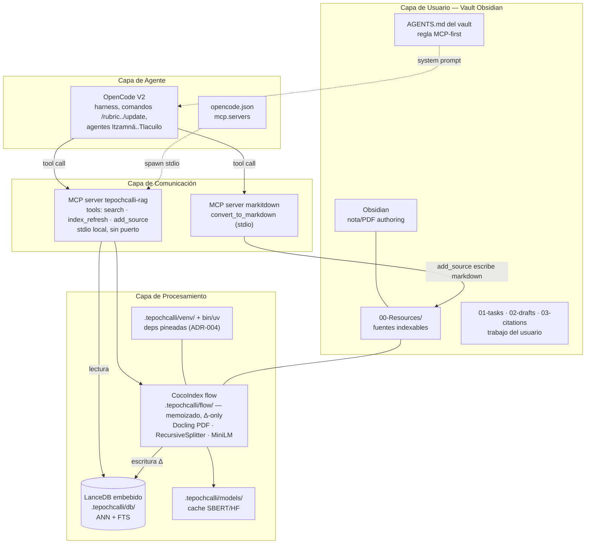
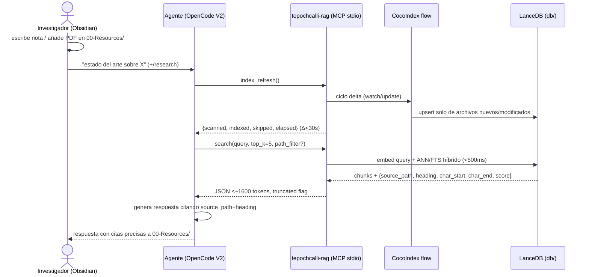
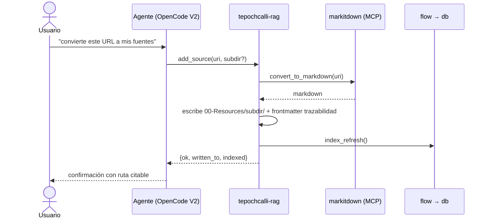

# Architecture — Tepochcalli

> Índice ejecutivo de las decisiones de arquitectura. Cada decisión significativa está
> registrada como ADR en [`specs/adr/`](../specs/adr/) siguiendo el formato MADR.
> Requisitos: [docs/UH.md](UH.md) · Especificación: [SPEC.md](../SPEC.md)

## Sistema en una frase

Un vault de Obsidian distribuible donde el harness **OpenCode V2** obtiene respuestas citadas
sobre el material de investigación del usuario (`00-Resources/`) consultando —vía **MCP
stdio local**— un índice vectorial **incremental** construido por **CocoIndex + LanceDB** con
embeddings **locales** (MiniLM multilingüe), entregado por un **wizard Rust** sin requerir
Python ni Node en el host.

## Diagrama de contenedores (C4 nivel 2)

Regla de dependencias: el flujo va SIEMPRE usuario→agente→MCP→engine→storage. El harness no
importa CocoIndex; el motor no conoce OpenCode. Único punto de contacto: los contratos de
herramienta de [specs/spec-mcp-server.md](../specs/spec-mcp-server.md) (ADR-005).

## Diagrama de secuencia — consulta citada

## Flujo de ingesta externa (URL → índice)

## Component inventory

| Componente | Capa | Ubicación | Spec/ADR |
|---|---|---|---|
| Vault numerado (00-Resources, 01-tasks…) | Usuario | `obsidian-workspace/` (payload) | spec-vault-structure |
| AGENTS.md del vault (MCP-first) | Usuario/Agente | `<vault>/AGENTS.md` | spec-agent-workflow |
| OpenCode V2 + agentes/comandos/skills | Agente | `<vault>/.opencode/` | spec-agent-workflow |
| `opencode.json` (`mcp.servers`) | Agente | `<vault>/opencode.json` | spec-markitdown §config |
| `tepochcalli-rag` (search/index_refresh/add_source) | Comunicación | `.tepochcalli/mcp/` | spec-mcp-server, ADR-005 |
| `markitdown-mcp` | Comunicación | venv del vault | spec-markitdown |
| CocoIndex flow (localfs→chunk→embed→target) | Procesamiento | `.tepochcalli/flow/` | spec-rag-engine, ADR-001 |
| LanceDB (ANN+FTS) | Procesamiento | `.tepochcalli/db/` | ADR-002 |
| Embeddings MiniLM multilingüe | Procesamiento | `.tepochcalli/models/` | ADR-006, spec-embeddings |
| venv + uv bootstrap | Runtime | `.tepochcalli/venv/`, `bin/` | ADR-004 |
| `tepochcalli.toml` | Config | `.tepochcalli/config/` (gitignored) | spec-embeddings |
| Wizard TUI Rust + cargo-dist | Distribución | repo `crates/` (Phase 3) + Releases | ADR-003, spec-installer-wizard |

## Decision Index

| ADR | Título | Status | Date |
|---|---|---|---|
| [ADR-001](../specs/adr/adr-001-motor-rag-cocoindex.md) | Motor RAG: CocoIndex (vs LEANN/LightRAG/RAG-Anything/PageIndex) | Accepted | 2026-10-21 |
| [ADR-002](../specs/adr/adr-002-lancedb-embebido.md) | LanceDB embebido (vs pgvector/Qdrant/ChromaDB/SQLite) | Accepted | 2026-10-21 |
| [ADR-003](../specs/adr/adr-003-distribucion-cargo-dist.md) | Distribución cargo-dist + GitHub Releases (no bunx) | Accepted | 2026-10-21 |
| [ADR-004](../specs/adr/adr-004-uv-venv-aislado.md) | uv + venv local de proyecto (usuario sin Python) | Accepted | 2026-10-21 |
| [ADR-005](../specs/adr/adr-005-mcp-ports-adapters.md) | MCP `tepochcalli-rag` como capa ports/adapters | Accepted | 2026-10-21 |
| [ADR-006](../specs/adr/adr-006-minilm-multilingue-default.md) | MiniLM multilingüe como embedding default (elección del modelo default; el comportamiento del wizard en §4.1 queda reemplazado por ADR-007) | Accepted | 2026-10-21 |
| [ADR-007](../specs/adr/adr-007-seleccion-embedder-instalacion.md) | Selección de embedder en instalación (menú D7.1-D7.4) | Accepted | 2026-10-21 |
| [ADR-008](../specs/adr/adr-008-transparencia-hardware-cambio-modelo.md) | Transparencia de hardware y swap atómico de modelo (refina ADR-007 capa UX) | Accepted | 2026-10-21 |

## Key decisions summary

1. **CocoIndex** (ADR-001) — incrementalismo memoizado, live-watch y cero LLM por índice: los tres requisitos que ningún otro candidato cumplía a la vez.
2. **LanceDB sin daemon** (ADR-002) — el índice es archivos bajo `.tepochcalli/db/`; Obsidian y la nube del usuario solo ven una carpeta más.
3. **stdio MCP = frontera** (ADR-005) — contratos `search/index_refresh/add_source` congelados; motor y almacén intercambiables sin tocar el harness.
4. **Distribución Rust one-liner** (ADR-003/004) — `curl | sh` o `cargo binstall`; el wizard hace bootstrap de `uv`, que a su vez instala un CPython gestionado: el investigador no instala nada.
5. **MiniLM local default** (ADR-006) — ES+EN, CPU, 8GB, $0; upgrades bge-m3/LiteLLM por config.

## Engine-migration contingency

Si ADR-001 se revisita (triggers en su §8): el payload del motor vive íntegramente en
`.tepochcalli/flow/`; los contratos MCP (ADR-005) permanecen. Rutas documentadas:
(a) mismo flow, otro target (pgvector/Qdrant/ChromaDB/SQLite — soportados por CocoIndex);
(b) motor nuevo (p.ej. LEANN vía `leann_mcp`): re-implementaría flow + adaptador de lectura,
conservando db schema lógico `{source_path, heading, char_start, char_end, text, vector}`;
(c) el directorio `.tepochcalli/` es engine-neutral precisamente para sobrevivir ese cambio.
Coste conocido: re-index completo y re-validación de los benchmarks <30s/<500ms/<2000 tokens.

## References

* [C4 model](https://c4model.com/) · [MADR](https://adr.github.io/) · OpenCode V2 docs (https://opencode.ai/v2/docs)
* Specs: [../specs/](../specs/) · Requisitos: [UH.md](UH.md)
