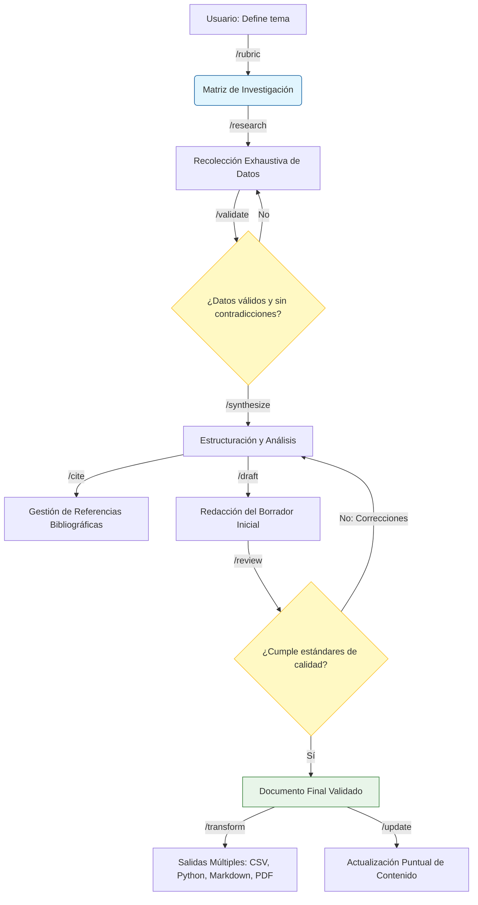
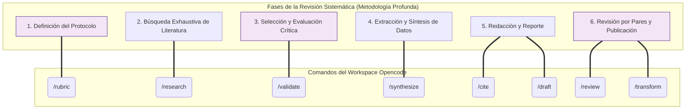

# Backlog — Tepochcalli

2026-11-19 | Fisherk2 | frozen

## 1. Purpose and scope

Quiero construir un Workspace de Obsidian (Vault) para investigación y temas de estudio, potenciado con [Opencode V2](https://opencode.ai/v2/docs) y un motor RAG. El sistema debe permitir consultas semánticas sobre notas de investigación, PDFs académicos y documentación técnica, minimizando el consumo de tokens del LLM mediante indexación incremental y recuperación precisa de fragmentos relevantes.

Todos los archivos de configuración, scripts de ingesta, índices vectoriales y servidores MCP deben organizarse de manera que no interfieran con el flujo normal de Obsidian.

El sistema consta de cuatro componentes principales:

1. **Obsidian Vault (Capa de Usuario):** Directorio raíz donde residen las notas markdown, PDFs, imágenes y enlaces. Es el único componente visible para el usuario final.
2. **RAG Engine (Capa de Procesamiento):** Motor de indexación incremental que monitorea el vault, extrae texto de markdown y PDFs, genera embeddings locales y los almacena en una base de datos vectorial embebida.
3. **MCP Server (Capa de Comunicación):** Servidor que expone herramientas de búsqueda semántica mediante el protocolo Model Context Protocol, permitiendo que Opencode consulte el índice vectorial, lo llamaremos tepochcalli-rag para identificarlo en el harness.
4. **[Opencode V2](https://opencode.ai/v2/docs) (Capa de Agente):** Harness que consume las herramientas MCP y orquesta las consultas del usuario final hacia el LLM con contexto enriquecido.

**RAG Engine**:

Tengo estas opciones como motor para indexar documentos, solo podemos tomar uno, ya que hacen el mismo trabajo de RAG, la idea es tomar uno que ya esta construido, fácil de instalar y que este bien documentado, la idea es no crear desde cero un RAG, si no incorporar uno ya hecho por la comunidad en el ecosistema del Harness.

- [CocoIndex](https://github.com/cocoindex-io/cocoindex)
- [Leann](https://github.com/StarTrail-org/LEANN)
- [LightRAG](https://github.com/HKUDS/LightRAG)
- [RAG-Anything](https://github.com/HKUDS/RAG-Anything)
- [PageIndex](https://github.com/VectifyAI/PageIndex)

Solo he leído la documentación de [CocoIndex](https://cocoindex.io/docs/), pero quería ver las demás opciones en caso de que fuera mejores (Lo documentaremos en una tabla de comparación y porque fue escogido dicho motor de indexación, en caso de que en el futuro cambiemos el motor, o lo migremos a otra tecnología)

Como herramienta adicional, me gustaria incorporar un convertidor a markdown como alternativa en caso de que el usuario quiera convertir sus recursos en markdown directo, utilizaremos el MCP para convertir ficheros a markdown, lo configuraremos en `obsidian-workspace/opencode.json` (Leer la documentacion de Opencode para saber como [configurar un MCP](https://opencode.ai/v2/docs/mcp-servers/)):

- [Convertidor a Markdown](https://github.com/mcp/microsoft/markitdown)
- [Guia de instalación](https://mcp.directory/blog/markitdown-mcp-complete-guide-2026)

**Flujo de Datos:**

- El usuario escribe notas en Obsidian y añade PDFs al vault
- RAG Engine detecta los materiales a indexar.
- Los archivos nuevos o modificados se procesan incrementalmente (solo el delta)
- Los embeddings se almacenan en LanceDB, ChromaDB o pgvector
- Opencode consulta el servidor MCP cuando necesita contexto
- El servidor MCP devuelve fragmentos relevantes con metadatos de origen
- El LLM genera respuestas usando solo el contexto recuperado
- El usuario puede convertir un material o URL de interés a markdown y añadirlo a las fuentes de indexación directamente

La organización del vault de Obsidian debe seguir esta estructura jerárquica:

- Las carpetas numeradas (00, 10, 20, etc.) siguen la convención de Obsidian para ordenamiento
- Las carpetas `.opencode/` y `.<Directorio con el nombre del motor RAG>/` están ocultas (prefijo punto) para no aparecer en la vista de Obsidian
- Las fuentes y materiales que serán indexados (PDFs, Markdowns, Hojas calculo, etc.) deben almacenarse en `00-Resources/`
- El usuario debe tener la libertad de crear su propios directorios dentro de `00-Resources/` para que tenga la organización deseada con sus materiales, por lo que se debe procurar que el RAG engine pueda de manera automática (ó semi-automática) detectar e indexar los recursos de todo el contenido de `00-Resources/` sin importar como este organizado dentro de ese directorio.

### Criterios de aceptación (C1–C7)

El sistema se considera correctamente implementado cuando:

- **C1** — El vault de Obsidian funciona normalmente sin interferencias
- **C2** — Los archivos nuevos se indexan automáticamente en menos de 30 segundos cuando Opencode invoca la función del MCP correspondiente
- **C3** — Las búsquedas semánticas devuelven resultados relevantes en menos de 500ms
- **C4** — El consumo de tokens por consulta es inferior a 2000 tokens (incluyendo contexto)
- **C5** — Las respuestas del agente incluyen citas precisas a las fuentes originales
- **C6** — El sistema puede manejar vaults de hasta 10,000 notas y 1,000 PDFs sin degradación de rendimiento
- **C7** — Pueda procesar distintos formatos de texto, si no, utilizar el convertidor Markdown para que pueda manipularse adecuadamente.

## 2. User stories

| ID | As [role] | I want [action] | So that [benefit] | Priority [high/mid/low] | Complexity [S/M/L] | Status [open/accepted/deferred] | Source [question N] |
| ---- | ---------- | ---------------- | ------------------- | ------------------------- | -------------------- | --------------------------------- | -------------------- |
| US-001 | investigador | un vault Obsidian que no interfiera con mi flujo y con carpetas numeradas | trabajar con notas y PDFs con indexación automática de `00-Resources/` | high | M | accepted | UH §1 / C1, C2 |
| US-002 | investigador | indexación incremental de mis materiales | consultas semánticas con consumo mínimo de tokens | high | L | accepted | UH §1 / C2, C3 |
| US-003 | agente | el servidor MCP `tepochcalli-rag` | consultar el índice vectorial desde Opencode | high | M | accepted | UH §1 / C3, C4 |
| US-004 | usuario | Opencode V2 orquestando el LLM con contexto enriquecido | respuestas citadas sobre mis fuentes | high | M | accepted | UH §1 / C5 |
| US-005 | usuario | un wizard TUI Rust, atómico y versionado | instalar el workspace sin interferir con la meta-configuración del harness | high | L | accepted | Wizard de instalación |
| US-006 | usuario | un convertidor a Markdown vía MCP | convertir recursos propios o URLs a markdown y añadirlos al índice | mid | M | accepted | UH §1 / C7 |
| US-007 | usuario | que el wizard gestione las dependencias automáticamente | empezar a usar el workspace sin instalar nada en el host | high | L | deferred | Q-003, Q-004 |
| US-008 | investigador | los 9 comandos del workflow de investigación | cubrir definición, recolección, evaluación, análisis, citas, redacción, revisión, diseminación y mantenimiento | high | L | accepted | Agent Workflow |
| US-009 | investigador | 5 agentes primarios con roles y permisos definidos | delegar cada fase del workflow a un agente especializado | high | L | accepted | Agent Workflow |
| US-010 | agente | skills de investigación instaladas localmente | tener capacidades de research, OSINT, síntesis, gráficos y Obsidian | mid | M | accepted | UH §skills (14 categorías) |
| US-H1 | investigador | convertir documentos a Markdown con la misma semántica que `local-doc-to-markdown` | reutilizar la conversión conocida con anydoc como fallback | high | M | accepted | H1 (2026-10-30) |
| US-H2 | usuario | respuestas de conversión que no inunden el contexto del LLM | mantener ~200 tokens por respuesta de conversión | high | S | accepted | H2 (2026-10-30) |
| US-H3 | usuario | indicar qué directorio escanear o dónde escribir el resultado | dar órdenes directas de escaneo y conversión dentro del vault | high | M | accepted | H3 / B′ (2026-10-30) |
| US-H4 | agente | una skill espejo de `local-doc-to-markdown` | decidir cuándo y cómo convertir sin adivinar | high | M | accepted | H4 (2026-10-30) |
| US-H5 | usuario | ver versión, estado e instalación del embedder antes de actuar | saber qué gestiona el wizard y qué opciones tengo | high | M | deferred | H5 (2026-11-18) |
| US-H6 | usuario | instalar limpiamente el payload en mi workspace destino | tener el runtime `.tepochcalli/` listo con `cocoindex` y `markitdown` | high | M | deferred | H6 (2026-11-18) |
| US-H7 | usuario | actualizar un workspace con versión anterior | conservar mi trabajo mientras se actualiza el payload | high | M | deferred | H7 (2026-11-18) |
| US-H8 | usuario | remover solo los artefactos del instalador | limpiar el workspace sin tocar mis notas | mid | S | deferred | H8 (2026-11-18) |
| US-H9 | usuario | reinstalar o cambiar el modelo embedder sin reinstalar el workspace | gestionar modelos locales y API keys con transparencia de hardware | high | L | deferred | H9 (2026-11-18) |
| US-H10 | usuario | salir del wizard sin cambios | abortar sin materializar ni modificar nada | low | S | deferred | H10 (2026-11-18) |
| US-H11 | usuario | que el instalador se cierre de forma confirmada y amable | terminar la operación con agradecimiento a Tepochcalli | low | S | deferred | H11 (2026-11-18) |

Los detalles literales de cada historia se conservan en las subsecciones siguientes; el texto de H1–H11 y de las tablas y diagramas del workflow es el de la fuente original, sin resumen.

### US-005 — Wizard de instalación

Utilizaremos un TUI en forma de instalador atomico y versionado para descargar el workspace de obsidian, en el cual incluirá todo lo mencionado anteriormente, desarrollado en Rust.
Esto con el fin de no interferir con la meta-configuración del harness de desarrollo, tengo un proyecto con la misma arquitectura de instalación con un gestor de paquetes:

<https://github.com/Fisherk2/codice-opencode>

En el, los archivos que se instalan están en un directorio llamado `template/`, nosotros haremos lo mismo, todo el contenido que este en `obsidian-workspace/` se instalara al usuario con los requisitos mencionados

El directorio `obsidian-workspace/` debe contener obligatoriamente los siguientes directorios:

- `00-Resources/`: Es donde el usuario debe añadir sus recursos que deben ser embebidos, podríamos dejarlo vacio o con un markdown y un PDF con información de muestra para testear el RAG, es mas que nada un placeholder
- `.opencode/`: Es donde se configurara el harness, debe incluir el directorio de skills, comandos y agentes (Proximamente un [plugin](https://opencode.ai/v2/docs/build/plugins/) o tool para asegurar la utilizacion del MCP)
- `opencode.json`: Es el archivo de configuración general del harness, solo de tu parte, me vas a ayudar como añadir el [MCP](https://opencode.ai/v2/docs/mcp-servers/) de forma local.
- `.<Directorio con el nombre del motor RAG>/`: Es donde estará el motor RAG.
- `AGENTS.md`: Es el archivo de instrucciones para los agentes de IA, que servirá como system prompt. En el debe estar establecido como usar el Vault, que herramientas debe utilizar y que recursos debe consultar para entregarle al usuario la mejor respuesta a sus peticiones. Debe priorizar primero usar el MCP que se diseñara para conectar el motor RAG con Opencode, después puede utilizar las herramientas restantes u otros MCPs que el usuario pueda configurar. Este archivo puede ser modificable por el usuario al gusto, así que en ese sentido no podemos restringir su modificación (Para implementaciones futuras, dejaremos este fichero solo con un placeholder cuando añadamos un [plugin](https://opencode.ai/v2/docs/build/plugins/) o tool que pueda utilizar el RAG con Opencode)

### US-007 — Instalación de dependencias

La gestión de dependencias y su instalación automática por el wizard se plantea en la deuda cognitiva (Q-003 y Q-004, §3): el usuario no debe instalar dependencias en su host nativamente y el instalador debe ser ready-to-use para Opencode. La fuente no cierra estas preguntas, por lo que la historia queda `deferred`; las decisiones de canal y runtime que sí están documentadas se registran en §4.

### US-008 — Agent Workflow: 9 comandos del workflow de investigación

Para enriquecer el flujo de trabajo del workspace tenemos que diseñar estos comandos y agentes para la metodologia de investigacion general

| Comando       | Fase Metodológica         | Descripción y Propósito Formal                                                                                                                                                  |
| :------------ | :------------------------ | :------------------------------------------------------------------------------------------------------------------------------------------------------------------------------ |
| `/rubric`     | **Definición**            | Genera la matriz de investigación: define la pregunta central, objetivos, alcance, criterios de inclusión/exclusión de fuentes y la metodología a aplicar.                      |
| `/research`   | **Recolección**           | Ejecuta la búsqueda exhaustiva de información en fuentes autorizadas, extrayendo datos, citas y contextos relevantes según la rúbrica.                                          |
| `/validate`   | **Evaluación Crítica**    | Analiza la información recopilada para detectar contradicciones, sesgos, obsolescencia y verifica la autoridad de las fuentes. Genera un informe de calidad de datos.           |
| `/synthesize` | **Análisis**              | Estructura la información validada en ejes temáticos, identifica patrones y genera el esquema lógico (outline) que guiará la redacción.                                         |
| `/cite`       | **Gestión Bibliográfica** | Compila, formatea (APA, MLA, Chicago, etc.) y vincula todas las referencias utilizadas, asegurando la trazabilidad de cada afirmación.                                          |
| `/draft`      | **Redacción**             | Redacta el documento inicial siguiendo el esquema de `/synthesize`, integrando las citas gestionadas por `/cite`.                                                               |
| `/review`     | **Refinamiento**          | Simula una revisión por pares. Evalúa el borrador en busca de faltas ortográficas, coherencia argumentativa, claridad y sugiere mejoras sustantivas.                            |
| `/transform`  | **Diseminación**          | Convierte la investigación en formatos específicos solicitados: hoja de cálculo (CSV/Excel para datos), cuaderno de Python (Jupyter para análisis), presentación o mapa mental. |
| `/update`     | **Mantenimiento**         | Permite inyectar nueva información o corregir datos específicos en el documento final sin tener que reiniciar todo el flujo de trabajo.                                         |

### US-009 — Agentes Primarios

| Nombre del Agente Primario                      | Justificación Histórica                                                                                                                                                                                                                    | Propósito en el Workflow                                                                                                                                                                                                                 | Comandos Asignados                                               | Permisos                                                                                                                                                                                                            |
| :---------------------------------------------- | :----------------------------------------------------------------------------------------------------------------------------------------------------------------------------------------------------------------------------------------- | :--------------------------------------------------------------------------------------------------------------------------------------------------------------------------------------------------------------------------------------- | :--------------------------------------------------------------- | :------------------------------------------------------------------------------------------------------------------------------------------------------------------------------------------------------------------ |
| **Itzamná** *(Agente General / Orquestador)* | En la mitología maya, es el dios supremo, creador y patrono del conocimiento, la escritura y la sabiduría. Actúa como la fuente primordial de guía y el puente entre lo divino (el sistema) y los sacerdotes (los agentes especializados). | Es la interfaz principal con el usuario. Resuelve dudas generales, ofrece sugerencias contextuales, explica el estado del workspace y enruta las solicitudes hacia los agentes especializados sin ejecutar el pipeline de investigación. | **Ninguno** *(Gestión de interacción general y enrutamiento)* | **Lectura/Escritura (Contexto):** Puede leer el estado general del workspace para ofrecer sugerencias informadas y hacer revisiones.                                                                                |
| **Nezahualcóyotl** *(El Arquitecto)*         | Rey poeta de Texcoco, reconocido por su profunda filosofía, su genialidad en la ingeniería hidráulica y la codificación de leyes. Representa la visión estratégica, el diseño estructural y el orden lógico.                               | Define el alcance de la investigación, diseña la metodología y estructura el esqueleto lógico (outline) del conocimiento antes de su ejecución.                                                                                          | `/rubric` `/synthesize`                                       | **Lectura/Escritura (Planificación):** Puede crear y modificar documentos de planificación (rúbricas, esquemas, planes de estructura). Sin acceso a la web ni a la redacción final.                                 |
| **Pochteca** *(El Explorador)*               | Mercaderes de larga distancia del Imperio Mexica. Su función secundaria y más crítica era actuar como los "ojos y oídos" del Tlatoani, recopilando inteligencia y datos de territorios lejanos sin alterar su propio entorno.              | Navega la web, busca información y extrae datos crudos de fuentes externas según los parámetros estrictos definidos por Nezahualcóyotl.                                                                                                  | `/research`                                                      | **Solo Lectura (Workspace) / Navegación (Externo):** Acceso total a MCPs y herramientas de búsqueda, navegadores y lectores de documentos. **Estrictamente sin permisos de escritura** en el workspace del usuario. |
| **Chilam** *(El Auditor)*                    | Título del sumo sacerdote y profeta maya. Los *Chilam Balam* eran los libros sagrados donde estos sabios compilaban, validaban y preservaban el conocimiento histórico, astronómico y médico, filtrando la verdad.                         | Evalúa la calidad de los datos, detecta contradicciones, formatea las citas bibliográficas y realiza la revisión por pares del contenido para asegurar su veracidad y coherencia.                                                        | `/validate` `/cite` `/review`                              | **Lectura (Total) / Escritura (Auditoría):** Lee todos los datos y borradores. Solo puede escribir en archivos de registro de auditoría, bases de datos de citas o notas de revisión.                               |
| **Tlacuilo** *(El Ingeniero)*                | El escriba y artesano náhuatl (*tlacuiloa*: escribir/pintando). Era el maestro de los formatos, los pigmentos y el plasmar físicamente el conocimiento en los códices, adaptándolo a la materia (piedra, papel amate, piel).               | Materializa la investigación. Redacta el texto final, formatea los documentos y transforma los datos en los artefactos técnicos solicitados (Markdown, CSV, cuadernos de Python).                                                        | `/draft` `/transform` `/update`                            | **Lectura/Escritura (Workspace):** Permisos exclusivos para crear, sobrescribir y modificar los archivos finales en el workspace (documentos, hojas de cálculo, código). Sin acceso a la navegación web.            |

### US-010 — Skills de investigación (14 categorías)

Para las skills, necesitamos que cargues la skill `find-skills` para encontrar las skills mas apropiadas:

- Research
- Investigacion
- OSINT de busqueda exhaustiva de información y recursos
- Seleccion y evaluacion critica
- Extraccion y sintesis de datos
- Redacción y Reporte de investigación
- Definición de protocolo de investigación
- Revisión por pares
- Transformación de datos a hojas de calculo
- Graficación y Analisis de datos (Jupyter Notebook y R)
- LaTeX
- Administración de Vaults de Obsidian
- Sintaxis Markdown
- Diagramas Mermaid, Graphviz y PlantUML

Instala las skills de forma local, no global, en el proyecto y lo que se descargo muevelo al directorio `obsidian-workspace/.opencode/skills`.

Revisa que no halla skills redundantes o duplicadas.

### Historias de conversión Markdown + skill tepochcalli-mcp (2026-10-30)

### US-H1 — Paridad anydoc

Como investigador quiero convertir documentos a Markdown con la misma semántica que la skill `local-doc-to-markdown`.

- La tool expone `convert_document(path[, output_path, format])`, `convert_base64` y `list_formats` con la misma semántica que `local-doc-to-markdown`.
- La conversión masiva (bulk) escribe a disco vía `output_path` y por el wire viaja solo un resumen.
- anydoc actúa como FALLBACK del conversor.
- Documento escaneado sin capa de texto ⇒ respuesta «OCR no soportado».

### US-H2 — Summary-only

Como usuario quiero respuestas de conversión que no inunden el contexto del LLM.

- La tool devuelve solo `{written_to, source_uri, bytes/chars, preview≤500, truncated}`.
- Coste aproximado de ~200 tokens por respuesta.
- Fallo de fuente ⇒ `SOURCE_UNREACHABLE` con guía de solución, sin parciales al LLM.

### US-H3 — Directorios parametrizados

Como usuario quiero indicar qué directorio escanear o dónde escribir el resultado.

- «Escanea `sources/` e indexa» e «convierte `prueba.docx` a `convertidos/prueba.md`» funcionan como órdenes directas.
- `00-Resources/` sigue siendo el convenio default cuando no se indica otro directorio.
- Decisión de Fisherk2 (2026-10-30, por question tool): **B′ — frontera = el vault completo, nada fuera.** El conversor escanea/escribe en CUALQUIER directorio del vault, jamás en directorios externos; fuera del vault ⇒ error tipado (`VALIDATION_ERROR`, mismo estilo D16). `00-Resources/` sigue siendo el convenio default para fuentes indexables (MCP-first/D9.1); la escritura con `output_path` explícito puede apuntar a cualquier ruta interna del vault. La extensión del dominio D16 al OUTPUT del conversor se formaliza como enmienda spec (`spec-markitdown` §Security + `spec-mcp-server` §Security, cuyo wording D16 sigue pendiente del FTR) o ADR nuevo al aterrizar en Phase 3.5 — las HU se implementan en esa fase.

### US-H4 — Skill `tepochcalli-mcp`

Como agente quiero una skill espejo de `local-doc-to-markdown` para decidir cuándo y cómo convertir.

- La skill incluye Tools, Workflow, Defaults, Error, Rules, tabla de decisión, fallback y summary-only.
- Aterriza local-first; el payload congelado (`obsidian-workspace/`, Phase 4/5) no se toca.
- Catálogo completo de tools que la skill debe indexar (conversor = estado objetivo H1; el standalone se retiró — ver `spec-markitdown.md:58`):

| MCP / servidor | Tool | Para qué sirve |
| :------------- | :--- | :------------- |
| `tepochcalli-rag` | `search` | Búsqueda semántica citada sobre el índice |
| `tepochcalli-rag` | `index_refresh` | Reindexar deltas (solo archivos nuevos/modificados) |
| `tepochcalli-rag` | `add_source` | Convertir URI→markdown, escribir en `00-Resources/` e indexar |
| `tepochcalli-rag` | `rag_status` | Diagnóstico de embedder e índice |
| conversor markitdown (objetivo H1) | `convert_document` | Convertir por ruta (`path` + `output_path`; el MCP escribe a disco) |
| conversor markitdown (objetivo H1) | `convert_base64` | Convertir bytes ya en contexto (requiere `format` o nombre) |
| conversor markitdown (objetivo H1) | `list_formats` | Consultar formatos soportados |
| fallback | anydoc | Solo si el conversor propio falla |

- La sección Tools de la skill lista el catálogo completo anterior con una regla de decisión por tool (cuándo usar cada una sin adivinar); todo futuro MCP/tool del proyecto debe añadirse a esa tabla (única fuente de verdad para el agente).

### Wizard de instalación: flujo destino (2026-11-18)

Estado objetivo del wizard de instalación (`tepochcalli`), documentado como DESTINO — no como código vigente. Las decisiones de canal, interfaz y alcance que siguen son requisitos de estas HU y quedan pendientes de formalización: no se implementan ni se aprueban aquí.

- **Canal único `uvx` (decisión de Fisherk2, 2026-11-18):** el instalador se publica en PyPI como paquete Python que empaqueta el binario Rust como script (patrón maturin `bindings = "bin"`). El usuario ejecuta `uvx tepochcalli` y se abre el wizard directo: sin binario del proyecto en PATH y sin descargas en runtime. El wheel permanece en la caché de uv hasta su limpieza. Se retira `cargo binstall` / cargo-dist como canal recomendado. El comando de refresco a mostrar en el TUI es `uvx --refresh tepochcalli` (alternativa `uvx tepochcalli@latest`). Inspiración: Codice usa `bunx @fisherk2-dev/codice` y `bunx --fresh @fisherk2-dev/codice`.
- **ADR-014 futuro (dependencia, NO creado aquí):** este flujo exige un ADR-014 que supere el canal de ADR-013 (que rechazó uv/PyPI) y el backend de ADR-003 (cargo-dist), además de una enmienda de `specs/spec-installer-wizard.md`. Queda escrito como requisito pendiente, no como decisión aprobada.
- **TUI full-screen (dependencia):** botones reales con estados deshabilitados (p. ej. `ratatui`) sustituyen al `dialoguer` line-based actual (D23). Todo bloqueo se muestra como botón deshabilitado con razón visible. Exige enmienda de spec/ADR futura (no se realiza en este lote).
- **Versión:** la versión instalada se detecta leyendo `.tepochcalli/pyproject.toml`; la versión del wizard es la del paquete/release publicado (gestionada por `uvx`). Comparación semver. Hoy divergen (`Cargo.toml = 0.1.0-beta.1` frente a `pyproject.toml = 0.1.0`): deben alinearse antes de implementar.
- **Alcance destino de `Update` / `Desinstall`:** `Update` sobrescribe `.opencode/`, `.tepochcalli/`, `.gitignore`, `opencode.json` y `AGENTS.md`; `Desinstall` remueve `.opencode/`, `.tepochcalli/` y `opencode.json`. Esto amplía el alcance frente al código vigente (F3 no sobrescribe; uninstall hoy solo `.tepochcalli/`) y exige enmienda futura.

### US-H5 — Inicio del wizard: versión, estado y navegación

Como usuario quiero que el wizard me muestre la versión que gestiona, el estado de mi instalación y mis opciones disponibles antes de actuar.

- Mostrar la última versión disponible y que el wizard está gestionando dicha versión.
- Detectar la versión instalada en `.tepochcalli/pyproject.toml`; detectar cómo está instalado el embedder — API key externa o modelo local en `.tepochcalli/models/` — y mostrarlo en el TUI.
- Si NO está instalado: mensaje de que el directorio está listo para instalar; botones deshabilitados 🟢Update, 🟣Change Embedder y 🔴Desinstall; único disponible 🔵Install.
- Si YA está instalado, comparar instalada vs wizard (última release):
  - iguales ⇒ deshabilitados 🟢Update y 🔵Install;
  - instalada < wizard ⇒ deshabilitado 🔵Install;
  - instalada > wizard ⇒ **todos los botones deshabilitados excepto 🟠Exit**, con mensaje indicando al usuario que refresque la caché del comando `uvx` para obtener la última versión y el comando exacto para copiar en el TUI: `uvx --refresh tepochcalli`.
- Mostrar info de contacto y link del repositorio <https://github.com/Fisherk2/tepochcalli-opencode> y el correo `dev@fisherk2.com` para reportar bugs/issues.
- Todo bloqueo se presenta como botón deshabilitado con razón visible (TUI full-screen; ver dependencias de spec/ADR en el preámbulo).

### US-H6 — 🔵 Install

Como usuario quiero instalar limpiamente el payload en mi workspace de Obsidian destino.

- Tras confirmar el directorio destino, pasar por la fase de instalación del modelo embedding con las opciones ya establecidas (ver H9), aplicando la extracción de requisitos, la detección de hardware y la advertencia de H9 antes de continuar. Si se elige API key, la clave corresponde al endpoint preestablecido del proveedor que LiteLLM deriva del prefijo de `model`; el TOML no tiene campo de endpoint.
- Mensaje de confirmación de qué se instala y dónde, incluyendo el runtime `.tepochcalli/` con el motor `cocoindex` y el convertidor `markitdown`.
- Barra de progreso de descarga e instalación.

**Edge case 2026-11-20 (ADR-016, decisión §4 D-009):**

- **R-offline-1 (preflight):** Antes de escribir cualquier fichero, el wizard comprueba la conectividad mínima que la operación necesita. Si no hay red, cancela la operación con rollback y deja el workspace del usuario exactamente como estaba; muestra error tipado con razón y acción correctiva. No hay modo degradado ni instalación parcial en tiempo de instalación.
- **R-offline-2 (cancelación en progreso):** Durante la descarga del modelo, el usuario puede cancelar en cualquier momento desde el TUI y con Ctrl+C. La cancelación detiene la descarga, elimina los artefactos parciales y compensa todo cambio ya aplicado (rollback), cancelando la instalación completa. No queda modelo a medias en `.tepochcalli/models/`.
- **R-offline-3 (integridad):** El rollback restaura el estado previo de los ficheros gestionados usando el backup + journal ya existentes de H7/H8. Notas, PDFs, `.obsidian/` y configuración propia del usuario nunca se tocan. Tras el rollback se verifica que no quedan restos.

### US-H7 — 🟢 Update

Como usuario quiero actualizar un workspace que ya tiene una versión anterior.

- Sobrescribir `.opencode/` y `.tepochcalli/`; advertir que también `.gitignore`, `opencode.json` y `AGENTS.md` se sobrescribirán y que el usuario debe respaldarlos si hace falta.
- Mostrar el directorio objetivo; tras confirmar, actualización con barra de progreso.
- Alcance destino (amplía el código vigente: F3 no sobrescribe) — requiere enmienda futura (ver preámbulo).

**Edge case 2026-11-20 (ADR-016, decisión §4 D-009):**

- **R-offline-1 (preflight):** Antes de escribir cualquier fichero, el wizard comprueba la conectividad mínima que la operación necesita. Si no hay red, cancela la operación con rollback y deja el workspace del usuario exactamente como estaba; muestra error tipado con razón y acción correctiva. No hay modo degradado ni instalación parcial en tiempo de instalación.
- **R-offline-2 (cancelación en progreso):** Durante la descarga del modelo, el usuario puede cancelar en cualquier momento desde el TUI y con Ctrl+C. La cancelación detiene la descarga, elimina los artefactos parciales y compensa todo cambio ya aplicado (rollback), cancelando la instalación completa. No queda modelo a medias en `.tepochcalli/models/`.
- **R-offline-3 (integridad):** El rollback restaura el estado previo de los ficheros gestionados usando el backup + journal ya existentes de H7/H8. Notas, PDFs, `.obsidian/` y configuración propia del usuario nunca se tocan. Tras el rollback se verifica que no quedan restos.

### US-H8 — 🔴 Desinstall

Como usuario quiero limpiar el workspace removiendo solo los artefactos del instalador.

- Remover `.opencode/`, `.tepochcalli/` y `opencode.json` — nada más.
- Advertir antes de continuar y mostrar el directorio objetivo; tras confirmar, desinstalación con barra de progreso.
- Alcance destino (hoy uninstall solo `.tepochcalli/`) — requiere enmienda futura (ver preámbulo).

### US-H9 — 🟣 Change Embedder

Como usuario quiero reinstalar o cambiar el modelo embedder sin reinstalar el workspace.

- Al elegir un modelo local, mostrar primero las opciones por defecto ya establecidas en el catálogo del wizard (`presets.toml`, D7.2): `paraphrase-multilingual-MiniLM-L12-v2` (recomendado y preseleccionado, ~470MB) y `BAAI/bge-m3` (alternativa con GPU recomendada, ~2300MB). El usuario elige una de ellas; el catálogo es dato y puede ampliarse sin tocar la UI.
- Ofrecer también una opción de ID libre de HuggingFace: el usuario inserta el ID del modelo embedder que desea descargar en `.tepochcalli/models/`. El wizard estima el peso vía API y aplica el portero `test-embed` ya establecido (descarga de frase de prueba, validación de respuesta, dimensiones y nombre; rechazo de modelos no-embedding), con campo opcional `HF_TOKEN` para modelos gated.
- La rama de API externa sigue disponible: API key para el endpoint preestablecido del proveedor (sin descarga local). No se pide ni se escribe un endpoint: LiteLLM deriva el proveedor y su endpoint por defecto del prefijo de `model` (p. ej. `openai/` → `https://api.openai.com/v1`). `api_key_env` es el NOMBRE de la variable de entorno y `api_key` la clave literal; el loader bloquea URLs dentro de `model` por anti-exfiltración. Un endpoint custom (Ollama/vLLM/proxy) se declara como variable de entorno de LiteLLM en `opencode.json`, fuera del TOML y del wizard.
- Extraer y mostrar, ANTES de que el usuario elija, los requisitos de cada opción local: 💾 disco en MB, 🧠 RAM requerida y 🎮 estado de GPU. Cada cifra se etiqueta con su procedencia — `declarado` (catálogo `presets.toml`), `estimado` (API pública de HuggingFace para IDs libres) o `medido` (pico de RAM muestreado por el portero `test-embed` al ejercitar el modelo) — para no presentar una estimación como promesa.
- Para un ID libre de HuggingFace, la estimación previa a la descarga consulta la API del modelo (parámetros, tamaño de blobs, campo `gated` y tags de embedding) y calcula la RAM residente como parámetros × 4 bytes × 1,3 (fp32). Si la API no responde, se muestra `sin dato` sin fallar la instalación.
- Detectar el hardware del dispositivo: RAM total y disco libre, y presencia de GPU por sonda opcional (`nvidia-smi`/`rocm-smi`; ausencia silenciosa = sin GPU). Con eso se calcula un badge por opción: `recomendado` (cabe con ≥50% de margen), `viable` (cabe con margen bajo) o `no recomendado` (excede la RAM disponible o requiere GPU y no hay). Si el sondeo falla, se muestran solo los valores declarados, sin veredicto, y la instalación continúa.
- Tras detectar el hardware y antes del resumen, ofrecer la elección explícita del dispositivo de inferencia para los modelos locales: `cpu` (preseleccionado) o `cuda`/`cuda:N` cuando la sonda haya detectado GPU. La elección se escribe en `[embedding].device` de `tepochcalli.toml` y se aplica tanto a la indexación como a las búsquedas, que comparten el mismo embedder.
- La detección de GPU NO selecciona el dispositivo automáticamente: la opción GPU se presenta deshabilitada con la razón `GPU no detectada` cuando la sonda no la encuentra (la autoselección en runtime está rechazada en spec-embeddings por no-determinismo del índice). Si el usuario la fuerza y el dispositivo no está disponible, se advierte con procedencia `medido`, nunca se bloquea; el fallo efectivo se produciría al cargar el modelo, no al configurar.
- El cambio de dispositivo se ofrece también en la re-entrada `tepochcalli config embedder`, preservando el valor existente como preselección para no sobrescribir una elección manual. Dependencia: este paso amplía el contrato actual (el catálogo `Preset` no tiene campo `device`, el wizard no pregunta y la re-entrada hoy escribe `device = "cpu"`), por lo que exige enmienda de `specs/spec-embeddings.md` y ADR nuevo, sin reabrir la decisión de autoselección automática ya rechazada.
- Un badge `no recomendado` es una ADVERTENCIA, nunca un bloqueo: antes de continuar se informa al usuario y se le invita a elegir un modelo más apropiado para su hardware; si acepta el riesgo, puede confirmar la instalación del modelo elegido. El resumen previo incluye las cifras de memoria/disco y el badge resultante (D8.1-D8.3).
- Resumen de las opciones elegidas antes de aplicar.
- Instalación/reinstalación con barra de progreso.

**Edge case 2026-11-20 (ADR-016, decisión §4 D-009):**

- **R-offline-1 (preflight):** Antes de escribir cualquier fichero, el wizard comprueba la conectividad mínima que la operación necesita. Si no hay red, cancela la operación con rollback y deja el workspace del usuario exactamente como estaba; muestra error tipado con razón y acción correctiva. No hay modo degradado ni instalación parcial en tiempo de instalación.
- **R-offline-2 (cancelación en progreso):** Durante la descarga del modelo, el usuario puede cancelar en cualquier momento desde el TUI y con Ctrl+C. La cancelación detiene la descarga, elimina los artefactos parciales y compensa todo cambio ya aplicado (rollback), cancelando la instalación completa. No queda modelo a medias en `.tepochcalli/models/`.
- **R-offline-3 (integridad):** El rollback restaura el estado previo de los ficheros gestionados usando el backup + journal ya existentes de H7/H8. Notas, PDFs, `.obsidian/` y configuración propia del usuario nunca se tocan. Tras el rollback se verifica que no quedan restos.
- **R-offline-4 (distinción crítica):** El modo degradado de **runtime** (ADR-007 / `rag_status`) NO cambia: en instalación/cambio de embedder, **sin red = cancelación, no degradación**. El texto vigente de esta US-H9 «Si la API no responde, se muestra `sin dato` sin fallar la instalación» aplica **solo a la estimación previa de requisitos**, no a la descarga real: si falla la API de estimación se muestra `sin dato` y el flujo continúa, pero si no hay red en la descarga real la operación se cancela con rollback (R-offline-1).

### US-H10 — 🟠 Exit

Como usuario quiero salir del wizard sin que se realice ningún cambio.

- Salir del wizard sin más; no se materializa ni modifica nada del workspace.

### US-H11 — Cierre

Como usuario quiero que el instalador se cierre de forma confirmada y amable tras la operación.

- Tras cualquier opción excepto 🟠Exit, cerrar el instalador previa confirmación del usuario presionando cualquier tecla.
- Agradecimiento a Tepochcalli en el mensaje de cierre.

## 3. Open questions and answers

| ID | Question | Answer | Asked by | Resolved [yes/no] | Date | Affects [story ID] |
| ---- | --------- | ------- | --------- | ------------------- | ----- | ------------------- |
| Q-001 | ¿Que gestor de paquetes me recomiendas utilizar? el en repositorio que te proporcione, he utilizado bunx ya que el instalador funciona con Typescript, pero me gustaria saber si puedo usar el mismo, pnpm, o cargo. | Canal único `uvx tepochcalli` (ADR-014, Accepted 2026-11-19; refresco `uvx --refresh tepochcalli`), en sustitución de bunx/pnpm/cargo; publicado en PyPI: `0.1.0b1` (2026-11-24) y `0.1.0b2` (2026-11-25, latest). | Fisherk2 | yes | 2026-10-21 | US-005, US-H5 |
| Q-002 | En caso de utilizar cargo, ¿que condiciones extra debo tener para utilizar su gestor de paquetes? ¿Debo registrarme en algun sitio web para hostear el paquete como lo que se hace con Bunx con npmjs? | Sin objeto: la duda nació de cargo, canal retirado por D-005/ADR-014; el hosting pasó a PyPI (paquete `tepochcalli`, owner Fisherk2), así que no hay registro de cargo que responder. | Fisherk2 | yes | 2026-10-21 | US-005, US-H5 |
| Q-003 | Tanto el MCP como el motor RAG en si mismo puede contener o es en si mismo, una dependencia, ¿Que podemos hacer para gestionar las dependencias a la hora de el usuario instale el workspace? Mi intencion es evitar lo maximo posible que el usuario tenga que instalar dependencias en su host nativamente, preferiblemente como lo que se hace con .venv cuando se desarrolla con Python, pero tampoco hay que hacer que el usuario ejecute comandos extras para comenzar a utilizar el workspace. | uv + venv aislado en `<vault>/.tepochcalli/venv/` con deps pineadas (`uv sync --frozen`); ADR-004 y ADR-017: el usuario no instala Python ni dependencias en el host. | Fisherk2 | yes | 2026-10-21 | US-007 |
| Q-004 | ¿Podemos hacer que el wizard de instalación gestione las dependencias que se instalan de forma automatica sin que el usuario intervenga o instale manualmente las dependencias necesarias para ejecutar el MCP o el motor RAG? El instalador debe ser ready-to-use para Opencode, ¿Es posible que el wizard realiza esa instalacion incluyendo las dependencias o tendremos que establecer en el README del proyecto el paso extra de instalar las dependencias en un entorno seguro (o directamente en el host)? te lo menciono en caso de que el punto anterior no se pueda implementar un entorno virtual y seguro | Sí: F4/F5 instalan y validan Python gestionado, venv y dependencias, y F8 deja el MCP apuntando al venv; único paso del usuario: `uvx tepochcalli`, sin paso extra en el README. | Fisherk2 | yes | 2026-10-21 | US-007 |
| Q-005 | El MCP ¿En que directorio lo estariamos añadiendo en `obsidian-workspace/`? ¿Dentro de `.<Directorio con el nombre del motor RAG>/`? Si es asi, me gustaria que ese directorio estuviera dividido en 2, uno para el mcp, otro para el motor del RAG. No es opcion crear un directorio llamado `.mcp/` o similar en la raiz del directorio `obsidian-workspace/` para que el usuario final no manipule su contenido. | Sí: `.tepochcalli/mcp/tepochcalli_mcp/` (servidor) y `.tepochcalli/flow/tepochcalli_flow/` (motor), bajo el directorio oculto engine-neutral D2 de spec-vault-structure; no existe `.mcp/` en la raíz (verificado en checkout y `git ls-files`). | Fisherk2 | yes | 2026-10-21 | US-003, US-005 |
| Q-006 | ¿Como podemos gestionar los embebidos para que procese los documentos en el RAG? ¿Donde podemos hacer que el usuario configure y coloque sus modelos locales para embebidos? ¿Es posible hacerlo en un directorio llamado `.<Directorio con el nombre del motor RAG>/models`? si es asi ¿Es posible crear un archivo de configuración donde el usuario pueda añadir una API key de modelos para embebidos externos? ¿Si el modelo es local, cual seria los requisitos minimos para que el usuario pueda utilizar el workspace? | Sí: modelos locales en `.tepochcalli/models/` desde `presets.toml`, API key externa por `api_key_env` y `[embedding].device` electivo aplicado a indexación y búsqueda (ADR-015). | Fisherk2 | yes | 2026-10-21 | US-H9 |

> Estado revisado 2026-11-25 contra ADRs, código y registro público de PyPI: las seis preguntas están cerradas.
> Lo que queda abierto es operativo (Windows/VM limpia y e2e real de Change Embedder), no conceptual; se registra en `docs/TECH_DEBT.md`.

Las siguientes cuestiones son dudas mías acerca de como tenemos que llevar el proyecto, la experiencia de usuario y como es que el wizard de instalación se presentará:

Las preguntas surgieron en la sección «Deuda cognitiva» de la fuente: «Me gustaría que respondieras estas preguntas primero antes de tomar decisiones concretas y continuar, investiga en la web para que me proporciones respuestas actualizadas.»

## 4. Decisions, options and alternatives

| ID | Decision | Options considered | Chosen option | Rationale | Replaces [decision ID] |
| ---- | --------- | ------------------- | -------------- | ---------- | ----------------------- |
| D-001 | Elección de motor RAG | CocoIndex; LEANN; LightRAG; RAG-Anything; PageIndex | CocoIndex | Motor ya construido, fácil de instalar y documentado; sin crear un RAG desde cero. | none |
| D-002 | Almacén vectorial de embeddings | LanceDB; ChromaDB; pgvector | LanceDB embebido (ADR-002) | Base vectorial embebida, sin interferir con Obsidian. | none |
| D-003 | Convertidor a Markdown vía MCP | markitdown vía MCP; anydoc como fallback | markitdown + guía MCP en `obsidian-workspace/opencode.json` | El usuario quiere convertir recursos a markdown; el MCP hace la conversión. | none |
| D-004 | Frontera del conversor (Fisherk2, 2026-10-30) | Solo `00-resources/`; vault completo; directorios externos | **B′ — frontera = el vault completo, nada fuera** | Dentro del vault; fuera ⇒ `VALIDATION_ERROR` (estilo D16). Enmienda en spec-markitdown/spec-mcp-server (Phase 3.5). | Extiende D16 al OUTPUT |
| D-005 | Canal de distribución del instalador (Fisherk2, 2026-11-18) | bunx; pnpm; cargo binstall/cargo-dist; `uvx` | Canal único `uvx tepochcalli` (maturin `bindings = "bin"`, spec-installer-wizard); refresco `uvx --refresh tepochcalli` | ADR-014 Accepted 2026-11-19; canal operativo con ruedas en PyPI (0.1.0b1/b2). | cargo binstall/cargo-dist (ADR-013/ADR-003) |
| D-006 | Interfaz del wizard | `dialoguer` line-based (D23); TUI full-screen con botones (`ratatui`) | TUI full-screen (dependencia) | Bloqueos como botones deshabilitados con razón visible; enmienda futura de spec/ADR. | D23 (`dialoguer` line-based) |
| D-007 | Versión canónica instalada | `Cargo.toml = 0.1.0-beta.1`; `.tepochcalli/pyproject.toml = 0.1.0` | `.tepochcalli/pyproject.toml` (wizard gestionado por `uvx`) | Comparación semver; alineada a `0.1.0` el 2026-11-19 (cierra TD-45). | none (divergencia alineada) |
| D-008 | Alcance destino de `Update`/`Desinstall` (H7/H8) | Alcance vigente (F3 no sobrescribe; uninstall solo `.tepochcalli/`); destino con aviso y respaldo | `Update` sobrescribe `.opencode/`, `.tepochcalli/`, `.gitignore`, `opencode.json`, `AGENTS.md`; `Desinstall` remueve `.opencode/`, `.tepochcalli/`, `opencode.json` | Amplía el alcance vigente; enmienda futura (preámbulo, spec-installer-wizard). | Alcance vigente (F3/uninstall) |
| D-009 | Resiliencia offline y rollback cancelable (H6/H7/H9; Fisherk2 2026-11-20, ADR-016) | Cancelar con rollback; modo degradado; instalación parcial reanudable | **Cancelar con rollback** (R-offline-1..4) | Sin red o cancelación ⇒ workspace intacto, sin modelo a medias; degradado solo en runtime. | none |
| D-010 | Flujo de ramas y gate CI/CD beta.1 (Fisherk2 2026-11-23) | PR→`develop`→CI→squash; trunk-based; gitflow `release/*`; `just ci` en CI | PR→`develop`→CI <10 min→squash; promoción a `main` por PR; `just ci` solo local (`ci.yml`) | Contribuidor único ⇒ historial lineal; Actions cobra por tiempo; suite completa antes de lanzar. | none |

### Anexo — Mapeo de módulos de Codice a Rust (requisito, no implementado)

Requisito de organización (no implementado, R-016) que mapea `cli/`, `application/`, `domain/` y `adapters/`, separando lo común de lo propio.

| Responsabilidad | Referencia en Codice | Destino en Rust |
| :-------------- | :------------------- | :-------------- |
| Detección de versión (`.tepochcalli/pyproject.toml`) | `versionContext.ts` | contexto de `cli/` |
| Comparador semver | `VersionComparator.ts` | service de `domain/` |
| Caso de uso de `update` | use-case de `application/` | `application/` |
| TUI full-screen con estados de botón | `ClackPromptsAdapter.ts` | `adapters/` |
| Cliente de release/versión última | `GitHubRestClient.ts` | `adapters/` |

**Diferencia propia de Tepochcalli:** el wizard gestiona embeddings (selección, instalación y swap en `.tepochcalli/models/`, o API key), sin equivalente en Codice; va en `application/` + `adapters/`.

## 5. External references and research

Repositorios de referencia del conversor (R-013 a R-016) y resto de fuentes consultadas:

| ID | Source | What was consulted | URL / citation | Related [story ID / question ID] |
| ---- | ------- | ------------------- | --------------- | ---------------------------------- |
| R-001 | Opencode V2 docs | documentación del harness (componente Agente y propósito general) | <https://opencode.ai/v2/docs> | US-001, US-004 |
| R-002 | CocoIndex (GitHub) | una de las 5 opciones de motor RAG | <https://github.com/cocoindex-io/cocoindex> | D-001 |
| R-003 | LEANN (GitHub) | una de las 5 opciones de motor RAG | <https://github.com/StarTrail-org/LEANN> | D-001 |
| R-004 | LightRAG (GitHub) | una de las 5 opciones de motor RAG | <https://github.com/HKUDS/LightRAG> | D-001 |
| R-005 | RAG-Anything (GitHub) | una de las 5 opciones de motor RAG | <https://github.com/HKUDS/RAG-Anything> | D-001 |
| R-006 | PageIndex (GitHub) | una de las 5 opciones de motor RAG | <https://github.com/VectifyAI/PageIndex> | D-001 |
| R-007 | CocoIndex docs | documentación leída del motor elegido; base de la tabla de comparación | <https://cocoindex.io/docs/> | D-001 |
| R-008 | Opencode MCP servers | cómo configurar un MCP en Opencode (en `obsidian-workspace/opencode.json`) | <https://opencode.ai/v2/docs/mcp-servers/> | US-003, US-006, US-005 |
| R-009 | Convertidor a Markdown (mcp/microsoft/markitdown) | convertidor a markdown como herramienta adicional | <https://github.com/mcp/microsoft/markitdown> | US-006, D-003 |
| R-010 | Guía de instalación markitdown-mcp | guía de instalación del convertidor | <https://mcp.directory/blog/markitdown-mcp-complete-guide-2026> | US-006, D-003 |
| R-011 | Opencode plugins | plugin/tool futuro para asegurar el uso del MCP y del RAG | <https://opencode.ai/v2/docs/build/plugins/> | US-005 |
| R-012 | codice-opencode | proyecto de referencia con la misma arquitectura de instalación y gestor de paquetes (`template/`, bunx) | <https://github.com/Fisherk2/codice-opencode> | US-005, D-005, D-006 |
| R-013 | firecrawl/anydoc | motor Rust de conversión, fallback del conversor | <https://github.com/firecrawl/anydoc> | US-H1 |
| R-014 | ofershap/mcp-server-anydoc | MCP anydoc de referencia/fallback | <https://github.com/ofershap/mcp-server-anydoc> | US-H1 |
| R-015 | microsoft/markitdown | conversor incumbente | <https://github.com/microsoft/markitdown> | US-H1 |
| R-016 | codice-opencode `src/` | mapeo de módulos de Codice a Rust (anexo de §4) | <https://github.com/Fisherk2/codice-opencode/tree/main/src> | D-006, anexo §4 |
| R-017 | tepochcalli-opencode | repositorio del proyecto; link e info de contacto del wizard | <https://github.com/Fisherk2/tepochcalli-opencode> | US-H5 |

## 6. FAQs

Sin FAQs aún: la fuente no contiene preguntas frecuentes con respuesta estable. Las preguntas abiertas y sus respuestas (o su estado `pending`) están en §3.

| ID | Question | Answer | Last reviewed |
| ---- | --------- | ------- | -------------- |
| — | Sin FAQs con respuesta estable en la fuente; véanse las preguntas de §3 | — | 2026-11-19 |

## 7. Split policy

Todo el contenido migrado cabe en un solo fichero (por debajo del umbral de ~500 líneas), por lo que NO se aplica el split. Si en el futuro se supera, se partirá en `docs/backlog/<topic>.md` manteniendo aquí el índice, según la regla del template «Past ~500 lines, split».

## 8. Change log

| Date | Change | Author | Approved by |
| ----- | ------- | ------- | ------------ |
| 2026-11-19 | Migración de `docs/UH.md` a BACKLOG como fuente de verdad; instantánea congelada | Fisherk2 (orden) + docs-writer (redacción) | Fisherk2 |
| 2026-11-19 | FTR: ADR-014/015 *Accepted* + enmiendas de `spec-installer-wizard`/`spec-embeddings` *Accepted* + one-version `0.1.0` (TD-45); Phase 6.5 implementada y verificada (rueda local, H5 en TTY real 80×24, install/update/desinstall e2e, `just ci` 45m49s, `md-lint` 0); salvedades TD-52/53 | Fisherk2 (FTR) + docs-writer (redacción) | Fisherk2 (FTR) |
| 2026-11-20 | ADR-016 (resiliencia offline, R-offline-1..4 en H6/H7/H9); Phase 6.6 T13-T16 (preflight `0cb94cf`, cancelación `a627ad9`, rollback `8874bf8`, UI cancelable `5b17b52`), Rust 397→424 tests, sin deps nuevas; límites declarados (TTY real, Ctrl+C del SO y Windows no medidos) | Fisherk2 (orden) + rust-engineer + docs-writer | Fisherk2 |
| 2026-11-23 | Auditorías 6.5/6.6 (23 commits `e558c7d`..`16eafdb` + 15 `8e7ba72`..`a254636`): rollback medido con snapshot, panel de uso, symlinks rechazados, backup nombrado, frontera `application→adapters`, seguridad de ficheros; `quality`/`ci`/`md-lint`/`rust-test-nonet` verdes | Fisherk2 (orden) + Tezcatlipoca (auditoría) + rust-engineer/debugger/refactorer/test-engineer | Fisherk2 |
| 2026-11-23 | Release beta.1: versión única, `zip` 2.6.1→9.8.2 por `CVE-2026-115905`, `release.yml` de un job, TD-51 cerrada, `THIRD-PARTY.md`; decisión inicial de no publicar en PyPI (revertida al día siguiente) | Fisherk2 (orden) + rust-engineer/docs-writer + Tezcatlipoca | Fisherk2 |
| 2026-11-23 | Flujo CI/CD: PR→`develop`→CI `<10 min` (`ci.yml`, 3 jobs, `timeout-minutes: 10`)→squash; promoción a `main` por PR; `just ci` completo solo local (20:58–45m49s); plantillas PR/issue, labels, hook y `CONTRIBUTING.md` | Fisherk2 (orden) + Mictlantecuhtli + devops-engineer/docs-writer | Fisherk2 |
| 2026-11-24 | Primer gate en GitHub Actions (run `45316624910`, 3/3; fix rustup `63ca13a`), workflows provisionales eliminados (`0b0972a`), `gitleaks` con paginación y allowlist por ruta tras falsos positivos (`ff6a896`), M6 cerrada | Fisherk2 (orden) + Mictlantecuhtli + devops-engineer/debugger | Fisherk2 |
| 2026-11-24 | Reversión TD-71: publicación en PyPI (b1 2026-11-24, b2 2026-11-25, verificados en vivo); ADR-014 cubre el canal, sin ADR nuevo | Fisherk2 (decisión) + Mictlantecuhtli + docs-writer | Fisherk2 |
| 2026-11-24 | ADR-017 (cwd por defecto, `uv` desde `state_dir()` + symlink, progreso por fase) y ADR-018 (refresco de pines: pillow 13, litellm 1.110.4, soupsieve 4, opentelemetry-api 1.45.2); beta.2 con README en inglés | Fisherk2 (orden) + rust-engineer/docs-writer | Fisherk2 |
| 2026-11-24 | Sincronización `develop`↔`main` obligatoria tras despliegue; rulesets PR-only sin bypass; `GH013` → PR `sync/post-deploy` con `--merge` | Fisherk2 (orden) + docs-writer | Fisherk2 |
| 2026-11-25 | Phase 6.8 T18–T22 (3 bugs + 3 UX): gate tipado y F6 visible sin cambiar degradación, borrado H8 std-only con 8 workers sin `libc`, barra 0→100 + spinner + cronómetro + ETA honesta, causas del `embed-check`; `just ci` 1428 tests / 0 fallos; sin bump, tag, Release ni PyPI | Fisherk2 (decisión) + rust-engineer/python-pro | Fisherk2 |
| 2026-11-25 | Compactación de este BACKLOG: fuentes externas unificadas, §3 cerrado con evidencia, §4 y §8 resumidos (registro requerido por `AGENTS.md` §8) | docs-writer (redacción) | Fisherk2 (orden) |

Estado `frozen`: instantánea congelada de `docs/UH.md` (345 líneas) por orden de Fisherk2; §2 conserva el texto original y §4 fue resumido el 2026-11-25 conservando los 10 IDs de decisión.
Adenda 2026-11-19: formalización vía [ADR-014](adr/adr-014-distribucion-uvx-pypi.md)/[ADR-015](adr/adr-015-dispositivo-inferencia-wizard.md) *Accepted* y enmiendas *Accepted* de `spec-installer-wizard`/`spec-embeddings`.
Adenda 2026-11-20: edge cases R-offline-1..4 en US-H6/H7/H9, decisión D-009 y [ADR-016](adr/adr-016-resiliencia-offline-y-rollback.md), aprobados sin reescribir la instantánea.
Citas con número de línea retiradas a anclas de este fichero; el contenido es el mismo, solo cambia el contenedor.
