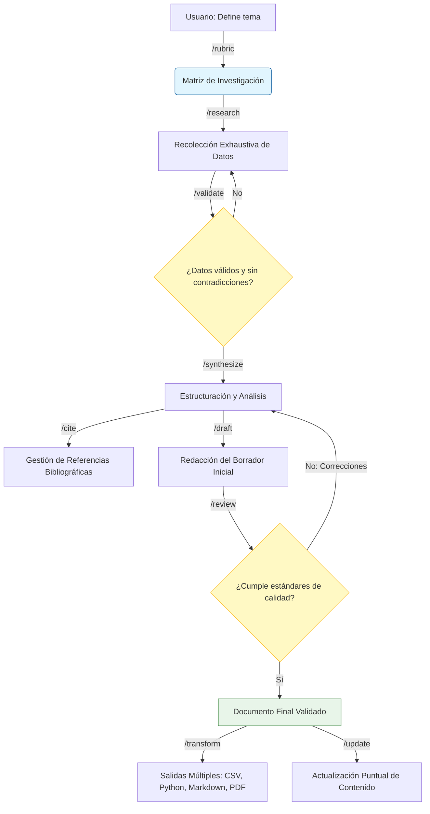
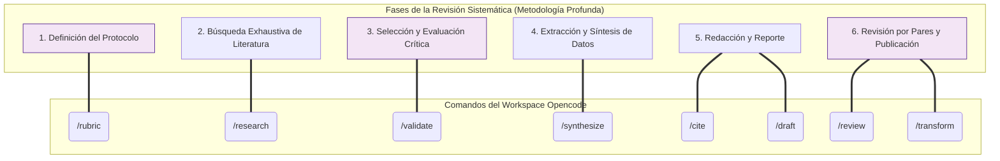

## Tepochcalli - USER HISTORIES

Quiero construir un Workspace de Obsidian (Vault) para investigación y temas de estudio, potenciado con [Opencode V2](https://opencode.ai/v2/docs) y un motor RAG. El sistema debe permitir consultas semánticas sobre notas de investigación, PDFs académicos y documentación técnica, minimizando el consumo de tokens del LLM mediante indexación incremental y recuperación precisa de fragmentos relevantes.

Todos los archivos de configuración, scripts de ingesta, índices vectoriales y servidores MCP deben organizarse de manera que no interfieran con el flujo normal de Obsidian.

El sistema consta de cuatro componentes principales:

1. **Obsidian Vault (Capa de Usuario):** Directorio raíz donde residen las notas markdown, PDFs, imágenes y enlaces. Es el único componente visible para el usuario final.

2. **RAG Engine (Capa de Procesamiento):** Motor de indexación incremental que monitorea el vault, extrae texto de markdown y PDFs, genera embeddings locales y los almacena en una base de datos vectorial embebida.

3. **MCP Server (Capa de Comunicación):** Servidor que expone herramientas de búsqueda semántica mediante el protocolo Model Context Protocol, permitiendo que Opencode consulte el índice vectorial, lo llamaremos tepochcalli-rag para identificarlo en el harness.

4. **[Opencode V2](https://opencode.ai/v2/docs) (Capa de Agente):** Harness que consume las herramientas MCP y orquesta las consultas del usuario final hacia el LLM con contexto enriquecido.

**RAG Engine**:

Tengo estas opciones como motor para indexar documentos, solo podemos tomar uno, ya que hacen el mismo trabajo de RAG, la idea es tomar uno que ya esta construido, fácil de instalar y que este bien documentado, la idea es no crear desde cero un RAG, si no incorporar uno ya hecho por la comunidad en el ecosistema del Harness.

- [CocoIndex](https://github.com/cocoindex-io/cocoindex)
- [Leann](https://github.com/StarTrail-org/LEANN)
- [LightRAG](https://github.com/HKUDS/LightRAG)
- [RAG-Anything](https://github.com/HKUDS/RAG-Anything)
- [PageIndex](https://github.com/VectifyAI/PageIndex) 

Solo he leído la documentación de [CocoIndex](https://cocoindex.io/docs/), pero quería ver las demás opciones en caso de que fuera mejores (Lo documentaremos en una tabla de comparación y porque fue escogido dicho motor de indexación, en caso de que en el futuro cambiemos el motor, o lo migremos a otra tecnología)

Como herramienta adicional, me gustaria incorporar un convertidor a markdown como alternativa en caso de que el usuario quiera convertir sus recursos en markdown directo, utilizaremos el MCP para convertir ficheros a markdown, lo configuraremos en `obsidian-workspace/opencode.json` (Leer la documentacion de Opencode para saber como [configurar un MCP](https://opencode.ai/v2/docs/mcp-servers/)):

- [Convertidor a Markdown](https://github.com/mcp/microsoft/markitdown)
- [Guia de instalación](https://mcp.directory/blog/markitdown-mcp-complete-guide-2026)

**Flujo de Datos:**

- El usuario escribe notas en Obsidian y añade PDFs al vault
- RAG Engine detecta los materiales a indexar.
- Los archivos nuevos o modificados se procesan incrementalmente (solo el delta)
- Los embeddings se almacenan en LanceDB, ChromaDB o pgvector
- Opencode consulta el servidor MCP cuando necesita contexto
- El servidor MCP devuelve fragmentos relevantes con metadatos de origen
- El LLM genera respuestas usando solo el contexto recuperado
- El usuario puede convertir un material o URL de interés a markdown y añadirlo a las fuentes de indexación directamente

La organización del vault de Obsidian debe seguir esta estructura jerárquica:

- Las carpetas numeradas (00, 10, 20, etc.) siguen la convención de Obsidian para ordenamiento
- Las carpetas `.opencode/` y `.<Directorio con el nombre del motor RAG>/` están ocultas (prefijo punto) para no aparecer en la vista de Obsidian
- Las fuentes y materiales que serán indexados (PDFs, Markdowns, Hojas calculo, etc.) deben almacenarse en `00-Resources/`
- El usuario debe tener la libertad de crear su propios directorios dentro de `00-Resources/` para que tenga la organización deseada con sus materiales, por lo que se debe procurar que el RAG engine pueda de manera automática (ó semi-automática) detectar e indexar los recursos de todo el contenido de `00-Resources/` sin importar como este organizado dentro de ese directorio.

El sistema se considera correctamente implementado cuando:

1. El vault de Obsidian funciona normalmente sin interferencias
2. Los archivos nuevos se indexan automáticamente en menos de 30 segundos cuando Opencode invoca la función del MCP correspondiente
3. Las búsquedas semánticas devuelven resultados relevantes en menos de 500ms
4. El consumo de tokens por consulta es inferior a 2000 tokens (incluyendo contexto)
5. Las respuestas del agente incluyen citas precisas a las fuentes originales
6. El sistema puede manejar vaults de hasta 10,000 notas y 1,000 PDFs sin degradación de rendimiento
7. Pueda procesar distintos formatos de texto, si no, utilizar el convertidor Markdown para que pueda manipularse adecuadamente.

### Agent Workflow

Para enriquecer el flujo de trabajo del workspace tenemos que diseñar estos comandos y agentes para la metodologia de investigacion general

| Comando       | Fase Metodológica         | Descripción y Propósito Formal                                                                                                                                                  |
| :------------ | :------------------------ | :------------------------------------------------------------------------------------------------------------------------------------------------------------------------------ |
| `/rubric`     | **Definición**            | Genera la matriz de investigación: define la pregunta central, objetivos, alcance, criterios de inclusión/exclusión de fuentes y la metodología a aplicar.                      |
| `/research`   | **Recolección**           | Ejecuta la búsqueda exhaustiva de información en fuentes autorizadas, extrayendo datos, citas y contextos relevantes según la rúbrica.                                          |
| `/validate`   | **Evaluación Crítica**    | Analiza la información recopilada para detectar contradicciones, sesgos, obsolescencia y verifica la autoridad de las fuentes. Genera un informe de calidad de datos.           |
| `/synthesize` | **Análisis**              | Estructura la información validada en ejes temáticos, identifica patrones y genera el esquema lógico (outline) que guiará la redacción.                                         |
| `/cite`       | **Gestión Bibliográfica** | Compila, formatea (APA, MLA, Chicago, etc.) y vincula todas las referencias utilizadas, asegurando la trazabilidad de cada afirmación.                                          |
| `/draft`      | **Redacción**             | Redacta el documento inicial siguiendo el esquema de `/synthesize`, integrando las citas gestionadas por `/cite`.                                                               |
| `/review`     | **Refinamiento**          | Simula una revisión por pares. Evalúa el borrador en busca de faltas ortográficas, coherencia argumentativa, claridad y sugiere mejoras sustantivas.                            |
| `/transform`  | **Diseminación**          | Convierte la investigación en formatos específicos solicitados: hoja de cálculo (CSV/Excel para datos), cuaderno de Python (Jupyter para análisis), presentación o mapa mental. |
| `/update`     | **Mantenimiento**         | Permite inyectar nueva información o corregir datos específicos en el documento final sin tener que reiniciar todo el flujo de trabajo.                                         |

| Nombre del Agente Primario                      | Justificación Histórica                                                                                                                                                                                                                    | Propósito en el Workflow                                                                                                                                                                                                                 | Comandos Asignados                                               | Permisos                                                                                                                                                                                                            |
| :---------------------------------------------- | :----------------------------------------------------------------------------------------------------------------------------------------------------------------------------------------------------------------------------------------- | :--------------------------------------------------------------------------------------------------------------------------------------------------------------------------------------------------------------------------------------- | :--------------------------------------------------------------- | :------------------------------------------------------------------------------------------------------------------------------------------------------------------------------------------------------------------ |
| **Itzamná** *(Agente General / Orquestador)* | En la mitología maya, es el dios supremo, creador y patrono del conocimiento, la escritura y la sabiduría. Actúa como la fuente primordial de guía y el puente entre lo divino (el sistema) y los sacerdotes (los agentes especializados). | Es la interfaz principal con el usuario. Resuelve dudas generales, ofrece sugerencias contextuales, explica el estado del workspace y enruta las solicitudes hacia los agentes especializados sin ejecutar el pipeline de investigación. | **Ninguno** *(Gestión de interacción general y enrutamiento)* | **Lectura/Escritura (Contexto):** Puede leer el estado general del workspace para ofrecer sugerencias informadas y hacer revisiones.                                                                                |
| **Nezahualcóyotl** *(El Arquitecto)*         | Rey poeta de Texcoco, reconocido por su profunda filosofía, su genialidad en la ingeniería hidráulica y la codificación de leyes. Representa la visión estratégica, el diseño estructural y el orden lógico.                               | Define el alcance de la investigación, diseña la metodología y estructura el esqueleto lógico (outline) del conocimiento antes de su ejecución.                                                                                          | `/rubric` `/synthesize`                                       | **Lectura/Escritura (Planificación):** Puede crear y modificar documentos de planificación (rúbricas, esquemas, planes de estructura). Sin acceso a la web ni a la redacción final.                                 |
| **Pochteca** *(El Explorador)*               | Mercaderes de larga distancia del Imperio Mexica. Su función secundaria y más crítica era actuar como los "ojos y oídos" del Tlatoani, recopilando inteligencia y datos de territorios lejanos sin alterar su propio entorno.              | Navega la web, busca información y extrae datos crudos de fuentes externas según los parámetros estrictos definidos por Nezahualcóyotl.                                                                                                  | `/research`                                                      | **Solo Lectura (Workspace) / Navegación (Externo):** Acceso total a MCPs y herramientas de búsqueda, navegadores y lectores de documentos. **Estrictamente sin permisos de escritura** en el workspace del usuario. |
| **Chilam** *(El Auditor)*                    | Título del sumo sacerdote y profeta maya. Los *Chilam Balam* eran los libros sagrados donde estos sabios compilaban, validaban y preservaban el conocimiento histórico, astronómico y médico, filtrando la verdad.                         | Evalúa la calidad de los datos, detecta contradicciones, formatea las citas bibliográficas y realiza la revisión por pares del contenido para asegurar su veracidad y coherencia.                                                        | `/validate` `/cite` `/review`                              | **Lectura (Total) / Escritura (Auditoría):** Lee todos los datos y borradores. Solo puede escribir en archivos de registro de auditoría, bases de datos de citas o notas de revisión.                               |
| **Tlacuilo** *(El Ingeniero)*                | El escriba y artesano náhuatl (*tlacuiloa*: escribir/pintando). Era el maestro de los formatos, los pigmentos y el plasmar físicamente el conocimiento en los códices, adaptándolo a la materia (piedra, papel amate, piel).               | Materializa la investigación. Redacta el texto final, formatea los documentos y transforma los datos en los artefactos técnicos solicitados (Markdown, CSV, cuadernos de Python).                                                        | `/draft` `/transform` `/update`                            | **Lectura/Escritura (Workspace):** Permisos exclusivos para crear, sobrescribir y modificar los archivos finales en el workspace (documentos, hojas de cálculo, código). Sin acceso a la navegación web.            |

Para las skills, necesitamos que cargues la skill `find-skills` para encontrar las skills mas apropiadas:

- Research 
- Investigacion
- OSINT de busqueda exhaustiva de información y recursos
- Seleccion y evaluacion critica
- Extraccion y sintesis de datos
- Redacción y Reporte de investigación
- Definición de protocolo de investigación
- Revisión por pares
- Transformación de datos a hojas de calculo
- Graficación y Analisis de datos (Jupyter Notebook y R)
- LaTeX
- Administración de Vaults de Obsidian
- Sintaxis Markdown
- Diagramas Mermaid, Graphviz y PlantUML

Instala las skills de forma local, no global, en el proyecto y lo que se descargo muevelo al directorio `obsidian-workspace/.opencode/skills`.

Revisa que no halla skills redundantes o duplicadas.

### Wizard de instalación

Utilizaremos un TUI en forma de instalador atomico y versionado para descargar el workspace de obsidian, en el cual incluirá todo lo mencionado anteriormente, desarrollado en Rust.
Esto con el fin de no interferir con la meta-configuración del harness de desarrollo, tengo un proyecto con la misma arquitectura de instalación con un gestor de paquetes:

https://github.com/Fisherk2/codice-opencode

En el, los archivos que se instalan están en un directorio llamado `template/`, nosotros haremos lo mismo, todo el contenido que este en `obsidian-workspace/` se instalara al usuario con los requisitos mencionados

El directorio `obsidian-workspace/` debe contener obligatoriamente los siguientes directorios:

- `00-Resources/`: Es donde el usuario debe añadir sus recursos que deben ser embebidos, podríamos dejarlo vacio o con un markdown y un PDF con información de muestra para testear el RAG, es mas que nada un placeholder
- `.opencode/`: Es donde se configurara el harness, debe incluir el directorio de skills, comandos y agentes (Proximamente un [plugin](https://opencode.ai/v2/docs/build/plugins/) o tool para asegurar la utilizacion del MCP)
- `opencode.json`: Es el archivo de configuración general del harness, solo de tu parte, me vas a ayudar como añadir el [MCP](https://opencode.ai/v2/docs/mcp-servers/) de forma local.
- `.<Directorio con el nombre del motor RAG>/`: Es donde estará el motor RAG.
- `AGENTS.md`: Es el archivo de instrucciones para los agentes de IA, que servirá como system prompt. En el debe estar establecido como usar el Vault, que herramientas debe utilizar y que recursos debe consultar para entregarle al usuario la mejor respuesta a sus peticiones. Debe priorizar primero usar el MCP que se diseñara para conectar el motor RAG con Opencode, después puede utilizar las herramientas restantes u otros MCPs que el usuario pueda configurar. Este archivo puede ser modificable por el usuario al gusto, así que en ese sentido no podemos restringir su modificación (Para implementaciones futuras, dejaremos este fichero solo con un placeholder cuando añadamos un [plugin](https://opencode.ai/v2/docs/build/plugins/) o tool que pueda utilizar el RAG con Opencode)

### Deuda cognitiva

Las siguientes cuestiones son dudas mías acerca de como tenemos que llevar el proyecto, la experiencia de usuario y como es que el wizard de instalación se presentará:

1. ¿Que gestor de paquetes me recomiendas utilizar? el en repositorio que te proporcione, he utilizado bunx ya que el instalador funciona con Typescript, pero me gustaria saber si puedo usar el mismo, pnpm, o cargo.
2. En caso de utilizar cargo, ¿que condiciones extra debo tener para utilizar su gestor de paquetes? ¿Debo registrarme en algun sitio web para hostear el paquete como lo que se hace con Bunx con npmjs?
3. Tanto el MCP como el motor RAG en si mismo puede contener o es en si mismo, una dependencia, ¿Que podemos hacer para gestionar las dependencias a la hora de el usuario instale el workspace? Mi intencion es evitar lo maximo posible que el usuario tenga que instalar dependencias en su host nativamente, preferiblemente como lo que se hace con .venv cuando se desarrolla con Python, pero tampoco hay que hacer que el usuario ejecute comandos extras para comenzar a utilizar el workspace.
4. ¿Podemos hacer que el wizard de instalación gestione las dependencias que se instalan de forma automatica sin que el usuario intervenga o instale manualmente las dependencias necesarias para ejecutar el MCP o el motor RAG? El instalador debe ser ready-to-use para Opencode, ¿Es posible que el wizard realiza esa instalacion incluyendo las dependencias o tendremos que establecer en el README del proyecto el paso extra de instalar las dependencias en un entorno seguro (o directamente en el host)? te lo menciono en caso de que el punto anterior no se pueda implementar un entorno virtual y seguro
5. El MCP ¿En que directorio lo estariamos añadiendo en `obsidian-workspace/`? ¿Dentro de `.<Directorio con el nombre del motor RAG>/`? Si es asi, me gustaria que ese directorio estuviera dividido en 2, uno para el mcp, otro para el motor del RAG. No es opcion crear un directorio llamado `.mcp/` o similar en la raiz del directorio `obsidian-workspace/` para que el usuario final no manipule su contenido.
6. ¿Como podemos gestionar los embebidos para que procese los documentos en el RAG? ¿Donde podemos hacer que el usuario configure y coloque sus modelos locales para embebidos? ¿Es posible hacerlo en un directorio llamado `.<Directorio con el nombre del motor RAG>/models`? si es asi ¿Es posible crear un archivo de configuración donde el usuario pueda añadir una API key de modelos para embebidos externos? ¿Si el modelo es local, cual seria los requisitos minimos para que el usuario pueda utilizar el workspace?

Me gustaría que respondieras estas preguntas primero antes de tomar decisiones concretas y continuar, investiga en la web para que me proporciones respuestas actualizadas.