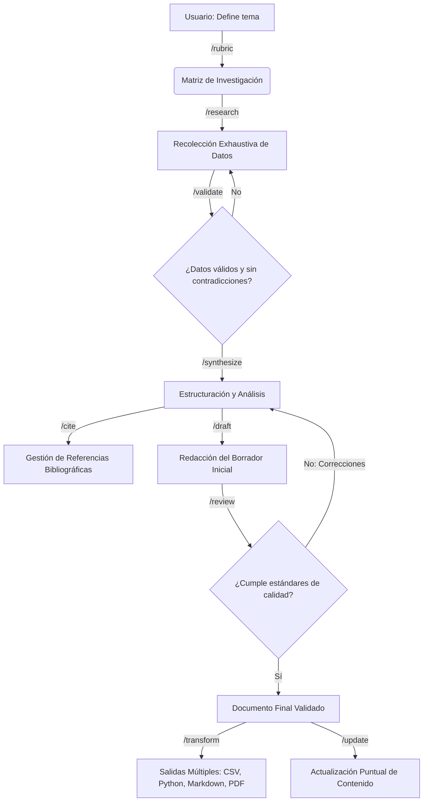

# Spec: Flujo de agente — comandos, agentes y política de skills del vault

* **Status:** Proposed
* **Date:** 2026-10-21
* **Author:** Arquitecto (entrevista /spec)
* **Reviewers:** Product Owner (usuario)
* **Traceability:** docs/UH.md (secciones "Agent Workflow" y skills), docs/APPFLOW.md, specs/spec-mcp-server.md (regla MCP-first), specs/spec-vault-structure.md (zonas de propiedad D9.1); mapa comandos→bandejas **D9.2** y desviación de permisos **D9.3** confirmadas por el usuario vía question tool el 2026-10-21 (sin ADR nuevo, por decisión del usuario)

## Summary

Documenta la capa de metodología del workspace: los 9 comandos de investigación, los 5 agentes nombrados con sus permisos, el grafo metodológico y los requisitos del `AGENTS.md` del vault (system prompt con regla "MCP-first"). Los artefactos ya existen en `obsidian-workspace/.opencode/` (agents/, commands/, skills/) — esta spec los DOCUMENTA y audita; no los modifica. Incluye el anexo de auditoría de skills frente a las 14 categorías pedidas en UH.md.

## Problem / Motivation

El valor del vault no es solo RAG: es convertirlo en pipeline de investigación reproducible. Sin permisos por agente (Pochteca solo escribe su bandeja de evidencia `01-tasks/research/`; Tlacuilo no navega), la metodología de UH.md degenera en un chat genérico. Y sin regla MCP-first documentada, el agente gastaría tokens leyendo archivos crudos en vez de buscar en el índice.

> Como investigador, quiero invocar `/research`, `/validate`, `/draft` sabiendo qué agente puede tocar qué, con citas garantizadas por el índice.

## Goals and Non-Goals

### Goals

* Tabla canónica de 9 comandos y 5 agentes con permisos (espejo de UH.md).
* Grafo metodológico reutilizado de UH.md.
* Requisitos del AGENTS.md del vault (incluida la regla MCP-first y su evolución a plugin).
* Auditoría honesta del inventario actual de skills: cobertura, gaps y duplicados, con acciones para /plan.

### Non-Goals

* Redefinir/redactar los archivos de agentes y comandos existentes (out of scope del manifiesto).
* Elegir skills e instalarlas (esto produce RECOMENDACIONES; la acción vive en Phase 4 de docs/WORKFLOW.md).

## Proposed Solution

Se adopta el workflow de UH.md como contrato del workspace. La auditoría de skills (Anexo A) clasifica las 208 instaladas: ~45 relevantes para las 14 categorías, un conjunto grande fuera de dominio (bioinformática/finanzas/GIS/marketing…) que se recomienda retirar del payload para reducir contexto, y gaps accionables (Jupyter, R, Graphviz/PlantUML, LaTeX de manuscrito).

## Detailed Design

### Comandos del workspace (9)

| Comando | Fase metodológica | Descripción y propósito formal |
|---|---|---|
| `/rubric` | Definición | Genera la matriz de investigación: pregunta central, objetivos, alcance, criterios de inclusión/exclusión de fuentes y metodología a aplicar. |
| `/research` | Recolección | Búsqueda exhaustiva de información en fuentes autorizadas; extrae datos, citas y contextos según la rúbrica. |
| `/validate` | Evaluación crítica | Detecta contradicciones, sesgos, obsolescencia; verifica autoridad de fuentes; genera informe de calidad de datos. |
| `/synthesize` | Análisis | Estructura la información validada en ejes temáticos, identifica patrones, genera el outline. |
| `/cite` | Gestión bibliográfica | Compila, formatea (APA/MLA/Chicago…) y vincula referencias; trazabilidad de cada afirmación. |
| `/draft` | Redacción | Redacta el documento inicial siguiendo el esquema de `/synthesize` con las citas de `/cite`. |
| `/review` | Refinamiento | Simula revisión por pares: ortografía, coherencia argumentativa, claridad, mejoras sustantivas. |
| `/transform` | Diseminación | Convierte la investigación a CSV/Excel, cuaderno Jupyter, presentación o mapa mental. |
| `/update` | Mantenimiento | Inyecta nueva información o corrige datos puntuales sin reiniciar el flujo. |

### Mapa de comandos→bandejas (D9.2 — canónico)

Cada comando escribe en UNA única bandeja (mapeo TOTAL: los 9 comandos están asignados; y ÚNICO: ningún comando tiene dos bandejas de salida; leer a través de otras bandejas — p.ej. `/transform` lee `02-drafts/` y `03-citations/`— es normal y no cuenta como salida):

| Bandeja | Dueño | Comandos |
|---|---|---|
| `00-Resources/` | usuario (el agente solo vía `add_source`) | ingesta; `/research` la lee vía `search` |
| `01-tasks/` | Nezahualcóyotl | `/rubric`, `/synthesize` (plan, outline, todo) |
| `01-tasks/research/` | **Pochteca** | `/research` (ver D9.3 — desviación documentada del UH) |
| `02-drafts/` | Tlacuilo | `/draft`, `/update` |
| `03-citations/` | Chilam | `/cite` |
| `04-review/` | Chilam | `/validate`, `/review` — NUEVO: informes de calidad de datos y revisiones por pares |
| `05-outputs/` | Tlacuilo | `/transform` — NUEVO: CSV/Excel, notebooks, presentaciones, mapas mentales (artefactos de diseminación separados de borradores) |

* **Formato de auditoría:** los informes de `/validate` y `/review` aterrizan en `04-review/` con frontmatter `{command, agent, target_doc, verdict}` (log auditable del estado de cada documento evaluado).
* Las notas de evidencia de `/research` en `01-tasks/research/` exigen frontmatter `{agent, timestamp, fuentes, método}` en cada nota.

### Agentes primarios (5)

| Agente | Rol | Comandos | Permisos (resumen D/manifest) |
|---|---|---|---|
| **Itzamná** | Orquestador / interfaz del usuario | ninguno | Lectura/escritura de contexto: lee estado del workspace, enruta, NO ejecuta el pipeline |
| **Nezahualcóyotl** | Arquitecto de investigación | `/rubric` `/synthesize` | Escritura solo de planificación (rúbricas, esquemas); sin web ni redacción final |
| **Pochteca** | Explorador/recolección | `/research` | lectura total del workspace + navegación web + MCPs/lectores + escritura ÚNICAMENTE en `01-tasks/research/` (desviación documentada del UH, decisión usuario 2026-10-21 — ver párrafo siguiente) |
| **Chilam** | Auditor | `/validate` `/cite` `/review` | Lectura total; escritura limitada a registros de auditoría, bases de citas y notas de revisión |
| **Tlacuilo** | Ingeniero de artefactos | `/draft` `/transform` `/update` | Escritura en workspace (documentos, hojas de cálculo, código); **sin navegación web** |

Justificación histórica de cada nombre: ver docs/UH.md (tabla "Agentes Primarios") — no se duplica aquí (progressive disclosure).

**Desviación documentada del UH (decisión usuario 2026-10-21):** docs/UH.md establece para Pochteca "**Estrictamente sin permisos de escritura** en el workspace del usuario". El usuario decidió explícitamente UNA excepción: Pochteca puede escribir **solo** en `01-tasks/research/`, con frontmatter obligatorio `{agent, timestamp, fuentes, método}` en cada nota. Justificación: la evidencia recolectada debe sobrevivir entre `/research → /validate → /synthesize` (sin bandeja propia, el trabajo de Pochteca moriría en el contexto de la sesión); la separación de poderes se preserva acotando la escritura a UN tray y prohibiendo el resto del vault (root de `01-tasks/`, `02-drafts/`, `03-citations/`, `04-review/`, `05-outputs/`, `00-Resources/` y carpetas personales: denegadas). UH.md se mantiene inmutable como fuente de requisitos; esta spec registra la desviación y su rationale, no la re-litiga.

### Grafo metodológico (de UH.md)

### Requisitos del `AGENTS.md` del vault (system prompt)

1. **Regla MCP-first:** para cualquier pregunta sobre material de `00-Resources/`, el agente DEBE invocar `tepochcalli-rag` `search` antes de leer archivos; `index_refresh()` antes de la primera búsqueda de una sesión si hay dudas de frescura; `add_source()` para convertir/ingerir material nuevo. Después de eso, puede usar otras herramientas/MCPs que el usuario configure.
2. **Política de citas:** toda afirmación basada en chunks recuperados cita `source_path` + `heading` (+ offsets si disponibles), en el formato definido por `/cite`.
3. **Presupuesto:** instrucción de no pedir `top_k` > 8 y de re-queryar antes que ensanchar contexto.
4. **No-interferencia:** nunca escribir fuera de las bandejas 01-05 según el mapa de trays (D9.2) y de `00-Resources/_inbox/` (solo vía `add_source`); jamás tocar `.obsidian/` ni `.tepochcalli/` manualmente.
5. **Modificabilidad:** el usuario puede editar este AGENTS.md — el wizard nunca lo sobreescribe si existe con cambios.
6. **Placeholder futuro:** cuando exista el plugin/tool de OpenCode V2 (nota de UH.md), la sección 1 se reduce a un placeholder que el plugin inyecta automáticamente (TECH_DEBT TD-6).
7. **no-contaminación de bandejas (D9.1):** el agente debe ADVERTIR si encuentra archivos depositados por el usuario dentro de las bandejas 01-05 — podría consumirlos por error en el pipeline; el usuario lee/extrae/borra, no deposita ni edita en sitio. Las bandejas se regeneran: borrarlas es seguro (semántica de caché).

## Alternatives Considered

* **Un solo agente general sin roles:** *rechazado:* pierde el control de escritura/web que protege la trazabilidad del método.
* **Permisos por convención de prompts sin archivos dedicados:** *rechazado:* los archivos bajo `.opencode/agent/` ya existen; la spec los adopta como contrato.

## Trade-offs

* ✅ **Pros:** metodología explícita y testeable; separación de poderes (auditor no redacta, explorador solo escribe su bandeja — D9.3).
* ⚠️ **Cons / Risks:** 5 agentes + 9 comandos = superficie grande que debe permanecer coherente con los contratos MCP; skills infladas (208) degradan contexto del harness.
* ⚖️ **Neutral:** el vault distribuido pesa más por skills; se mitiga con Anexo A.

## Testing Strategy

* E2E golden-vault: `/rubric → /research → …` sobre la muestra del wizard asserta que `/research` usa `tepochcalli-rag.search` (captura de tool-calls) y que las citas resuelven a rutas reales.
* Permiso: fixtures de configuración OpenCode verifican `tools`/`permission` por agente (D9.3): escritura de Pochteca permitida **solo** bajo `01-tasks/research/` y **denegada en todo lo demás**; navegación web permitida en Pochteca; sin web en Tlacuilo.
* Regresión de skills: tras el aseo de /plan, lista blanca versionada en `.opencode/skills.lock` equivalente.

## Security Considerations

* AGENTS.md es editable por el usuario: las reglas de seguridad DURAS (no claves, no red, markitdown file-read) también viven en docs/SECURITY.md del repo del producto, no solo en el vault.
* Los agentes con navegación (Pochteca) enfrentan contenido no confiable → regla anti-injection documentada en spec-markitdown §seguridad.

## Rollback / Monitoring

* Cambios de comandos/agentes son archivos versionados → rollback por git.
* Señales: tasa de respuestas de `/research` sin citas (criterio 5) y latencia media de sesiones.

## Open Questions

* ¿El orquestador Itzamná debe ser el `default agent` del harness en `opencode.json`? (decisión pendiente para /plan)

## References

* docs/UH.md §Agent Workflow y §skills
* obsidian-workspace/.opencode/agents/ (5 primarios: itzamná, nezahualcoyotl, pochteca, chilam, tlacuilo) y commands/ (9)
* Anexo A (este documento) — auditoría de skills

---

## Anexo A — Auditoría de skills (`obsidian-workspace/.opencode/skills/`)

Inventario real: **208 skills** (listado completo al final). Las 14 categorías solicitadas en UH.md se contrastan a continuación.

### Cobertura por categoría

| # | Categoría (UH.md) | Skills que la cubren (existentes) | Estado |
|---|---|---|---|
| 1 | Research | deep-research, deep-research-swarm, research-lookup, research-literature, tooluniverse-literature-deep-research, scientific-problem-selection | ✅ cubierta (con duplicación) |
| 2 | Investigación (ES) | mismas que #1; ninguna específica en español | ⚠️ parcial |
| 3 | OSINT / búsqueda exhaustiva | multi-search-engine, parallel-web, exa-search, perplexity-search, wikipedia-search, patents-search, agent-browser, uspto-database, database-lookup | ✅ cubierta |
| 4 | Selección y evaluación crítica | scientific-critical-thinking, scholar-evaluation, analytical-method-validation, uncertainty-and-units | ✅ |
| 5 | Extracción y síntesis de datos | markitdown, pdf + pdf-anthropic + pdf-processing + pdf-processing-pro + liteparse, docx, xlsx, data-transform, data-stats-analysis, open-notebook, paper-2-web | ✅ (con duplicación) |
| 6 | Redacción y reporte | scientific-writing, scientific-manuscript, article-writing, doc-coauthoring, review-writing | ✅ |
| 7 | Protocolo de investigación | experimental-design, protocol-writing, hypothesis-generation | ✅ |
| 8 | Revisión por pares | peer-review, scholar-evaluation | ✅ |
| 9 | Hojas de cálculo | xlsx, xlsx-official, excel-analysis, data-transform | ✅ (duplicación) |
| 10 | Graficación / Jupyter / R | matplotlib, seaborn, plotly, data-viz-plots, scientific-visualization, networkx | ⚠️ **gap:** sin skill de Jupyter notebook ni de R |
| 11 | LaTeX | latex-posters, venue-templates, scientific-slides | ⚠️ parcial — no hay skill de composición de manuscrito LaTeX general |
| 12 | Administración de vaults Obsidian | obsidian-cli, obsidian-vault | ✅ |
| 13 | Sintaxis Markdown | obsidian-markdown, markdown-mermaid-writing | ✅ |
| 14 | Diagramas Mermaid/Graphviz/PlantUML | markdown-mermaid-writing (solo Mermaid; scientific-schematics en diagramas técnicos) | ⚠️ **gap:** Graphviz/PlantUML no cubiertos |

### Duplicados/redundancias a consolidar (propuesta /plan)

| Familia | Skills | Acción recomendada |
|---|---|---|
| Office "oficial vs libre" | docx + docx-official · pptx + pptx-official · xlsx + xlsx-official | conservar la variante oficial; retirar la duplicada (misma función) |
| PDF ×5 | pdf, pdf-anthropic, pdf-processing, pdf-processing-pro, liteparse | quedarse con 1–2 (proponer: `pdf` general + `pdf-processing-pro`); liteparse lo cubre el motor propio (Docling) |
| Búsqueda de literatura ×8+ | literature, literature-search, literature-review, research-literature, academic-literature-search, paper-lookup, arxiv-search, biorxiv-search, medrxiv-search, pubmed-search, pubmed-database, openalex-database, bgpt-paper-search, paperzilla | consolidar a 2: un buscador general (research-lookup) + uno de preprints/biomed por dominio si el usuario lo pide; las de bases bio específicas son out-of-domain para el payload genérico |
| Deep research ×4 | deep-research, deep-research-swarm, tooluniverse-literature-deep-research, research-lookup | conservar 1–2 (swarm es una variante de orquestación: evaluar coste de tokens contra presupuesto del criterio 4) |
| Estadística | statistical-analysis, data-stats-analysis, statsmodels, statistical-power | statistical-analysis + statsmodels cubren el rango; revisar superposición con data-stats-analysis |
| Brainstorm/ideas | brainstorming, scientific-brainstorming, hypothesis-generation, hypogenic, idea-refine, what-if-oracle | mantener scientific-brainstorming + hypothesis-generation; el resto, candidatas a retiro del payload |
| Escrita | article-writing, scientific-writing, scientific-manuscript, doc-coauthoring | scientific-manuscript parece solaparse con scientific-writing; consolidar en Phase 4 |

### Out-of-domain para el payload distribuible

≈120 skills se especializan en bioinformática/lab/física/química/clínico (scanpy, pydeseq2, qiime2-amplicon, neuropixels-analysis, diffdock, qiskit, matlab, geopandas/GIS, marketing-*, finance-*, legal-*, healthcare-*, etc.). **Recomendación:** convertirlas en un "skill pack" opcional (`tepochcalli pack install bio`) y dejar el vault base con las ~40 relevantes a las 14 categorías: menos contexto, menos descarga, instalación más liviana.

### Gaps → acciones de instalación (para Phase 4 de WORKFLOW)

1. Skill de **cuadernos Jupyter** (crear/editar ejecutar .ipynb) — soporte directo de `/transform`.
2. Skill de **R / graficación estadística en R** — pedida explícitamente en UH.md (#10).
3. Skill de **LaTeX para manuscritos** (no solo posters/venues) — #11.
4. Skill de **Graphviz/PlantUML** — #14 (Mermaid ya cubierto).
5. (Opcional) guía corta en español de metodología (categoría #2) como skill propia del proyecto.

### Inventario completo (208 — lectura directa de `obsidian-workspace/.opencode/skills/`, 2026-10-21)

Ver listado completo

academic-literature-search · aeon · agent-browser · analytical-method-validation · anndata · arbor · arboreto · article-writing · arxiv-search · astropy · autoskill · benchling-integration · bgpt-paper-search · bids · biopython · biorxiv-database · biorxiv-search · brainstorming · bulk-rnaseq · cantera · cirq · citation-management · cobrapy · consciousness-council · dask · data-stats-analysis · data-transform · data-viz-plots · database-lookup · datalad · datamol · deep-research · deep-research-swarm · deepspot-m · deeptools · depmap · diffdock · doc-coauthoring · docx · docx-official · esm · etetoolkit · exa-search · excel-analysis · experimental-design · exploratory-data-analysis · fictiv · flowio · flowkit · fluidsim · folklore-variant-evidence · generate-image · geo-database · geomaster · geopandas · get-available-resources · gget · ginkgo-cloud-lab · gtars · gwas-database · histolab · hmdb-database · hugging-science · hypogenic · hypothesis-generation · idea-refine · imaging-data-commons · infographics · interview-me · iso-standards-readiness · lab-hardware-cad · labarchive-integration · lamindb · latex-posters · liteparse · literature · literature-review · literature-search · literature_to_hypothesis · mageck · markdown-mermaid-writing · market-research-reports · markitdown · matchms · matlab · matplotlib · medrxiv-search · modal · molecular-dynamics · molfeat · multi-search-engine · ncats-arax · networkx · neurokit2 · neuropixels-analysis · nextflow · nmrglue · nwb-conversion · obsidian-cli · obsidian-markdown · obsidian-vault · omero-integration · onekgpd · ontology-term-resolution · open-notebook · openalex-database · openpiv · opentrons-integration · optimize-for-gpu · pacsomatic · paper-2-web · paper-lookup · paperclip · paperzilla · parallel-web · patents-search · pathway-enrichment · pdb-database · pdf · pdf-anthropic · pdf-processing · pdf-processing-pro · peer-review · pennylane · perplexity-search · pi-agent · pkpd-modeling · plotly · polars · polars-bio · pptx · pptx-official · pptx-posters · primekg · primer-design · protocol-writing · protocolsio-integration · pubmed-database · pubmed-search · pufferlib · pybamm · pycalphad · pydeseq2 · pydicom · pyhealth · pylabrobot · pymatgen · pymc · pymoo · pyopenms · pysam · pytdc · pytorch-lightning · pyzotero · qiime2-amplicon · qiskit · qutip · relion · relsa-severity-assessment · research-grants · research-literature · research-lookup · review-writing · scanpy · scholar-evaluation · scientific-brainstorming · scientific-critical-thinking · scientific-manuscript · scientific-problem-selection · scientific-schematics · scientific-slides · scientific-visualization · scientific-writing · scikit-bio · scikit-learn · scikit-survival · scvelo · scvi-tools · seaborn · shap · simpy · stable-baselines3 · statistical-analysis · statistical-power · statsmodels · sympy · tamarind · tellurium · tiledbvcf · timesfm-forecasting · tooluniverse-literature-deep-research · torch-geometric · torchdrug · transformers · treatment-plans · umap-learn · uncertainty-and-units · usfiscaldata · uspto-database · vaex · venue-templates · what-if-oracle · wikipedia-search · writing-plans · writing-skills · xlsx · xlsx-official · zarr-python

