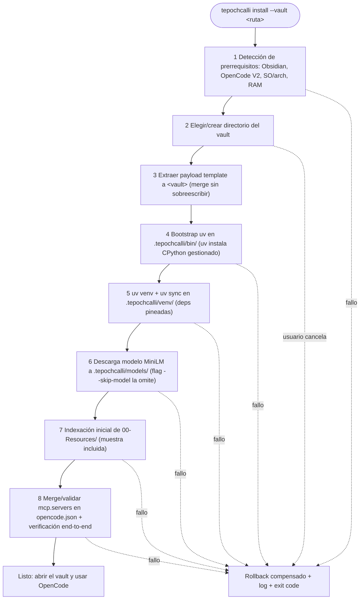

# Spec: Wizard de instalación (TUI Rust atomico y versionado)

* **Status:** Proposed
* **Date:** 2026-10-21
* **Author:** Arquitecto (entrevista /spec)
* **Reviewers:** Product Owner (usuario)
* **Traceability:** docs/UH.md (sección "Wizard de instalación" + deuda cognitiva 1-5), ADR-003 (cargo-dist), ADR-004 (uv/venv), specs/spec-vault-structure.md (payload), docs/APPFLOW.md (journey d)

## Summary

`tepochcalli` es una TUI en Rust, distribuida vía cargo-dist + GitHub Releases (ADR-003), que materializa un vault de Obsidian listo-para-usar: instala el payload del workspace (espejo del modelo `template/` de Fisherk2/codice-opencode, aquí `obsidian-workspace/`), bootea `uv`, crea el venv del proyecto, descarga el modelo de embeddings, ejecuta la indexación inicial de `00-Resources/` y valida/fusiona las entradas `mcp.servers` de `opencode.json`. Cada corrida es atómica con rollback en fallo.

## Problem / Motivation

Preguntas abiertas de UH.md: ¿qué gestor de paquetes?, ¿debo registrarme en algún sitio?, ¿puede el usuario final evitar instalar dependencias nativamente? La respuesta de arquitectura: el usuario no instala Python ni Node ni bun; el wizard —un binario único descargado con un oneliner— hace todo dentro de `.tepochcalli/`.

> Como investigador sin perfil DevOps, quiero ejecutar un solo comando, responder unas pocas preguntas en una TUI y tener el vault con RAG funcionando.

## Goals and Non-Goals

### Goals

* Oneliner de instalación: `curl -L https://github.com/Fisherk2/tepochcalli-opencode/releases/latest/download/install.sh | sh` o `cargo binstall tepochcalli` (ADR-003).
* Flujo atómico de 8 fases con rollback por compensación (ver Detailed Design).
* Idempotencia: re-ejecutar = reparación/no-op, nunca duplicados.
* Flags `--offline` (usa cachés locales, sin red) y `--skip-model` (omite la descarga del embedder).
* UX de fallo accionable: qué fase, por qué, qué hacer, dónde está el log.

### Non-Goals

* Actualizaciones automáticas del vault del usuario (se re-ejecuta el wizard; upgrade asistido = futuro).
* Gestionar la instalación de Obsidian ni de OpenCode (solo detectar; el wizard abre instrucciones si faltan).
* Editor de la config RAG (eso es `tepochcalli.toml`, spec-embeddings).
* Publicación en crates.io (opcional posterior — ADR-003).

## Proposed Solution

Crate Rust `tepochcalli` (workspace con el payload `template/` embebido en release como tarball adjunto). Modelo de instalación espejo de codice-opencode: el directorio `obsidian-workspace/` del repo ES el `template/`: se extrae a la ruta del vault elegido por el usuario (fusionando, nunca sobreescribiendo archivos del usuario), y luego las fases runtime preparan `.tepochcalli/`.

## Detailed Design

### Fases (atómicas, con compensación)



| # | Fase | Compensación en fallo |
|---|---|---|
| 1 | Detectar prereqs (Obsidian en rutas estándar por SO; `opencode` en PATH; memoria/disco) | sin cambios; guía de qué instalar |
| 2 | Seleccionar destino del vault (ruta nueva o vault existente) | sin cambios |
| 3 | Copiar payload (carpetas numeradas, `.opencode/` con agents/commands/skills, `AGENTS.md` del vault, `opencode.json` base, `00-Resources/` con muestras md+PDF) | borrar lo copiado en esta corrida (marca `.tepochcalli/.install-intent`) |
| 4 | Descargar binario `uv` → `.tepochcalli/bin/`; uv asegura CPython gestionado (el usuario NO necesita Python) | eliminar `bin/` |
| 5 | `uv venv .tepochcalli/venv` + `uv sync` desde `pyproject.toml` (`cocoindex[lancedb]`, `sentence-transformers`, `docling`, `markitdown-mcp`) | `rm -rf venv/` |
| 6 | Descargar `paraphrase-multilingual-MiniLM-L12-v2` a `models/` (SBERT/HF_HOME) | `rm -rf models/` |
| 7 | Correr flow: index inicial de `00-Resources/` (incluye parse Docling de PDF de muestra) | `rm -rf db/ flow state` |
| 8 | Fusionar entradas MCP en `opencode.json` (ver abajo) y smoke-test `search` sobre la muestra | revertir `opencode.json` desde backup `.bak` |

* La fase 1 no puede "deshacerse"; las fases 3-8 crean solo artefactos propios → la compensación es puramente de archivos bajo rutas del runtime/payload de esta corrida. Nunca se tocan `.obsidian/` ni archivos previos del usuario (la merge del payload omite existentes salvo plantillas gestionadas).
* Si la fase 8 detecta una entrada `tepochcalli-rag` previa, la valida (comando apunta al venv actual) y solo la reescribe si difiere, conservando las demás servers del usuario.

### Merge/validación del bloque MCP (fase 8, resultado esperado)

```jsonc
{ "mcp": { "servers": {
    "tepochcalli-rag": {
      "type": "local",
      "command": [".tepochcalli/venv/bin/tepochcalli-mcp"],
      "cwd": ".",
      "environment": { "TEPOCHCALLI_ROOT": "." },
      "disabled": false
    },
    "markitdown": {
      "type": "local",
      "command": [".tepochcalli/venv/bin/python", "-m", "markitdown_mcp"],
      "disabled": false
    }
} } }
```

(Snippet canónico y justificación del venv en vez de `uvx`: spec-markitdown §config.)

### Flags

* `--offline`: omite fases que requieren red (descarga payload/modelo/wheels): requiere caché previa (`models/`, cache uv). Si falta algo, fallo limpio diciendo qué se necesita descargar.
* `--skip-model`: instala todo pero omite fase 6; `search` reportará `INDEX_EMPTY` hasta que un `tepochcalli model` posterior descargue el embedder.
* (v2 sugerido) `--vault <ruta>`, `--non-interactive` para CI.

### Versionado y release (D5/ADR-003)

* semver en el crate; tags `v*` → CI cargo-dist → release con `install.sh`/`install.ps1` + artefactos (x86_64/aarch64 Linux, macOS, Windows) + SHA-256.
* El payload viaja como asset de la misma release (`tepochcalli-workspace-<ver>.tar.gz`): wizard y vault versionan juntos — el binario v0.3.x instala siempre payload v0.3.x (one-version rule).
* `cargo binstall tepochcalli` funciona out-of-box porque el layout de assets respeta el estándar de cargo-dist.

### UX de fallo

* Panel final rojo con: fase fallida, causa resumida, comando de reintento (`tepochcalli install --resume`, reusa artefactos válidos), ruta del log (`$XDG_STATE_HOME/tepochcalli/install-<ts>.log` o `%LOCALAPPDATA%` equivalente — el log NO vive en el vault, para no ensuciar git/status).
* Códigos de salida: 0 ok; 10-19 prereqs; 20-29 red; 30-39 disco/permisos; 40+ fallo interno del motor.

## Alternatives Considered

* **bunx/npm (modelo actual de codice-opencode):** rechazado en D5 — añade runtime Node/bun al host del investigador.
* **Script bash + pip al host:** sin aislamiento, sin rollback, contamina site-packages.
* **Instalador gráfico (electron) o app store:** coste de mantenimiento sin beneficio para el perfil CLI/TUI.
* **crates.io + cargo install:** exige toolchain Rust al usuario (ADR-003).

## Trade-offs

* ✅ **Pros:** un comando; cero prereqs Python; atómico/resumible; el vault resultante es portable y auditable.
* ⚠️ **Cons / Risks:** primer arranque requiere internet (wheels + modelo — límite declarado); binario multi-plataforma implica CI que mantener; payloads grandes suben el tamaño de release.
* ⚖️ **Neutral:** aparece un sub-proyecto Rust en el repo (crates + dist) con su propio CI.

## Testing Strategy

* Matrix: VM limpia por plataforma (Ubuntu latest, macOS arm64, Windows) — acceptance: "clean VM → installed vault with one command incl. deps" (Phase 3 exit, docs/WORKFLOW.md).
* Idempotencia: `install` dos veces → mismo estado, cero duplicados en `opencode.json` ni en `00-Resources/` (SPEC.md §Testing).
* Fallo inducido: matar la red en fase 5/6 → assert del rollback correspondiente y `.bak` intacto.
* `--offline` segunda corrida (con cachés) → éxito sin red (fixture en CI con cache uv/`models/` pre-cargados).

## Security Considerations

* Verificación SHA-256 de assets de release; `curl | sh` documentado con el caveat de inspección (docs/SECURITY.md).
* El modelo se descarga de HuggingFace; uv baja wheels de PyPI — ambas provenancias declaradas en SECURITY.
* El wizard no escribe claves: solo referencia `api_key_env` (config la decide el usuario después).

## Rollback / Monitoring

* Desinstalación: `tepochcalli uninstall --vault <ruta>` elimina `.tepochcalli/` y deja notas sobre qué hizo en el vault (payload de usuario no se borra; borrar vault es decisión del usuario).
* Telemetría: ninguna por default (producto local); logs locales para soporte.

## Open Questions

* ¿`--resume` guarda el estado de fase en `bin/.install-state` o deduce por artefactos presentes? (propuesta: deducir + marker)

## References

* Fisherk2/codice-opencode (modelo `template/` → instalación)
* cargo-dist — https://opensource.axo.dev/cargo-dist/
* uv — https://docs.astral.sh/uv/
* ADR-003 / ADR-004; docs/APPFLOW.md journeys d y e
