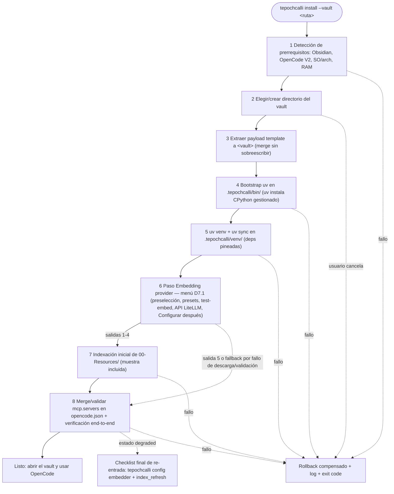

# Spec: Wizard de instalación (TUI Rust atomico y versionado)

* **Status:** Proposed
* **Date:** 2026-10-21
* **Author:** Arquitecto (entrevista /spec)
* **Reviewers:** Product Owner (usuario)
* **Traceability:** docs/UH.md (sección "Wizard de instalación" + deuda cognitiva 1-5), ADR-003 (cargo-dist), ADR-004 (uv/venv), ADR-007 (paso "Embedding provider" D7.1 + re-entrada D7.4), ADR-008 (transparencia de hardware D8.1-D8.3 + swap atómico D8.4), specs/spec-vault-structure.md (payload), specs/spec-embeddings.md (menú y edge cases), docs/APPFLOW.md (journey d)

## Summary

`tepochcalli` es una TUI en Rust, distribuida vía cargo-dist + GitHub Releases (ADR-003), que materializa un vault de Obsidian listo-para-usar: instala el payload del workspace (espejo del modelo `template/` de Fisherk2/codice-opencode, aquí `obsidian-workspace/`), bootea `uv`, crea el venv del proyecto, presenta el paso **"Embedding provider"** (menú de cinco salidas de ADR-007/D7.1 con `paraphrase-multilingual-MiniLM-L12-v2` pre-seleccionado), ejecuta la indexación inicial de `00-Resources/` y valida/fusiona las entradas `mcp.servers` de `opencode.json`. Cada corrida es atómica con rollback en fallo; la salida 5 del menú ("Configurar después") degrada RAG honestamente sin abortar la instalación.

## Problem / Motivation

Preguntas abiertas de UH.md: ¿qué gestor de paquetes?, ¿debo registrarme en algún sitio?, ¿puede el usuario final evitar instalar dependencias nativamente? La respuesta de arquitectura: el usuario no instala Python ni Node ni bun; el wizard —un binario único descargado con un oneliner— hace todo dentro de `.tepochcalli/`.

> Como investigador sin perfil DevOps, quiero ejecutar un solo comando, responder unas pocas preguntas en una TUI y tener el vault con RAG funcionando.

## Goals and Non-Goals

### Goals

* Oneliner de instalación: `curl -L https://github.com/Fisherk2/tepochcalli-opencode/releases/latest/download/install.sh | sh` o `cargo binstall tepochcalli` (ADR-003).
* Flujo atómico de 8 fases con rollback por compensación (ver Detailed Design).
* Idempotencia: re-ejecutar = reparación/no-op, nunca duplicados.
* Flags `--offline` (usa cachés locales, sin red — válido solo con `models/` o config API presente) y `--skip-model` (equivale a la salida 5 del menú embedder: instalar sin provider).
* UX de fallo accionable: qué fase, por qué, qué hacer, dónde está el log.

### Non-Goals

* Actualizaciones automáticas del vault del usuario (se re-ejecuta el wizard; upgrade asistido = futuro).
* Gestionar la instalación de Obsidian ni de OpenCode (solo detectar; el wizard abre instrucciones si faltan).
* Editor de la config RAG (eso es `tepochcalli.toml`, spec-embeddings).
* Publicación en crates.io (opcional posterior — ADR-003).

## Proposed Solution

Crate Rust `tepochcalli` (workspace con el payload `template/` embebido en release como tarball adjunto). Modelo de instalación espejo de codice-opencode: el directorio `obsidian-workspace/` del repo ES el `template/`: se extrae a la ruta del vault elegido por el usuario (fusionando, nunca sobreescribiendo archivos del usuario), y luego las fases runtime preparan `.tepochcalli/`.

## Detailed Design

### Fases (atómicas, con compensación)



Nota D7: el paso "Embedding provider" (fase 6) va **entre** el venv sync (fase 5) y la indexación
inicial (fase 7) para las salidas 1-4 del menú; la salida 5 ("Configurar después") **omite la
fase 7** y termina con el checklist degraded. Un fallo de descarga o validación del modelo en la
fase 6 **no aborta la instalación**: hace fallback a la salida 5 (ver §Fases, fila 6).

| # | Fase | Compensación en fallo |
|---|---|---|
| 1 | Detectar prereqs (Obsidian en rutas estándar por SO; `opencode` en PATH; memoria/disco) | sin cambios; guía de qué instalar |
| 2 | Seleccionar destino del vault (ruta nueva o vault existente) | sin cambios |
| 3 | Copiar payload (carpetas numeradas, `.opencode/` con agents/commands/skills, `AGENTS.md` del vault, `opencode.json` base, `00-Resources/` con muestras md+PDF) | borrar lo copiado en esta corrida (marca `.tepochcalli/.install-intent`) |
| 4 | Descargar binario `uv` → `.tepochcalli/bin/`; uv asegura CPython gestionado (el usuario NO necesita Python) | eliminar `bin/` |
| 5 | `uv venv .tepochcalli/venv` + `uv sync` desde `pyproject.toml` (`cocoindex[lancedb]`, `sentence-transformers`, `docling`, `markitdown-mcp`) | `rm -rf venv/` |
| 6 | Paso **"Embedding provider"** (menú D7.1/ADR-007) con filas de transparencia de hardware (D8.1) y badges de detección del host (D8.2): salida 1 `paraphrase-multilingual-MiniLM-L12-v2` preseleccionado (~470MB a `models/`), salida 2 presets `BAAI/bge-m3` / `all-MiniLM-L6-v2` de `presets.toml` con peso estimado y detección de GPU (advertencia, no bloqueo), salida 3 ID libre de HuggingFace tras el gate **test-embed** (`HF_TOKEN` opcional para gated), salida 4 API LiteLLM con clave en `config/tepochcalli.toml` (gitignored), salida 5 "Configurar después" | un fallo de descarga/validación **no aborta**: `rm -rf models/` parcial + fallback a salida 5 (instalación completa en estado `degraded`) |
| 7 | Correr flow: index inicial de `00-Resources/` (incluye parse Docling de PDF de muestra; **omitida en salida 5**) | `rm -rf db/ flow state` |
| 8 | Fusionar entradas MCP en `opencode.json` (ver abajo) y smoke-test `search` sobre la muestra | revertir `opencode.json` desde backup `.bak` |

* La fase 1 no puede "deshacerse"; las fases 3-8 crean solo artefactos propios → la compensación es puramente de archivos bajo rutas del runtime/payload de esta corrida. Nunca se tocan `.obsidian/` ni archivos previos del usuario (la merge del payload omite existentes salvo plantillas gestionadas).
* Si la fase 8 detecta una entrada `tepochcalli-rag` previa, la valida (comando apunta al venv actual) y solo la reescribe si difiere, conservando las demás servers del usuario.
* **Semántica de rollback del provider (D7.1):** si la descarga o el gate test-embed de la fase 6 fallan tras el reintento, el wizard **cae a la salida 5 en vez de abortar**: el vault se instala COMPLETO (todas las demás fases del wizard corren), la indexación inicial se omite, RAG queda en estado `degraded`, y el wizard muestra el checklist final de re-entrada sin escribir half-config.

### Transparencia de hardware y detección de host en el paso embedder (D8.1-D8.3/ADR-008)

#### D8.1 — Filas de requisitos visibles ANTES de seleccionar (NFR cero-sorpresas)

Cada fila del menú "Embedding provider" —presets y IDs libres de HuggingFace por igual— muestra
pre-elección: `💾 disk (MB) · 🧠 RAM requirement · 🎮 GPU status`. Cada número lleva su
procedencia (`medido`/`estimado`/`declarado`) — nunca presentar una estimación como promesa.
Las tres fuentes y la extracción de metadatos (API de HF, fórmula `params × 4 bytes × 1.3
overhead factor`) se especifican en specs/spec-embeddings.md §Tres fuentes de verdad de los
requisitos; el RSS pico se muestrea en el gate test-embed para TODO camino local (salidas 1-3),
no solo para IDs custom.

#### D8.2 — Secuencia de detección del host (al entrar en el paso)

1. **Sondeo base:** RAM total + disco libre vía crate `sysinfo`.
2. **Sondeo GPU (opcional):** probe de `nvidia-smi`/`rocm-smi` en PATH; ausencia silenciosa = no hay GPU, **no es un error**.
3. **Cómputo de badge por opción**, ratio = `rec_ram_gb` / RAM disponible:

| Badge | Criterio (testeable) |
|---|---|
| `recommended` | la opción cabe con ≥50% de margen (ratio ≤ 2/3 de la RAM disponible) |
| `viable` | cabe, con margen bajo |
| `no recomendado` | el requerimiento estimado excede la RAM disponible, **o** `gpu_recommended` && sin GPU detectada |

   Ejemplo (host de 4 GB de RAM, fila canónica para tests): MiniLM badge `recommended` (≈0.5 GB disk, ~0.9 GB est. RAM); `BAAI/bge-m3` badge `no recomendado` (≈2.3 GB disk, ~2.9 GB est. RAM).

4. **Fallback:** si el sondeo falla (`/proc` ilegible, plataforma exótica) → usar valores declarados de `presets.toml`, **sin badge de veredicto**, y la instalación continúa normal — nunca un crash.

#### D8.3 — Advertir, nunca bloquear (locked)

El badge `no recomendado` es advertencia; la selección sigue siendo posible (cuantización,
"sé lo que hago", la máquina más grande de mañana). No se re-regula: aplica la fila existente
de la matriz de edge cases de specs/spec-embeddings.md ("GPU insuficiente para `BAAI/bge-m3` →
advertencia, no bloqueo").

### Swap de modelo atómico sin reinstalar (D8.4/ADR-008)

Secuencia de estados de `tepochcalli config embedder` cuando el vault ya tiene un embedder
activo (respuesta user-facing a "cambié de opinión / elegí mal"):

1. **Mostrar estado actual:** model, dims, filas del índice, tamaño de db (lectura local con forma `rag_status`).
2. **Elegir nuevo embedder:** el mismo menú D7.1 con transparencia D8.1 y badges D8.2.
3. **Advertencia explícita de re-index:** re-index completo requerido (LanceDB no puede mezclar dimensiones — consecuencia ADR-006 §6); tiempo estimado desde el tamaño del índice actual; requiere `--confirm` (evoca el contrato D7.4: `tepochcalli reindex --confirm`).
4. **Descarga + gate test-embed** del modelo nuevo (RSS medido registrado) **→ re-index** con el nuevo embedder. **Invariante: el índice viejo permanece intacto y servable durante todo el proceso** — el target gestionado de CocoIndex construye filas nuevas; la tabla vieja **no se elimina hasta el éxito**.
5. **Éxito → conmutación atómica** de `config.model` + metadatos; **entonces** (y solo entonces) se borra el cache del modelo viejo de `models/` (auto-GC). El flag `--keep-previous` desactiva el borrado.
6. **Fallo en cualquier paso → rollback:** config, índice viejo y modelo viejo quedan intactos (cambio de estado cero); el vault nunca queda en half-state. Durante todo el flujo, `search` solo degrada para la indexación de archivos nuevos, **nunca para lecturas del índice existente**.

### Merge/validación del bloque MCP (fase 8, resultado esperado)

```jsonc
{ "mcp": { "servers": {
    "tepochcalli-rag": {
      "type": "local",
      "command": [".tepochcalli/venv/bin/tepochcalli-mcp"],
      "cwd": ".",
      "environment": { "TEPOCHCALLI_ROOT": "." },
      "disabled": false
    },
    "markitdown": {
      "type": "local",
      "command": [".tepochcalli/venv/bin/python", "-m", "markitdown_mcp"],
      "disabled": false
    }
} } }
```

(Snippet canónico y justificación del venv en vez de `uvx`: spec-markitdown §config.)

### Flags

* `--offline`: omite fases que requieren red (descarga payload/modelo/wheels): requiere caché previa (`models/`, cache uv). Regla D7.3: `--offline` solo es válido si existe `models/` cacheado **o** una config de API externa presente; si falta lo necesario, fallo limpio con `E_OFFLINE_NO_CACHE` nombrando qué se necesita descargar.
* `--skip-model`: equivale no-interactivamente a la salida 5 del menú embedder ("Configurar después"): el vault se instala COMPLETO (todas las demás fases del wizard corren), la indexación inicial se omite, RAG queda en estado `degraded`, y el wizard muestra el checklist final de re-entrada sin escribir half-config. `search` responderá `E_NO_EMBEDDER` hasta completar la re-entrada.
* (v2 sugerido) `--vault <ruta>`, `--non-interactive` para CI.

### Re-entrada y superficie CLI post-instalación (D7.4/ADR-007)

* `tepochcalli config embedder` — reabre el menú "Embedding provider" (D7.1) sobre un vault ya instalado; escribe `[embedding]` en `config/tepochcalli.toml`, corre el gate test-embed para IDs libres, y si hay un embedder activo ejecuta el flujo completo de swap atómico D8.4 (§Swap de modelo atómico; flags `--confirm`, `--keep-previous`).
* `tepochcalli reindex --confirm` — swap de modelo = re-index completo **destructivo** (vacía y regenera `chunks` en `.tepochcalli/db/`); requiere confirmación explícita; procedimiento alineado con specs/spec-embeddings.md §Procedimiento de swap de modelo.
* `tepochcalli install [--resume]` — corrida atómica de 8 fases (arriba); `--resume` reusa artefactos válidos.
* `tepochcalli uninstall --vault <ruta>` — ver §Rollback / Monitoring.
* (P2, nice-to-have D8.4) `tepochcalli models list` / `tepochcalli models prune` — higiene de la cache `models/` tras swaps: inventario con procedencia (medido/declarado) y limpieza de modelos huérfanos.
* Checklist de re-entrada (salida 5): `tepochcalli config embedder` → provider + descarga/API → `index_refresh()` (o re-ejecutar `install --resume`) → smoke-test `search`. El wizard lo imprime al terminar la instalación degraded.

### Versionado y release (D5/ADR-003)

* semver en el crate; tags `v*` → CI cargo-dist → release con `install.sh`/`install.ps1` + artefactos (x86_64/aarch64 Linux, macOS, Windows) + SHA-256.
* El payload viaja como asset de la misma release (`tepochcalli-workspace-<ver>.tar.gz`): wizard y vault versionan juntos — el binario v0.3.x instala siempre payload v0.3.x (one-version rule).
* `cargo binstall tepochcalli` funciona out-of-box porque el layout de assets respeta el estándar de cargo-dist.

### UX de fallo

* Panel final rojo con: fase fallida, causa resumida, comando de reintento (`tepochcalli install --resume`, reusa artefactos válidos), ruta del log (`$XDG_STATE_HOME/tepochcalli/install-<ts>.log` o `%LOCALAPPDATA%` equivalente — el log NO vive en el vault, para no ensuciar git/status).
* Códigos de salida: 0 ok; 10-19 prereqs; 20-29 red; 30-39 disco/permisos; 40+ fallo interno del motor.

## Alternatives Considered

* **bunx/npm (modelo actual de codice-opencode):** rechazado en D5 — añade runtime Node/bun al host del investigador.
* **Script bash + pip al host:** sin aislamiento, sin rollback, contamina site-packages.
* **Instalador gráfico (electron) o app store:** coste de mantenimiento sin beneficio para el perfil CLI/TUI.
* **crates.io + cargo install:** exige toolchain Rust al usuario (ADR-003).

## Trade-offs

* ✅ **Pros:** un comando; cero prereqs Python; atómico/resumible; el vault resultante es portable y auditable.
* ⚠️ **Cons / Risks:** primer arranque requiere internet (wheels + modelo — límite declarado); binario multi-plataforma implica CI que mantener; payloads grandes suben el tamaño de release.
* ⚖️ **Neutral:** aparece un sub-proyecto Rust en el repo (crates + dist) con su propio CI.

## Testing Strategy

* Matrix: VM limpia por plataforma (Ubuntu latest, macOS arm64, Windows) — acceptance: "clean VM → installed vault with one command incl. deps" (Phase 3 exit, docs/WORKFLOW.md).
* Idempotencia: `install` dos veces → mismo estado, cero duplicados en `opencode.json` ni en `00-Resources/` (SPEC.md §Testing).
* Fallo inducido: matar la red en fase 5/6 → assert del rollback correspondiente y `.bak` intacto.
* `--offline` segunda corrida (con cachés) → éxito sin red (fixture en CI con cache uv/`models/` pre-cargados).
* Salida 5 del menú embedder (y `--skip-model`): assert de instalación COMPLETA sin fase 7 + checklist degraded impreso + `search` → `E_NO_EMBEDDER` + `rag_status` → `degraded` con `fix_hint` (ADR-007 §8).
* Gate test-embed: fixture con ID HF no-embedding → rechazo en fase 6, sin half-config escrita, fallback a salida 5 (no abort).
* D8.1/D8.2: host fixture de 4 GB → fila `BAAI/bge-m3` con badge `no recomendado` pero SELECCIONABLE; fila MiniLM `recommended`; todo número muestra etiqueta `medido`/`estimado`/`declarado`.
* D8.4 swap atómico: durante el re-index una `search` resuelve contra el índice viejo (servable); tras éxito el modelo viejo no está en `models/` (sí con `--keep-previous`); descarga interrumpida a mitad del swap → cambio de estado cero (config/índice/modelo viejos byte-a-byte intactos).

## Security Considerations

* Verificación SHA-256 de assets de release; `curl | sh` documentado con el caveat de inspección (docs/SECURITY.md).
* El modelo se descarga de HuggingFace; uv baja wheels de PyPI — ambas provenancias declaradas en SECURITY.
* El wizard solo escribe la clave API de la salida 4 (LiteLLM) en `.tepochcalli/config/tepochcalli.toml` (gitignored) — nunca en logs, `opencode.json` ni fuera del vault; `HF_TOKEN` vive solo en el entorno del proceso de descarga (specs/spec-embeddings.md §HF_TOKEN).

## Rollback / Monitoring

* Desinstalación: `tepochcalli uninstall --vault <ruta>` elimina `.tepochcalli/` y deja notas sobre qué hizo en el vault (payload de usuario no se borra; borrar vault es decisión del usuario).
* Telemetría: ninguna por default (producto local); logs locales para soporte.

## Open Questions

* ¿`--resume` guarda el estado de fase en `bin/.install-state` o deduce por artefactos presentes? (propuesta: deducir + marker)

## References

* Fisherk2/codice-opencode (modelo `template/` → instalación)
* cargo-dist — https://opensource.axo.dev/cargo-dist/
* uv — https://docs.astral.sh/uv/
* ADR-003 / ADR-004 / ADR-007 (paso embedder + re-entrada) / ADR-008 (transparencia hardware + swap atómico); docs/APPFLOW.md journeys d, e y f
