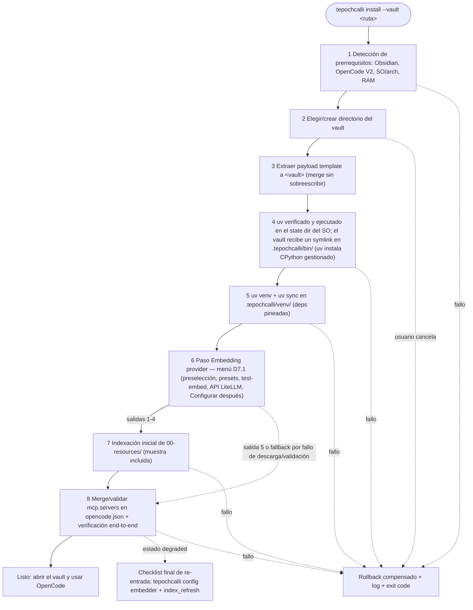
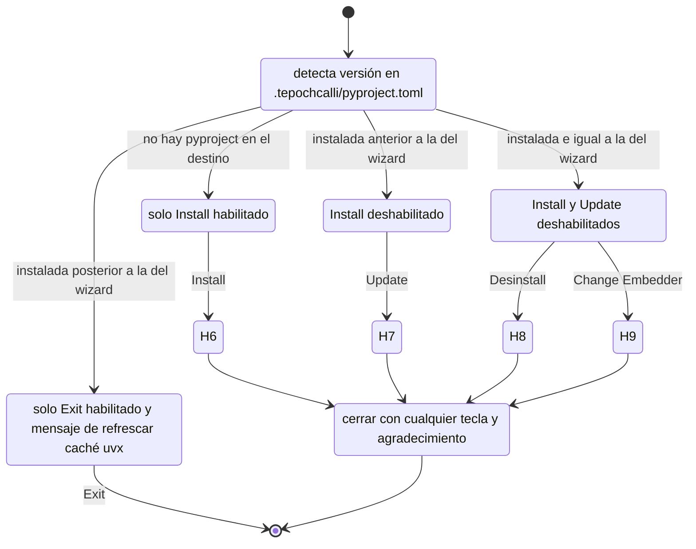

# Spec: Wizard de instalación (TUI Rust atomico y versionado)

* **Status:** Approved (FTR Phase 3→4, 2026-10-28 — ver `docs/WORKFLOW.md` §4; deuda nueva M6/D-b/F-T20 en `docs/TECH_DEBT.md`) · **Enmienda 2026-11-13** (estado de soporte de Windows en v1, §Enmienda D-b; canal de instalación `cargo binstall` primero, §Enmienda canal) · **Enmienda 2026-11-18 — flujo destino (Accepted 2026-11-19)** (§Enmienda 2026-11-18) · **Enmienda 2026-11-25 — TUI responsive y propiedad de pantalla** (§Enmienda 2026-11-25)
* **Date:** 2026-10-21
* **Author:** Arquitecto (entrevista /spec)
* **Reviewers:** Product Owner (usuario)
* **Traceability:** docs/BACKLOG.md (sección "Wizard de instalación" + deuda cognitiva 1-5), ADR-013 (canal de instalación), ADR-003 (cargo-dist como backend de release), ADR-004 (uv/venv), ADR-007 (paso "Embedding provider" D7.1 + re-entrada D7.4), ADR-008 (transparencia de hardware D8.1-D8.3 + swap atómico D8.4), specs/spec-vault-structure.md (payload), specs/spec-embeddings.md (menú y edge cases), docs/APPFLOW.md (journey d)

## Summary

`tepochcalli` es una TUI en Rust, distribuida vía cargo-dist + GitHub Releases (ADR-003) y con
`cargo binstall tepochcalli` como canal recomendado de instalación (ADR-013), que materializa un vault de Obsidian listo-para-usar: instala el payload del workspace (espejo del modelo `template/` de Fisherk2/codice-opencode, aquí `obsidian-workspace/`), bootea `uv`, crea el venv del proyecto, presenta el paso **"Embedding provider"** (menú de cinco salidas de ADR-007/D7.1 con `paraphrase-multilingual-MiniLM-L12-v2` pre-seleccionado), ejecuta la indexación inicial de `00-resources/` y valida/fusiona las entradas `mcp.servers` de `opencode.json`. Cada corrida es atómica con rollback en fallo; la salida 5 del menú ("Configurar después") degrada RAG honestamente sin abortar la instalación.

## Problem / Motivation

Preguntas abiertas de BACKLOG.md: ¿qué gestor de paquetes?, ¿debo registrarme en algún sitio?, ¿puede el usuario final evitar instalar dependencias nativamente? La respuesta de arquitectura: el usuario no instala Python ni Node ni bun; el wizard —un binario único descargado con un oneliner— hace todo dentro de `.tepochcalli/`.

> Como investigador sin perfil DevOps, quiero ejecutar un solo comando, responder unas pocas preguntas en una TUI y tener el vault con RAG funcionando.

## Goals and Non-Goals

### Goals

* Canal de instalación: **`uvx tepochcalli`** (ADR-014, §Enmienda 2026-11-18); `cargo binstall`
  y los scripts `install.sh`/`install.ps1` quedan como canal heredado.
* Flujo atómico de 8 fases con rollback por compensación (ver Detailed Design).
* Idempotencia: re-ejecutar = reparación/no-op, nunca duplicados.
* Flags `--offline` (usa cachés locales, sin red — válido solo con `models/` o config API presente) y `--skip-model` (equivale a la salida 5 del menú embedder: instalar sin provider).
* UX de fallo accionable: qué fase, por qué, qué hacer, dónde está el log.

### Non-Goals

* Actualizaciones automáticas del vault del usuario (se re-ejecuta el wizard; upgrade asistido = futuro).
* Gestionar la instalación de Obsidian ni de OpenCode (solo detectar; el wizard abre instrucciones si faltan).
* Editor de la config RAG (eso es `tepochcalli.toml`, spec-embeddings).
* Gestionar el binario del host: lo gestiona `uvx` (§Enmienda 2026-11-18); `uninstall` no lo borra.

## Proposed Solution

Crate Rust `tepochcalli` (workspace con el payload `template/` embebido en release como tarball adjunto). Modelo de instalación espejo de codice-opencode: el directorio `obsidian-workspace/` del repo ES el `template/`: se extrae a la ruta del vault elegido por el usuario (fusionando, nunca sobreescribiendo archivos del usuario), y luego las fases runtime preparan `.tepochcalli/`.

## Detailed Design

### Fases (atómicas, con compensación)



Nota D7: el paso "Embedding provider" (fase 6) va **entre** el venv sync (fase 5) y la indexación
inicial (fase 7) para las salidas 1-4 del menú; la salida 5 ("Configurar después") **omite la
fase 7** y termina con el checklist degraded. Un fallo de descarga o validación del modelo en la
fase 6 **no aborta la instalación**: hace fallback a la salida 5 (ver §Fases, fila 6).

| # | Fase | Compensación en fallo |
| --- | --- | --- |
| 1 | Detectar prereqs (Obsidian en rutas estándar por SO; `opencode` en PATH; memoria/disco) | sin cambios; guía de qué instalar |
| 2 | Seleccionar destino del vault (ruta nueva o vault existente) | sin cambios |
| 3 | Copiar payload (carpetas numeradas, `.opencode/` con agents/commands/skills, `AGENTS.md` del vault, `opencode.json` base, `00-resources/` con muestras md+PDF) | borrar lo copiado en esta corrida (marca `.tepochcalli/.install-intent`) |
| 4 | Descargar y verificar (SHA-256) el binario `uv`; chmod y ejecución desde `state_dir()` del SO (fuera del vault); `.tepochcalli/bin/uv` = symlink en Unix; uv asegura CPython gestionado (el usuario NO necesita Python) | eliminar `bin/` del vault y del state root y `.uv-stage` — nunca el state root (logs) |
| 5 | `uv venv .tepochcalli/venv` + `uv sync` desde `pyproject.toml` (`cocoindex[lancedb,sentence-transformers,litellm]`, `markitdown[docx,pptx,xlsx,xls,pdf]` — ADR-011) | `rm -rf venv/` |
| 6 | Paso **"Embedding provider"** (menú D7.1/ADR-007) con filas de transparencia de hardware (D8.1) y badges de detección del host (D8.2): salida 1 `paraphrase-multilingual-MiniLM-L12-v2` preseleccionado (~470MB a `models/`), salida 2 presets `BAAI/bge-m3` / `all-MiniLM-L6-v2` de `presets.toml` con peso estimado y detección de GPU (advertencia, no bloqueo), salida 3 ID libre de HuggingFace tras el gate **test-embed** (`HF_TOKEN` opcional para gated), salida 4 API LiteLLM con clave en `config/tepochcalli.toml` (gitignored), salida 5 "Configurar después" | un fallo de descarga/validación **no aborta**: `rm -rf models/` parcial + fallback a salida 5 (instalación completa en estado `degraded`) |
| 7 | Correr flow: index inicial de `00-resources/` (incluye parse Docling de PDF de muestra; **omitida en salida 5**) | `rm -rf db/ flow state` |
| 8 | Fusionar entradas MCP en `opencode.json` (ver abajo) y smoke-test `search` sobre la muestra | revertir `opencode.json` desde backup `.bak` |

* La fase 1 no puede "deshacerse"; las fases 3-8 crean solo artefactos propios → la compensación es puramente de archivos bajo rutas del runtime/payload de esta corrida. Nunca se tocan `.obsidian/` ni archivos previos del usuario (la merge del payload omite existentes salvo plantillas gestionadas).
* Si la fase 8 detecta una entrada `tepochcalli-rag` previa, la valida (comando apunta al venv actual) y solo la reescribe si difiere, conservando las demás servers del usuario **y las claves de `environment` que no gestiona**: solo impone `TEPOCHCALLI_ROOT`, así que `INDEXER_DIR` y `TEPOCHCALLI_TOP_K` (declaradas en el payload) sobreviven a reinstalar.
* **Contenido inicial de `00-resources/` (D22):** la fase 3 crea `00-resources/` con el case exacto que indexa el flow y deja 2 placeholders — 1 `.md` y 1 `.pdf` válido y parseable por markitdown — para que la fase 7 siempre tenga qué indexar.
* **Materialización del modelo (T6/D59, ADR-011):** F6 no descarga desde Rust (D25). Invoca el CLI del flow `python -m tepochcalli_flow embed-check --model <id> --revision <sha>`: ese comando descarga con la revisión pineada (de `presets.toml`, o el `sha` que devuelve la API de HF para un id libre) y materializa el directorio estable `<models>/<slug>@<sha>/` (`slug` = id con `/`→`__`). Tras el gate, el wizard **verifica** que el directorio existe y no está vacío **antes** de escribir `[embedding]` (`provider`, `model`, `revision`, `device`); si no, F6 falla y compensa a la salida 5. `rag_status.embedder.model` sigue reportando el **id**. Sin SHA conocido (API caída) la verificación acepta cualquier `<slug>@*` no vacío — `shortcut:` con falso positivo posible si coexiste un snapshot viejo del mismo modelo.
* **Semántica de rollback del provider (D7.1):** si la descarga o el gate test-embed de la fase 6 fallan tras el reintento, el wizard **cae a la salida 5 en vez de abortar**: el vault se instala COMPLETO (todas las demás fases del wizard corren), la indexación inicial se omite, RAG queda en estado `degraded`, y el wizard muestra el checklist final de re-entrada sin escribir half-config.

### Transparencia de hardware y detección de host en el paso embedder (D8.1-D8.3/ADR-008)

#### D8.1 — Filas de requisitos visibles ANTES de seleccionar (NFR cero-sorpresas)

Cada fila del menú "Embedding provider" —presets y IDs libres de HuggingFace por igual— muestra
pre-elección: `💾 disk (MB) · 🧠 RAM requirement · 🎮 GPU status`. Cada número lleva su
procedencia (`medido`/`estimado`/`declarado`) — nunca presentar una estimación como promesa.
Las tres fuentes y la extracción de metadatos (API de HF, fórmula `params × 4 bytes × 1.3
overhead factor`) se especifican en specs/spec-embeddings.md §Tres fuentes de verdad de los
requisitos; el RSS pico se muestrea en el gate test-embed para TODO camino local (salidas 1-3),
no solo para IDs custom.

#### D8.2 — Secuencia de detección del host (al entrar en el paso)

1. **Sondeo base:** RAM total + disco libre vía crate `sysinfo`.
2. **Sondeo GPU (opcional):** probe de `nvidia-smi`/`rocm-smi` en PATH; ausencia silenciosa = no hay GPU, **no es un error**.
3. **Cómputo de badge por opción**, ratio = `rec_ram_gb` / RAM disponible:

| Badge | Criterio (testeable) |
| --- | --- |
| `recommended` | la opción cabe con ≥50% de margen (ratio ≤ 2/3 de la RAM disponible) |
| `viable` | cabe, con margen bajo |
| `no recomendado` | el requerimiento estimado excede la RAM disponible, **o** `gpu_recommended` && sin GPU detectada |

   Ejemplo (host de 4 GB de RAM, fila canónica para tests): MiniLM badge `recommended` (≈0.5 GB disk, ~0.9 GB est. RAM); `BAAI/bge-m3` badge `no recomendado` (≈2.3 GB disk, ~2.9 GB est. RAM).

1. **Fallback:** si el sondeo falla (`/proc` ilegible, plataforma exótica) → usar valores declarados de `presets.toml`, **sin badge de veredicto**, y la instalación continúa normal — nunca un crash.

#### D8.3 — Advertir, nunca bloquear (locked)

El badge `no recomendado` es advertencia; la selección sigue siendo posible (cuantización,
"sé lo que hago", la máquina más grande de mañana). No se re-regula: aplica la fila existente
de la matriz de edge cases de specs/spec-embeddings.md ("GPU insuficiente para `BAAI/bge-m3` →
advertencia, no bloqueo").

### Swap de modelo atómico sin reinstalar (D8.4/ADR-008)

Secuencia de estados de `tepochcalli config embedder` cuando el vault ya tiene un embedder
activo (respuesta user-facing a "cambié de opinión / elegí mal"):

1. **Mostrar estado actual:** model, dims, filas del índice, tamaño de db (lectura local con forma `rag_status`).
2. **Elegir nuevo embedder:** el mismo menú D7.1 con transparencia D8.1 y badges D8.2.
3. **Advertencia explícita de re-index:** re-index completo requerido (LanceDB no puede mezclar dimensiones — consecuencia ADR-006 §6); tiempo estimado desde el tamaño del índice actual; requiere `--confirm` (evoca el contrato D7.4: `tepochcalli reindex --confirm`).
4. **Descarga + gate test-embed** del modelo nuevo (RSS medido registrado) **→ re-index** con el nuevo embedder. **Invariante: el índice viejo permanece intacto y servable durante todo el proceso** — el target gestionado de CocoIndex construye filas nuevas; la tabla vieja **no se elimina hasta el éxito**.
5. **Éxito → conmutación atómica** de `config.model` + metadatos; **entonces** (y solo entonces) se borra el cache del modelo viejo de `models/` (auto-GC). El flag `--keep-previous` desactiva el borrado.
6. **Fallo en cualquier paso → rollback:** config, índice viejo y modelo viejo quedan intactos (cambio de estado cero); el vault nunca queda en half-state. Durante todo el flujo, `search` solo degrada para la indexación de archivos nuevos, **nunca para lecturas del índice existente**.

### Merge/validación del bloque MCP (fase 8, resultado esperado)

```jsonc
{ "mcp": { "servers": {
    "tepochcalli-rag": {
      "type": "local",
      "command": [".tepochcalli/venv/bin/python", "-m", "tepochcalli_mcp"],
      "cwd": ".",
      "environment": { "TEPOCHCALLI_ROOT": "." },
      "disabled": false
    }
} } }
```

La única entrada gestionada es `tepochcalli-rag` (D19): la fase 8 **no registra `mcp.servers.markitdown`** — la conversión a Markdown es **en proceso** vía `add_source` (librería `markitdown`, no server standalone), retirada del payload en `ee26073` y reforzada por `tests/unit/test_opencode_payload_registration.py` (`MANAGED_KEYS`). Si el vault del usuario trae una entrada `markitdown` previa, la fase 8 la elimina.

El comando del MCP se **genera por SO** (D20): `.tepochcalli/venv/bin/python` en POSIX y `.tepochcalli/venv/Scripts/python.exe` en Windows, con `-m tepochcalli_mcp` en ambos casos (D17: forma `python -m`, nunca console script).

(Snippet canónico y justificación del venv en vez de `uvx`: spec-markitdown §config.)

### TUI (D23)

El wizard usa una TUI line-based con `dialoguer` (`Select` con default preseleccionado, `Input` para texto, `Confirm` para confirmaciones) — no `ratatui` full-screen. La TUI **nunca** se usa sin TTY: el modo `--non-interactive` es obligatorio en CI y falla con error tipado si le falta una respuesta.

### Flags

* `--offline`: omite fases que requieren red (descarga payload/modelo/wheels): requiere caché previa (`models/`, cache uv). Regla D7.3: `--offline` solo es válido si existe `models/` cacheado **o** una config de API externa presente; si falta lo necesario, fallo limpio con `E_OFFLINE_NO_CACHE` nombrando qué se necesita descargar.
* `--skip-model`: equivale no-interactivamente a la salida 5 del menú embedder ("Configurar después"): el vault se instala COMPLETO (todas las demás fases del wizard corren), la indexación inicial se omite, RAG queda en estado `degraded`, y el wizard muestra el checklist final de re-entrada sin escribir half-config. `search` responderá `E_NO_EMBEDDER` hasta completar la re-entrada.
* (v2 sugerido) `--vault <ruta>`, `--non-interactive` para CI.

### Re-entrada y superficie CLI post-instalación (D7.4/ADR-007)

* `tepochcalli config embedder` — reabre el menú "Embedding provider" (D7.1) sobre un vault ya instalado; escribe `[embedding]` en `config/tepochcalli.toml`, corre el gate test-embed para IDs libres, y si hay un embedder activo ejecuta el flujo completo de swap atómico D8.4 (§Swap de modelo atómico; flags `--confirm`, `--keep-previous`).
* `tepochcalli reindex --confirm` — swap de modelo = re-index completo **destructivo** (vacía y regenera `chunks` en `.tepochcalli/db/`); requiere confirmación explícita; procedimiento alineado con specs/spec-embeddings.md §Procedimiento de swap de modelo.
* `tepochcalli install [--resume]` — corrida atómica de 8 fases (arriba); `--resume` reusa artefactos válidos.
* `tepochcalli uninstall --vault <ruta>` — ver §Rollback / Monitoring.
* (P2, nice-to-have D8.4) `tepochcalli models list` / `tepochcalli models prune` — higiene de la cache `models/` tras swaps: inventario con procedencia (medido/declarado) y limpieza de modelos huérfanos.
* Checklist de re-entrada (salida 5): `tepochcalli config embedder` → provider + descarga/API → `index_refresh()` (o re-ejecutar `install --resume`) → smoke-test `search`. El wizard lo imprime al terminar la instalación degraded.

### Versionado y release (D5/ADR-003; canal superado por ADR-014)

* One-version rule: el binario y el payload comparten semver; el wizard instala siempre
  `tepochcalli-workspace-<ver>.tar.gz` de su misma versión (tag `tepochcalli-v<ver>`).
* El detalle del canal heredado (cargo-dist/binstall, metadatos y orden de publicación) vive en
  la §Enmienda canal 2026-11-13 y en §Enmienda 2026-11-18; ADR-003/013/014 son la fuente.

### UX de fallo

* Panel final rojo con: fase fallida, causa resumida, comando de reintento (`tepochcalli install --resume`, reusa artefactos válidos), ruta del log (`$XDG_STATE_HOME/tepochcalli/install-<ts>.log` o `%LOCALAPPDATA%` equivalente — el log NO vive en el vault, para no ensuciar git/status).
* Códigos de salida: 0 ok; 10-19 prereqs; 20-29 red; 30-39 disco/permisos; 40+ fallo interno del motor.

## Alternatives Considered

* **bunx/npm (modelo actual de codice-opencode):** rechazado en D5 — añade runtime Node/bun al host del investigador.
* **Script bash + pip al host:** sin aislamiento, sin rollback, contamina site-packages.
* **Instalador gráfico (electron) o app store:** coste de mantenimiento sin beneficio para el perfil CLI/TUI.
* **crates.io + cargo install:** exige toolchain Rust al usuario (ADR-003).

## Trade-offs

* ✅ **Pros:** un comando; cero prereqs Python; atómico/resumible; el vault resultante es portable y auditable.
* ⚠️ **Cons / Risks:** primer arranque requiere internet (wheels + modelo — límite declarado); binario multi-plataforma implica CI que mantener; payloads grandes suben el tamaño de release.
* ⚖️ **Neutral:** aparece un sub-proyecto Rust en el repo (crates + dist) con su propio CI.

## Testing Strategy

* Matrix: VM limpia por plataforma (Ubuntu latest, macOS arm64, Windows) — acceptance: "clean VM → installed vault with one command incl. deps" (Phase 3 exit, docs/WORKFLOW.md). **Windows: soportado con verificación pendiente** — objetivo nunca ejecutado, ver §Enmienda D-b.
* Idempotencia: `install` dos veces → mismo estado, cero duplicados en `opencode.json` ni en `00-resources/` (SPEC.md §Testing).
* Fallo inducido y `--offline` con/sin cachés → rollback, `.bak` intacto y `E_OFFLINE_NO_CACHE`
  (detalle en §Enmienda 2026-11-20).
* Salida 5 del menú embedder (y `--skip-model`): assert de instalación COMPLETA sin fase 7 + checklist degraded impreso + `search` → `E_NO_EMBEDDER` + `rag_status` → `degraded` con `fix_hint` (ADR-007 §8).
* Gate test-embed: fixture con ID HF no-embedding → rechazo en fase 6, sin half-config escrita, fallback a salida 5 (no abort).
* D8.1/D8.2: host fixture de 4 GB → fila `BAAI/bge-m3` con badge `no recomendado` pero SELECCIONABLE; fila MiniLM `recommended`; todo número muestra etiqueta `medido`/`estimado`/`declarado`.
* D8.4 swap atómico: durante el re-index una `search` resuelve contra el índice viejo (servable); tras éxito el modelo viejo no está en `models/` (sí con `--keep-previous`); descarga interrumpida a mitad del swap → cambio de estado cero (config/índice/modelo viejos byte-a-byte intactos).

## Security Considerations

* Verificación SHA-256 de assets de release; canal recomendado `cargo binstall` (checksum del
  crate en crates.io + del asset, sin ejecutar código de instalador) y `curl | sh` como fallback
  con el caveat de inspección (docs/SECURITY.md).
* El modelo se descarga de HuggingFace; uv baja wheels de PyPI — ambas provenancias declaradas en SECURITY.
* El wizard solo escribe la clave API de la salida 4 (LiteLLM) en `.tepochcalli/config/tepochcalli.toml` (gitignored) — nunca en logs, `opencode.json` ni fuera del vault; `HF_TOKEN` vive solo en el entorno del proceso de descarga (specs/spec-embeddings.md §HF_TOKEN).

## Rollback / Monitoring

* Desinstalación: `tepochcalli uninstall --vault <ruta>` elimina `.tepochcalli/` y deja notas sobre qué hizo en el vault (payload de usuario no se borra; borrar vault es decisión del usuario).
* Telemetría: ninguna por default (producto local); logs locales para soporte.

## Open Questions

Ninguna pendiente. Resuelta (D21): `--resume` **deduce por artefactos presentes + marker `.tepochcalli/.install-state`** — no guarda el estado de fase en `bin/.install-state`; reusa artefactos válidos y reanuda desde la primera fase incompleta.

## Enmienda 2026-11-13 — estado de soporte de Windows en v1 (D-b)

**Decisión firmada (2026-11-13, evidencia `declarado`):** **Windows está soportado con
verificación pendiente.**

Esta spec describe un wizard que **declara** un target de Windows (`x86_64-pc-windows-msvc`) en
`dist.toml` y en el job de `release.yml`, un `install.ps1`, el layout de venv
`venv/Scripts/python.exe` (D20) y ramas `cfg!(windows)`. Eso es **código declarado**: **nada de
ese camino se ejecutó nunca en Windows** — ni el instalador, ni el smoke path-5, ni la matriz CI
(la matriz era ubuntu+macos y `release.yml` nunca corrió — M6 en `docs/TECH_DEBT.md`). Los
artefactos y su estado uno a uno: `docs/TECH_DEBT.md` §D-b; la decisión propagada: `docs/TRD.md`
§2 y `docs/APPFLOW.md` §5.

* **Consecuencia para el usuario:** puede instalar en Windows por ese camino, pero nadie ha
  verificado que funcione; si falla, **no hay soporte comprometido**. El wizard **no** rechaza
  Windows (`SUPPORTED_OS` lo incluye): la coletilla es de soporte, no un gate de runtime.
* **Qué quita la coletilla (paso a `medido`):** un smoke path-5 (`--non-interactive
  --skip-model`) ejecutado en un runner `windows-latest` **sobre una release real**, con
  `install.ps1` invocado y el layout `venv/Scripts/python.exe` + `mcp.servers` verificados en el
  vault instalado, la evidencia archivada y Windows añadido como fila de la matriz CI.

## Enmienda canal 2026-11-13 — `cargo binstall` como canal recomendado (ADR-013)

**Decisión del dueño (2026-11-13):** el canal recomendado de instalación del wizard pasa a ser
**`cargo binstall tepochcalli`**, con `shell`/`powershell` conservados como **fallback sin
toolchain**. Reemplaza el **canal** de ADR-003; cargo-dist sigue siendo el backend de release
(`dist.toml`, 5 targets, check-sums, `install.sh`/`install.ps1`). Evidencia: `declarado` —
`cargo binstall` **nunca se ha ejecutado contra un release de este repo** (M6 abierto).

* **Dos pasos, no uno:** `cargo binstall tepochcalli` instala el binario y termina;
  `tepochcalli install --vault <ruta>` configura el vault. **Binstall no reenvía flags al
  binario** (`--vault`, `--offline`, `--skip-model` van en el segundo comando) — a diferencia
  de `bunx`, que sí los acepta.
* **Requisito del host:** `cargo` + `cargo-binstall`
  (`cargo install cargo-binstall --locked`); si binstall cae a `cargo install`, hace falta
  linker/compilador.
* **Cobertura:** solo los 5 targets de `dist.toml` tienen asset; musl/ARMv7/Windows-ARM caen a
  compilar.
* **Metadatos obligatorios:** `[package.metadata.binstall]` con `pkg-url` explícito por el
  namespace `tepochcalli-v<ver>` (fixture de otro calpulli en `Cargo.toml`).
* **Orden de release:** tag → release con assets → `cargo publish`.
* **Desinstalación:** `tepochcalli uninstall` **no** retira el binario (solo `.tepochcalli/`);
  se retira con `cargo uninstall tepochcalli`.
* **npm/homebrew/msi** quedan fuera de v1: cargo-dist los soporta y activarlos exige su token,
  no un ADR nuevo.

## Enmienda 2026-11-18 — flujo destino (Accepted 2026-11-19)

**Status: Accepted 2026-11-19** — aprobada por el FTR del dueño el 2026-11-19 y es el **contrato
que gobierna la Phase 6.5** (docs/WORKFLOW.md §Phase 6.5). Describe el estado **destino** del
wizard según docs/BACKLOG.md §"Wizard de instalación: flujo destino (2026-11-18)" (H5–H11 + anexo
Codice). Lo implementado hasta la fecha sigue siendo el **código vigente** descrito en las
secciones Accepted de arriba; la fase materializa el destino. **Supera** D23 (TUI), §Versionado,
el canal de la §Enmienda canal 2026-11-13 y el alcance de uninstall de §Rollback. Depende de
**ADR-014** (canal/versión, *Accepted* 2026-11-19) y **ADR-015** (embedder, *Accepted*
2026-11-19; ver specs/spec-embeddings.md §Enmienda 2026-11-18).

### Canal `uvx` (ref ADR-014)

* El instalador se publica en **PyPI** como paquete que empaqueta el binario Rust (patrón
  maturin `bindings = "bin"`). Un solo paso: `uvx tepochcalli` abre el wizard directo — sin
  binario del proyecto en PATH y sin descargas en runtime; el wheel queda en la **caché de uv**
  hasta su limpieza. Esto reemplaza conceptualmente el "dos pasos" (binstall + `tepochcalli
  install`) de Goals/§Enmienda canal y el §Versionado: la versión del binario la gestiona esa
  caché, no el host.
* `cargo binstall` / assets cargo-dist (ADR-013/003) quedan como canal heredado/fallback; la
  superación formal del canal y del backend la fija ADR-014.
* Comando de refresco a mostrar en el TUI: `uvx --refresh tepochcalli` (alternativa `uvx
  tepochcalli@latest`). Inspiración: Codice (`bunx @fisherk2-dev/codice`, `bunx --fresh`).
* Flags: `--offline`, `--skip-model`, `--vault`, `--non-interactive` conservan su semántica y
  viajan en el mismo comando `uvx tepochcalli …` (a diferencia de binstall, que no reenvía).

### Versionado (destino)

* Versión **instalada**: se lee de `.tepochcalli/pyproject.toml` (fuente canónica del destino,
  ref ADR-014).
* Versión **del wizard**: la del paquete PyPI/release publicado (la que gestiona `uvx`).
* Comparación entre ambas: semver mediante un comparador como service de `domain/`
  (anexo Codice abajo).
* Drift resuelto el 2026-11-19 (TD-45): `crates/tepochcalli/Cargo.toml` estaba en
  `0.1.0-beta.1` frente a `obsidian-workspace/.tepochcalli/pyproject.toml` = `0.1.0`; alineado
  a `0.1.0` antes de implementar.

### TUI full-screen y menú H5 (supera D23 `dialoguer`)

Botones **reales** con estado deshabilitado y razón visible (librería: **`ratatui` + `crossterm`**,
fijadas por aprobación del dueño el 2026-11-19). El H5 muestra la versión que gestiona el
wizard, detecta cómo está instalado el embedder (API key externa o modelo local en
`.tepochcalli/models/`) y ofrece cinco botones: 🟢 Update · 🟣 Change Embedder · 🔴 Desinstall ·
🔵 Install · 🟠 Exit.

| Estado (instalada vs wizard) | Habilitados | Deshabilitados (con razón visible) |
| --- | --- | --- |
| No instalado | 🔵 Install | 🟢, 🟣, 🔴 — "no hay instalación aún"; mensaje: directorio listo para instalar |
| instalada == wizard | 🟣, 🔴, 🟠 | 🔵 Install y 🟢 Update — "versión al día" |
| instalada < wizard | 🟢, 🟣, 🔴, 🟠 | 🔵 Install — "ya existe instalación" |
| instalada > wizard | solo 🟠 Exit | todo lo demás — mensaje "refresca la caché de uvx" con el comando exacto a copiar: `uvx --refresh tepochcalli` |

El TUI muestra además el link del repositorio <https://github.com/Fisherk2/tepochcalli-opencode>
y el correo `dev@fisherk2.com` para reportar bugs/issues.



### Casos de uso destino (H6–H11)

* **H6 🔵 Install.** Tras confirmar el directorio destino, pasa por la fase de embedder según
  H9 (spec-embeddings.md §Enmienda 2026-11-18, ref ADR-015) con extracción de requisitos,
  detección de hardware y advertencia previas. Si se elige API key, la clave corresponde al
  endpoint **PREESTABLECIDO** del proveedor que LiteLLM deriva del prefijo de `model` — el TOML
  no tiene campo de endpoint. Mensaje de confirmación de qué y dónde se instala (incluido el
  runtime `.tepochcalli/` con el motor `cocoindex` y el convertidor `markitdown`) y barra de
  progreso de descarga e instalación.
* **H7 🟢 Update (use-case NUEVO, hoy inexistente).** Sobrescribe `.opencode/`,
  `.tepochcalli/`, `.gitignore`, `opencode.json` y `AGENTS.md`. **Supera F3** ("merge sin
  sobreescribir") en el camino Update: **backup obligatorio** de los ficheros
  existentes antes de pisarlos + advertencia visible (regla fijada en docs/CODE_STYLE.md
  §Reglas específicas del payload, enmendada 2026-11-18). Muestra el directorio objetivo y
  barra de progreso.
* **H8 🔴 Desinstall.** Remueve `.opencode/`, `.tepochcalli/` y `opencode.json` — nada más.
  **Amplía el alcance del uninstall actual** (§Rollback: hoy solo `.tepochcalli/`). El binario no
  se desinstala del host: el wheel vive en la caché de uv y se retira limpiando dicha caché.
  Advertencia:
  * directorio objetivo + backup y barra de progreso.
* **H9 🟣 Change Embedder:** remite a specs/spec-embeddings.md §Enmienda 2026-11-18 (device,
  presets, badges, gate test-embed — ref ADR-015). El menú D7.1, la transparencia D8.1-D8.3 y
  el swap D8.4 siguen vigentes presentados en la TUI full-screen.
* **H10 🟠 Exit.** Sin cambios: salir sin materializar ni modificar nada.
* **H11 Cierre.** Tras cualquier opción salvo Exit, el instalador se cierra previa
  confirmación pulsando cualquier tecla, con mensaje de agradecimiento a Tepochcalli.

### Anexo — mapeo de módulos Codice → Rust (requisito de organización, no spec nueva)

Derivado de <https://github.com/Fisherk2/codice-opencode/tree/main/src> (docs/BACKLOG.md §Anexo).
`crates/tepochcalli/src/` ya tiene forma análoga (`cli/`, `application/`, `adapters/`,
`config/`, `domain/`); no es un renome sino el destino de cada responsabilidad del flujo nuevo.

| Responsabilidad | Referencia en Codice | Destino en Rust |
| --- | --- | --- |
| Detección de la versión instalada desde `.tepochcalli/pyproject.toml` | `versionContext.ts` | contexto de `cli/` |
| Comparador semver | `VersionComparator.ts` | service de `domain/` |
| Use-case `update` (H7, hoy inexistente) | use-case de `application/` | `application/` |
| TUI full-screen con estados de botón | `ClackPromptsAdapter.ts` | `adapters/` |
| Cliente de release/última versión | `GitHubRestClient.ts` | `adapters/` |
| **Diferencia propia:** gestión del modelo de embeddings (selección, instalación y swap, con resumen y barra de progreso) — sin equivalente en Codice | — | `application/` + `adapters/`, sin forzar el mapeo |

## Enmienda 2026-11-20 — resiliencia offline y rollback cancelable (H6/H7/H9, ADR-016)

**Status: Accepted 2026-11-20** — orden directa de Fisherk2 («orden de Fisherk2, 2026-11-20»),
registrada en docs/BACKLOG.md §2 (US-H6/H7/H9) y §4 / D-009. Decisión de fondo:
[ADR-016](../docs/adr/adr-016-resiliencia-offline-y-rollback.md). **Refina**, sin re-escribir:
la §Enmienda 2026-11-18, la fila 6 de §Fases, la §Semántica de rollback del provider (D7.1),
la §UX de fallo y el backup de H7/H8. Canal `uvx`, TUI full-screen y `device` electivo intactos.

### Contrato verificable

| Req | Regla |
| --- | --- |
| **R-offline-1** | Antes de escribir cualquier fichero, el wizard comprueba la conectividad mínima que la operación necesita. Si no hay red, cancela con rollback y deja el workspace del usuario exactamente como estaba; error tipado con razón y acción correctiva. **No hay modo degradado ni instalación parcial en tiempo de instalación.** |
| **R-offline-2** | Durante la descarga del modelo (H6/H9; y H7 si la operación descarga algo), el usuario puede cancelar en cualquier momento desde el TUI y con **Ctrl+C**: se detiene la descarga, se eliminan los parciales y se compensa todo cambio ya aplicado. No queda modelo a medias en `.tepochcalli/models/`. |
| **R-offline-3** | El rollback restaura los ficheros gestionados mediante el **backup + journal ya existentes de H7/H8**; notas, PDFs, `.obsidian/` y configuración propia del usuario nunca se tocan; tras el rollback se verifica que no quedan restos. |
| **R-offline-4** | El modo `degraded` de **runtime** (ADR-007 / `rag_status`) NO cambia: en instalación/cambio de embedder, **sin red = cancelación, no degradación**. «`sin dato` si la API no responde» (US-H9) aplica **solo a la estimación previa**, nunca a la descarga real. |

### Fases atómicas y compensación

* **Fase 0 (nueva) — preflight de red**, antes de la fase 1 y de cualquier escrito: reachability
  mínima según la operación (registro de paquetes / HuggingFace / proveedor LiteLLM). Sin red ⇒
  cancelación tipada en la banda 20-29, antes de crear `.tepochcalli/`, antes del backup de H7 y
  antes de escribir `opencode.json`. `--offline` (D7.3) conserva su semántica: con caché válida
  no hay preflight; sin ella, `E_OFFLINE_NO_CACHE` como hoy.
* **Fase 6 — descarga del modelo:** el botón **Cancel** y `Ctrl+C` comparten un manejador de
  cancelación cooperativa propagado al gate (§Materialización del modelo). Se detiene el stream,
  se descarta el fichero en escritura y se compensan las fases ejecutadas en **orden inverso**
  usando el journal de H7/H8. Resultado: cancelación de la **instalación completa**.
* **Precedencia sobre el texto previo:** la fila 6 de §Fases y la §Semántica de rollback del
  provider (D7.1) siguen vigentes para `E_MODEL_INVALID` (modelo no válido en `test-embed`) y para
  la salida 5 elegida **explícitamente** o `--skip-model`. **Cuando la causa es ausencia de red en
  H6/H7/H9, el fallback automático a salida 5 se sustituye por cancelación con rollback**: nunca
  se instala `degraded` por falta de red.

### UX de fallo ante sin red y cancelación

* Error tipado con fase, razón y acción correctiva (reconectar o usar `--offline` con caché) en la
  banda 20-29 de red; `E_CANCELLED` para cancelación del usuario; coherente con §UX de fallo y
  sin texto libre como error.
* La barra de progreso de H6/H9 muestra el botón **Cancel** activo y el hint `Ctrl+C`; tras la
  cancelación informa del rollback ejecutado y de la verificación «sin restos».
* El log sigue fuera del vault (`$XDG_STATE_HOME/tepochcalli/install-<ts>.log`).

### Testing exigido a la implementación

* **Sin red:** fixture sin conectividad en H6, H7 y H9 → el preflight cancela antes del primer
  escrito; assert de workspace byte-a-byte idéntico, sin `.tepochcalli/` nuevo y error tipado.
* **Cancelación a mitad de descarga:** botón Cancel y `Ctrl+C` por separado → stream detenido,
  cero parcial en `.tepochcalli/models/`, compensaciones en orden inverso y sin marker de
  instalación; coherente con el test de descarga interrumpida del swap D8.4.
* **Integridad:** snapshot de notas, PDFs, `.obsidian/` y config propia antes/después →
  byte-idénticos; assert de verificación «sin restos» (ni parcial, ni `.install-intent`, ni
  entrada `tepochcalli-rag` nueva en `opencode.json`).
* **No regresión:** la salida 5 explícita y `--skip-model` siguen instalando completo con
  `rag_status` → `degraded`; `sin dato` sigue siendo solo la estimación de requisitos.
* Evidencia `declarado` hasta la implementación (ADR-016 §6); este lote no añade gates.

## Enmienda 2026-11-24 — instalación filesystem-agnóstica y vault por cwd (ADR-017)

**Status: Accepted 2026-11-24** — orden del dueño; decisión de fondo:
[ADR-017](../docs/adr/adr-017-instalacion-filesystem-agnostica.md). **Refina**, sin re-escribir,
la fila 4 de §Fases, el layout D2 de spec-vault-structure y la ubicación física de ADR-004
§3/§4/§7. ADR-003/004/014, el contrato MCP, el canal `uvx`, el `device` electivo y ADR-016 intactos.

* **F4 — ubicación física:** el `uv` pineado se descarga, se verifica con SHA-256, se chmoddea y
  se ejecuta desde `application::failure::state_dir()` (`$XDG_STATE_HOME/tepochcalli` o
  `$HOME/.local/state/tepochcalli`; en Windows `%LOCALAPPDATA%/tepochcalli`). El vault recibe solo
  un **symlink Unix** en `.tepochcalli/bin/uv` (Windows conserva la copia `.exe`). `Phase4Report.uv`,
  F5, `resume.rs` y la ruta runtime de `opencode.json` no cambian. `compensate_phase4` retira
  `bin/` del vault, `bin/` del state root y `.uv-stage`, nunca el state root (logs). Limitación
  declarada: sin `HOME`/XDG, `state_dir()` cae a `std::env::temp_dir()`, no garantizado exec-capable.
* **F2 / flags / H5-H6:** `resolve_vault_dir` no pregunta: sin `--vault` (o en blanco) ⇒
  `current_dir()` absoluto; `--vault <dir>` sigue ganando. Help: `vault directory (default:
  current directory)`. H5/H6 operan sobre ese destino sin prompt de ruta; la coletilla «v2
  sugerido» de §Flags queda superada.
* **Progreso:** F3/F4/F5/F7 muestran la barra indeterminada existente (`Ui::run_cancellable`) con
  el vault destino en el título; F6 y el mirror conservan sus prompts interactivos y las líneas de
  estado quedan fuera de la pantalla alternativa. Salvedad: el token de `run_cancellable` es solo
  visual en F3/F4/F5/F7 (sus APIs no lo aceptan): Esc/Ctrl+C cierra la pantalla pero no detiene los
  subprocesos; la cancelación efectiva sigue en F6 y update/uninstall/reindex, y ampliarla exige
  ensanchar esas APIs (diferido).
* **Evidencia:** `medido` en el mount fuseblk/NTFS-3G (exit 0, F4+F5 verdes, `venv/bin/python` →
  CPython 3.12.14). Citas: `application/prereqs.rs:97-107`,
  `application/installer.rs:184-193,387-402,444-456`, `cli/install_phases.rs:150,244,266,316`.

## Enmienda 2026-11-25 — TUI responsive y propiedad de pantalla

**Status: Accepted 2026-11-25** — UX reversible sin ADR nuevo (D1-D8 intactas), registrada en `docs/WORKFLOW.md` §Phase 6.9 y `docs/BACKLOG.md` §8. Supera la §TUI (D23), el orden de H6 y la barra indeterminada de la §Enmienda 2026-11-24; sin tag/Release/PyPI.

* **Un dueño del frame (C1):** el watcher de `adapters/ui_ratatui.rs` pinta y lee; selección, entrada y panel son estado del frame junto a `ACTIVE_PROGRESS` (`ports/ui.rs`). `Ui::select` conserva su firma, sin segundo `try_init()`; Esc/Ctrl+C cancela y compensa con el journal.
* **Tres zonas y ETA (C2):** ARRIBA banner/progreso/spinner y ETA en columna derecha (`Layout::horizontal`), CENTRO mensajes/opciones/confirmaciones/selección y ABAJO menú H5 y contacto; wrap/elipsis y cota mínima para Cancelar a 80×24, 40×12, 30×8 y 20×6.
* **Orden de Install (C3):** la selección de embedder es la primera interacción, dentro del frame y antes de F3 (`run_stages`); el gate test-embed sigue tras el venv (F5) y el título nombra `<vault>/.tepochcalli/models/` como destino (ADR-015 intacto).
* **Banner semántico (C4):** «listo para instalar» si `installed_version()` no halla `.tepochcalli/pyproject.toml`; si lo halla, la versión instalada, reutilizando `READY_NOTICE` sin tocar `installed_version`, `home_view`, `MenuView` ni `installed_state`.
* **Evidencia:** `int_ui_screen_ownership`, `int_ui_layout`, `int_embedder_menu`, `int_install_f4_f5` y `e2e_install_tty` (PTY con `script(1)`), `just ci` completo en verde y `just comment-density` ≈7,6 %.

## References

* Fisherk2/codice-opencode (modelo `template/` → instalación)
* cargo-dist — <https://opensource.axo.dev/cargo-dist/>
* uv — <https://docs.astral.sh/uv/>
* ADR-003 / ADR-004 / ADR-007 (paso embedder + re-entrada) / ADR-008 (transparencia hardware + swap atómico) / ADR-013 (canal `cargo binstall`); docs/APPFLOW.md journeys d, e y f
* cargo-binstall — <https://github.com/cargo-bins/cargo-binstall> · SUPPORT (`pkg-url`) — <https://github.com/cargo-bins/cargo-binstall/blob/main/SUPPORT.md>
