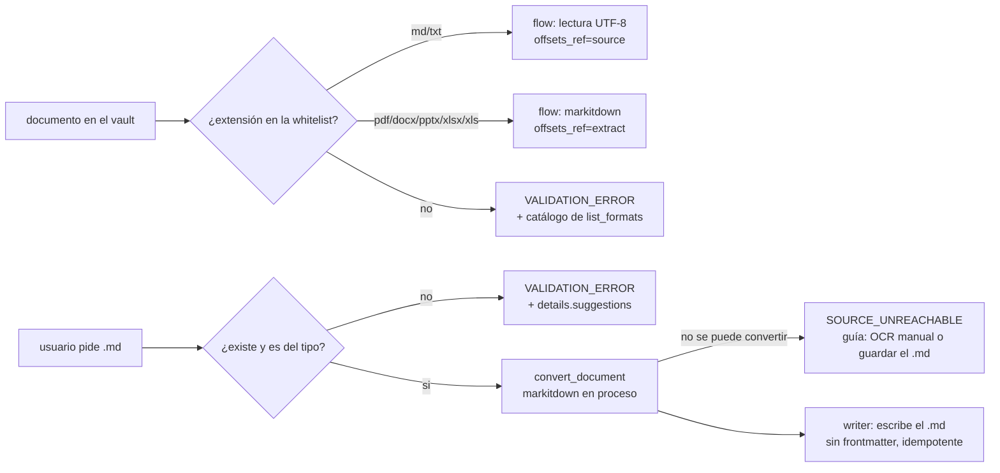

# Spec: Integración de MarkItDown (extractor del motor y conversor del wire)

* **Status:** Approved 2026-10-27 (FTR Phase 2→3, docs/WORKFLOW.md §4) · Amended 2026-11-02 (Phase 3.5; ADR-009/010/011 Accepted 2026-11-03)
* **Date:** 2026-10-21
* **Author:** Arquitecto (entrevista /spec)
* **Reviewers:** Product Owner (usuario)
* **Traceability:** docs/UH.md (H1-H2 anexo 2026-10-30; criterio 7) · specs/spec-mcp-server.md (7 tools) · specs/spec-rag-engine.md (whitelist y extracción) · docs/SECURITY.md · ADR-009 (conversor resumen-only) · ADR-010 (índice multi-raíz) · ADR-011 (dieta de dependencias)

## Summary

`markitdown==0.1.9` se usa de **dos** formas con propósitos distintos, en el mismo venv y en proceso:

1. **Extractor del motor** — `parsers.extract_text` (D48) indexa el documento **original**; no hay paso «convertir y luego indexar» (D49). `.md/.markdown/.txt` se leen en UTF-8 estricto (`offsets_ref="source"`); `.pdf/.docx/.pptx/.xlsx/.xls` se extraen con markitdown (`offsets_ref="extract"`, `heading` nulo en PDF, D54).
2. **Conversor de las 3 tools** — `convert_document`, `convert_base64` y `list_formats` (D28) producen el `.md` que el usuario pide y devuelven **solo un resumen**.

Una sola librería, dos consumidores. El server standalone `markitdown` está **retirado del payload** (D29): el conversor tiene un solo camino, dentro de `tepochcalli-rag`.

## Problem / Motivation

Criterio 7 de UH.md: «Pueda procesar distintos formatos de texto, si no, utilizar el convertidor Markdown». El parser nativo del flow cubre md/txt; la ofimática y el PDF entran por markitdown. El defecto que esta enmienda cierra (H1/H2, anexo 2026-10-30; diagnosis `fix01`): el MCP standalone devolvía el markdown **completo** en `content[0].text`, de modo que el coste de una tool call crecía con el tamaño del documento y saturaba el contexto. La conversión debe ser un artefacto en disco con un resumen constante en el wire.

> Como investigador, quiero convertir un DOCX o un PDF a Markdown sin abrir Word ni copiar/pegar, y que la operación no consuma mi ventana de contexto.

## Goals and Non-Goals

### Goals

* **Resumen de 5 claves, sin cuerpo en el wire** (H1/H2, D36): éxito = `{written_to, source_uri, bytes, chars, preview}` (+ `truncated` cuando el preview se recorta). El markdown nunca viaja en `content[0].text`; coste ~200 tokens con independencia del tamaño.
* **Frontera B′** (D31): entrada **y** salida dentro del vault; `..`, ruta absoluta externa o symlink que escapa ⇒ `VALIDATION_ERROR` antes de convertir.
* **Catálogo honesto** (D55/ADR-011): `list_formats` publica exactamente lo que la instalación convierte; un formato fuera del catálogo es `VALIDATION_ERROR` con la lista en `details`.
* **Un solo proceso** (D28): markitdown en proceso dentro de `tepochcalli-rag`, sin server standalone ni segundo venv. `convert.py` es el único módulo que importa `markitdown` (test de arquitectura).

### Non-Goals

* **OCR / documentos escaneados**: un PDF sin capa de texto ⇒ `SOURCE_UNREACHABLE` con guía (guardar el `.md` a mano u OCR manual); v1 no hace OCR.
* **Audio e imagen**: fuera de v1 (ni instalados por la dieta de extras).
* Conversión masiva o en lote, y streaming: una llamada, un documento.
* Indexar el `.md` convertido (D49): el motor indexa originales; el conversor no indexa.
* Sustituir al extractor del motor o reintroducir Docling (D53): dos caminos de parseo producirían texto distinto para el mismo fichero.

## Proposed Solution

`convert.py` (ya existente para `add_source`) gana `convert_local()` y `convert_bytes()`; `formats.py` publica el catálogo como dato puro; `summary.py` construye el resumen desde el fichero escrito; `writer.py` centraliza la escritura atómica e idempotente. Los handlers `tools/convert_document.py`, `tools/convert_base64.py` y `tools/list_formats.py` reciben las costuras inyectadas desde `server.py` (composition root) — nunca importan `markitdown`, regla de arquitectura ya vigente para `tools/*`.

## Detailed Design

### Contrato de las 3 tools (D28, D36)

```jsonc
// convert_document(path, output_path?, format?)  → y convert_base64(data, output_path?, format?, filename?)
{ "written_to": "00-Resources/informe-anual.md",
  "source_uri": "00-Resources/fuentes/informe-anual.docx",
  "bytes": 48213, "chars": 47120,
  "preview": "# Informe anual 2026\n\n…", "truncated": true }

// list_formats()
{ "formats": [".pdf", ".docx", ".pptx", ".xlsx", ".xls", ".html", ".htm", ".csv",
              ".txt", ".md", ".markdown", ".json", ".jsonl"],
  "count": 13, "notes": "…sin OCR: un PDF escaneado no tiene capa de texto…" }
```

* **Sin clave `ok`**: el éxito es la ausencia de error (D36/D66). `truncated` solo aparece cuando `preview` se recortó; `preview` ≤500 caracteres, leído **del fichero escrito** (no del buffer en memoria), igual que `bytes` (`stat()`) y `chars` (`len()`).
* `source_uri` refleja la entrada tal como llegó: la ruta en `convert_document`, el `filename` en `convert_base64` (si vino).
* `convert_base64` exige `format` **o** `filename`; sin pista de tipo ⇒ `VALIDATION_ERROR` (adivinar el extractor produciría markdown plausible pero falso). En `convert_document`, `format` es solo una pista opcional (`StreamInfo(extension=…)`) para nombres sin extensión — **rev. 2026-11-03 (orden del dueño):** y FUERZA el sufijo del destino (`x.pdf` con contenido Markdown) y actúa como pista de conversión real: un fichero sin extensión + `format=".txt"` se convierte (via `convert_local(…, extension_hint=…)`).
* `output_path` omitido ⇒ `00-Resources/<slug>.md` (`paths.slugify_uri`). El destino no se auto-renombra ante colisión: `paths.available_name` solo **propone** el alternativo que acompaña al error de D66.

### Catálogo de formatos (verificado contra la instalación)

Verificado sobre `markitdown==0.1.9` con extras `[pdf,docx,pptx,xlsx,xls]` — no sobre una estimación: cada extensión se pasa por `MarkItDown().convert` sobre un fixture en los contract tests.

| Familia | Extensiones | Convertidor |
| --- | --- | --- |
| PDF | `.pdf` | `PdfConverter` (`pdfminer.six` + `pdfplumber`) |
| Word | `.docx` | `DocxConverter` (`mammoth`) |
| PowerPoint | `.pptx` | `PptxConverter` (`python-pptx`) |
| Excel | `.xlsx`, `.xls` | `XlsxConverter`, `XlsConverter` |
| Web | `.html`, `.htm` | `HtmlConverter` |
| Tabular | `.csv` | `CsvConverter` |
| Texto | `.txt`, `.md`, `.markdown`, `.json`, `.jsonl` | `PlainTextConverter` |

**Fuera del catálogo, con motivo:**

* `.doc` y `.ppt` (binarios legacy): `markitdown 0.1.9` **no tiene convertidor** — verificado en el paquete instalado: no existen `_doc_converter.py` ni `_ppt_converter.py`. Prometerlos sería un error tardío, en tiempo de conversión.
* `.zip`, `.epub`, `.ipynb`, `.xml`, `.jpg`: hay convertidor presente, pero quedan fuera de v1 — sin OCR y multiplican la superficie de decodificación de entrada no confiable (ADR-011). `.msg` tampoco entra: su convertidor depende de `olefile`, que sale con la dieta `[all]`→extras (ADR-011 D55), así que tras T4 fallaría por dependencia ausente.

Un formato fuera del catálogo ⇒ `VALIDATION_ERROR` con la lista del catálogo en `details`.

### Destino, idempotencia y escritura (D31, D37, D66)

* **B′ — entrada y salida dentro del vault.** `paths.validate_vault_path` valida la entrada y el padre del `output_path`; `paths.ensure_within` es la defensa en profundidad antes de escribir. La comprobación corre **antes** de convertir: no se gasta una conversión de 100 páginas para descubrir que el destino era ilegal.
* **El `.md` escrito no lleva frontmatter ni `converted_at`.** Es la regla que hace posible D66: un timestamp haría que dos conversiones idénticas difirieran siempre y la idempotencia sería inalcanzable. El frontmatter de trazabilidad (`source_uri`, `converted_at`) es exclusivo de `add_source`, cuyo artefacto sí es una fuente indexada.
* **Idempotencia (D66):** si el destino existe con **los mismos bytes** ⇒ misma respuesta de éxito, sin tocar el fichero. Si el contenido **difiere** ⇒ `VALIDATION_ERROR` («el destino existe, elige otro `output_path`») con el nombre alternativo propuesto. Nunca se sobrescribe material del usuario.
* La escritura es atómica (`writer.write_atomic`: temporal en el mismo directorio + `os.replace`), compartida con `add_source`.

### Cadena de fallback de formatos (criterio 7)

El motor indexa **originales** (D49): no existe el paso «convertir y luego indexar». El conversor produce el `.md` que el usuario pide; si además quiere citarlo, encadena `convert_document` + `index_refresh` (o usa `add_source`, que hace ambas cosas y exige `00-Resources` declarada en `INDEXER_DIR`).



**Escalera de errores** (tres códigos, D39 — la taxonomía no crece):

| Situación | Código |
| --- | --- |
| No existe, es un directorio, fuera del vault, `..`, formato fuera del catálogo | `VALIDATION_ERROR` |
| Existe y es del tipo pedido, pero no se puede convertir (escaneado sin texto, corrupto, cifrado) | `SOURCE_UNREACHABLE` |
| Bug nuestro | `INTERNAL` (el detalle vive en el log) |

### Seguridad del canal (crítico)

* markitdown con `file:` puede leer **cualquier archivo accesible al usuario del proceso** — no solo el vault. `paths.py` es la **ÚNICA** puerta que decide qué `file:` y qué ruta llegan al conversor (`validate_source_uri`/`resolve_file_uri` para `add_source`, `validate_vault_path` para las 3 tools), y corre antes de que markitdown toque el disco. Documentado en docs/SECURITY.md §markitdown y en el AGENTS.md del vault.
* **B′**: la salida también queda dentro del vault; escribir fuera sería *arbitrary file write*. `ensure_within` es la última defensa antes de `os.replace`.
* `http(s):` descarga contenido no confiable ⇒ riesgo de prompt injection vía material ingerido; mitigación: los chunks viajan como datos citados y la regla de citación exige verificar fuente/autor.

## Alternatives Considered

* **MCP `markitdown` standalone:** rechazado — reproduce el defecto (cuerpo en el wire, coste O(tamaño)), un proceso más que versionar y una segunda puerta que no aplica B′ (D29).
* **Devolver el markdown completo y que el agente lo trunque:** rechazado — el presupuesto dependería del modelo, con degradación silenciosa; viola el criterio 4 (D36).
* **Conversor que además indexa:** rechazado — fusiona dos responsabilidades y movería la cita al derivado en vez del original (D35/D49).

## Trade-offs

* ✅ **Pros:** amplía formatos sin código propio; coste en tokens constante; una sola puerta de lectura y escritura; un solo proceso y un solo venv.
* ⚠️ **Cons / Risks:** el agente ya no lee el markdown desde la respuesta (necesita `read` o `search`); `list_formats` es dato curado sin API upstream que lo respalde (OM-4); sin OCR, un escaneado es `SOURCE_UNREACHABLE`.
* ⚖️ **Neutral:** `add_source` sigue siendo el camino de ingesta (convierte, escribe con frontmatter e indexa); el conversor es el camino del artefacto.

## Testing Strategy

* **Contract tests de las 3 tools:** shape exacto de 5 claves (+`truncated` solo al recortar), orden de claves, `len(preview) <= 500`, `bytes`/`chars` iguales a `stat()`/`len()` del fichero.
* **Test nuclear:** documento sintético ≥100 000 caracteres con `TEPOCHCALLI_BODY_SENTINEL` ⇒ la marca **está** en el `.md` escrito y **no** en `content[0].text`.
* **Catálogo vs. instalación:** un test pasa cada extensión de `list_formats` por `MarkItDown().convert` sobre un fixture y falla si el catálogo promete algo que el paquete no convierte (o al revés).
* **Idempotencia:** dos llamadas idénticas ⇒ mismo `written_to` y mtime intacto; contenido distinto sobre el mismo destino ⇒ `VALIDATION_ERROR` y el original intacto byte a byte.
* **Negativos:** ruta inexistente/directorio ⇒ `VALIDATION_ERROR` sin invocar markitdown (espía sobre la costura); formato fuera del catálogo ⇒ `VALIDATION_ERROR` con la lista; escaneado ⇒ `SOURCE_UNREACHABLE`; `output_path` con `..` o symlink que escapa ⇒ `VALIDATION_ERROR` y el fichero externo **no** se crea.

## Security Considerations

Ver §Seguridad del canal; política central en docs/SECURITY.md (no ingestión de material no confiado, sin claves en configs commiteadas). La validación de rutas es pura y corre antes de cualquier acceso a disco; los errores `INTERNAL` nunca exponen el traceback al harness.

## Rollback / Monitoring

* Desactivar el conversor es trivial: la librería vive tras la costura de `server.py`; sin markitdown, las 3 tools degradan a un error accionable sin romper `search` ni `index_refresh`.
* Monitoreo: conversiones por semana y ratio `SOURCE_UNREACHABLE` / total; el fallback no debe superar ~5 % de la ingesta normal.

## References

* MarkItDown — <https://github.com/microsoft/markitdown> (librería `markitdown`, extras granulares; el server `markitdown-mcp` ya no se usa)
* OpenCode V2 MCP servers — <https://opencode.ai/v2/docs/mcp-servers/>
* specs/spec-mcp-server.md; specs/spec-rag-engine.md; docs/SECURITY.md; ADR-009; ADR-010; ADR-011
