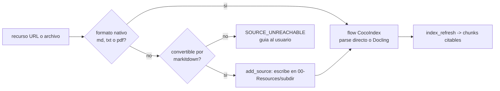

# Spec: Integración de MarkItDown (conversión a Markdown como capacidad de soporte)

* **Status:** Proposed
* **Date:** 2026-10-21
* **Author:** Arquitecto (entrevista /spec)
* **Reviewers:** Product Owner (usuario)
* **Traceability:** docs/UH.md (herramienta adicional + criterio 7), specs/spec-mcp-server.md (`add_source`), specs/spec-rag-engine.md (fallback de formatos), docs/SECURITY.md

## Summary

MarkItDown (MCP oficial de Microsoft: paquete `markitdown-mcp`) es el convertidor de documentos a Markdown que Tepochcalli usa como capacidad de soporte: permite convertir un recurso (URL, DOCX, PPTX, XLSX, HTML…) a Markdown para colocarlo bajo `00-Resources/` y que el motor RAG lo indexe. Se configura como segundo MCP server local en `opencode.json` y su uso queda encapsulado por la herramienta `add_source` de `tepochcalli-rag`.

## Problem / Motivation

Criterio 7 de UH.md: "Pueda procesar distintos formatos de texto, si no, utilizar el convertidor Markdown". El parser nativo del flow cubre Markdown/txt y PDF (Docling); otros formatos ofimáticos y páginas web no son indexables tal cual. El usuario necesita un camino simple: "convierte esto a markdown y añádelo a mis fuentes".

> Como investigador, quiero pasar un enlace o un DOCX y que quede como nota Markdown indexada sin abrir Word ni copiar/pegar.

## Goals and Non-Goals

### Goals

* Config V2 documentada para `opencode.json` (`mcp.servers`) para markitdown y `tepochcalli-rag`.
* Contrato de `convert_to_markdown(uri)` documentado con ejemplos (http/https/file/data URIs).
* Cadena de fallback de formatos definida y visible para el usuario.
* Advertencias de seguridad del canal de lectura de archivos locales escritas en la spec (y reflejadas en docs/SECURITY.md).

### Non-Goals

* Reemplazar a Docling para PDFs científicos (Docling conserva estructura mejor para citas; markitdown queda para el resto).
* Conversión masiva offline como feature dedicada (el usuario convierte lo que pide).
* Soporte de audio/transcripción (aunque markitdown pueda, no está en scope v1).

## Proposed Solution

Dos consumers conviven: (a) el agente puede invocar `convert_to_markdown` directamente cuando el usuario pide convertir, y (b) `add_source` del server `tepochcalli-rag` integra conversión + escritura en `00-Resources/<subdir>/` + `index_refresh` en una sola operación, que es el camino recomendado y probado. markitdown corre como proceso stdio local dentro del venv del vault (misma garantía de aislamiento que ADR-004), distribuido como el paquete pip oficial `markitdown-mcp`.

## Detailed Design

### Config en `opencode.json` (OpenCode V2, `mcp.servers`)

Schema V2 usado: entradas bajo `mcp.servers.<nombre>` con `type: "local"`, `command` (array), `cwd` opcional, `environment` con sustitución `{env:VAR}` y flag `disabled`.

```jsonc
"mcp": {
  "servers": {
    "tepochcalli-rag": {
      "type": "local",
      "command": [".tepochcalli/venv/bin/tepochcalli-mcp"],
      "cwd": ".",
      "environment": { "TEPOCHCALLI_ROOT": "." },
      "disabled": false
    },
    "markitdown": {
      "type": "local",
      "command": [".tepochcalli/venv/bin/python", "-m", "markitdown_mcp"],
      "disabled": false
    }
  }
}
```

* Decisión de empaquetado: se usa el venv del proyecto en lugar de `uvx markitdown-mcp` por defecto — `uvx` requiere red en el primer arranque de cada sesión nueva (resuelve/empaqueta al vuelo) y rompería `--offline`; el venv ya pinea `markitdown-mcp` (D2/pyproject). `uvx` queda documentado como alternativa para usuarios sin wizard.
* El wizard (fase 8) fusiona estas entradas y no toca servers preexistentes del usuario.

### Contrato `convert_to_markdown`

* Herramienta MCP del server markitdown: `convert_to_markdown(uri: string) -> markdown text`.
* URI aceptadas: `http://`, `https://` (páginas → markdown), `file:///...` (DOCX/PPTX/XLSX/PDF/CSV/JSON/XML/ZIP…), `data:` (bloques embebidos).
* Ejemplo (flujo agente → tool call):

```jsonc
// request
{ "tool": "convert_to_markdown", "arguments": { "uri": "file:///vault/tmp/informe-anual.docx" } }
// response (texto plano markdown dentro del content del tool result)
{ "content": [{ "type": "text",
  "text": "# Informe anual\n\n## Resumen ejecutivo\n..." }] }
```

* Sin garantías de citas offset-level cuando la salida no conserva estructura de encabezados: por eso `add_source` añade un frontmatter de trazabilidad (`source_uri`, `converted_at`) al escribir el archivo.

### Cadena de fallback de formatos (criterio 7)

1. **Parser nativo del flow:** `.md/.markdown/.txt` directo; `.pdf` vía Docling (mejores headings → mejores citas).
2. **Conversión markitdown:** `.docx/.pptx/.xlsx/.csv/.json/.xml/.html` y contenido web → markdown escrito bajo `00-Resources/` (vía `add_source` o a mano por el agente).
3. **Usuario-visible:** si ningún paso anterior funciona (formato raro, cifrado, >límites), `add_source` responde `SOURCE_UNREACHABLE` con mensaje claro ("guárdalo manualmente en 00-Resources/ y ejecuta index_refresh").



### Seguridad del canal (crítico)

* `convert_to_markdown(uri)` con `file:` puede leer **cualquier archivo accesible al usuario del proceso** — no solo el vault. El harness debe usarlo solo con rutas que el usuario indicó explícitamente. Documentado en docs/SECURITY.md §markitdown y repetido en el AGENTS.md del vault (spec-agent-workflow) y en la description de la herramienta del server wrapper.
* `http(s):` descarga contenido no confiable → se convierte en nota del usuario: riesgo de prompt injection vía material ingerido; mitigación: los chunks viajan como datos citados, y la regla de citación del flujo `/research` exige verificar fuente/autor.
* `add_source` limita la escritura a `00-Resources/<subdir>` con normalización anti path-traversal (spec-mcp-server §validación).

## Alternatives Considered

* **Solo parser propio sin markitdown:** incumpliría el criterio 7 para ofimática/URL y contradice D-manifest (markitdown pineado).
* **Usar markitdown como conversor único (también PDF):** descartado: pierde estructura de headings de Docling que alimenta las citas (criterio 5).
* **`uvx markitdown-mcp` en la config default:** rechazado por dependencia de red por sesión (arriba).

## Trade-offs

* ✅ **Pros:** amplía formatos sin código propio; un solo paquete oficial pineado; integrado en el mismo venv.
* ⚠️ **Cons / Risks:** superficie de lectura de filesystem arbitrario (documentada); doble vía del mismo conversor (agente directo vs `add_source`) puede confundir → el AGENTS.md del vault prioriza `add_source`.
* ⚖️ **Neutral:** el vault acepta archivos convertidos con frontmatter de trazabilidad.

## Testing Strategy

* Contract: `add_source(http)` y `add_source(file:docx)` sobre fixtures → archivo en `00-Resources/_inbox/` con frontmatter + chunk indexado con `source_path` correcto.
* Golden-vault: la muestra del wizard incluye un DOCX de prueba además de md+PDF (extensión del fixture de SPEC.md).
* Negativos: `file:` fuera del vault vía `add_source` → rechazado; formato no convertible → `SOURCE_UNREACHABLE`.

## Security Considerations

Ver §Seguridad del canal arriba; política central en docs/SECURITY.md (no ingestión de material no confiado, sin claves en configs commiteadas).

## Rollback / Monitoring

* Desactivar markitdown es trivial: `opencode.json` → `"disabled": true` en su entrada; `add_source` degradará a "copie el archivo manualmente" sin romper `search`.
* Monitoreo: tamaño/éxito de conversiones por semana = métrica de la fase 2; el fallback no debe superar ~5% de ingesta normal.

## Open Questions

* ¿`add_source` debería ofrecer `format_hint` (md|text) al convertir? (propuesta Phase 2: no; defaults de markitdown)

## References

* MarkItDown MCP — https://github.com/microsoft/markitdown (paquete `markitdown-mcp`, pypi/uvx)
* OpenCode V2 MCP servers — https://opencode.ai/v2/docs/mcp-servers/
* specs/spec-mcp-server.md; specs/spec-rag-engine.md; docs/SECURITY.md
