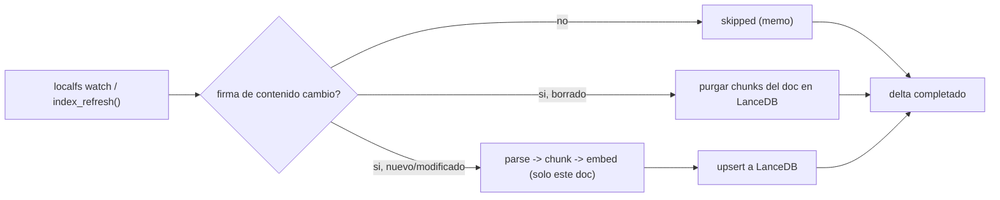

# Spec: Motor RAG — flujo CocoIndex sobre `00-Resources/`

* **Status:** Approved 2026-10-23 (FTR Phase 0→1, docs/WORKFLOW.md §4)
* **Date:** 2026-10-23 (original: 2026-10-21)
* **Author:** Arquitecto (entrevista /spec)
* **Reviewers:** Product Owner (usuario)
* **Traceability:** docs/UH.md (capa RAG Engine), ADR-001 (motor), ADR-002 (almacén), ADR-006 (embeddings), docs/ARCHITECTURE.md, docs/WORKFLOW.md Phase 1

## Summary

Define el flujo de indexación declarativo de CocoIndex que vive en `.tepochcalli/flow/`: observa recursivamente `00-Resources/`, extrae texto de Markdown y PDF (Docling), particiona con `RecursiveSplitter`, genera embeddings locales (`paraphrase-multilingual-MiniLM-L12-v2`) y materializa un índice LanceDB embebido en `.tepochcalli/db/` con índices vectorial (ANN) y full-text. Es la Capa de Procesamiento del sistema y garantiza la semántica incremental "solo delta" exigida por UH.md.

## Problem / Motivation

Un investigador deposita PDFs y notas en `00-Resources/` con su propia organización arbitraria. El sistema debe detectar y indexar ese contenido automáticamente, sin LLM por chunk (presupuesto de tokens) y sin demonios que interfieran con Obsidian.

> Como investigador, quiero que todo lo que ponga en `00-Resources/` quede indexado buscable en segundos, sin configurar nada, para poder preguntar a OpenCode y obtener respuestas citadas.

## Goals and Non-Goals

### Goals

* Flujo incremental con live-watch de `00-Resources/**` (anidamiento libre, autodetección recursiva).
* Delta (≤~50 archivos típicos) indexado en **<30s** cuando `index_refresh()` es invocado (criterio 2).
* Parsing de PDF en CPU con Docling; extracción con metadatos de cita por chunk.
* Índice LanceDB con ANN (384 dims) + FTS para búsqueda híbrida <500ms (criterios 3 y 6).
* Presupuesto de escala documentado para 10k notas + 1k PDFs.

### Non-Goals

* Indexar fuera de `00-Resources/` (notas en 01/02/03 no se indexan en v1 — decisión del vault, ver spec-vault-structure).
* Indexación de imágenes/OCR completo (fuera de scope v1; el texto embebido en PDF sí viaja con Docling).
* Búsqueda multi-usuario o servidor central.
* Entrenamiento/fine-tuning de modelos.

## Proposed Solution

Un módulo Python declarativo `tepochcalli_flow` (en `.tepochcalli/flow/`) que define una tabla de documentos fuente (`localfs` source con `watch`), transformaciones memoizadas con `@coco.fn(memo=True)` y un target `LanceDB`. La incrementalidad es estructural: CocoIndex firma el contenido de cada etapa y solo recomputa lo cambiado; los chunks hijos de un documento inmutable se reutilizan por memoización.

**Versión pineada (spike verificado 2026-10-21):** `cocoindex==1.0.25` — extras `cocoindex[lancedb,sentence-transformers]`; entorno resuelto `lancedb==0.40.0`, `sentence-transformers==6.2.0`, `torch==2.14.1`, CPython 3.12.14. La CLI de v1 **no tiene paso `setup`**: subcomandos `drop, init, ls, show, update`, con el estado del engine en `COCOINDEX_DB`. La idempotencia se afirma sobre las estadísticas del data plane (`process_file: unchanged=N, adds=0, deletes=0, reprocess=0`), porque los componentes de traversa `app_main` reportan `reprocess=1` por diseño (E2).

```python
# .tepochcalli/flow/tepochcalli_flow/pipeline.py (esqueleto del flujo; cocoindex==1.0.25)
from collections.abc import AsyncIterator

import cocoindex as coco
from cocoindex.connectors import lancedb, localfs
from cocoindex.ops.sentence_transformers import SentenceTransformerEmbedder
from cocoindex.ops.text import RecursiveSplitter
from cocoindex.resources.chunk import Chunk
from cocoindex.resources.file import FileLike, PatternFilePathMatcher
from cocoindex.resources.id import IdGenerator

MODEL_ID = "paraphrase-multilingual-MiniLM-L12-v2"
DEVICE = "cpu"  # [embedding] device en tepochcalli.toml (default "cpu", E1)
SPLITTER = RecursiveSplitter()
RESOURCES_DIR = ...  # 00-Resources/ (raíz del vault)

# ChunkRow: dataclass de esquema — {id, source_path, doc_kind, heading, char_start,
# char_end, text, embedding, model, indexed_at} (glue real de Phase 1)

LANCE_DB = coco.ContextKey[lancedb.LanceAsyncConnection]("tepochcalli_db")
EMBEDDER = coco.ContextKey[SentenceTransformerEmbedder]("embedder", detect_change=True)


@coco.lifespan
async def provide_resources(builder) -> AsyncIterator[None]:
    builder.provide(LANCE_DB, await lancedb.connect_async("./.tepochcalli/db/tepochcalli.lance"))
    builder.provide(EMBEDDER, SentenceTransformerEmbedder(MODEL_ID, device=DEVICE))
    yield


@coco.fn
async def write_chunk(
    chunk: Chunk, ..., id_gen: IdGenerator, table: lancedb.TableTarget[ChunkRow]
) -> None:
    table.declare_row(
        row=ChunkRow(
            id=await id_gen.next_id(chunk.text),  # ids estables por chunk (condición 3/3 de F2)
            char_start=chunk.start.char_offset,  # cita exacta vía offsets (F1)
            char_end=chunk.end.char_offset,
            text=chunk.text,
            embedding=await coco.use_context(EMBEDDER).embed(chunk.text),  # F6: normalize_embeddings va en embed()
            # ... source_path, doc_kind, heading (DERIVADA de las líneas previas a char_start; F1), model, indexed_at
        )
    )


@coco.fn(memo=True)
async def index_file(file: FileLike, table: lancedb.TableTarget[ChunkRow]) -> None:
    text = await file.read_text()  # F1: text[chunk.start.char_offset:chunk.end.char_offset] == chunk.text
    chunks = SPLITTER.split(text, chunk_size=1536, chunk_overlap=192, language="markdown")  # bytes (F4)
    await coco.map(write_chunk, chunks, ..., IdGenerator(), table)  # ... = glue de Phase 1


async def build_flow(app: coco.App) -> None:
    # target gestionado (condición 1/3 de la purga automática al borrar la fuente, F2)
    table = await lancedb.mount_table_target(
        LANCE_DB,
        "chunks",
        table_schema=await lancedb.TableSchema.from_class(ChunkRow, primary_key=["id"]),
    )
    # source: included SOLO no excluye dirs-punto; excluded explícito es obligatorio (F3)
    files = localfs.walk_dir(
        RESOURCES_DIR,
        recursive=True,
        path_matcher=PatternFilePathMatcher(
            included_patterns=["**/*.md", "**/*.markdown", "**/*.txt", "**/*.pdf"],
            excluded_patterns=["**/.*", "**/.git/**"],
        ),
    )
    # F5: >100MB / symlink roto -> skipped con motivo: chequeo NUESTRO, no del conector
    await coco.mount_each(index_file, files.items(), table)  # condiciones 2/3 y 3/3 de F2
    table.declare_vector_index(column="embedding")
    table.declare_fts_index(column="text")


app = coco.App(coco.AppConfig(name="tepochcalli"), build_flow)  # run: `cocoindex update`
```

## Detailed Design

### Fuentes (sources)

* **`localfs` sobre `00-Resources/`**, recursivo, con filtros de extensión por whitelist: `.md`, `.markdown`, `.txt`, `.pdf` (+ `.docx/.pptx/.xlsx` opcionales vía conversión markitdown, ver spec-markitdown §fallback).
* Exclusiones: rutas con `.`-prefijo en cualquier segmento, `.git/`, symlinks rotos, archivos >100MB (se registran como `skipped`, no fallan el delta).
* **F3 (trampa verificada):** `included_patterns=["**/*.md"]` por sí solo **NO excluye directorios-punto** — en el globset de Rust subyacente `*` casa segmentos iniciales con `.` (experimento control: `.oculto/ignorar.md` queda INCLUIDO con solo el include). La exclusión de segmentos `.`-prefijo exige `excluded_patterns=["**/.*"]` explícito (más `**/.git/**`); los globs son relativos al root del walk y usan barras normales. Fuente: [connectors/localfs.md](https://cocoindex.io/docs/connectors/localfs.md).
* **F5 (regla nuestra, no del conector):** `localfs.walk_dir(path, *, live=False, recursive=False, path_matcher=None, rescan_interval=...)` no ofrece ni límite de tamaño ni hook de errores — un symlink roto se omite en silencio a nivel del walk y un archivo chmod-000 solo cuenta 1 error sin abortar el delta. En consecuencia la regla ">100MB → `skipped` con motivo, sin fallar el delta" **no la satisface el conector**: hay que implementarla nosotros (custom `FilePathMatcher` con `stat()`, o chequeo de tamaño sobre `FileLike` dentro de la función por archivo). Fuente: [connectors/localfs.md](https://cocoindex.io/docs/connectors/localfs.md).
* El anidamiento interno es libre: el source recorre el árbol y `source_path` del chunk conserva la ruta relativa completa → preserva la organización del usuario como metadato de cita.

### Chunking

* `RecursiveSplitter` con separators en orden: heading Markdown (`#`), párrafo (`\n\n`), oración (`.`), palabra.
* **F4 — el splitter mide en BYTES, no en chars** (verificado empírico con `chunk_size=200`: texto CJK cortado a 65 chars / **195 bytes**; español con `ñ` a 167 chars / **195 bytes** — la longitud en bytes sigue a `chunk_size`, la de chars no). Presupuesto reescrito en bytes, decisión de usuario 2026-10-21: **`chunk_size=1536`, `chunk_overlap=192`** — conserva la intención original de ~1024 caracteres de prosa española (1536 bytes con holgura para la expansión UTF-8 de acentos y `ñ`) y el ratio de overlap declarado (192/1536 = 128/1024 = **12,5%**; ~14% de chunks adicionales). El overlap cubre frases cortadas entre chunks sin inflar el índice. Fuente: [ops/text.md](https://cocoindex.io/docs/ops/text.md).
* Por chunk se derivan metadatos de cita: `source_path` (relativo a la raíz del vault), `heading` (último heading padre visto, o título del PDF), `char_start`/`char_end` (offsets dentro del texto extraído), `doc_kind` (md|pdf|txt), `model` (nombre del embedder, para detección de índice mixto — ADR-006).
* **F1 — offsets citables exactos:** `Chunk` (`from cocoindex.resources.chunk import Chunk`) es un dataclass congelado con `text: str` y `start`/`end: TextPosition` (`byte_offset`, `char_offset`, `line` 1-based, `column` 1-based). La cita se toma de `chunk.start.char_offset` / `chunk.end.char_offset`, sobre los que se cumple exactamente `text[chunk.start.char_offset : chunk.end.char_offset] == chunk.text` al indexar sobre la salida de `FileLike.read_text()` (verificado 51/51 filas). **`heading` NO es campo de `Chunk`** — se deriva escaneando las líneas previas a `char_start` (o el título del PDF). Fuente: [ops/text.md](https://cocoindex.io/docs/ops/text.md), [common_resources/data_types.md](https://cocoindex.io/docs/common_resources/data_types.md).

### Ruta PDF (Docling, CPU)

* `parse_document` despacha por extensión: Markdown/txt → lectura directa; PDF → Docling en modo CPU (sin opts GPU), emitiendo markdown con jerarquía de headings conservada (mejora las citas).
* Costo conocido: un PDF académico de 30 páginas ≈ 5-30s en CPU 4-core. **No entra en el criterio de 30s del delta típico**; deltas con PDFs grandes se ejecutan con progreso visible desde el MCP (spec-mcp-server §latencia) y se registra como deuda (docs/TECH_DEBT.md TD-2).
* Memoización: el parse de un PDF inmutable no se repite jamás (firma de contenido + mtime como fast-path).

### Embeddings

* Default: `SentenceTransformerEmbedder(model_name_or_path="paraphrase-multilingual-MiniLM-L12-v2", device=...)` con cache en `.tepochcalli/models/` (vía `SENTENCE_TRANSFORMERS_HOME`/`HF_HOME` exportados por el venv/wizard) — ADR-006.
* **E1 — `device` explícito (decisión de usuario 2026-10-21):** el flow lee la clave `device` de `[embedding]` en `tepochcalli.toml`, **default `"cpu"`**, y la pasa a `SentenceTransformerEmbedder(..., device=...)`. El GPU local de esta host (GTX 1050, `sm_61`) no tiene kernels en el `torch 2.14.1+cu130` resuelto; el default CPU es coherente con ADR-006 (local-first) y ADR-008 (hardware transparente y sobre-escribible por el usuario).
* **F6 — corrección de doc-drift (source instalada manda sobre la página de docs):** a `cocoindex==1.0.25`, `SentenceTransformerEmbedder.__init__` solo acepta `model_name_or_path`, `device` y `trust_remote_code`; `normalize_embeddings` es parámetro de `embed()` (default `True`), no del constructor — el snippet de la página de docs lanzaría `TypeError`. Fuente: [ops/sentence_transformers.md](https://cocoindex.io/docs/ops/sentence_transformers.md).
* Opcional: LiteLLM embedder externo (100+ proveedores) configurable en `.tepochcalli/config/tepochcalli.toml`; el flow lee proveedor/modelo de ahí, nunca hardcodea (spec-embeddings).
* Cambio de modelo ⇒ re-index completo: el flow versiona el modelo en los datos; mismatch ⇒ `search` degrada con error tipado (ADR-006 §Consequences).

### Target LanceDB + índices

* Base: `.tepochcalli/db/tepochcalli.lance`, tabla `chunks`.
* Índice vectorial: ANN sobre 384 dims (IVF_PQ por default en LanceDB; para corpus <200k chunks el brute-force ya cumple <500ms — se configura ANN cuando el bench lo exija).
* Índice FTS: sobre el campo `text` (tokenizador por defecto de LanceDB) para la parte léxica de la búsqueda híbrida; ideal para términos técnicos exactos.
* Esquema por fila: `{id, source_path, doc_kind, heading, char_start, char_end, text, vector[384], model, indexed_at}`. **Nulabilidad (D13):** `heading` es **nullable** — su valor es `null` cuando el documento no tiene heading padre (`.txt` plano, nota suelta) pero el campo **siempre está presente** (ADR-005: la cita es estructural, no opcional); `source_path`, `char_start`, `char_end` y `doc_kind` son **no nulos**.

### Semántica incremental Δ (criterio 2)



* Disparo: la herramienta MCP `index_refresh()` (no un cron ni un watcher residente del vault; Obsidian-safe) ejecuta un ciclo de actualización de CocoIndex estilo `cocoindex update` sobre el delta acumulado.
* Budget de aceptación: delta de ≤50 archivos pequeños (md/txt) en <30s medidos desde inicio de `index_refresh()` hasta commit en LanceDB.
* Concurrencia: un lockfile de un solo proceso en `.tepochcalli/flow/`; una segunda invocación devuelve `{scanned:0, indexed:0, skipped:0}` con nota `locked` en vez de correr dos escrituras (riesgo asumido en ADR-002 §6).

### Presupuesto de escala (criterio 6)

| Concepto | Estimación 10k notas + 1k PDFs |
| --- | --- |
| Chunks totales | ~100k (notas ≈6, PDFs ≈40 promedio) |
| Vectores | 100k × 384 × 4B ≈ **154MB** (+ overhead LanceDB ≈300MB total) |
| RAM de búsqueda ANN | <1GB (índice mapeado, sin servidor) |
| Latencia target | <500ms p95 CPU, sin degradación reportada hasta 200k chunks |
| Índices FTS+ANN rebuild | amortizado en refresh incremental |

### Escape hatch de migración de motor

* Todo acoplamiento motor↔vault está en `tepochcalli_flow/`; el contrato `search/index_refresh` (ADR-005) no menciona CocoIndex.
* Opciones documentadas si el motor cambia: LEANN (ADR-001 §revisit; aprovecha `leann_mcp`) o cambio de target (pgvector/Qdrant/ChromaDB/SQLite — todos soportados por CocoIndex, ADR-002).
* Trigger de re-evaluación: API-inestabilidad de CocoIndex entre pineos, o almacenamiento dominante en disco.

## Alternatives Considered

* **Alternative A:** LEANN como motor — *Reason for rejection:* latencia de recomputación en CPU con riesgo >500ms y metadatos de cita delgados (ADR-001).
* **Alternative B:** LightRAG/RAG-Anything — *Reason for rejection:* LLM obligatorio por chunk indexado (viola presupuesto de tokens) + daemon en puerto.
* **Alternative C:** PageIndex — *Reason for rejection:* LLM por consulta y falla de escala multi-documento.
* **Alternative D:** RAG propio con LangChain/LlamaIndex — *Reason for rejection:* UH.md pide explícitamente incorporar un motor comunitario, no construir uno.

## Trade-offs

* ✅ **Pros:** Incremental real, cero LLM, cero puertos, targets intercambiables, flujo declarativo versionado.
* ⚠️ **Cons / Risks:** Costo CPU de Docling en PDFs grandes; dependencias de versiones tempranas de CocoIndex (pinea `pyproject.toml`).
* ⚖️ **Neutral:** Modelo mental de "flujos" para quien mantenga el pipeline.

## Testing Strategy

* Unit: transformaciones puras (normalizador de ruta, derivación de `heading`/offsets) sin red ni modelos.
* Integración: flujo completo contra vault fixture dorado (1 md + 1 PDF de muestra, spec-vault-structure) asertando filas LanceDB y metadatos.
* Performance: bench del delta <30s y stress 10k/1k del TRD §metodología (Phase 1 exit: `cocoindex update` indexa muestra <30s y filas queryables).

## Security Considerations

* Nunca se invocan LLM externos en el flujo default (ADR-006 local first); si el usuario configura LiteLLM, la clave vive en `config/tepochcalli.toml` (gitignored) o env var (docs/SECURITY.md).
* Archivos fuente se tratan como datos, no como instrucciones: el parse no ejecuta nada del contenido (limitación conocida de ingestión de PDF maliciosos — riesgo bajo local, documentar en SECURITY).

## Rollback / Monitoring

* El índice es derivado: borrar `.tepochcalli/db/` y re-ejecutar la indexación inicial lo reconstruye entero (sin pérdida de datos fuente).
* Métricas por refresh: `scanned/indexed/skipped/elapsed` (contractuales en MCP, spec-mcp-server); log de errores por archivo sin abortar el delta.

## Open Questions

* ¿Umbrales de re-ranking híbrido (peso vector vs FTS) se exponen en `tepochcalli.toml` o quedan fijos en v1? (propuesto: fijos, afinar en Phase 6)

## References

* CocoIndex docs — <https://cocoindex.io/docs/>
* Docling — <https://github.com/docling-project/docling>
* LanceDB — <https://lancedb.github.io/lancedb/>
* ADR-001 / ADR-002 / ADR-004 / ADR-006 (specs/adr/)
