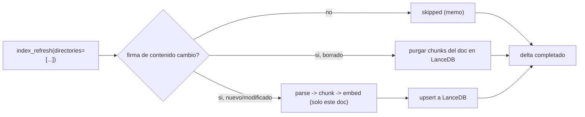

# Spec: Motor RAG — flujo CocoIndex multi-raíz sobre el vault

* **Status:** Approved 2026-10-23 (FTR Phase 0→1, docs/WORKFLOW.md §4); Amended 2026-11-02 (Phase 3.5; ADR-009/010/011 Proposed, FTR en T16)
* **Date:** 2026-10-23 (original: 2026-10-21)
* **Author:** Arquitecto (entrevista /spec)
* **Reviewers:** Product Owner (usuario)
* **Traceability:** docs/UH.md (capa RAG Engine), ADR-001 (motor), ADR-002 (almacén), ADR-006 (embeddings), ADR-009 (conversor separado del índice), ADR-010 (multi-raíz y cita vault-relativa), ADR-011 (dieta de dependencias y embedder único), docs/ARCHITECTURE.md, docs/WORKFLOW.md Phase 1

## Summary

Define el flujo de indexación declarativo de CocoIndex que vive en `.tepochcalli/flow/`: recibe **N raíces del vault por llamada** (`index_refresh(directories=…)`), extrae texto con markitdown de ocho formatos (texto plano y ofimáticos; Docling ya no participa), particiona con `RecursiveSplitter`, genera embeddings locales (`paraphrase-multilingual-MiniLM-L12-v2`) y materializa un índice LanceDB embebido en `.tepochcalli/db/` con índices vectorial (ANN) y full-text. `00-Resources/` es la raíz por omisión, no una imposición (D32, ADR-010). Es la Capa de Procesamiento del sistema y garantiza la semántica incremental "solo delta" exigida por UH.md.

## Problem / Motivation

Un investigador deposita PDFs y notas con su propia organización arbitraria: por convención en `00-Resources/`, pero también en carpetas propias (`materiales/`, `documentos/`) que no quiere duplicar ni mover. El sistema debe indexar lo que se le pide, sin LLM por chunk (presupuesto de tokens) y sin demonios que interfieran con Obsidian.

> Como investigador, quiero que lo que ponga en mis carpetas quede indexado buscable en segundos, sin configurar nada y sin mover archivos, para poder preguntar a OpenCode y obtener respuestas citadas.

## Goals and Non-Goals

### Goals

* Flujo incremental sobre **N raíces** del vault, recursivo a cualquier profundidad (ADR-010).
* Delta de texto (≤~50 archivos md/txt típicos) indexado en **<30s** cuando `index_refresh()` es invocado (criterio 2); los documentos binarios se miden aparte (D51).
* Extracción con `markitdown` de `md/markdown/txt/pdf/docx/pptx/xlsx/xls`; metadatos de cita por chunk.
* Índice LanceDB con ANN (384 dims) + FTS para búsqueda híbrida <500ms (criterios 3 y 6).
* Presupuesto de escala documentado para 10k notas + 1k PDFs.

### Non-Goals

* Indexar fuera del **vault** (frontera B′, D16/D47): la raíz es un argumento, el límite de confianza no.
* OCR de PDFs escaneados o imágenes (fuera de scope v1).
* Un índice/tabla por raíz (opción D descartada en ADR-010: rompe el ranking único).
* Búsqueda multi-usuario o servidor central.
* Entrenamiento/fine-tuning de modelos.

## Proposed Solution

Un módulo Python declarativo `tepochcalli_flow` (en `.tepochcalli/flow/`) que recibe las raíces como argumento, monta un `localfs` source por raíz con clave de memo estable, transformaciones memoizadas con `@coco.fn(memo=True)` y un target `LanceDB`. La incrementalidad es estructural: CocoIndex firma el contenido de cada etapa y solo recomputa lo cambiado; los chunks hijos de un documento inmutable se reutilizan por memoización.

**Versión pineada (spike verificado 2026-10-21):** `cocoindex==1.0.25` — extras `cocoindex[lancedb,sentence-transformers]`; entorno resuelto `lancedb==0.40.0`, `sentence-transformers==6.2.0`, `torch==2.14.1`, CPython 3.12.14. La CLI de v1 **no tiene paso `setup`**: subcomandos `drop, init, ls, show, update`, con el estado del engine en `COCOINDEX_DB`. La idempotencia se afirma sobre las estadísticas del data plane (`process_file: unchanged=N, adds=0, deletes=0, reprocess=0`), porque los componentes de traversa `app_main` reportan `reprocess=1` por diseño (E2).

```python
# .tepochcalli/flow/tepochcalli_flow/app.py (esqueleto; cocoindex==1.0.25)
import os
from collections.abc import AsyncIterator
from pathlib import Path

import cocoindex as coco
from cocoindex.connectors import lancedb, localfs
from cocoindex.ops.sentence_transformers import SentenceTransformerEmbedder
from cocoindex.ops.text import RecursiveSplitter
from cocoindex.resources.file import PatternFilePathMatcher
from markitdown import MarkItDown

# D59: el modelo se referencia por RUTA LOCAL materializada, nunca por nombre ("main").
MODEL_PATH = ".tepochcalli/models/paraphrase-multilingual-MiniLM-L12-v2@<sha>"
DEVICE = "cpu"  # [embedding] device en tepochcalli.toml (default "cpu", E1)
DB_PATH = ".tepochcalli/db/tepochcalli.lance"
# D43: whitelist de 8 en un solo lugar; DocKind espeja el mismo conjunto cerrado.
WHITELIST_PATTERNS = (
    "**/*.md", "**/*.markdown", "**/*.txt", "**/*.pdf",
    "**/*.docx", "**/*.pptx", "**/*.xlsx", "**/*.xls",
)
EXCLUDED_PATTERNS = ("**/.*", "**/.git/**")  # el conector PODA el subárbol (ADR-010 §4.9)

SPLITTER = RecursiveSplitter()
LANCE_DB = coco.ContextKey[lancedb.LanceAsyncConnection]("tepochcalli_db")
EMBEDDER = coco.ContextKey[SentenceTransformerEmbedder]("embedder", detect_change=True)
# Una ContextKey[Path] por posición de raíz, creada UNA vez (el registro de claves es de
# proceso): su valor es la raíz de la pasada y su clave es ESTABLE ⇒ mover el vault no
# invalida el índice; un Path pelado se resolvería contra el CWD (D62).
ROOT_KEYS: tuple[coco.ContextKey[Path], ...] = ...


@coco.lifespan
async def provide(builder) -> AsyncIterator[None]:
    builder.provide(LANCE_DB, await lancedb.connect_async(DB_PATH))
    builder.provide(EMBEDDER, SentenceTransformerEmbedder(MODEL_PATH, device=DEVICE))  # D59
    # Las ROOT_KEYS se proveen con los valores de la pasada (build_flow), no aquí: la clave
    # sobrevive a la mudanza del vault, el valor es la ruta de hoy (D62).
    yield


@coco.fn.as_async
def _markitdown_extract(path: Path) -> str:
    """Extractor de todo lo que no es texto plano (D48/D53); as_async no bloquea el loop (D60)."""
    return MarkItDown().convert(path).markdown


@coco.fn
async def extract_text(file: localfs.File, kind: DocKind) -> tuple[str, str]:
    """Devuelve (texto, offsets_ref). `@coco.fn` sin memo: editar el parser invalida el memo (D58)."""
    if kind in ("md", "markdown", "txt"):
        return await file.read_text(), "source"  # UTF-8 estricto; offsets del ORIGINAL
    return await _markitdown_extract(Path(file.file_path)), "extract"  # offsets del extracto


@coco.fn
def chunk_document(text: str, source_path: str, offsets_ref: str) -> list[DocumentChunk]:
    """Chunking 1536/192 + metadatos de cita; `source_path` YA es relativo al vault (D41)."""
    ...


@coco.fn(memo=True)
async def index_file(file: localfs.File, table: lancedb.TableTarget[ChunkRow], key) -> None:
    path = Path(os.fspath(file.file_path))  # ruta absoluta que entrega el walk
    text, offsets_ref = extract_text(file, doc_kind_for(path))
    source_path = normalize_source_path(path.relative_to(VAULT_ROOT))  # D41: relativo al VAULT
    chunks = chunk_document(text, source_path, offsets_ref)
    await coco.map(write_chunk, chunks, IdGenerator(), table)


async def build_flow(roots: list[str]) -> _ScanTally:
    table = await lancedb.mount_table_target(LANCE_DB, "chunks", table_schema=...)
    for position, root in enumerate(dedup_roots(roots)):  # D46: solapadas se deduplican
        key = ROOT_KEYS[position]
        if is_file_root(root):
            # Raíz-fichero: entrada propia, NUNCA walk_dir (ValueError si no es dir, _source.py:109).
            await coco.mount(index_file, single_file_entry(root, key), table, key)
            continue
        walker = localfs.walk_dir(
            key,  # ContextKey: base_dir estable (D62), no un Path pelado
            recursive=True,
            path_matcher=PatternFilePathMatcher(
                included_patterns=list(WHITELIST_PATTERNS),
                excluded_patterns=list(EXCLUDED_PATTERNS),
            ),
        )
        async for _, file in walker.items():
            await coco.mount(index_file, file, table, key)
    table.declare_vector_index(column="embedding")
    table.declare_fts_index(column="text")
```

## Detailed Design

### Fuentes (sources)

* **N raíces por llamada:** `index_refresh(directories=[...])`. Sin argumento ⇒ `["00-Resources"]`
  (compatibilidad byte-a-byte). Las raíces viven **solo** en la invocación: no hay `index.roots`
  en `tepochcalli.toml`, no tocan el wizard y no sobreviven al proceso (ADR-010 §4.1, D32/D42).
* **Validación en el borde MCP, antes de tocar el disco:** cada raíz se valida en `paths.py`
  (existe, es directorio o fichero con extensión soportada, dentro del vault, sin `..`) y un fallo
  devuelve `VALIDATION_ERROR` con `details.suggestions` (D64, ADR-010 §4.8). Motivo verificado:
  `localfs.walk_dir` lanza `ValueError("Path is not a directory: …")`
  (`connectors/localfs/_source.py:109-110`) y el `internal_guard` lo convertiría en un falso
  «fallo interno» por una carpeta mal escrita.
* **Recursión a cualquier profundidad:** `localfs.walk_dir(..., recursive=True)` con `**/*` ya la
  ofrece; la multi-raíz no añade límite. El anidamiento dentro de una raíz es libre.
* **Raíz-fichero (D46):** una raíz puede ser un **fichero suelto**. El motor NO lo pasa a
  `walk_dir` (que exige un directorio) sino que lo entrega como una entrada única, ya validada por
  el borde (existencia + extensión en la whitelist).
* **Dedup de raíces solapadas (D46):** una raíz dentro de otra —o repetida— se deduplica antes de
  caminar; sin dedup el mismo fichero contaría dos veces y `scanned == indexed + skipped` mentiría.
* **Whitelist ampliada a 8 (D43):** `md`, `markdown`, `txt`, `pdf`, `docx`, `pptx`, `xlsx`, `xls`
  en un solo lugar (`WHITELIST_PATTERNS`); `DocKind` espeja el mismo conjunto cerrado. Sin OCR y
  sin audio/vídeo: el catálogo es dato curado, no la lista de extras del lock (ADR-011).
* **Frontera de los symlinks = el VAULT, no la raíz (D47):** `classify_file` rechaza el link cuyo
  target **resuelto** sale del vault. Con una raíz ambos límites coincidían; con N, un link de
  `documentos/` a `materiales/x.pdf` es legítimo (ambos dentro del vault y ambos indexables).
* **Exclusiones globales con poda:** `PatternFilePathMatcher` con `**/.*` + `**/.git/**`. El
  conector comprueba `is_dir_included` **antes de encolar** el subdirectorio
  (`_source.py:136-138`): lo excluido no se recorre ⇒ indexar la raíz del vault no baja a
  `.tepochcalli/venv/` (2,4 GB), `.obsidian/` ni `.trash/`. No hacen falta patrones nuevos
  (ADR-010 §4.9).
* **F3 (trampa verificada):** `included_patterns=["**/*.md"]` por sí solo **NO excluye
  directorios-punto** — el globset de Rust hace casar `*` con segmentos iniciales `.` (control:
  `.oculto/ignorar.md` queda INCLUIDO). La exclusión exige `excluded_patterns=["**/.*"]`
  explícito; los globs son relativos al root del walk y usan barras normales.
* **F5 (regla nuestra, no del conector):** `walk_dir` no ofrece límite de tamaño ni hook de
  errores; un symlink roto se omite en silencio y un directorio ilegible también
  (`except PermissionError: continue`). La regla «>100MB / roto / ilegible → `skipped` con motivo,
  sin abortar el delta» se implementa en `source.py` con `SkipReason` tipado, y su recuento entra
  en `scanned` (ADR-010 §4.9: lo que falta es **contar**, no recorrer).
* **`source_path` es relativo al vault**, no a la raíz pedida (§Target, D41): con dos raíces, el
  relativo a la raíz colisiona.

### Chunking

* `RecursiveSplitter` con separators en orden: heading Markdown (`#`), párrafo (`\n\n`), oración (`.`), palabra.
* **F4 — el splitter mide en BYTES, no en chars** (verificado empírico con `chunk_size=200`: texto CJK cortado a 65 chars / **195 bytes**; español con `ñ` a 167 chars / **195 bytes** — la longitud en bytes sigue a `chunk_size`, la de chars no). Presupuesto reescrito en bytes, decisión de usuario 2026-10-21: **`chunk_size=1536`, `chunk_overlap=192`** — conserva la intención original de ~1024 caracteres de prosa española (1536 bytes con holgura para la expansión UTF-8 de acentos y `ñ`) y el ratio de overlap declarado (192/1536 = 128/1024 = **12,5%**; ~14% de chunks adicionales). El overlap cubre frases cortadas entre chunks sin inflar el índice. Fuente: [ops/text.md](https://cocoindex.io/docs/ops/text.md).
* Por chunk se derivan metadatos de cita: `source_path` (POSIX **relativo al vault**, D41),
  `heading` (último heading ATX padre; `null` en documentos extraídos), `char_start`/`char_end`
  (offsets en el espacio que declare `offsets_ref`), `doc_kind` (`md|markdown|txt|pdf|docx|pptx|xlsx|xls`),
  `offsets_ref` (`source|extract`) y `model` (nombre del embedder, para detección de índice mixto — ADR-006).
* **F1 — offsets citables exactos:** `Chunk` (`from cocoindex.resources.chunk import Chunk`) es un dataclass congelado con `text: str` y `start`/`end: TextPosition` (`byte_offset`, `char_offset`, `line` 1-based, `column` 1-based). La cita se toma de `chunk.start.char_offset` / `chunk.end.char_offset`, sobre los que se cumple exactamente `text[chunk.start.char_offset : chunk.end.char_offset] == chunk.text` al indexar sobre la salida del extractor de §Ruta de documentos (verificado 51/51 filas sobre md). **`heading` NO es campo de `Chunk`** — se deriva escaneando las líneas previas a `char_start` para el texto plano (en un documento extraído no hay jerarquía que derivar; ver §Ruta de documentos). Fuente: [ops/text.md](https://cocoindex.io/docs/ops/text.md), [common_resources/data_types.md](https://cocoindex.io/docs/common_resources/data_types.md).

### Ruta de documentos (extractor: markitdown)

`markitdown` es el extractor de **todo lo que no es texto plano** (D48/D53); Docling está fuera
del venv y del flow (ADR-011 §4.3). `parse_document` despacha por `doc_kind`:

| `doc_kind` | Extractor | `offsets_ref` | `heading` |
| --- | --- | --- | --- |
| `md` · `markdown` · `txt` | lectura UTF-8 estricta del original | `source` | derivado del propio texto (F1) |
| `pdf` · `docx` · `pptx` · `xlsx` · `xls` | `MarkItDown().convert(Path).markdown` | `extract` | `null` |

* **Texto plano** → `FileLike.read_text()` en UTF-8 estricto (un fichero no-UTF-8 falla aislado y
  cuenta como `skipped`, sin abortar el delta). Los offsets citan el **original**:
  `original[char_start:char_end] == text`.
* **Binarios** → markitdown en proceso. Los offsets citan el **texto extraído**
  (`offsets_ref="extract"`): el binario no es espacio de cita porque no es texto. El slice del
  extracto reproduce `text`; el del binario, no.
* **El PDF pierde la jerarquía de headings (D54).** markitdown extrae texto plano, así que
  `heading` es `null` en toda cita de PDF. No se disimula con el título del fichero —un heading
  inventado es una cita falsa—; el criterio 5 se apoya en `source_path` + `doc_kind` + offsets, y
  como `text` se persiste en la fila, la cita es **reproducible**. Recuperar la jerarquía
  (Docling u otro extractor) exige revertir ADR-011 y pagar sus 225 MB y 2,0 GB de RSS pico.
* **El texto extraído se persiste en la fila (`text`)** ⇒ la cita sobrevive a una actualización de
  markitdown que cambie su salida: se cita el texto que se indexó, no lo que el extractor
  produciría hoy.
* **Documentos binarios fuera del Δ de 30 s (D51):** markitdown tarda segundos por documento y un
  `.docx` de 200 páginas no cabe en el presupuesto de 50 md/txt. Se publican dos medidas —Δ de
  **texto** (md/txt, el contrato de 30 s) y Δ de **documentos**— en vez de una promesa que se
  rompe sola.
* **Sin OCR:** un PDF escaneado no tiene capa de texto ⇒ skip tipado con motivo (el conversor, en
  cambio, responde `SOURCE_UNREACHABLE`, ADR-009). Nunca se emite una fila vacía.
* **La extracción es síncrona:** `MarkItDown().convert` va tras `@coco.fn.as_async` (o un hilo), no
  directo en el event loop del server (D60).
* **Memoización:** el parse de un documento inmutable no se repite; la firma incluye la **lógica**
  del parser gracias a `@coco.fn` (§Semántica incremental, D58).

### Embeddings

* Default: `SentenceTransformerEmbedder` con `paraphrase-multilingual-MiniLM-L12-v2` (384d, CPU) —
  ADR-006/ADR-007. El cache vive en `.tepochcalli/models/`.
* **D59 — un solo embedder para write y read.** Write y read usan **la misma** implementación
  (`cocoindex.ops.sentence_transformers.SentenceTransformerEmbedder`) y el modelo se referencia por
  **ruta local materializada** `<models>/<slug>@<sha>/`. El bug que cierra: hoy write usa la op sin
  `revision` (⇒ «main») y read usa `SentenceTransformer(revision=MODEL_REVISION)`; si el upstream
  mueve `main`, el binario que indexa y el que incrusta la query **no son el mismo fichero** y el
  espacio vectorial se desalinea sin error visible. La op acepta «name **or path**» ⇒ la ruta local
  es el pin, sin inventar API. Snapshot ausente ⇒ `E_MODEL_INVALID` con guía; **nunca** descarga
  silenciosa de otro modelo.
* **D60 — `as_async` + batching:** los embeddings se calculan con `@coco.fn.as_async` y se agrupan
  en lotes según la op. El event loop del server no se bloquea durante el refresh, y el batching es
  del backend, no código nuestro (no hay saltos a hilo manuales).
* **D61 — sin memo de embeddings por chunk:** ~6 KB/vector ⇒ ~600 MB por 100k chunks para cubrir
  reruns raros, cuando el memo por fichero ya cubre el caso estable. Se re-embebe el chunk cuando
  cambia el fichero; sale más barato que mantener una caché coherente.
* **E1 — `device` explícito (decisión de usuario 2026-10-21):** el flow lee la clave `device` de `[embedding]` en `tepochcalli.toml`, **default `"cpu"`**, y la pasa a `SentenceTransformerEmbedder(..., device=...)`. El GPU local de esta host (GTX 1050, `sm_61`) no tiene kernels en el `torch 2.14.1+cu130` resuelto; el default CPU es coherente con ADR-006 (local-first) y ADR-008 (hardware transparente y sobre-escribible por el usuario).
* **F6 — corrección de doc-drift (source instalada manda sobre la página de docs):** a `cocoindex==1.0.25`, `SentenceTransformerEmbedder.__init__` solo acepta `model_name_or_path`, `device` y `trust_remote_code`; `normalize_embeddings` es parámetro de `embed()` (default `True`), no del constructor — el snippet de la página de docs lanzaría `TypeError`. Fuente: [ops/sentence_transformers.md](https://cocoindex.io/docs/ops/sentence_transformers.md).
* Opcional: `LiteLLMEmbedder` (op de cocoindex, 100+ proveedores) configurable en `.tepochcalli/config/tepochcalli.toml`; el flow lee proveedor/modelo de ahí, nunca hardcodea (spec-embeddings, ADR-011 §4.6).
* Cambio de modelo ⇒ re-index completo: el flow versiona el modelo en los datos; mismatch ⇒ `search` degrada con error tipado (ADR-006 §Consequences).

### Target LanceDB + índices

* Base: `.tepochcalli/db/tepochcalli.lance`, tabla `chunks` (una sola tabla para todas las raíces:
  el ranking híbrido es único — ADR-010 §5, opción D descartada).
* Índice vectorial: ANN sobre 384 dims (IVF_PQ por default en LanceDB; para corpus <200k chunks el brute-force ya cumple <500ms — se configura ANN cuando el bench lo exija).
* Índice FTS: sobre el campo `text` (tokenizador por defecto de LanceDB) para la parte léxica de la búsqueda híbrida; ideal para términos técnicos exactos.
* **`source_path` es relativo al VAULT (D41):** `materiales/a.pdf`, `documentos/a.pdf`,
  `00-Resources/nota.md`. Con N raíces, dos raíces distintas pueden contener el mismo relativo;
  guardar el relativo a la raíz colapsaría ambas filas en `a.pdf` y la cita dejaría de localizar
  nada. `normalize_source_path` deja de prefijar `00-Resources/`. Es un cambio **breaking** de
  `search` asumido por el dueño: `path_filter` pasa a interpretarse contra el vault.
* **`doc_kind` gana `docx/pptx/xlsx/xls`** como columna de texto (aditivo, sin migración de
  esquema ni enum de base de datos); `DocKind` es el conjunto cerrado compartido con la whitelist.
* **`offsets_ref_for` (D50):** `{md, markdown, txt} → "source"`; el resto (`pdf/docx/pptx/xlsx/xls`)
  → `"extract"`. Una columna por fila, para que `search` diga siempre contra qué se citan los offsets.
* Esquema por fila: `{id, source_path, doc_kind, heading, char_start, char_end, text, vector[384], model, offsets_ref, indexed_at}`. **Nulabilidad (D13):** `heading` es **nullable** — su valor es `null` cuando el documento no tiene heading padre (`.txt` plano, nota suelta, **cualquier documento extraído**) pero el campo **siempre está presente** (ADR-005: la cita es estructural, no opcional); `source_path`, `char_start`, `char_end`, `doc_kind` y `offsets_ref` son **no nulos**.
* Ejemplo de fila del puerto `ChunkReader` (las 6 claves congeladas, D41 + F1):

```json
{
  "text": "La aridez del altiplano condiciona el calendario agrícola…",
  "source_path": "materiales/1-geografia/clima.pdf",
  "heading": null,
  "char_start": 120,
  "char_end": 1450,
  "score": 0.83
}
```

`offsets_ref` viaja como campo **aditivo** junto a esas seis claves (Hyrum: nunca se retira una
clave). El `source_path` del ejemplo solo localiza el PDF porque es vault-relativo: `clima.pdf`
a secas sería ambiguo si `documentos/` tuviera otro.

### Semántica incremental Δ (criterio 2)



* Disparo: la herramienta MCP `index_refresh()` (no un cron ni un watcher residente del vault; Obsidian-safe) ejecuta un ciclo de actualización de CocoIndex estilo `cocoindex update` sobre el delta acumulado.
* Budget de aceptación: delta de ≤50 archivos pequeños (md/txt) en <30s medidos desde inicio de `index_refresh()` hasta commit en LanceDB. **Los documentos binarios se miden aparte** (D51, §Ruta de documentos): no entran en esa cifra.
* **D58 — `@coco.fn` en los helpers de parseo y cita:** `extract_text`, `chunk_document` y los
  helpers de cita se decoran con `@coco.fn` (sin `memo=True`). Sin el decorador, un helper es
  **invisible** al fingerprint: cambiar el parser **no invalida** el memo del fichero y el índice
  queda obsoleto en silencio. Con el decorador, nuestra lógica entra en la identidad del memo.
* **D62 — identidad de memo por raíz:** cada raíz se materializa como `ContextKey[Path]` con clave
  **estable**, y todos los `FilePath` de esa raíz se construyen con `base_dir=` esa clave — **nunca**
  con un `Path` pelado. Verificado en el pin `1.0.25`: `to_file_path` resuelve un `Path` contra el
  **CWD del proceso** (`connectors/localfs/_common.py:69-75`), de modo que la clave de memo
  dependería de dónde se lanzó el server. Con la clave explícita, **mover el vault no invalida el
  índice**.
* **Cada pasada declara el conjunto completo de raíces:** el target de CocoIndex reconcilia el
  estado declarado, así que una llamada que no declara una raíz puede purgar sus filas. El reporte
  gana `roots` (aditivo) y `rag_status` publica `last_refresh_roots`/`available_roots` para que el
  agente vea qué está indexado en vez de adivinarlo (ADR-010 §4.1).
* Concurrencia: un lockfile de un solo proceso en `.tepochcalli/flow/`; una segunda invocación devuelve `{scanned:0, indexed:0, skipped:0}` con nota `locked` en vez de correr dos escrituras (riesgo asumido en ADR-002 §6).

### Presupuesto de escala (criterio 6)

| Concepto | Estimación 10k notas + 1k PDFs |
| --- | --- |
| Chunks totales | ~100k (notas ≈6, PDFs ≈40 promedio) |
| Vectores | 100k × 384 × 4B ≈ **154MB** (+ overhead LanceDB ≈300MB total) |
| RAM de búsqueda ANN | <1GB (índice mapeado, sin servidor) |
| Latencia target | <500ms p95 CPU, sin degradación reportada hasta 200k chunks |
| Índices FTS+ANN rebuild | amortizado en refresh incremental |

### Escape hatch de migración de motor

* Todo acoplamiento motor↔vault está en `tepochcalli_flow/`; el contrato `search/index_refresh` (ADR-005) no menciona CocoIndex.
* Opciones documentadas si el motor cambia: LEANN (ADR-001 §revisit; aprovecha `leann_mcp`) o cambio de target (pgvector/Qdrant/ChromaDB/SQLite — todos soportados por CocoIndex, ADR-002).
* Trigger de re-evaluación: API-inestabilidad de CocoIndex entre pineos, o almacenamiento dominante en disco.

## Alternatives Considered

* **Alternative A:** LEANN como motor — *Reason for rejection:* latencia de recomputación en CPU con riesgo >500ms y metadatos de cita delgados (ADR-001).
* **Alternative B:** LightRAG/RAG-Anything — *Reason for rejection:* LLM obligatorio por chunk indexado (viola presupuesto de tokens) + daemon en puerto.
* **Alternative C:** PageIndex — *Reason for rejection:* LLM por consulta y falla de escala multi-documento.
* **Alternative D:** RAG propio con LangChain/LlamaIndex — *Reason for rejection:* UH.md pide explícitamente incorporar un motor comunitario, no construir uno.
* **Alternative E:** Docling como extractor de PDF (mantener el stack anterior) — *Reason for rejection:*
  cuesta **≈225 MB** (`opencv` 153, `docling_parse` 33, `rapidocr` 32) y **≈2,0 GB de RSS pico** en el
  ciclo Δ (medido en ADR-011 §4.3) para una jerarquía de headings que el criterio 5 **no exige**; y
  deja dos caminos de parseo que producen texto distinto para el mismo fichero.
* **Alternative F:** un índice (tabla LanceDB) por raíz — *Reason for rejection:* multiplica el coste
  de búsqueda (N ANN + N FTS + fusión entre tablas), rompe el ranking único ANN+FTS que sostiene
  <500 ms, y la lista de tablas se vuelve estado que mantener (ADR-010 §5, opción D).

## Trade-offs

* ✅ **Pros:** Incremental real sobre cualquier carpeta del vault, cero LLM, cero puertos, targets intercambiables, flujo declarativo versionado; los ofimáticos entran sin paso de conversión previo.
* ⚠️ **Cons / Risks:** **El PDF pierde la jerarquía de headings** (D54): la cita se apoya en `source_path` + offsets, no en el heading. **Los documentos binarios quedan fuera del Δ de 30 s** (D51): un vault lleno de `.docx` tendrá refreshes lentos y visibles, medidos aparte. **El agente debe pasar raíces explícitas**: sin argumento solo se indexa `00-Resources/`, y un agente que asuma memoria entre sesiones indexará de menos. `source_path` vault-relativo es un cambio breaking para `path_filter` y prompts. Dependencias de versiones tempranas de CocoIndex (pinea `pyproject.toml`).
* ⚖️ **Neutral:** Modelo mental de "flujos" para quien mantenga el pipeline; la raíz pasa de constante del producto a dato de la operación.

## Testing Strategy

* Unit: transformaciones puras (normalizador de ruta **vault-relativo**, `doc_kind_for` con las 8
  extensiones, `offsets_ref_for`, derivación de `heading`) sin red ni modelos.
* Integración — recursión a **2 niveles**: raíces `materiales/` y `documentos/` con
  `materiales/1-geografia/x.pdf` y `documentos/pdf/y.pdf` ⇒ dos filas con
  `source_path == "materiales/1-geografia/x.pdf"` y `"documentos/pdf/y.pdf"`.
* Integración — **raíz-fichero**: `directories=["notas/suelta.md"]` indexa exactamente una entrada y
  el motor no la pasa por `walk_dir`.
* Integración — **dedup de raíces solapadas**: `["00-Resources", "00-Resources/sub"]` ⇒
  `scanned == indexed + skipped` y ninguna entrada duplicada; también `["x", "x"]`.
* Integración — **identidad del reporte**: `scanned == indexed + skipped` en el 100 % de los
  refreshes de la suite (incluye oversized, symlink roto, directorio ilegible).
* Golden-vault: 1 md + 1 PDF + 1 docx. Para el md, `original[char_start:char_end] == text` de la
  fila; para el docx, `doc_kind == "docx"`, `offsets_ref == "extract"` y `heading is None`.
* **PDF sin headings, afirmado**: un `.pdf` con títulos visibles produce filas con
  `heading is None` — el test fija el coste de D54 en vez de ocultarlo.
* **Poda**: un `.md` dentro de `.tepochcalli/` y otro en `.obsidian/` no producen filas ni skips al
  indexar la raíz del vault, y el tiempo del pase no escala con el tamaño de esos árboles.
* **Cambio de parser invalida el memo (D58):** editar `parsers.extract_text`, repetir el refresh ⇒
  el fichero se re-indexa (`indexed > 0`).
* **Embedder único (D59):** write y read resuelven **el mismo path** de modelo (`Path.resolve()`).
* Performance: bench del delta de texto <30s (M1) y stress 10k/1k del TRD §metodología; el Δ de
  documentos se publica como medida aparte (D51), no se suma al de texto.

## Security Considerations

* Nunca se invocan LLM externos en el flujo default (ADR-006 local first); si el usuario configura LiteLLM, la clave vive en `config/tepochcalli.toml` (gitignored) o env var (docs/SECURITY.md).
* Archivos fuente se tratan como datos, no como instrucciones: el parse no ejecuta nada del contenido. Los extractores de `pdf/docx/pptx/xlsx/xls` (markitdown y sus dependencias) son decodificadores de entrada no confiable y por eso la **whitelist es dato curado**: cada formato admitido es superficie de ataque declarada (ADR-011 §4.3/§5).
* La frontera de contención sigue siendo el **vault** (D16/D47): ninguna raíz, symlink ni `file:` puede hacer que el índice ingiera material de fuera.

## Rollback / Monitoring

* El índice es derivado: borrar `.tepochcalli/db/` y re-ejecutar la indexación inicial lo reconstruye entero (sin pérdida de datos fuente).
* Métricas por refresh: `scanned/indexed/skipped/elapsed` (contractuales en MCP, spec-mcp-server) + `roots` aditivo con las raíces de la pasada; log de errores por archivo sin abortar el delta. El Δ de texto y el de documentos se reportan como medidas separadas (D51).

## Open Questions

* ¿Umbrales de re-ranking híbrido (peso vector vs FTS) se exponen en `tepochcalli.toml` o quedan fijos en v1? (propuesto: fijos, afinar en Phase 6)
* ¿El Δ de documentos se publica como campo del reporte o solo en el bench? (propuesto: solo bench en v1; el reporte no crece sin necesidad)

## References

* CocoIndex docs — <https://cocoindex.io/docs/>
* markitdown — <https://github.com/microsoft/markitdown>
* LanceDB — <https://lancedb.github.io/lancedb/>
* ADR-001 / ADR-002 / ADR-004 / ADR-006 / ADR-009 / ADR-010 / ADR-011 (specs/adr/)

## Anexo A — Alternativas externas consultadas (2026-10-28)

> Anexo informativo, no normativo — no altera las secciones anteriores ni el status Approved. Origen: análisis externo 2026-10-28. Registra veredictos ya tomados para no repetir la investigación; toda adopción futura exige ADR nuevo (nunca re-editar un ADR Accepted).

### A) opendataloader-pdf — <https://github.com/opendataloader-project/opendataloader-pdf>

* **Qué es:** parser PDF→Markdown/JSON/HTML (motor local Java, orden de lectura XY-Cut++, bounding boxes por elemento) + modo `hybrid` cuyo backend **es literalmente Docling** (`docling-fast`; el extra `[hybrid]` instala docling + docling-serve; el OCR — EasyOCR/Tesseract/RapidOCR — corre vía ese backend, no en el modo local).
* **Veredicto: VIGILAR — no adoptar.** Desde ADR-011 el PDF **sí** pasa por markitdown, así que su ventaja teórica (headings, 0.824 vs 0.821 sobre Docling) sería real; pero adoptarlo exige **Java 11+ en el host** (viola ADR-003/ADR-004: el investigador no instala nada) y un **servidor en el puerto 5002** (viola la regla sin demonios/puertos de ADR-002/ADR-005), paga un stack completo para una jerarquía que el criterio 5 no exige, y sus ventajas reales (bounding boxes, anti prompt-injection) no las consume ningún requisito de docs/UH.md.
* **Revisit trigger:** si el criterio 5 pasa a exigir headings en PDFs (hoy D54 los declara nulos) o se activa OCR v1; benchmark replicado por terceros.
* **Coste de adopción registrado:** ADR nuevo + cambio de §Ruta de documentos + reindex completo (los offsets F1 cambian) + revalidación de benches M1/M2 y golden-vault.

### B) PixelRAG — <https://github.com/StarTrail-org/PixelRAG>

* **Qué es:** framework de **RAG visual** (paper PIXELRAG, Berkeley SkyLab — misma org que LEANN): renderiza páginas/PDF a **tiles JPEG** (Chromium headless) y recupera con embedding VLM `Qwen3-VL-2B`; índice FAISS/Qdrant + FastAPI con puerto. **No es un scraper y NO produce markdown** (su único texto es `innerText` opcional plano, sin headings).
* **Veredicto: DESCARTAR como dependencia; vigilar solo la idea (captura visual).** La vía `add_source`→markitdown ya cubre URL→markdown; su salida JPEG no es indexable por CocoIndex + MiniLM; es un **segundo stack RAG** que choca con ADR-001/ADR-002 (CocoIndex+LanceDB), ADR-005 (puertos/daemon) y ADR-006 (VLM vs MiniLM CPU, $0). Único gap que destapa: **rendering JS** (markitdown no ejecuta JS) — si algún día duele, vía ADR de herramienta focalizada captura→markdown, no PixelRAG.
* **Revisit trigger:** caso de uso "tabla/gráfico que el markdown pierde" o SPA pesada problemática → ADR nuevo de captura puntual.

### C) book-to-skill — <https://github.com/virgiliojr94/book-to-skill>

* **Qué es:** skill instalable (`~/.agents/skills/`) que destila libros → skill (`SKILL.md` + `chapters/`): extracción determinista (modo *technical* → **Docling**, que ya no es nuestro extractor desde ADR-011) + síntesis con LLM (~$1/libro); filosofía *"extract structure, never raw text"* — **tira el texto crudo**, sin índice vectorial ni citas offset-level.
* **Veredicto: NO INSTALAR.** (1) Gate: `obsidian-workspace/.opencode/` congelado hasta el blueprint de Phase 4 (spec-payload-vault). (2) Redundante: el vault ya tiene el skill `markitdown/` y el producto convierte vía `add_source`. (3) Choca con el criterio 5 de docs/UH.md: la destilación elimina el original y produce síntesis sin citas verificables.
* **Revisit trigger:** si el usuario pide un workflow de "destilación de libros en síntesis reutilizables" → decisión de blueprint en Phase 4, no instalación casual.

### D) Cross-reference — opendraft

`opendraft` (<https://github.com/federicodeponte/opendraft>) se consultó por su workflow (no por motor): sus hallazgos ya viven en specs/spec-payload-vault.md / specs/spec-agent-workflow.md (§Origen de las enmiendas 2026-10-28) y docs/TECH_DEBT.md TD-13…TD-16 — ver esos documentos, no duplicarlos aquí.
