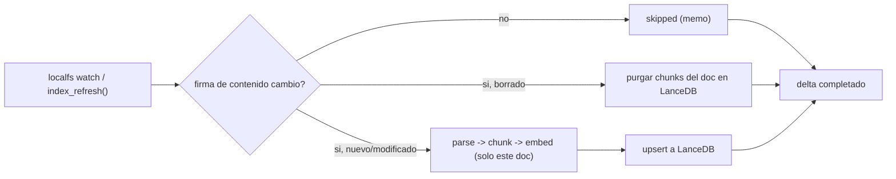

# Spec: Motor RAG — flujo CocoIndex sobre `00-Resources/`

* **Status:** Proposed
* **Date:** 2026-10-21
* **Author:** Arquitecto (entrevista /spec)
* **Reviewers:** Product Owner (usuario)
* **Traceability:** docs/UH.md (capa RAG Engine), ADR-001 (motor), ADR-002 (almacén), ADR-006 (embeddings), docs/ARCHITECTURE.md, docs/WORKFLOW.md Phase 1

## Summary

Define el flujo de indexación declarativo de CocoIndex que vive en `.tepochcalli/flow/`: observa recursivamente `00-Resources/`, extrae texto de Markdown y PDF (Docling), particiona con `RecursiveSplitter`, genera embeddings locales (`paraphrase-multilingual-MiniLM-L12-v2`) y materializa un índice LanceDB embebido en `.tepochcalli/db/` con índices vectorial (ANN) y full-text. Es la Capa de Procesamiento del sistema y garantiza la semántica incremental "solo delta" exigida por UH.md.

## Problem / Motivation

Un investigador deposita PDFs y notas en `00-Resources/` con su propia organización arbitraria. El sistema debe detectar y indexar ese contenido automáticamente, sin LLM por chunk (presupuesto de tokens) y sin demonios que interfieran con Obsidian.

> Como investigador, quiero que todo lo que ponga en `00-Resources/` quede indexado buscable en segundos, sin configurar nada, para poder preguntar a OpenCode y obtener respuestas citadas.

## Goals and Non-Goals

### Goals

* Flujo incremental con live-watch de `00-Resources/**` (anidamiento libre, autodetección recursiva).
* Delta (≤~50 archivos típicos) indexado en **<30s** cuando `index_refresh()` es invocado (criterio 2).
* Parsing de PDF en CPU con Docling; extracción con metadatos de cita por chunk.
* Índice LanceDB con ANN (384 dims) + FTS para búsqueda híbrida <500ms (criterios 3 y 6).
* Presupuesto de escala documentado para 10k notas + 1k PDFs.

### Non-Goals

* Indexar fuera de `00-Resources/` (notas en 01/02/03 no se indexan en v1 — decisión del vault, ver spec-vault-structure).
* Indexación de imágenes/OCR completo (fuera de scope v1; el texto embebido en PDF sí viaja con Docling).
* Búsqueda multi-usuario o servidor central.
* Entrenamiento/fine-tuning de modelos.

## Proposed Solution

Un módulo Python declarativo `tepochcalli_flow` (en `.tepochcalli/flow/`) que define una tabla de documentos fuente (`localfs` source con `watch`), transformaciones memoizadas con `@coco.fn(memo=True)` y un target `LanceDB`. La incrementalidad es estructural: CocoIndex firma el contenido de cada etapa y solo recomputa lo cambiado; los chunks hijos de un documento inmutable se reutilizan por memoización.

```python
# .tepochcalli/flow/tepochcalli_flow/pipeline.py (esqueleto del flujo)
import cocoindex as coco
from cocoindex.processing import chunking

@coco.component
@coco.fn(memo=True)
def parse_document(source: coco.Text) -> coco.Text:
    """md: paso directo; pdf: Docling (CPU) a markdown."""
    ...

@coco.fn(memo=True)
def split_and_embed(doc: coco.Text) -> coco.Vector[384]:
    chunks = chunking.recursive_splitter(
        doc, policy=coco.TextChunkingPolicy(max_chunk_size=1024, overlap=128)
    )
    ...
```

## Detailed Design

### Fuentes (sources)

* **`localfs` sobre `00-Resources/`**, recursivo, con filtros de extensión por whitelist: `.md`, `.markdown`, `.txt`, `.pdf` (+ `.docx/.pptx/.xlsx` opcionales vía conversión markitdown, ver spec-markitdown §fallback).
* Exclusiones: rutas con `.`-prefijo en cualquier segmento, `.git/`, symlinks rotos, archivos >100MB (se registran como `skipped`, no fallan el delta).
* El anidamiento interno es libre: el source recorre el árbol y `source_path` del chunk conserva la ruta relativa completa → preserva la organización del usuario como metadato de cita.

### Chunking

* `RecursiveSplitter` con separators en orden: heading Markdown (`#`), párrafo (`\n\n`), oración (`. `), palabra.
* `max_chunk_size = 1024` chars, `overlap = 128` chars. El overlap cubre frases cortadas entre chunks sin inflar el índice (~14% de chunks adicionales).
* Por chunk se derivan metadatos de cita: `source_path` (relativo a la raíz del vault), `heading` (último heading padre visto, o título del PDF), `char_start`/`char_end` (offsets dentro del texto extraído), `doc_kind` (md|pdf|txt), `model` (nombre del embedder, para detección de índice mixto — ADR-006).

### Ruta PDF (Docling, CPU)

* `parse_document` despacha por extensión: Markdown/txt → lectura directa; PDF → Docling en modo CPU (sin opts GPU), emitiendo markdown con jerarquía de headings conservada (mejora las citas).
* Costo conocido: un PDF académico de 30 páginas ≈ 5-30s en CPU 4-core. **No entra en el criterio de 30s del delta típico**; deltas con PDFs grandes se ejecutan con progreso visible desde el MCP (spec-mcp-server §latencia) y se registra como deuda (docs/TECH_DEBT.md TD-2).
* Memoización: el parse de un PDF inmutable no se repite jamás (firma de contenido + mtime como fast-path).

### Embeddings

* Default: `SentenceTransformerEmbedder(model="paraphrase-multilingual-MiniLM-L12-v2")` con cache en `.tepochcalli/models/` (vía `SENTENCE_TRANSFORMERS_HOME`/`HF_HOME` exportados por el venv/wizard) — ADR-006.
* Opcional: LiteLLM embedder externo (100+ proveedores) configurable en `.tepochcalli/config/tepochcalli.toml`; el flow lee proveedor/modelo de ahí, nunca hardcodea (spec-embeddings).
* Cambio de modelo ⇒ re-index completo: el flow versiona el modelo en los datos; mismatch ⇒ `search` degrada con error tipado (ADR-006 §Consequences).

### Target LanceDB + índices

* Base: `.tepochcalli/db/tepochcalli.lance`, tabla `chunks`.
* Índice vectorial: ANN sobre 384 dims (IVF_PQ por default en LanceDB; para corpus <200k chunks el brute-force ya cumple <500ms — se configura ANN cuando el bench lo exija).
* Índice FTS: sobre el campo `text` (tokenizador por defecto de LanceDB) para la parte léxica de la búsqueda híbrida; ideal para términos técnicos exactos.
* Esquema por fila: `{id, source_path, doc_kind, heading, char_start, char_end, text, vector[384], model, indexed_at}`.

### Semántica incremental Δ (criterio 2)



* Disparo: la herramienta MCP `index_refresh()` (no un cron ni un watcher residente del vault; Obsidian-safe) ejecuta un ciclo de actualización de CocoIndex estilo `cocoindex update` sobre el delta acumulado.
* Budget de aceptación: delta de ≤50 archivos pequeños (md/txt) en <30s medidos desde inicio de `index_refresh()` hasta commit en LanceDB.
* Concurrencia: un lockfile de un solo proceso en `.tepochcalli/flow/`; una segunda invocación devuelve `{scanned:0, indexed:0, skipped:0}` con nota `locked` en vez de correr dos escrituras (riesgo asumido en ADR-002 §6).

### Presupuesto de escala (criterio 6)

| Concepto | Estimación 10k notas + 1k PDFs |
|---|---|
| Chunks totales | ~100k (notas ≈6, PDFs ≈40 promedio) |
| Vectores | 100k × 384 × 4B ≈ **154MB** (+ overhead LanceDB ≈300MB total) |
| RAM de búsqueda ANN | <1GB (índice mapeado, sin servidor) |
| Latencia target | <500ms p95 CPU, sin degradación reportada hasta 200k chunks |
| Índices FTS+ANN rebuild | amortizado en refresh incremental |

### Escape hatch de migración de motor

* Todo acoplamiento motor↔vault está en `tepochcalli_flow/`; el contrato `search/index_refresh` (ADR-005) no menciona CocoIndex.
* Opciones documentadas si el motor cambia: LEANN (ADR-001 §revisit; aprovecha `leann_mcp`) o cambio de target (pgvector/Qdrant/ChromaDB/SQLite — todos soportados por CocoIndex, ADR-002).
* Trigger de re-evaluación: API-inestabilidad de CocoIndex entre pineos, o almacenamiento dominante en disco.

## Alternatives Considered

* **Alternative A:** LEANN como motor — *Reason for rejection:* latencia de recomputación en CPU con riesgo >500ms y metadatos de cita delgados (ADR-001).
* **Alternative B:** LightRAG/RAG-Anything — *Reason for rejection:* LLM obligatorio por chunk indexado (viola presupuesto de tokens) + daemon en puerto.
* **Alternative C:** PageIndex — *Reason for rejection:* LLM por consulta y falla de escala multi-documento.
* **Alternative D:** RAG propio con LangChain/LlamaIndex — *Reason for rejection:* UH.md pide explícitamente incorporar un motor comunitario, no construir uno.

## Trade-offs

* ✅ **Pros:** Incremental real, cero LLM, cero puertos, targets intercambiables, flujo declarativo versionado.
* ⚠️ **Cons / Risks:** Costo CPU de Docling en PDFs grandes; dependencias de versiones tempranas de CocoIndex (pinea `pyproject.toml`).
* ⚖️ **Neutral:** Modelo mental de "flujos" para quien mantenga el pipeline.

## Testing Strategy

* Unit: transformaciones puras (normalizador de ruta, derivación de `heading`/offsets) sin red ni modelos.
* Integración: flujo completo contra vault fixture dorado (1 md + 1 PDF de muestra, spec-vault-structure) asertando filas LanceDB y metadatos.
* Performance: bench del delta <30s y stress 10k/1k del TRD §metodología (Phase 1 exit: `cocoindex update` indexa muestra <30s y filas queryables).

## Security Considerations

* Nunca se invocan LLM externos en el flujo default (ADR-006 local first); si el usuario configura LiteLLM, la clave vive en `config/tepochcalli.toml` (gitignored) o env var (docs/SECURITY.md).
* Archivos fuente se tratan como datos, no como instrucciones: el parse no ejecuta nada del contenido (limitación conocida de ingestión de PDF maliciosos — riesgo bajo local, documentar en SECURITY).

## Rollback / Monitoring

* El índice es derivado: borrar `.tepochcalli/db/` y re-ejecutar la indexación inicial lo reconstruye entero (sin pérdida de datos fuente).
* Métricas por refresh: `scanned/indexed/skipped/elapsed` (contractuales en MCP, spec-mcp-server); log de errores por archivo sin abortar el delta.

## Open Questions

* ¿Umbrales de re-ranking híbrido (peso vector vs FTS) se exponen en `tepochcalli.toml` o quedan fijos en v1? (propuesto: fijos, afinar en Phase 6)

## References

* CocoIndex docs — https://cocoindex.io/docs/
* Docling — https://github.com/docling-project/docling
* LanceDB — https://lancedb.github.io/lancedb/
* ADR-001 / ADR-002 / ADR-004 / ADR-006 (specs/adr/)
