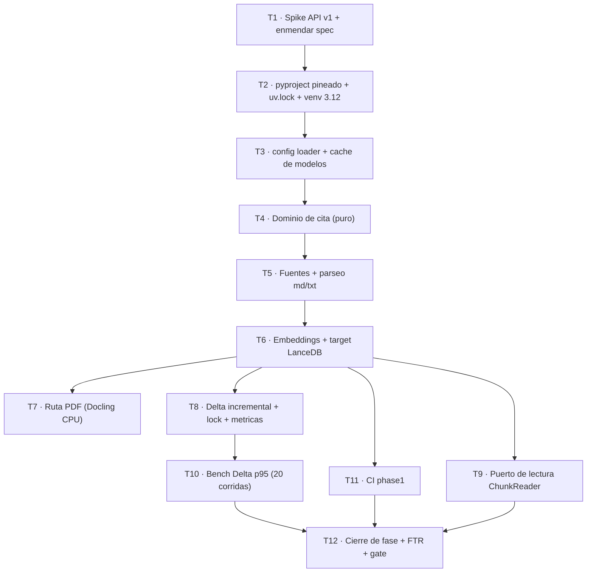
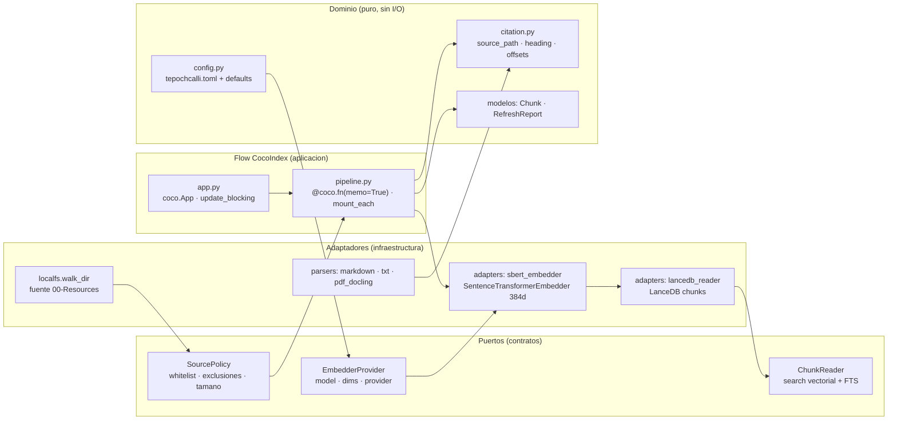

# Plan de implementación — Phase 1: Engine + Flow

> **Rama de trabajo:** `feat/workspace-obsidian` (creada por el usuario).
> **Fuente de verdad:** [docs/WORKFLOW.md](../docs/WORKFLOW.md) §Phase 1 · [specs/spec-rag-engine.md](../specs/spec-rag-engine.md) · [specs/spec-embeddings.md](../specs/spec-embeddings.md) · ADR-001/002/004/006.
> **Alcance de este plan:** SOLO Phase 1. No toca el servidor MCP (Phase 2), ni el wizard (Phase 3), ni el payload de agents/commands/skills (Phase 4-5).
> **Autorización requerida:** escribir en `obsidian-workspace/` (AGENTS.md, checklist de pre-commit). Este plan es esa autorización.

## 1. Objetivo y criterio de éxito

**Objetivo:** que `.tepochcalli/flow/` sea un motor de indexación real y verificable:
`00-Resources/**` (localfs) → parseo (Markdown/txt/Docling-PDF) → `RecursiveSplitter(1024/128)` →
embeddings MiniLM multilingüe (384d) → tabla `chunks` en LanceDB embebido, con **metadatos de cita
completos** (`source_path`, `heading`, `char_start`, `char_end`, `doc_kind`, `model`), semántica
**incremental Δ** real, y un **puerto de lectura** que Phase 2 heredará sin volver a tocar el motor.

**El gate de Phase 1 (WORKFLOW §2) se cumple cuando:**

| # | Métrica de cierre | Verificada en |
|---|---|---|
| M1 | Δ < 30s (p95, 20 corridas, corpus muestra) | T10 |
| M2 | 100% de filas con metadatos de cita no nulos | T6 |
| M3 | 0 llamadas LLM observables en indexación | T6 |
| M4 | Fila de LanceDB queryable con `{source_path, heading, char_start, char_end}` | T9 |
| M5 | Bench de exclusión de PDF documentado (costo real medido) | T7, T10 |
| M6 | Fixtures de `spec-rag-engine` §Testing verdes en CI | T11 |
| M7 | Gate Phase 1 → Phase 2 aprobado por el usuario | T12 |

## 2. Decisiones tomadas en la entrevista (2026-10-21)

| # | Decisión | Valor | Consecuencia en el plan |
|---|---|---|---|
| D-a | Ubicación del código | `obsidian-workspace/.tepochcalli/` · tests en `<repo>/tests/phase1/` | El payload queda instalable tal cual por el wizard (Phase 3) sin paso de copia; los tests no viajan al vault del usuario |
| D-b | Spec con API obsoleta | Enmendar + registrar en `docs/WORKFLOW.md` §8 | T1 corrige `specs/spec-rag-engine.md` §Proposed Solution; NO es cambio de decisión → NO requiere ADR |
| D-c | Docling / PDF | Entra desde el inicio | T7 implementa la ruta PDF; el PDF grande queda FUERA del presupuesto Δ (TD-2) y se mide |
| D-d | CI y bench | CI = unit+integration smoke; bench p95 de 20 corridas = local documentado | T11 (CI) y T10 (bench local) |

## 3. Omen mayor detectado (fail-fast en T1)

> **La spec congelada manda una API que ya no existe.**
> `specs/spec-rag-engine.md` §Proposed Solution usa la API **pre-1.0** de CocoIndex
> (`@coco.component`, `from cocoindex.processing import chunking`, `chunking.recursive_splitter`,
> y el paso `cocoindex setup`). PyPI sirve hoy **cocoindex 1.0.25** con la **API v1**:
> `coco.App`, `coco.mount_each`, `coco.map`, `coco.lifespan`, `coco.ContextKey`,
> `cocoindex.connectors.localfs.walk_dir`, `cocoindex.ops.text.RecursiveSplitter`,
> `cocoindex.ops.sentence_transformers.SentenceTransformerEmbedder`,
> `cocoindex.resources.{file,chunk,id}`, `cocoindex.connectors.lancedb.mount_table_target`.
> En v1 **no existe** el paso `setup`: se ejecuta `cocoindex update` o `app.update_blocking()`.

La *decisión* (ADR-001: motor = CocoIndex) **no cambia**; lo que caduca es el ejemplo ilustrativo.
Por eso T1 existe y va primero: si la API real difiere en algo más (offsets de chunk, purga de
filas, `declare_row`), el resto del plan se reescribe con el dato real en vez de con una suposición.

## 4. Grafo de dependencias



**Orden imposed por el grafo:** T1 → T2 → T3 → T4 → T5 → T6 · luego T7, T8, T9 **paralelizables**
(independientes entre sí, todos dependen de T6) · luego T10, T11 · cierre T12.

## 5. Arquitectura del módulo (hexagonal, D2 + ADR-005)



**Regla de dependencia (clean-ddd-hexagonal):** el dominio (`citation.py`, `config.py`, `modelos`)
**no importa** `cocoindex` ni `lancedb`. T9 verifica esta frontera con un test de arquitectura
(parseo del grafo de imports con `ast`).

### Contrato de datos (congelado para Phase 2)

Fila en `chunks` (`.tepochcalli/db/tepochcalli.lance`):

```text
{ id, source_path, doc_kind, heading, char_start, char_end, text, vector[384], model, indexed_at }
```

* `vector` con dims resueltas del embedder configurado (384 con el default ADR-006).
* `model` = id del embedder → habilita `E_MODEL_MISMATCH` / `INDEX_STALE_MODEL` en Phase 2 (ADR-007, TD-3).
* `source_path` relativo a la raíz del vault, POSIX, con prefijo `00-Resources/`.
* `char_start` / `char_end` = offsets **de carácter dentro del texto extraído** (no del binario PDF).

El puerto de lectura `ChunkReader` devuelve exactamente los campos que el contrato `search` de
[specs/spec-mcp-server.md](../specs/spec-mcp-server.md) congela: `{text, source_path, heading,
char_start, char_end, score}`.

## 6. Tareas

### Sub-fase A — Anclaje y cimientos

---

#### T1 — Spike: anclar la API real de CocoIndex v1 y enmendar la spec congelada

**Descripción:** antes de escribir el flow, probar en un scratch la forma real de la API v1 sobre
`cocoindex==1.0.25` y corregir el ejemplo obsoleto de la spec. Es la tarea de mayor riesgo de la
fase y va primero porque su resultado puede reescribir el resto del plan.

**Criterios de aceptación:**
- [ ] `uv` crea un venv con **CPython 3.12** e instala `cocoindex==1.0.25` + extras `[lancedb]` y `[sentence-transformers]` sin conflicto de resolución.
- [ ] El spike ejecuta el camino completo `localfs.walk_dir` → `RecursiveSplitter.split` → `SentenceTransformerEmbedder.embed` → `lancedb.mount_table_target` + `declare_row` → `app.update_blocking()` y deja filas en `.tepochcalli/db/`.
- [ ] **Hallazgo documentado:** si `Chunk` expone offsets de **carácter** o solo de **línea**, y cuál es la forma exacta de derivar `char_start`/`char_end` reproducibles.
- [ ] **Hallazgo documentado:** comportamiento real de **borrado** (si el target declarativo purga las filas de un archivo eliminado).
- [ ] **Hallazgo documentado:** firma real de `PatternFilePathMatcher` y del filtro de exclusión por segmento con punto.
- [ ] `specs/spec-rag-engine.md` §Proposed Solution actualizado con el esqueleto v1 real (imports exactos de `cocoindex.connectors`, `cocoindex.ops.text`, `cocoindex.ops.sentence_transformers`, `cocoindex.resources`).
- [ ] `docs/WORKFLOW.md` §8 tiene la entrada **"D11 — Corrección de la API de CocoIndex (pre-1.0 → v1)"**, declarando explícitamente que *no* es cambio de decisión y *no* requiere ADR.
- [ ] `docs/UH.md`, `README.md`, `LICENSE`, `CODE_OF_CONDUCT.md`, `opencode.json` (raíz) y `obsidian-workspace/.opencode/` **intactos** (verificado con `git status --short`).

**Verificación:**
- [ ] El script del spike corre de principio a fin sin `AttributeError`/`ImportError` y su salida se pega en el cuerpo del commit.
- [ ] `markdownlint specs docs` limpio tras la enmienda.
- [ ] `git diff --stat` muestra solo `specs/spec-rag-engine.md` y `docs/WORKFLOW.md`.

**Dependencias:** ninguna.
**Ficheros probables:** `specs/spec-rag-engine.md`, `docs/WORKFLOW.md`, scratch del spike (efímero o bajo `tests/spikes/`, ignorado por `.gitignore`).
**Tamaño estimado:** M (3-5 ficheros).

---

#### T2 — Cimientos del paquete: `pyproject.toml` pineado, `uv.lock`, venv 3.12 y gitignore del runtime

**Descripción:** materializar el runtime tal como lo describe `spec-vault-structure` §Layout:
`.tepochcalli/{pyproject.toml, uv.lock, .python-version, flow/}` versionado; `{venv,db,models,bin,config}`
ignorado. Fijar los pines que [docs/TRD.md](../docs/TRD.md) §4 deja explícitamente para Phase 1.

**Criterios de aceptación:**
- [ ] `obsidian-workspace/.tepochcalli/pyproject.toml` con pines: `cocoindex==1.0.25` (con extra `lancedb`), `sentence-transformers>=3.3.1,<4`, `docling>=2,<3` (**sin** extra GPU). `lancedb`/`pyarrow` **no** se pinean aparte (vienen por el extra — TRD §4).
- [ ] `uv.lock` commiteado; `uv sync` reproducible desde cero en máquina limpia.
- [ ] `.tepochcalli/.python-version` = `3.12` (`uv python pin 3.12`).
- [ ] `tepochcalli_flow` importable tras `uv sync` (paquete en `.tepochcalli/flow/tepochcalli_flow`, modo editable).
- [ ] `.gitignore` (raíz) **ignora** `obsidian-workspace/.tepochcalli/{venv,db,models,bin,config}` y **NO ignora** `{flow,pyproject.toml,uv.lock,.python-version}` — verificado con `git check-ignore -v`.
- [ ] `[tool.ruff]` con `target-version = "py312"` y `select` incluyendo `ANN` (type hints estrictos — CODE_STYLE).
- [ ] `uv run ruff check .` y `uv run ruff format --check .` limpios.
- [ ] `uv run pytest` desde `.tepochcalli/` completa la collection sin error.
- [ ] Auditoría de CVEs y licencias de las 4 dependencias, resumida en el cuerpo del commit.

**Verificación:**
- [ ] `rm -rf .tepochcalli/venv && cd obsidian-workspace/.tepochcalli && uv sync && uv run pytest` → OK desde cero.
- [ ] `git check-ignore -v obsidian-workspace/.tepochcalli/venv` devuelve regla; `git check-ignore obsidian-workspace/.tepochcalli/flow/tepochcalli_flow/` **no** devuelve nada.

**Dependencias:** T1 (los pines salen del spike).
**Ficheros probables:** `obsidian-workspace/.tepochcalli/pyproject.toml`, `obsidian-workspace/.tepochcalli/uv.lock`, `obsidian-workspace/.tepochcalli/.python-version`, `.gitignore` (raíz).
**Tamaño estimado:** M.

---

#### T3 — Config loader y resolución del cache de modelos (cierra la decisión abierta `SBERT_HOME`)

**Descripción:** `WORKFLOW.md` §Phase 1 declara que *la decisión abierta de `spec-embeddings`
(`env SBERT_HOME`) se resuelve aquí*. El flow lee `[embedding]` y `[chunking]` de
`.tepochcalli/config/tepochcalli.toml` (gitignored) con fallbacks a default, y resuelve dónde vive
el modelo sin hardcodear el id.

**Criterios de aceptación:**
- [ ] `tepochcalli_flow/config.py` lee `tepochcalli.toml` con `tomllib`; si falta el archivo o faltan claves → defaults: `paraphrase-multilingual-MiniLM-L12-v2`, 384d, `max_chunk_size=1024`, `overlap=128`, `top_k=5`.
- [ ] `provider` ∈ {`local`, `litellm`}; `api_key_env` **nunca** aparece en `repr()`, `str()` ni logs — solo su nombre de variable.
- [ ] `models_dir` resuelto a `<vault>/.tepochcalli/models`; el loader **exporta** `SENTENCE_TRANSFORMERS_HOME` y `HF_HOME` a ese path *antes* de instanciar el embedder.
- [ ] `obsidian-workspace/.tepochcalli/config/tepochcalli.toml.example` commiteado como plantilla; el `.toml` real nunca se commitea.
- [ ] Tests unitarios: defaults, overrides parciales, TOML malformado → default + warning, y clave nunca expuesta.

**Verificación:**
- [ ] `uv run pytest tests/phase1/test_config.py -v` verde.
- [ ] Test que serializa el objeto de config y afirma que no aparece ningún valor de clave.

**Dependencias:** T2.
**Ficheros probables:** `obsidian-workspace/.tepochcalli/flow/tepochcalli_flow/config.py`, `obsidian-workspace/.tepochcalli/config/tepochcalli.toml.example`, `tests/phase1/test_config.py`.
**Tamaño estimado:** S.

---

### Sub-fase B — Camino Markdown completo

---

#### T4 — Dominio de cita: `source_path`, `heading`, `char_start`/`char_end`, `doc_kind`, `model`

**Descripción:** funciones puras (sin I/O, sin red, sin modelos) que derivan los metadatos de cita
de cada chunk. Es el núcleo que garantiza el criterio 5 (citas precisas) y el contrato de `search`
que Phase 2 congelará.

**Criterios de aceptación:**
- [ ] `source_path` = POSIX **relativo a la raíz del vault**, con prefijo `00-Resources/`, normalizado (sin `./`, sin `..`, separador `/`).
- [ ] `heading` = último heading Markdown padre visto en el texto extraído (niveles `#`..`######`); para PDF, la sección (o el título del documento si no hay).
- [ ] `char_start`/`char_end` = offsets **de carácter** dentro del texto extraído, verificables: `extracted_text[char_start:char_end]` corresponde al texto del chunk (con el overlap documentado).
- [ ] `doc_kind` ∈ {`md`, `markdown`, `txt`, `pdf`}; `model` = id del embedder configurado.
- [ ] Funciones puras: sin disco, sin red, sin modelos; cobertura de tests **100%** del módulo.
- [ ] Type hints estrictos en todas las firmas públicas; docstrings en español citando el criterio afectado.

**Verificación:**
- [ ] `uv run pytest tests/phase1/test_citation.py --cov=tepochcalli_flow.citation --cov-fail-under=100` verde.
- [ ] Test que recorta el texto extraído con los offsets y compara con el texto del chunk.

**Dependencias:** T3.
**Ficheros probables:** `obsidian-workspace/.tepochcalli/flow/tepochcalli_flow/citation.py`, `obsidian-workspace/.tepochcalli/flow/tepochcalli_flow/models.py`, `tests/phase1/test_citation.py`.
**Tamaño estimado:** M.

---

#### T5 — Fuentes y parseo Markdown/TXT: whitelist, exclusiones y chunks en memoria

**Descripción:** camino vertical #1 — un `.md` en `00-Resources/` produce N chunks con metadatos de
cita correctos, sin embeddings y sin escribir en LanceDB. Aísla el parseo para poder fallar rápido.

**Criterios de aceptación:**
- [ ] `localfs.walk_dir` sobre `00-Resources/`, recursivo, con `PatternFilePathMatcher` de whitelist `.md/.markdown/.txt` y `excluded_patterns` para segmentos con prefijo punto y `.git/**`.
- [ ] Archivos >100MB, symlinks rotos y no legibles → `skipped` **con motivo**; la pasada no se aborta.
- [ ] `RecursiveSplitter` con `chunk_size=1024`, `chunk_overlap=128`; comportamiento de separadores verificado en el spike de T1 y documentado.
- [ ] Cada chunk sale con `source_path`, `heading`, `char_start`, `char_end`, `doc_kind` **no nulos**.
- [ ] Fixture de anidamiento libre: `tests/phase1/fixtures/vault_markdown/00-Resources/{nota.md, sub/carpeta/anidada.md, .oculto/ignorar.md}` → 2 indexados, 1 excluido.

**Verificación:**
- [ ] `uv run pytest tests/phase1/test_parsers.py -v` verde.
- [ ] Test de exclusión: el archivo bajo `.oculto/` no aparece en la lista de procesados.

**Dependencias:** T4.
**Ficheros probables:** `obsidian-workspace/.tepochcalli/flow/tepochcalli_flow/pipeline.py`, `obsidian-workspace/.tepochcalli/flow/tepochcalli_flow/parsers/{markdown.py,txt.py}`, `obsidian-workspace/.tepochcalli/flow/tepochcalli_flow/ports.py`, `tests/phase1/test_parsers.py`, `tests/phase1/fixtures/vault_markdown/**`.
**Tamaño estimado:** M.

---

#### T6 — Embeddings y target LanceDB: escritura de la fila completa

**Descripción:** camino vertical #2 (escritura) — parseo → chunk → embed 384d → fila completa en
LanceDB con **todos** los campos del contrato de datos.

**Criterios de aceptación:**
- [ ] `SentenceTransformerEmbedder("paraphrase-multilingual-MiniLM-L12-v2")` provisto en el `lifespan` de CocoIndex con `ContextKey(..., detect_change=True)`; dims resueltas = **384**.
- [ ] Esquema de fila **exacto**: `{id, source_path, doc_kind, heading, char_start, char_end, text, vector[384], model, indexed_at}`.
- [ ] Base `.tepochcalli/db/tepochcalli.lance`, tabla `chunks`.
- [ ] **M2:** 100% de las filas con metadatos de cita no nulos (assert explícito en el test de integración).
- [ ] Índice **ANN** vectorial creado (IVF_PQ por default; si el bench no lo exige, brute-force queda documentado) e índice **FTS** sobre `text`.
- [ ] **M3:** 0 llamadas LLM observables durante la indexación — el camino por defecto no importa `litellm`; test que bloquea la salida a red durante un refresh y afirma que el refresh completa.
- [ ] `model` de las filas = modelo configurado (habilita `E_MODEL_MISMATCH` en Phase 2).

**Verificación:**
- [ ] `uv run pytest tests/phase1/test_pipeline_integration.py -v` verde.
- [ ] Inspección de la tabla con la API de LanceDB: nº de filas, columnas y dims del vector.

**Dependencias:** T5.
**Ficheros probables:** `obsidian-workspace/.tepochcalli/flow/tepochcalli_flow/app.py`, `obsidian-workspace/.tepochcalli/flow/tepochcalli_flow/adapters/sbert_embedder.py`, `obsidian-workspace/.tepochcalli/flow/tepochcalli_flow/models.py`, `tests/phase1/test_pipeline_integration.py`.
**Tamaño estimado:** M.

---

### Sub-fase C — PDF, incrementalidad y puerto de lectura

---

#### T7 — Ruta PDF con Docling (CPU) y exclusión por tamaño

**Descripción:** camino vertical #3 — un PDF en `00-Resources/` produce chunks citados con heading de
sección. Docling entra desde el inicio (D-c), pero el PDF **grande** queda fuera del presupuesto
Δ<30s (TD-2) y su costo real se mide, no se estima.

**Criterios de aceptación:**
- [ ] `docling` invocado en modo **CPU** (sin opts GPU); salida markdown con **jerarquía de headings conservada**.
- [ ] `doc_kind == "pdf"`; `heading` = sección del PDF (o título del documento).
- [ ] `char_start`/`char_end` referidos al **texto markdown extraído** (no al binario PDF) — documentado de forma explícita en el docstring del módulo.
- [ ] **M5:** costo real medido del parseo (PDF de N páginas → X s en la máquina de referencia); la cifra se reporta, nunca se estima.
- [ ] PDF >100MB → `skipped` con motivo; el delta **no** se aborta.
- [ ] Fixture PDF real y pequeño (1-2 páginas, commiteado en `tests/phase1/fixtures/`) → chunks con `heading` no nulo.

**Verificación:**
- [ ] `uv run pytest tests/phase1/test_pdf.py -v` verde.
- [ ] Tiempo de parseo del fixture registrado en el cuerpo del commit.

**Dependencias:** T6.
**Ficheros probables:** `obsidian-workspace/.tepochcalli/flow/tepochcalli_flow/parsers/pdf_docling.py`, `tests/phase1/test_pdf.py`, `tests/phase1/fixtures/vault_golden/00-Resources/*.pdf`.
**Tamaño estimado:** M.

---

#### T8 — Semántica incremental Δ, lock de un solo proceso y métricas

**Descripción:** el núcleo del criterio 2. `index_refresh` solo reprocesa lo que cambió; una
segunda invocación concurrente devuelve `locked` sin escribir. El resultado debe ser **reutilizable
tal cual** por el MCP de Phase 2 (`{scanned, indexed, skipped, elapsed_ms}`).

**Criterios de aceptación:**
- [ ] Primera pasada: `scanned=N, indexed=M, skipped=0`. Segunda pasada sin cambios: `indexed=0, skipped=N` (memoización efectiva, no re-embed).
- [ ] Archivo **modificado** → solo sus chunks se reescriben. Archivo **eliminado** → sus filas se purgan (según el comportamiento real medido en T1; si el target no purga, se implementa reconciliación explícita y se documenta).
- [ ] **Lock de un solo proceso**: la segunda invocación concurrente devuelve `{scanned:0, indexed:0, skipped:0, locked:true}` y **no** escribe en LanceDB.
- [ ] Métricas por refresh: `{scanned, indexed, skipped, elapsed_ms, locked}` con `elapsed_ms` monotónico (`time.monotonic_ms`).
- [ ] El valor de retorno es un modelo tipado (sin `Any` en la firma pública) que Phase 2 serializará tal cual.
- [ ] Tests de los 5 escenarios: add / modify / delete / idempotencia / lock.

**Verificación:**
- [ ] `uv run pytest tests/phase1/test_delta.py -v` verde.
- [ ] Test del lock: dos procesos concurrentes → exactamente uno escribe, el otro reporta `locked:true`.

**Dependencias:** T6.
**Ficheros probables:** `obsidian-workspace/.tepochcalli/flow/tepochcalli_flow/app.py`, `obsidian-workspace/.tepochcalli/flow/tepochcalli_flow/models.py`, `tests/phase1/test_delta.py`.
**Tamaño estimado:** M.

---

#### T9 — Puerto de lectura `ChunkReader` + adaptador LanceDB (fila queryable)

**Descripción:** la frontera hexagonal que Phase 2 heredará. **No** es la tool `search` (esa es
Phase 2): es el puerto de lectura, su adaptador LanceDB y un verificador que aserta que las filas
son queryables con sus metadatos de cita (M4).

**Criterios de aceptación:**
- [ ] `tepochcalli_flow/ports.py` define el protocolo `ChunkReader` (búsqueda vectorial + FTS, `path_filter`, `top_k`) **sin** dependencias de LanceDB ni de CocoIndex.
- [ ] `tepochcalli_flow/adapters/lancedb_reader.py` implementa el puerto y devuelve `{text, source_path, heading, char_start, char_end, score}` — exactamente los campos que el contrato `search` de `spec-mcp-server` congela.
- [ ] `score` normalizado **[0,1]**, orden descendente garantizado.
- [ ] `path_filter` como glob relativo a la raíz del vault (misma semántica que el contrato de Phase 2: `*`→`%` en el `WHERE`).
- [ ] Verificador ejecutable (CLI del paquete) que abre la db, cuenta filas y devuelve los chunks citados de una query de ejemplo.
- [ ] Test de arquitectura: `citation.py` y `config.py` **no** importan `lancedb` ni `cocoindex` (assert sobre el grafo de imports con `ast`).
- [ ] Búsqueda ANN+FTS verificada **<500ms p95** en el corpus dorado (10 queries) — cifra preliminar; el corpus 10k/1k es Phase 6 (TRD §6).

**Verificación:**
- [ ] `uv run pytest tests/phase1/test_read_port.py -v` verde.
- [ ] Ejecución manual del verificador mostrando filas con `source_path`, `heading` y offsets.

**Dependencias:** T6.
**Ficheros probables:** `obsidian-workspace/.tepochcalli/flow/tepochcalli_flow/ports.py`, `obsidian-workspace/.tepochcalli/flow/tepochcalli_flow/adapters/lancedb_reader.py`, `obsidian-workspace/.tepochcalli/flow/tepochcalli_flow/verify.py`, `tests/phase1/test_read_port.py`, `tests/phase1/test_architecture.py`.
**Tamaño estimado:** M.

---

### Sub-fase D — Medición, CI y cierre

---

#### T10 — Bench Δ<30s p95 (20 corridas) + reporte del costo de PDF

**Descripción:** la métrica de cierre M1. El protocolo es el de [docs/TRD.md](../docs/TRD.md) §6:
20 corridas, corpus de 50 archivos md/txt, `p95 < 30000ms`, PDFs grandes **excluidos y reportados aparte**.

**Criterios de aceptación:**
- [ ] Script reproducible (`tests/phase1/bench_delta.py`) que prepara un corpus de 50 archivos md/txt, ejecuta 20 refresh modificando 1-50 archivos y calcula el p95 de `elapsed_ms`.
- [ ] **M1:** p95 < 30.000 ms en la máquina de referencia, con host documentado (CPU, RAM, disco).
- [ ] **M5:** los PDFs grandes quedan **excluidos** del presupuesto y **reportados aparte** con su costo real medido (T7).
- [ ] El resultado con metodología y número de máquina se registra en `docs/WORKFLOW.md` §Phase 1 (cifra **medida**, nunca estimada).
- [ ] El bench es idempotente, usa un vault temporal y **no** deja basura en `00-Resources/`.

**Verificación:**
- [ ] El número publicado en el documento es **idéntico** al del output del script.
- [ ] Segunda ejecución del bench sobre el mismo corpus no degrada el p95 (estabilidad).

**Dependencias:** T8.
**Ficheros probables:** `tests/phase1/bench_delta.py`, `docs/WORKFLOW.md`.
**Tamaño estimado:** S.

---

#### T11 — CI de Phase 1 (ruff + unit/integration smoke)

**Descripción:** el gate M6 exige *fixtures verdes en CI*. Decisión D-d: CI cubre unit + integración
con smoke; el p95 de 20 corridas se queda en local documentado (T10), porque un runner compartido
introduce ruido en la latencia.

**Criterios de aceptación:**
- [ ] `.github/workflows/phase1.yml` dispara en PR y push: `uv sync --frozen` → `uv run ruff check .` → `uv run ruff format --check .` → `uv run pytest tests/phase1 -m "not slow"`.
- [ ] El job cachea el modelo HF con clave por **revisión pineada** (la integración no depende de red en cada corrida).
- [ ] Smoke del bench Δ (**1** corrida, umbral generoso) para cazar regresiones groseras; el p95 de 20 corridas **no** corre en CI.
- [ ] El workflow **no** toca `.tepochcalli/{db,models,config,venv}` del repo (todo artefacto vive en caché de CI).
- [ ] El workflow está referenciado desde `docs/WORKFLOW.md` §Phase 1.

**Verificación:**
- [ ] Push a la rama → workflow verde.
- [ ] Un PR de prueba con un fallo intencionado de lint → workflow rojo (el gate **muerde**).

**Dependencias:** T6 (paquete instalable), T10 (define el smoke).
**Ficheros probables:** `.github/workflows/phase1.yml`, `docs/WORKFLOW.md`.
**Tamaño estimado:** S.

---

#### T12 — Cierre de fase: FTR, métricas, deuda técnica y status de specs

**Descripción:** documentar el resultado **medido** de Phase 1, re-revisar el registro de deuda
técnica y cerrar el gate antes de que Phase 2 arranque.

**Criterios de aceptación:**
- [ ] `docs/WORKFLOW.md` §Phase 1 actualizado con las 3 métricas de cierre medidas (M1, M2, M3) y §8 con las *Lessons learned* de la fase.
- [ ] `docs/TECH_DEBT.md` re-revisado: **TD-1** (autoría del flow) con su estado real; **TD-2** (costo Docling) con la cifra medida; **TD-3** (swap de modelo) anotando que el campo `model` ya se escribe por fila; **TD-4** (índice obsoleto) con el comportamiento Δ real.
- [ ] `SPEC.md` §Índice de specs: `spec-rag-engine.md` y `spec-embeddings.md` pasan de `Proposed` a `Approved` (el gate de Phase 1 es quien los valida).
- [ ] FTR Phase 0→1 ejecutado (WORKFLOW §4): consistencia D1-D9, enlaces funcionales, mermaid válido → `markdownlint docs specs AGENTS.md SPEC.md` limpio.
- [ ] `docs/ARCHITECTURE.md`: component inventory actualizado con la ruta real del flow + **diagrama de componentes** del motor (§5 de este plan).
- [ ] Checklist de pre-commit de `AGENTS.md` verificado: `docs/UH.md`, `README.md`, `LICENSE`, `CODE_OF_CONDUCT.md`, `opencode.json` (raíz) y `obsidian-workspace/.opencode/` **intactos**.
- [ ] `git status --short` no muestra `venv/db/models/bin/config`.
- [ ] **M7:** gate Phase 1 → Phase 2 aprobado explícitamente por el usuario (firma en el documento).

**Verificación:**
- [ ] `markdownlint docs specs AGENTS.md SPEC.md` → 0 errores.
- [ ] `git diff --stat main...HEAD` solo toca los ficheros previstos en este plan.

**Dependencias:** T10, T11 (y T7/T9 para las métricas de PDF y de lectura).
**Ficheros probables:** `docs/WORKFLOW.md`, `docs/TECH_DEBT.md`, `SPEC.md`, `docs/ARCHITECTURE.md`.
**Tamaño estimado:** M.

## 7. Checkpoints (gates de calidad entre sub-fases)

| Checkpoint | Tareas | Debe pasar antes de continuar |
|---|---|---|
| **CP-A · Cimientos** | T1→T3 | ☐ La API v1 real está probada en el spike y la spec está corregida · ☐ `uv sync` reproducible desde cero · ☐ pines exactos y `ruff`/`mypy` limpios · ☐ `tepochcalli.toml` real nunca commiteable · ☐ revisión humana de la enmienda de la spec |
| **CP-B · Camino Markdown** | T4→T6 | ☐ Un `.md` en `00-Resources/` produce filas completas en LanceDB · ☐ M2 (100% metadatos no nulos) · ☐ M3 (0 LLM) · ☐ el dominio no importa infra (test de arquitectura verde) · ☐ `code-reviewer` aprueba el diff de la sub-fase |
| **CP-C · PDF + Δ + lectura** | T7→T9 | ☐ PDF produce chunks con heading · ☐ Δ: add/modify/delete/idempotencia/lock verdes · ☐ M4 (fila queryable con los 4 campos) · ☐ M5 con costo real medido · ☐ el puerto `ChunkReader` está congelado para Phase 2 |
| **CP-D · Gate Phase 1** | T10→T12 | ☐ M1 (p95 < 30s) con cifra y máquina documentadas · ☐ M6 (CI verde y **muerde**) · ☐ FTR Phase 0→1 con checklist D1-D9 · ☐ `SPEC.md` y `TECH_DEBT.md` al día · ☐ **M7: aprobación explícita del usuario para arrancar Phase 2** |

## 8. Asignación de subagentes y skills

> Solo subagentes (`mode: subagent`). Los agentes principales (`huitzilopochtli`, `quetzalcoatl`,
> `mictlantecuhtli`, `tlaloc`, `tezcatlipoca`, `moctezuma`) quedan excluidos por diseño.

| Tarea | Subagente(s) | Skill(s) |
|---|---|---|
| **T1** Spike API v1 + enmendar spec | `python-pro` (spike), `tool-evaluator` (investigar versión/docs; solo lectura), `minimal-change-engineer` (enmendar sin tocar decisiones) | `source-driven-development`, `find-docs`, `documentation-and-adrs`, `clean-code` |
| **T2** pyproject + uv.lock + venv | `python-pro` (packaging/venv), `dependency-manager` (pines + CVEs) | `source-driven-development`, `dependency-audit`, `env-setup`, `clean-code` |
| **T3** config loader + cache de modelos | `python-pro` (implementación), `security-auditor` (no-filtrado de claves) | `solid`, `clean-code`, `test-driven-development`, `security-and-hardening` |
| **T4** Dominio de cita | `rag-pipeline-engineer` (estrategia de chunking y metadatos), `nlp-engineer` (deriva de heading/offsets) | `solid`, `clean-code`, `test-driven-development`, `clean-ddd-hexagonal`, `design-patterns` |
| **T5** Fuentes + parseo md/txt | `data-engineer` (pipeline ETL), `rag-pipeline-engineer` (chunking), `test-engineer` (fixtures) | `test-driven-development`, `clean-code`, `solid`, `design-patterns`, `clean-ddd-hexagonal` |
| **T6** Embeddings + target LanceDB | `rag-pipeline-engineer` (embeddings + ANN/FTS), `nlp-engineer` (modelo), `data-engineer` (esquema/target) | `source-driven-development`, `clean-ddd-hexagonal`, `design-patterns`, `test-driven-development`, `clean-code` |
| **T7** Ruta PDF (Docling) | `data-engineer` (integración), `rag-pipeline-engineer` (calidad de chunks), `performance-benchmarker` (costo CPU real) | `source-driven-development`, `performance-analysis`, `test-driven-development`, `clean-code` |
| **T8** Δ + lock + métricas | `rag-pipeline-engineer` (incrementalidad), `python-pro` (lock y tipado), `test-engineer` (escenarios add/modify/delete) | `test-driven-development`, `solid`, `clean-code`, `error-handling-patterns`, `observability-and-instrumentation` |
| **T9** Puerto de lectura | `software-architect` (puertos/adapter), `search-relevance-engineer` (híbrido ANN+FTS, `path_filter`), `python-pro` | `clean-ddd-hexagonal`, `api-and-interface-design`, `design-patterns`, `test-driven-development`, `clean-code` |
| **T10** Bench Δ p95 | `performance-benchmarker` (diseño y ejecución), `data-engineer` (corpus sintético) | `performance-analysis`, `performance-optimization`, `observability-and-instrumentation`, `documentation-and-adrs` |
| **T11** CI | `devops-engineer` (workflow), `python-pro` (caché uv/HF) | `ci-cd-and-automation`, `source-driven-development`, `clean-code` |
| **T12** Cierre + FTR + gate | `technical-writer` (docs), `code-reviewer` (5 ejes sobre el código de la fase), `security-auditor` (revisión de seguridad del flow), `minimal-change-engineer` (disciplina de alcance) | `documentation-and-adrs`, `code-review-and-quality`, `git-workflow-and-versioning`, `architecture-diagrams`, `security-and-hardening` |

**Dependencias de ejecución (secuencial / paralelo):**

```text
T1 → T2 → T3 → T4 → T5 → T6 ─┬─→ T7 ─┐
                              ├─→ T8 ─┼─→ T10 ─┐
                              └─→ T9 ─┘        ├─→ T12
                                      T11 ─────┘
```

* **Secuencial:** T1→T2→T3→T4→T5→T6 (cadena de cimientos y camino principal).
* **Paralelizable:** T7, T8, T9 arrancan en cuanto T6 está verde (ramaparable con worktrees de git).
* **Remoto/depth:** T12 cierra la fase; nada arranca Phase 2 sin M7.

## 9. Riesgos (omens) y mitigación

| # | Omen | Prob. | Impacto | Mitigación | Contingencia |
|---|---|---|---|---|---|
| O1 | La API v1 difiere de lo asumido en specs (offsets, purga, matcher) | **alta** | alto | T1 es el spike fail-fast; el hallazgo se escribe antes de escribir el flow | Ajustar T4-T9 con el dato real; la spec se enmenda en T1, no sobre la marcha |
| O2 | `cocoindex` 1.0.x rompe API entre parches | media | alto | Pin exacto `==1.0.25` + `uv.lock`; bump solo con suite verde (TRD §4) | Bajar de versión; alternativa de target (ADR-002) documentada |
| O3 | `docling` es pesado y choca con `sentence-transformers` en el mismo venv | media | medio | Aislar la resolución de deps en T2; `uv lock` antes de T6 | Extraer Docling a un venv/proceso aparte (sub-tarea, no ADR) |
| O4 | Derivar `char_start`/`char_end` de forma **reproducible** no es trivial con overlap de 128 chars | **alta** | medio | T1 lo resuelve empíricamente; T4 fija la regla con test que recorta el texto | Redefinir la semántica de offsets en la spec (no nulos ≠ exactos) |
| O5 | El target declarativo **no** purga filas al borrar un archivo | media | medio | Verificado en T1; T8 implementa reconciliación explícita si hace falta | Fase de reconciliación en `index_refresh` (contrato intacto) |
| O6 | La descarga del modelo (470MB) falla o el host no la permite | baja | medio | T2/T3 cachean en `.tepochcalli/models/`; el bench documenta el modo "degraded" | Indexar sin embeddings está prohibido (M3): se reporta y se reintenta |
| O7 | El p95 Δ<30s no se cumple en el hardware de referencia | media | crítico | T10 mide con el protocolo de TRD §6 y reporta la cifra real | Tope de `top_k`/tamaño de chunk solo con ADR nuevo; ajustar el corpus de la métrica |
| O8 | El CI no reproduce el bench local (ruido de runner) | alta | bajo | D-d: el p95 NO corre en CI; solo smoke | Bench de nightly opcional en Phase 3+ |
| O9 | Escribir en `obsidian-workspace/` choca con el checklist de pre-commit de AGENTS.md | **alta** | medio | Este plan es la autorización explícita; T12 verifica que `.opencode/` está intacto | Reubicar el código y copiar en Phase 3 (retrasa el gate) |

## 10. Nota sobre la rama de trabajo

La rama activa es `feat/workspace-obsidian` (creada por el usuario antes de esta sesión), pero el
contenido de este plan es **Phase 1 (Engine + Flow)**, no el payload del workspace (Phase 4/5).
Dos lecturas posibles: (a) la rama es un contenedor genérico para el trabajo de Tepochcalli y se
usa tal cual; (b) el nombre se quedó corto respecto a la intención. `docs/CODE_STYLE.md` §Nomenclatura
y la skill `git-workflow-and-versioning` recomiendan `feature/<descripción-corta>`.
**Este plan no renombra la rama** (decisión del usuario); se registra la discrepancia aquí y se
revisará al cerrar T12, antes de que nazcan worktrees paralelos para T7/T8/T9.

## 11. Referencias

* [docs/WORKFLOW.md](../docs/WORKFLOW.md) §Phase 1, §4 (FTR), §8 (Change Control) · [docs/TRD.md](../docs/TRD.md) §4 (pines), §6 (protocolo de performance) · [docs/CODE_STYLE.md](../docs/CODE_STYLE.md) · [docs/TECH_DEBT.md](../docs/TECH_DEBT.md) TD-1..TD-4 · [docs/ARCHITECTURE.md](../docs/ARCHITECTURE.md) · [AGENTS.md](../AGENTS.md)
* [specs/spec-rag-engine.md](../specs/spec-rag-engine.md) · [specs/spec-embeddings.md](../specs/spec-embeddings.md) · [specs/spec-vault-structure.md](../specs/spec-vault-structure.md) · [specs/spec-mcp-server.md](../specs/spec-mcp-server.md) (contrato de lectura que hereda T9)
* ADR-001 (motor) · ADR-002 (LanceDB) · ADR-004 (uv/venv) · ADR-005 (frontera MCP) · ADR-006 (MiniLM default) · ADR-007 (embedder + `E_*`)
* CocoIndex v1 — <https://cocoindex.io/docs/> (API v1: `coco.App`, `connectors.localfs`, `ops.text.RecursiveSplitter`, `ops.sentence_transformers`, `connectors.lancedb`)

---

**"Que la tierra se mida antes de sembrarla, y que el registro precede al obra."**
Cada tarea es una calpulli: un camino completo, con su tribute (criterio de aceptación) y su
verificación. Ninguna fase avanza sin su checkpoint en verde.
