# Plan de implementación — Phase 3: Wizard Rust `tepochcalli`

> **Rama de trabajo:** `feat/workspace-obsidian` (creada por el usuario).
> **Fuente de verdad:** [docs/WORKFLOW.md](../docs/WORKFLOW.md) §Phase 3 ·
> [specs/spec-installer-wizard.md](../specs/spec-installer-wizard.md) ·
> [specs/spec-embeddings.md](../specs/spec-embeddings.md) ·
> [specs/spec-vault-structure.md](../specs/spec-vault-structure.md) ·
> [specs/spec-rag-engine.md](../specs/spec-rag-engine.md) ·
> ADR-003 (cargo-dist) · ADR-004 (uv + venv) · ADR-007 (menú D7) · ADR-008 (badges D8).
> **Alcance de este plan:** SOLO Phase 3 (instalador). No toca el payload de
> agents/commands/skills del vault (Phase 4-5), ni `docs/UH.md`, ni `README.md`.
> **Autorización de escritura:** crear `crates/tepochcalli/` (crate nuevo) · crear
> `.github/workflows/phase3.yml` y `.github/workflows/release.yml` · **editar**
> `obsidian-workspace/.tepochcalli/flow/tepochcalli_flow/__main__.py` (CLI nuevo, T12) ·
> **editar** `obsidian-workspace/.tepochcalli/pyproject.toml` (R6, T9) ·
> **editar** `specs/spec-installer-wizard.md` y `docs/WORKFLOW.md` (T1) ·
> añadir recipes Rust al `Justfile` (T18) · `obsidian-workspace/.opencode/` sigue **VEDADO**.
> **Historial:** este fichero sustituye al plan de Phase 2, que se conserva íntegro en el
> historial de git (`git show a070385:tasks/plan.md`).

## 1. Objetivo y criterio de éxito

**Objetivo:** que exista un instalador Rust (`tepochcalli`) que, con **un comando**, materialice
el vault completo desde una máquina limpia (sin Python ni Node), bootee `uv`, cree el venv,
presente el menú de embedder (D7.1, 5 salidas), indexe `00-Resources/`, registre `mcp.servers`
y **no pierda un byte de lo que el usuario ya tenía** si algo falla.

**El gate de Phase 3 (WORKFLOW §1) se cumple cuando:**

| # | Métrica de cierre | Verificada en |
| --- | --- | --- |
| M1 | VM limpia (Linux/macOS, sin Python/Node) → `curl \| sh` → vault instalado con índice inicial y `mcp.servers` válidos | T8, T9, T12, T13, T19 |
| M2 | Las 8 fases se ejecutan en orden y cada una tiene compensación probada | T14 |
| M3 | Idempotencia: 2 corridas → 0 duplicados en `opencode.json` ni en `00-Resources/` | T14 |
| M4 | Los 5 caminos del menú de embedder (D7.1) están cubiertos, incluida la salida 5 (degraded) | T11, T13 |
| M5 | Fallo inducido en cada fase → compensación correcta, **sin datos del usuario perdidos** | T14 |
| M6 | Badges D8.2 con fixture host 4 GB: `BAAI/bge-m3` = `no recomendado` **pero seleccionable** | T10 |
| M7 | Swap atómico D8.4: índice viejo servable durante el reindex; modelo viejo purgado solo tras éxito | T16 |
| M8 | El comando del MCP es **portable por SO** (`venv/bin/python` vs `venv/Scripts/python.exe`) | T13 |
| M9 | Config de release: `dist.toml` + workflow `release.yml` + assets con SHA-256, regla one-version | T18, T19 |
| M10 | FTR Phase 3→4 con el usuario + docs al día | T20 |

> **Lo que este plan NO promete:** CI verde. M6 sigue vigente (GitHub Actions nunca ha corrido
> en este repo). T18/T19 **escriben** el workflow y la config de release, pero **no se publica**
> ningún tag ni release: la evidencia de «funciona en las 3 plataformas» queda como tarea
> pendiente del usuario, documentada como tal en T20.

## 2. Decisiones tomadas en la entrevista (2026-10-28)

| # | Decisión | Valor | Consecuencia en el plan |
| --- | --- | --- | --- |
| D-a | **Alcance de entrega** | Crate completo + `dist.toml` (cargo-dist) + workflow de release, **sin publicar** | T18/T19 escriben la config y el workflow; el gate «release de prueba» queda pendiente de ejecución, anotado en T20. M6 sigue vigente |
| D-b | **Windows** | Fuera de la matriz CI (Linux + macOS), **pero** el comando del MCP se escribe portable por SO | T13 genera el comando según el SO ⇒ no se deja deuda que rompa el MCP en Windows más adelante |
| D-c | **Conflicto `markitdown`** | Se **corrige** el snippet §Merge de la spec (status *Proposed*, editable); ola en WORKFLOW §8; **sin ADR** | T1 es la primera calpulli; WORKFLOW §8 tipifica esto como «corrección de hechos» |

### Decisiones derivadas (con suoletad de registro)

| # | Decisión | Razón | Dónde se registra |
| --- | --- | --- | --- |
| **D19** | `mcp.servers.markitdown` **NO** se registra en F8 | El payload lo retiró en `ee26073` (conversión en proceso vía `add_source`); WORKFLOW línea 71 lo prohíbe; `tests/unit/test_opencode_payload_registration.py` lo afirma | `specs/spec-installer-wizard.md` §Merge + `docs/WORKFLOW.md` §8 (**sin ADR**: corrección de hechos) |
| **D20** | El comando del MCP se **genera por SO** en F8 (`venv/bin/python` POSIX · `venv/Scripts/python.exe` Windows) | El payload trae `.tepochcalli/venv/bin/python`, que no existe en Windows ⇒ el MCP no arrancaría. Es deuda barata de pagar ahora (D-b) | `specs/spec-installer-wizard.md` §Merge + `docs/WORKFLOW.md` §8 (**sin ADR**) |
| **D21** | `--resume` = **deducir por artefactos + marker** `.tepochcalli/.install-state` | Cierra la *Open Question* de la spec (que ya proponía «deducir + marker»). El marker solo, no basta: artefactos + marker cubren a la vez «¿se hizo?» y «¿hasta dónde?» | `specs/spec-installer-wizard.md` §Open Question + `docs/WORKFLOW.md` §8 (**sin ADR**) |
| **D22** | El **wizard** crea `00-Resources/` (canónico, case exacto) + 2 placeholders; el scaffold del repo **no** se renombra | El flow indexa `00-Resources` exacto (`citation.py:32 RESOURCES_DIR`) y **el payload no tiene ese directorio** ⇒ sin esto, F7 no puede producir índice. TD-8 (renombrar el scaffold del repo) sigue en Phase 4/5: el wizard crea el canónico y hace merge sin sobreescribir, así que es inmune a la decisión | `docs/WORKFLOW.md` §8 (**sin ADR**) |
| **D23** | TUI **line-based** con `dialoguer`, no `ratatui` | La instalación debe correr sin TTY (CI, pipes) y con salida legible. `ratatui` full-screen rompe eso y multiplica el coste | `specs/spec-installer-wizard.md` §TUI (se actualiza al quedar *Approved*) |
| **D24** | F7 y el gate de embedder invocan un **CLI nuevo y mínimo** `python -m tepochcalli_flow` (`refresh`, `embed-check`) | El wizard no debe reimplementar la descarga de modelos ni la indexación (el flow ya lo sabe, con `HF_HOME` en `.tepochcalli/models/`). Un CLI de 2 subcomandos es el mínimo que lo hace posible sin hablar MCP por stdio | `specs/spec-rag-engine.md` §Target + `docs/WORKFLOW.md` §8 (**sin ADR**) |
| **D25** | El wizard **no descarga modelos**: el flow Python lo hace y **reporta el RSS pico medido** | `sentence-transformers` es una librería Python; el RSS pico se mide dentro del proceso (D8.1 lo exige «medido» en **todo** camino local). Rust mediría el RSS de otro proceso, que es otra cosa | `specs/spec-embeddings.md` §Gate + `docs/WORKFLOW.md` §8 (**sin ADR**) |
| **D26** | **5 puertos**, no 6: `CommandRunner`, `HttpClient`, `HostProbe`, `PayloadSource`, `Ui`. **Sin puerto `FileSystem`** | Cada puerto existe porque un AC lo fuerza: CommandRunner (inyectar fallo de `uv`), HttpClient (offline + fallo de descarga), HostProbe (fixture 4 GB), PayloadSource (payload local en dev/test), Ui (CI sin TTY). El FS se prueba **real** sobre `tempfile` ⇒ un puerto de FS sería simulacro sin AC detrás | `specs/spec-installer-wizard.md` (se documenta en T3) |
| **D27** | Códigos de salida del wizard: **los rangos los fija la spec** (0 · 10-19 · 20-29 · 30-39 · 40+); el número exacto dentro de cada rango lo elige el wizard, y cada fallo se **mapea a un `E_*` del contrato MCP** cuando existe equivalente | La spec solo fija rangos. El mapeo evita que el usuario reciba «error 42» sin significado | `specs/spec-installer-wizard.md` §UX de fallo + `docs/WORKFLOW.md` §8 (**sin ADR**) |

## 3. Omen mayor detectado (fail-fast en T2)

> **Extraer ficheros en Rust de forma portable (tar.gz + zip) defendiéndose del path traversal.**

F3 extrae el payload (`tepochcalli-workspace-<ver>.tar.gz`) y F4 baja el binario de `uv`
(`.tar.gz` en Unix, `.zip` en Windows) ⇒ **dos** formatos de archivo y **dos** Denial-of-Service
clásicos: *zip-slip* (`../../.ssh/authorized_keys`) y *tar-slip* (ruta absoluta o `..` en el
nombre de un miembro). Un instalador que escribe dentro del vault del usuario es, por
definición, un extractor de archivos Writing-Outside-Dir: si esto se exploitable, el
`curl | sh` del README es un vector de escritura arbitraria.

**Mitigación (fail-fast en T2, antes de cualquier fase):** spike que extrae un tar.gz y un zip
con rutas maliciosas (`../`, `/abs`, `C:\abs`, symlink absoluto) y **rechaza** cada una con un
error tipado, antes de tocar el disco. T2 no avanza a verde hasta que las 4 clases están
cubiertas por test.

**Omens menores (se mitigan en su propia calpulli):**

| # | Omen | Mitigación | Tarea |
| --- | --- | --- | --- |
| OM-2 | **R6**: `pyproject.toml` del payload omite `tepochcalli_mcp.tools` ⇒ un wheel perdería el subpaquete y el MCP no arrancaría | Se cambia a `find`/explícito **antes** de construir cualquier distribución, y T9 verifica `import tepochcalli_mcp.tools.search` tras F5 | T9 |
| OM-3 | **M6**: GitHub Actions nunca ha corrido ⇒ la matrix no se puede declarar verde | T18 escribe el workflow y lo marca como *no ejecutado*; T20 lo refleja en el FTR sin adornos | T18, T20 |
| OM-4 | El payload **no tiene** `00-Resources/` ⇒ F7 no puede indexar nada | D22: el wizard crea el directorio canónico + 2 placeholders | T8 |
| OM-5 | `uv` no se puede instalar igual en todas las plataformas (script `install.sh` vs `install.ps1`) | El wizard baja el **binario released** de uv por plataforma y lo verifica por SHA-256 (no ejecuta scripts remotos) | T9 |
| OM-6 | El RSS pico se mide distinto en Linux (KB) y macOS (bytes) | `resource.getrusage().ru_maxrss` normalizado en el CLI Python con test por plataforma | T12 |

## 4. Grafo de dependencias

```mermaid
graph TB
    T1["T1 · Reconciliar contratos"] --> T2["T2 · Spike: extracción segura + uv portable"]
    T2 --> T3["T3 · Esqueleto del crate: dominio + CLI"]
    T3 --> T4["T4 · 5 puertos + fakes + test de arquitectura"]
    T4 --> T5["T5 · Adapters: fs real, proc, http, host"]
    T5 --> T6["T6 · UI: TTY + headless"]
    T6 --> T7["T7 · F1 prerrequisitos + F2 vault"]
    T7 --> T8["T8 · F3 payload + install-intent + 00-Resources"]
    T8 --> T9["T9 · F4 uv + F5 venv/sync (R6)"]
    T9 --> T10["T10 · F6a presets.toml + badges D8"]
    T10 --> T11["T11 · F6b menú 5 salidas + gate test-embed"]
    T11 --> T12["T12 · F7 índice inicial (CLI flow)"]
    T12 --> T13["T13 · F8 merge mcp.servers + bak + e2e"]
    T13 --> T14["T14 · Compensaciones + resume + offline + idempotencia"]
    T14 --> T15["T15 · UX de fallo: panel, log, exit codes"]
    T15 --> T16["T16 · Swap atómico D8.4"]
    T16 --> T17["T17 · reindex --confirm + uninstall"]
    T17 --> T18["T18 · dist.toml + workflow release + matrix CI"]
    T18 --> T19["T19 · install.sh/ps1 + asset payload + one-version"]
    T19 --> T20["T20 · Docs + CHANGELOG + FTR gate"]
```



**Por qué este orden y no otro:** T2 va antes que T3 porque el spike de extracción decide si el
crate necesita un motor de archivos propio o si `tar`/`unzip` del sistema bastan (cambia el
número de dependencias y la política de seguridad). T13 (F8) va **después** de T12 porque el
merge de `mcp.servers` depende de saber si el venv quedó bien (la ruta del intérprete se
escribe en F8 y la crea F5). T14 va después de T13 porque la idempotencia solo se puede medir
sobre una instalación completa.

## 5. Arquitectura del crate (hexagonal, coherente con ADR-005)

El motor de Phase 1 ya es hexagonal (`domain/` + `ports.py` + `adapters/`, con test de
arquitectura). El wizard **obliga** a lo mismo: la matrix CI corre sin TTY y los tests de
compensación deben simular fallos de red sin tocar la red.

### 5.1 Layout de ficheros (nuevo)

```text
crates/tepochcalli/
├── Cargo.toml                     # paquete único; sin workspace (el repo no es Rust)
├── dist.toml                      # cargo-dist: targets, installers, ci = ["github"]
├── assets/
│   └── ejemplo.pdf                # placeholder binario embebido (include_bytes!)
├── src/
│   ├── main.rs                    # entrypoint: argv → subcomando
│   ├── lib.rs                     # superficie pública (tests de integración)
│   ├── domain/                    # SIN I/O y SIN crates de infraestructura
│   │   ├── mod.rs
│   │   ├── phase.rs               # Phase (F1..F8), PhaseState, PhaseOutcome
│   │   ├── plan.rs                # InstallPlan, VaultPath, InstallContext
│   │   ├── embedder.rs            # EmbedderChoice (5 salidas), Badge, ResourceFacts
│   │   ├── outcome.rs             # InstallOutcome = Ok | Degraded, DegradedInfo
│   │   └── error.rs               # WizardError + ExitCode (rangos de la spec)
│   ├── application/
│   │   ├── mod.rs
│   │   ├── installer.rs           # InstallOrchestrator: execute → compensate
│   │   ├── state.rs               # marker .install-state + deducción de estado (D21)
│   │   ├── swap.rs                # swap atómico D8.4
│   │   └── reindex.rs             # reindex --confirm (TD-3)
│   ├── ports/
│   │   ├── mod.rs
│   │   ├── proc.rs                # CommandRunner
│   │   ├── net.rs                 # HttpClient
│   │   ├── host.rs                # HostProbe
│   │   ├── payload.rs             # PayloadSource
│   │   └── ui.rs                  # Ui (menú, prompt, confirm, panel)
│   ├── adapters/
│   │   ├── mod.rs
│   │   ├── archive.rs             # tar.gz + zip con anti path-traversal (OM-1)
│   │   ├── std_proc.rs            # CommandRunner real
│   │   ├── http.rs                # HttpClient real
│   │   ├── host.rs                # HostProbe real (sysinfo + nvidia-smi/rocm-smi)
│   │   ├── payload.rs             # ReleasePayload (asset + sha256) | LocalPayload
│   │   └── ui.rs                  # TtyUi (dialoguer) | HeadlessUi
│   ├── config/
│   │   ├── mod.rs
│   │   ├── presets.toml           # D7.2 — datos, no UI (include_str!)
│   │   └── presets.rs             # parser + campos D8.1
│   └── commands/
│       ├── mod.rs
│       ├── install.rs
│       ├── config_embedder.rs
│       ├── reindex.rs
│       └── uninstall.rs
└── tests/
    ├── common/mod.rs              # fakes: FakeProc, FakeHttp, FakeHost, ScriptedUi
    ├── phases.rs                  # 1 test por fase (execute + compensate)
    ├── rollback.rs                # fallo inducido en cada una de las 8 fases
    ├── idempotency.rs
    ├── embedder_menu.rs
    ├── swap.rs
    └── architecture.rs            # domain/ no importa adapters/ ni crates de infra
```

### 5.2 Los 5 puertos y el AC que los fuerza (D26)

| Puerto | Interfaz (resumen) | AC que lo justifica | Falso de test |
| --- | --- | --- | --- |
| `CommandRunner` | `run(cmd, cwd, env) -> Result<Output>` | M5: fallo inducido ⇒ `uv` falla | `FakeProc` (script de respuestas) |
| `HttpClient` | `get(url) -> bytes` · `download(url, dest, sha256)` | M1/M5: `--offline` y fallo de red | `FakeHttp` |
| `HostProbe` | `ram_gb()`, `disk_free_gb()`, `gpu() -> Option<Gpu>` | **M6**: fixture host 4 GB (el host real no sirve) | `FakeHost` |
| `PayloadSource` | `materialize(dest) -> Vec<PathBuf>` | M1: el payload en dev/test es local; en prod es el asset | `LocalPayload` |
| `Ui` | `select()`, `prompt()`, `confirm()`, `panel()` | M4/M6: CI no tiene TTY; el menú se prueba guionizado | `ScriptedUi` |

> **No hay puerto de FS a propósito:** los tests de compensación corren sobre un `tempfile`
> real. Simular el sistema de ficheros para luego no tocar el disco no aporta nada que un
> directorio real no dé, y el AC de «sin datos del usuario perdidos» **exige** disco real.

### 5.3 Contrato de fases (congelado por la spec)

| Fase | Nombre | Compensación | Rollback toca datos del usuario |
| --- | --- | --- | --- |
| F1 | Detección de prerrequisitos | — (no se deshace) | no |
| F2 | Directorio del vault | — (no se deshace) | no |
| F3 | Extraer payload | borrar lo copiado (`.install-intent`) | no |
| F4 | Bootstrap `uv` | `rm .tepochcalli/bin/` | no |
| F5 | `uv venv` + `uv sync` | `rm -rf .tepochcalli/venv/` | no |
| F6 | Embedding provider | `rm -rf .tepochcalli/models/` parcial + **fallback salida 5** | no |
| F7 | Índice inicial | `rm -rf .tepochcalli/db/` + estado del flow | no |
| F8 | Merge `mcp.servers` | restaurar `opencode.json` desde `.bak` | no (restaura el original) |

**Invariante dura (AC de M5 y de la spec):** ninguna compensación borra ficheros que el
usuario tuviera **antes** de la instalación. De ahí el marker `.tepochcalli/.install-intent`:
F3 anota exactamente qué escribió, y la compensación borra exactamente eso.

### 5.4 Mapeo de errores → códigos de salida y `E_*` del MCP (D27)

| Situación | Exit | `E_*` equivalente (contrato MCP) |
| --- | --- | --- |
| OK (instalación completa) | 0 | — |
| OK degradado (salida 5) | 0 | `E_NO_EMBEDDER` (lo devuelve `search`) |
| RAM < 8 GB / disco < 4 GB / plataforma no soportada | 10-19 | — |
| Fallo de red (payload, uv, modelo) | 20-29 | — |
| `--offline` sin caché | 21 | `E_OFFLINE_NO_CACHE` |
| Clave API rechazada (salida 4) | 22 | `E_API_AUTH` |
| Disco lleno / permiso denegado / asset corrupto | 30-39 | — |
| Cancelación del usuario | 40 | — |
| Modelo no-embedding (portero del gate) | 40+ | `E_MODEL_INVALID` |
| Dims del modelo ≠ índice | 40+ | `E_MODEL_MISMATCH` |
| Fase fallida (compensación aplicada) | 40+ | — |
| Fallo interno del wizard | 40+ | — |

### 5.5 Menú de embedder: qué muestra cada fila (D8.1)

Cada fila del menú muestra, **antes** de seleccionar: `💾 disk (MB)` · `🧠 RAM` · `🎮 GPU`, y
todo número lleva su procedencia (`medido` | `estimado` | `declarado`):

| Salida | Origen de los números | Badge (host 4 GB) |
| --- | --- | --- |
| 1 · `paraphrase-multilingual-MiniLM-L12-v2` (default preseleccionado) | `presets.toml` (declarado) + RSS medido en el gate | `recommended` |
| 2 · `BAAI/bge-m3` / `all-MiniLM-L6-v2` | `presets.toml` (declarado) + RSS medido | `bge-m3`: `no recomendado` — **pero seleccionable** (D8.3) |
| 3 · ID libre de HuggingFace | HF API (estimado) + RSS medido | según estimación |
| 4 · API externa (LiteLLM) | coste por token (declarado) | sin badge |
| 5 · "Configurar después" | — | — |

## 6. Tareas

> Detalle completo (AC, verificación, subagentes, dependencias) en [tasks/todo.md](todo.md).
> Cada calpulli = un camino completo, con criterio de aceptación y verificación.

### Sub-fase A — Anclaje y contratos (fail-fast)

| # | Tarea | Tamaño |
| --- | --- | --- |
| T1 | Reconciliar contratos: §Merge de la spec (D19, D20) + olas D19-D27 en WORKFLOW §8 | S |
| T2 | Spike: extracción tar.gz/zip anti path-traversal + bootstrap de `uv` portable | M |
| T3 | Esqueleto del crate: `Cargo.toml`, CLI, dominio (fases, plan, error, exit codes) | M |
| T4 | 5 puertos + fakes + test de arquitectura | M |
| T5 | Adapters reales: `std_proc`, `http`, `host` (sysinfo + GPU probe) | M |
| T6 | UI: `TtyUi` (dialoguer) + `HeadlessUi` (`--non-interactive`) | S |

### Sub-fase B — Las 8 fases (el camino de instalación)

| # | Tarea | Tamaño |
| --- | --- | --- |
| T7 | F1 prerrequisitos + F2 directorio del vault | M |
| T8 | F3 extraer payload + `.install-intent` + `00-Resources/` + placeholders | L |
| T9 | F4 bootstrap `uv` + F5 venv/sync + fix R6 | M |
| T10 | F6a: `presets.toml` embebido + parser + badges D8.1/D8.2/D8.3 | M |
| T11 | F6b: menú de 5 salidas + gate test-embed (RSS medido) + config atómico | L |
| T12 | F7 índice inicial + CLI `python -m tepochcalli_flow` (`refresh`, `embed-check`) | M |
| T13 | F8 merge `mcp.servers` + `.bak` + comando portable por SO + e2e `rag_status` | L |

### Sub-fase C — Atomicidad y superficie post-instalación

| # | Tarea | Tamaño |
| --- | --- | --- |
| T14 | Compensaciones por fase + `--resume` + `--offline` + idempotencia | L |
| T15 | UX de fallo: panel, log en `XDG_STATE_HOME`, códigos de salida, redacción de secretos | M |
| T16 | Swap atómico D8.4 (`tepochcalli config embedder`) + auto-GC del modelo viejo | L |
| T17 | `tepochcalli reindex --confirm` (TD-3) + `tepochcalli uninstall` | M |

### Sub-fase D — Distribución y cierre

| # | Tarea | Tamaño |
| --- | --- | --- |
| T18 | `dist.toml` + `.github/workflows/release.yml` + `phase3.yml` (matrix linux/macos) + recipes `just` | M |
| T19 | `install.sh`/`install.ps1` + asset del payload + regla one-version + SHA-256 | M |
| T20 | Docs (APPFLOW, TECH_DEBT, CHANGELOG) + FTR Phase 3→4 | M |

## 7. Checkpoints (gates de calidad entre sub-fases)

### CP-A · Anclaje — 6/6

- [ ] §Merge de la spec corregido (D19, D20) y olas D19-D27 en WORKFLOW §8
- [ ] Extracción segura: 4 clases de ataque (zip-slip, tar-slip, ruta absoluta, symlink) rechazadas por test
- [ ] `cargo build`, `cargo fmt --check`, `cargo clippy -D warnings` y `cargo test` verdes
- [ ] Test de arquitectura: `domain/` no importa `adapters/` ni crates de infra
- [ ] `tepochcalli --help` / `--version` / `--help` de cada subcomando funcionan
- [ ] `just quality` sigue verde (el gate Python no se ha roto)

### CP-B · Las 8 fases — 6/6

- [ ] Las 8 fases se ejecutan en orden sobre un `tempfile` real
- [ ] Cada fase tiene compensación ejecutada y probada
- [ ] `00-Resources/` canónico creado con 2 placeholders; el flow encuentra `00-Resources` (case exacto)
- [ ] `uv` queda en `.tepochcalli/bin/`, el venv en `.tepochcalli/venv/`, `import tepochcalli_mcp.tools.search` OK
- [ ] `.tepochcalli/config/` y `models/` gitignorados; ningún secreto en logs
- [ ] Ningún fichero del usuario preexisting fue sobrescrito

### CP-C · Embedder, índice y cierre de instalación — 6/6

- [ ] Menú de 5 salidas con default preseleccionado; todas guionizadas y probadas
- [ ] Badges con fixture 4 GB: `bge-m3` = `no recomendado` **pero seleccionable**
- [ ] RSS pico **medido** en todo camino local (salidas 1-3) y etiquetado como tal
- [ ] Salida 3 con modelo no-embedding ⇒ rechazo `E_MODEL_INVALID` **sin escribir config**
- [ ] F7 deja índice con chunks de los placeholders; 2ª corrida ⇒ 0 nuevos, 0 duplicados
- [ ] F8: `mcp.servers` del usuario preservadas, `tepochcalli-rag` con comando portable por SO, **sin** `markitdown`, `.bak` íntegro

### CP-D · Atomicidad y swap — 6/6

- [ ] Fallo inducido en las 8 fases ⇒ compensación correcta, 0 datos del usuario perdidos
- [ ] `--resume` reanuda desde la fase correcta (artefactos + marker, D21)
- [ ] `--offline` sin caché ⇒ `E_OFFLINE_NO_CACHE` limpio; con caché ⇒ instala sin red
- [ ] Idempotencia: install ×2 ⇒ 0 duplicados en `opencode.json` ni en `00-Resources/`
- [ ] Swap D8.4: índice viejo servable durante el reindex; fallo ⇒ config/índice/modelo idénticos byte a byte; éxito ⇒ modelo viejo purgado (salvo `--keep-previous`)
- [ ] `tepochcalli reindex --confirm` y `uninstall` con AC próprios

### CP-E · Gate Phase 3 → Phase 4 — 6/6

- [ ] `dist.toml` + `release.yml` + `phase3.yml` escritos; `cargo test` verde en linux y macos **localmente**
- [ ] `install.sh`/`install.ps1` generados por `dist`; asset del payload con SHA-256; regla one-version
- [ ] Las 5 salidas del menú cubiertas en la matrix CI (paths 1-5)
- [ ] `just quality` (Python) + `just rust-*` verdes; `just md-lint` verde
- [ ] Docs al día (APPFLOW, TECH_DEBT, CHANGELOG); spec-installer-wizard → *Approved*
- [ ] **FTR con el usuario** + registro explícito de lo que **no** se pudo verificar (CI sin ejecutar, release sin publicar)

## 8. Asignación de subagentes y skills

| Tarea | Subagente lead | Subagentes de apoyo | Skills |
| --- | --- | --- | --- |
| T1 | `technical-writer` | `code-reviewer` | `documentation-and-adrs`, `spec-driven-development`, `clean-code` |
| T2 | `rust-engineer` | `security-auditor` | `test-driven-development`, `security-and-hardening`, `error-handling-patterns`, `doubt-driven-development` |
| T3 | `rust-engineer` | `cli-developer` | `clean-ddd-hexagonal`, `design-patterns`, `solid`, `error-handling-patterns` |
| T4 | `rust-engineer` | `test-engineer` | `clean-ddd-hexagonal`, `api-and-interface-design`, `test-driven-development` |
| T5 | `rust-engineer` | `platform-engineer` | `source-driven-development`, `error-handling-patterns`, `performance-analysis` |
| T6 | `cli-developer` | `rust-engineer` | `clean-code`, `test-driven-development`, `crafting-effective-readmes` |
| T7 | `rust-engineer` | `platform-engineer` | `error-handling-patterns`, `clean-code` |
| T8 | `rust-engineer` | `security-auditor` | `security-and-hardening`, `test-driven-development`, `clean-code` |
| T9 | `rust-engineer` | `devops-engineer`, `dependency-manager` | `bash-defensive-patterns`, `dependency-audit`, `debugging-and-error-recovery` |
| T10 | `rust-engineer` | `test-engineer` | `source-driven-development`, `test-driven-development`, `clean-code` |
| T11 | `rust-engineer` | `test-engineer`, `security-auditor` | `test-driven-development`, `security-and-hardening`, `error-handling-patterns` |
| T12 | `rust-engineer` | `rag-pipeline-engineer`, `python-pro` | `incremental-implementation`, `observability-and-instrumentation` |
| T13 | `rust-engineer` | `mcp-builder`, `security-auditor` | `api-and-interface-design`, `clean-code`, `test-driven-development` |
| T14 | `rust-engineer` | `test-engineer`, `chaos-engineer` | `test-driven-development`, `debugging-and-error-recovery`, `doubt-driven-development` |
| T15 | `cli-developer` | `technical-writer`, `security-auditor` | `error-handling-patterns`, `crafting-effective-readmes`, `security-and-hardening` |
| T16 | `rust-engineer` | `test-engineer`, `security-auditor` | `test-driven-development`, `doubt-driven-development`, `clean-ddd-hexagonal` |
| T17 | `rust-engineer` | `test-engineer` | `test-driven-development`, `error-handling-patterns` |
| T18 | `devops-engineer` | `build-engineer`, `tooling-engineer` | `ci-cd-and-automation`, `shipping-and-launch`, `bash-defensive-patterns` |
| T19 | `devops-engineer` | `security-auditor` | `security-and-hardening`, `ci-cd-and-automation` |
| T20 | `technical-writer` | `code-reviewer` | `documentation-and-adrs`, `changelog-generate`, `crafting-effective-readmes` |

### Tabla de MCPs y herramientas por tarea

| Tarea | MCP / herramienta | Para qué |
| --- | --- | --- |
| T2 | `context7` | docs actuales de `tar`/`zip`/`flate2` en Rust; API de `sysinfo` |
| T5 | `context7` | docs de `sysinfo` (RAM/disco) y `ureq`/`reqwest` bloqueante |
| T6 | `context7` | docs de `dialoguer` (Select/Confirm/Input, temas, no-TTY) |
| T9 | `gitmcp` / `websearch` | releases de `uv` por plataforma + checksums oficiales |
| T10-T11 | `context7` | API de HF (`/api/models/<id>`: `safetensors`, `pipeline_tag`, `tags`) |
| T12 | `codebase-memory-mcp` | localizar `app.refresh()` y `citation.RESOURCES_DIR` en `flow/` |
| T13 | `codebase-memory-mcp` | forma exacta de `rag_status` (4 bloques) y de `mcp.servers` |
| T14 | `codebase-memory-mcp` | precedente de los tests de rollback de Phase 2 (`tests/unit/`) |
| T18-T19 | `context7` | `dist` (cargo-dist): `dist.toml`, `dist init --ci=github`, installers |

## 9. Riesgos (omens) y mitigación

| Riesgo | Prob. | Impacto | Mitigación |
| --- | --- | --- | --- |
| Extracción de archivos vulnerable a path traversal | media | **crítico** | T2 fail-fast: 4 clases de ataque por test antes de F3 (OM-1) |
| `uv` no arranca en alguna plataforma | media | alto | T2 lo prueba en linux+macos antes de F4; checksum del binario |
| F7 no encuentra nada (payload sin `00-Resources/`) | **alta** (ya detectada) | alto | D22: el wizard crea el directorio canónico + placeholders (T8) |
| R6 rompe el MCP tras instalar | **alta** (ya detectada) | alto | T9 verifica `import tepochcalli_mcp.tools.search` y arregla `packages` |
| `dialoguer` no funciona sin TTY | media | medio | `HeadlessUi` detrás del puerto `Ui`; CI nunca usa la TTY |
| El reindex del swap deja el índice a medias | baja | alto | D8.4: el índice viejo sigue servible; conmutación atómica tras éxito (T16) |
| La matrix CI no se puede ejecutar (M6) | **alta** (cierta) | medio | Se escribe el workflow y se declara *no ejecutado*; el FTR lo refleja (T20) |
| Windows se queda fuera y rompe el MCP | baja | medio | D20: comando portable por SO desde F8 (T13) |
| La spec del wizard se queda *Proposed* | media | bajo | T20 la pasa a *Approved* tras el FTR |

## 10. Nota sobre la rama de trabajo

Todo Phase 3 se desarrolla en `feat/workspace-obsidian` (la rama ya existe y está usada por
Phase 1 y 2). El crate Rust vive en `crates/tepochcalli/` **dentro del repo**, no en un repo
separado: el payload y el wizard salen de la misma release (regla one-version).

**El wizard NO se ejecuta dentro de este repo durante el desarrollo**: los tests corren sobre
`tempfile`, y el smoke real (`install.sh` en VM limpia) es una tarea de T19/T20 que el usuario
lanza, porque el `curl | sh` real necesita red y una VM.

## 11. Referencias

- [docs/WORKFLOW.md](../docs/WORKFLOW.md) §Phase 3, §3 Testing, §5 Riesgos, §8 Change control
- [specs/spec-installer-wizard.md](../specs/spec-installer-wizard.md) (8 fases, UX de fallo, flags, testing)
- [specs/spec-embeddings.md](../specs/spec-embeddings.md) §D7/D8, `presets.toml`, `tepochcalli.toml`
- [specs/spec-vault-structure.md](../specs/spec-vault-structure.md) §Layout, §Gitignore
- [specs/spec-rag-engine.md](../specs/spec-rag-engine.md) §Target
- [specs/adr/adr-003](../specs/adr/adr-003-distribucion-cargo-dist.md) · [adr-004](../specs/adr/adr-004-uv-venv-aislado.md) · [adr-007](../specs/adr/adr-007-seleccion-embedder-instalacion.md) · [adr-008](../specs/adr/adr-008-transparencia-hardware-cambio-modelo.md)
- [docs/TECH_DEBT.md](../docs/TECH_DEBT.md) — TD-3 (pagada por T17), R6 (pagada por T9), M6 (sigue), TD-8 (no es de esta fase)
- [docs/APPFLOW.md](../docs/APPFLOW.md) journeys d, e, f
- [commands/build.md](../commands/build.md) — el ejecutor de este plan
