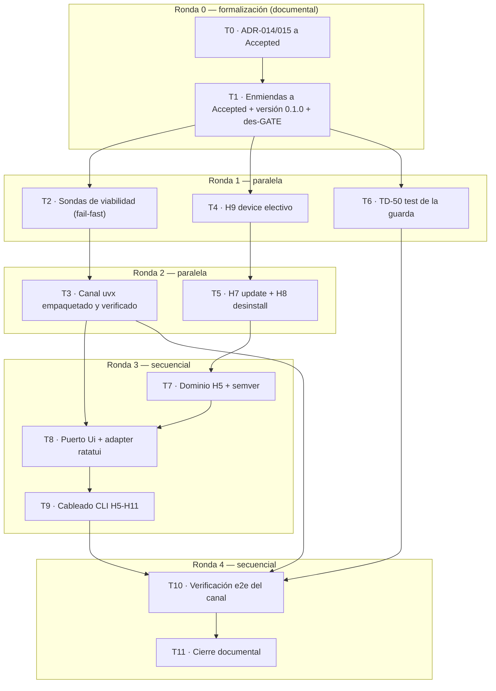
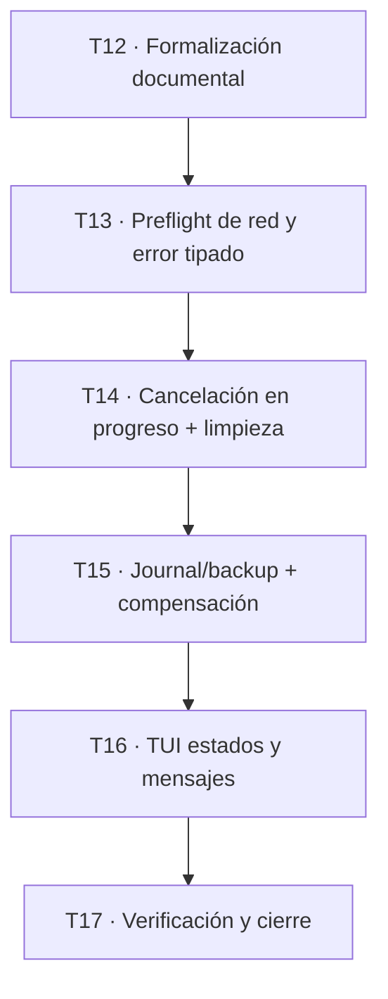

# Plan de implementación — Phase 6.5 (wizard, flujo destino H5-H11)

> **Estado:** planificado el 2026-11-19 · tlatoani: Moctezuma · FTR firmado por Fisherk2 (2026-11-19)
> **Fuente de verdad:** [docs/BACKLOG.md](../docs/BACKLOG.md) §2 «Wizard de instalación: flujo destino (2026-11-18)» + §4 D-005..D-008
> **Restricción vigente del dueño:** **no se publica en ningún gestor de paquetes.** Solo se prepara y se verifica en local.
> **Alcance documental:** ADR-014/015, enmiendas 2026-11-18 de `spec-installer-wizard` / `spec-embeddings`, [docs/WORKFLOW.md](../docs/WORKFLOW.md) §Phase 6.5, [docs/TECH_DEBT.md](../docs/TECH_DEBT.md) TD-45..TD-50.

---

## 1. Objetivo

Materializar el flujo destino del wizard ordenado por el dueño el 2026-11-18 (H5-H11 + anexo
Codice), cerrando los tres use-cases que hoy **no existen** (`update` de H7, `desinstall`
ampliado de H8, `device` electivo de H9), sustituyendo el `dialoguer` line-based por una TUI
full-screen con botones deshabilitados y razón visible, y dejando el canal `uvx` **preparado y
verificable en local** — sin que ninguna rueda llegue a PyPI.

Lo que **no** cambia: el motor RAG (`cocoindex` + `markitdown`), el contrato MCP de 7 tools, el
payload `obsidian-workspace/` (congelado salvo orden explícita), la regla one-version de ADR-004
(uv + venv del vault) y ADR-011 (ledger de dos librerías Python).

## 2. Decisiones del dueño (FTR del 2026-11-19)

| # | Decisión | Alcance | Efecto en el plan |
| --- | --- | --- | --- |
| D-6.5-a | **Firmar el FTR**: ADR-014 y ADR-015 pasan de *Proposed* a *Accepted*; las enmiendas 2026-11-18 de las dos specs pasan a *Accepted*; se alinean las versiones a `0.1.0` | Desbloquea la Phase 6.5 (las 4 precondiciones de WORKFLOW.md:299 quedan resueltas) | T0 y T1 |
| D-6.5-b | **Librería TUI: `ratatui` + `crossterm`** (lo que ADR-015 nombraba como ejemplo) | Única dep nueva del binario | T8 |
| D-6.5-c | **Empaquetado verificable en local**: `maturin build` + verificación de la rueda + `uvx --from <rueda local>` + CI que **construye** ruedas sin publicar | Ningún publish | T2 y T3 |
| D-6.5-d | **Núcleo primero, TUI al final**: 3 cortes commiteables (núcleo → TUI → verificación) | Reduce el radio de impacto por commit | §6 |
| D-6.5-e | **Anexo Codice→Rust fuera de alcance**: lo nuevo se aloja en las carpetas existentes (`cli/`, `application/`, `adapters/`, `domain/`) sin renombrar módulos | Evita un diff estructural sobre 18.499 líneas de Rust | Todo el plan |

**Aceptar ADR-014 no es publicar.** El ADR decide el canal; la publicación a PyPI sigue siendo
un acto futuro que este plan **no ejecuta** (ADR-014 §4.3 deja la toolchain de release propuesta,
y el dueño no ha pedido publicar).

## 3. Estado verificado del repositorio (censo del 2026-11-19)

Cifras medidas, no estimadas:

| Elemento | Estado verificado | Tarea que lo toca |
| --- | --- | --- |
| Crate Rust | `crates/tepochcalli/`, **18.499 líneas** en 66 `.rs`; capas `domain/` `ports/` `adapters/` `application/` `cli/` `config/` | T4, T5, T7, T8, T9 |
| Puerto `Ui` | `ports/ui.rs`: 4 métodos (`select`, `input`, `input_secret`, `panel`); **33 call sites**; 4 de ellos son `select` | T8 |
| Adapters de UI | `TtyUi` (dialoguer) + `HeadlessUi` (scripted) + fakes en tests | T8 |
| `Preset` | `config/presets.rs`: 10 campos, **sin `device`**; `presets.toml` con 2 entradas (MiniLM, BGE-M3) | T4 |
| Drift `device` | `application/embedder_config.rs:42` → `device = "cpu"` hardcodeado; `application/swap.rs:422` (`picked_config_body`) reconstruye el cuerpo y **pisa** el valor | T4 |
| `update` | **No existe** ningún use-case ni subcomando | T5 |
| `uninstall` | `application/maintenance.rs:148` — borra **solo** `.tepochcalli/`; `AGENTS.md` nunca se toca | T5 |
| Versiones | `Cargo.toml` = `0.1.0-beta.1` vs `obsidian-workspace/.tepochcalli/pyproject.toml` = `0.1.0` → **TD-45** | T1, T3 |
| Empaquetado | **No existe** `crates/tepochcalli/pyproject.toml` → maturin no tiene qué empaquetar | T3 |
| Toolchain del host | `maturin 1.15.0` ✅ · `uv`/`uvx` 0.12.9 ✅ · `cargo` 1.100.0 ✅ · **`cargo-dist`/`dist` AUSENTES** ⚠️ | T3 |
| Deps nuevas | `ratatui` 0.30.2 (crates.io, 2026-06-19) y `crossterm` 0.29.0 disponibles; **no cacheadas** → el primer build necesita red | T8 |
| Gates | `just quality` (702 tests, verde) · `just ci` (suite completa + 4 módulos + rust-ci 323 tests) · `just md-lint` (0 issues) | Todos |

### 3.1 Dos sondas que NO pude cerrar en la fase de planificación

El sandbox de esta sesión bloquea la escritura fuera del workspace, así que no pude ejecutar en
este entorno las dos comprobaciones de las que depende la forma del empaquetado. **No las doy por
buenas: son el primer trabajo de T2, con puerta de parada.**

| Sonda | Por qué importa | Fuente consultada |
| --- | --- | --- |
| ¿`maturin` empaqueta un crate con `lib.rs` (rlib) **y** `main.rs` con `bindings = "bin"`? | La doc dice que la detección automática de `bin` solo ocurre «si hay un único target binario y sin dependencia pyo3 ni target cdylib». El crate tiene **ambos** targets. Con `bindings = "bin"` explícito debería funcionar, pero la rueda podría arrastrar el rlib. | [maturin §bindings](https://www.maturin.rs/bindings.html) ✔ leída |
| ¿`uvx` puede ejecutar una tool desde una **rueda local** (`uvx --from ./tepochcalli-0.1.0-*.whl tepochcalli`)? | Es la única forma de **verificar el canal sin publicar**. Si `--from` no acepta rutas locales, el plan cambia a `uv tool install ./rueda` + `uv tool run --from`, o el canal queda sin verificación local. | [uv §Using tools](https://docs.astral.sh/uv/guides/tools/) ✔ leída (`--from` acepta «sources»; el caso local no está documentado explícitamente) |

## 4. Grafo de dependencias

**Por qué esas flechas y no otras:**

- `T0 → T1`: T1 cita la aceptación de T0 en el encabezado de las specs. No hay independencia real.
- `T1 → {T2, T4, T6}`: toda la ronda 1 exige el FTR (ADR-015Accepted es lo que habilita T4; la
  lectura de `device` en el flow ya está, el hueco está solo del lado del wizard).
- `T2 → T3`: **T3 no se escribe hasta que T2 demuestra que el canal es viable.** Es la puerta de
  parada: si la sonda falla, T3 cambia de forma (o el dueño decide) en vez de construir sobre arena.
- `T4 → T5`: T5 (update) y T4 (device) tocan ambos `lib.rs` y `application/`; se serializan para
  que un solo frente sea dueño de los exports públicos en cada momento.
- `T3 → T8`: T8 cambia el canal de invocación (el binario pasa a servirse como script de rueda);
  la TUI debe arrancar igual desde `uvx` que desde `./target/release/tepochcalli`.
- `T5 → T7`: el menú H5 enruta a los use-cases de T5 (update/desinstall); la máquina de estados
  no se diseña antes que sus destinos.
- `T7 → T8`: T7 define el **contrato** (`MenuSpec`, botones, razones) como tipo puro del dominio;
  T8 lo implementa en el puerto y en el adapter. Primero el contrato, luego el render — el ADR-005
  exige que el contrato se congele antes de las adaptaciones.
- `T9 → T10`: el smoke e2e necesita el menú cableado.

**Paralelismo real:** R1 (3 frentes: T2 · T4 · T6) y R2 (2 frentes: T3 · T5). Todo lo demás es
secuencial por dependencia de contrato, no por prudencia.

## 5. Tareas por corte

### CORTE 0 — Formalización (sin código)

#### T0 · Aceptar ADR-014 y ADR-015

**Descripción.** Cambiar el `Status` de ambos ADR de *Proposed* a *Accepted*, añadir la nota de
aprobación (FTR del dueño, 2026-11-19) y ajustar sus secciones §8 «Compliance and Review» para
que la evidencia pase de `declarado` a lo que realmente habrá tras T3. **No se reescribe ninguna
decisión ya Accepted** (ADR-003, ADR-004, ADR-007, ADR-008, ADR-011, ADR-013): los ADR-014/015
sustituyen/invierten lo que corresponde y lo declaran explícitamente.

**Criterios de aceptación.**

- [ ] `docs/adr/adr-014-distribucion-uvx-pypi.md` y `docs/adr/adr-015-dispositivo-inferencia-wizard.md` con `Status: Accepted` y fecha de aprobación 2026-11-19.
- [ ] La nota de «no entra en vigor hasta la aprobación explícita del usuario» se sustituye por la constancia de aprobación, sin borrar el historial de que nacieron *Proposed*.
- [ ] ADR-013, ADR-003, ADR-007 y ADR-008: **byte-idénticos** (verificado con `git diff --exit-code`).
- [ ] ADR-014 §4.3 registra que `maturin` + PyPI + `ratatui`/`crossterm` quedan **aprobados como deps** por el dueño (2026-11-19) y que la publicación sigue **no ejecutada**.
- [ ] `Decision Makers` pasa de «Dueño del repo» a «Fisherk2» en ambos ADR (alineación con el BACKLOG).

**Verificación.**

- [ ] `grep -rn 'Status: Proposed' docs/adr/` → vacío.
- [ ] `git diff --stat -- docs/adr/adr-003* docs/adr/adr-004* docs/adr/adr-007* docs/adr/adr-008* docs/adr/adr-011* docs/adr/adr-013*` → 0 líneas.
- [ ] `just md-lint` → 0 issues.

**Dependencias:** ninguna. **Ficheros:** 2 ADR. **Alcance:** S.

---

#### T1 · Enmiendas Accepted, versión alineada y des-GATE de la Phase 6.5

**Descripción.** Cerrar la precondición (c) y (d) del gate, y abrir la fase en el registro de fase.
Sin esto, T2-T11 trabajan contra un contrato `Proposed`.

**Criterios de aceptación.**

- [ ] `specs/spec-installer-wizard.md`: el encabezado pasa a «Enmienda 2026-11-18 — flujo destino (**Accepted**)» y §Enmienda 2026-11-18 deja de decir «no se aprueba ni se implementa aquí».
- [ ] `specs/spec-embeddings.md`: su enmienda 2026-11-18 pasa a **Accepted** y formaliza `[embedding].device` electivo (autoselección en runtime sigue **rechazada**).
- [ ] `crates/tepochcalli/Cargo.toml` `version` = `0.1.0` (alineado detrás de la canónica `obsidian-workspace/.tepochcalli/pyproject.toml` = `0.1.0`). → **cierra TD-45**.
- [ ] `docs/WORKFLOW.md` §Phase 6.5: el estado pasa de «GATED, no ejecutable» a «desbloqueada», con las 4 precondiciones marcadas como resueltas y fecha del FTR.
- [ ] `docs/TECH_DEBT.md`: TD-46 → cerrada; TD-45 → cerrada; **TD-51 nueva** (retiro materializado de `dist.toml` + `release.yml`, diferido por decisión del dueño).
- [ ] `docs/BACKLOG.md` §8: una fila por cada cambio estructural de esta fase.
- [ ] `SPEC.md` §Boundaries: la lista «preguntar antes» registra `maturin`/PyPI y `ratatui`/`crossterm` como **aprobadas** (con fecha), no como pendientes.

**Verificación.**

- [ ] `grep -n 'version' crates/tepochcalli/Cargo.toml` → `0.1.0`; `grep -n '^version' obsidian-workspace/.tepochcalli/pyproject.toml` → `0.1.0`.
- [ ] `grep -rn 'Proposed' specs/spec-installer-wizard.md specs/spec-embeddings.md` → vacío.
- [ ] `just md-lint` → 0 issues.

**Dependencias:** T0. **Ficheros:** 2 specs + `Cargo.toml` + `WORKFLOW.md` + `TECH_DEBT.md` + `BACKLOG.md` + `SPEC.md`. **Alcance:** M.

> **Checkpoint 0** — el FTR está registrado y el gate abierto. Sin este checkpoint, T2-T11 no arrancan.

---

### CORTE 1 — Núcleo verificable

#### T2 · Sondas de viabilidad del empaquetado (puerta de parada)

**Descripción.** Resolver empíricamente las dos sondas de §3.1 **antes** de escribir una línea de
empaquetado. El resultado es un veredicto por sonda: viable / inviable / workaround. Si alguna es
inviable sin workaround, **T3 se detiene y el dueño decide**.

**Criterios de aceptación.**

- [ ] Sonda A: un crate de prueba con `lib.rs` + `main.rs` y `bindings = "bin"` se empaqueta con `maturin build` sin error, y el contenido de la rueda se lista (`unzip -l`) para confirmar que **no** arrastra el rlib.
- [ ] Sonda B: `uvx --from <rueda local> <comando>` ejecuta el binario desde la rueda local sin instalar nada en el host. Si `--from` no acepta la ruta, se prueba `uv tool install <rueda>` + `uv tool run --from <rueda>` y se documenta el camino válido.
- [ ] Sonda C (extra): `maturin build` con el **crate real** produce una rueda cuyo nombre sigue la convención esperada (`tepochcalli-0.1.0-<tag>-<platform>.whl`).
- [ ] Informe de 15 líneas en el cuerpo del commit: veredicto por sonda, comando exacto que funcionó y el fallo exacto del camino que no.

**Verificación.**

- [ ] Cada sonda queda registrada con su comando y su salida cruda (no descrita).
- [ ] `git status` limpio tras la sonda (no se commitean binarios ni ruedas).

**Dependencias:** T1. **Ficheros:** ninguno del repo (trabajo en scratch). **Alcance:** S.

> **Checkpoint 1** — veredicto de viabilidad. Si falla, se para aquí y se consulta al dueño.

---

#### T3 · Canal `uvx`: rueda preparada y verificada en local (sin publicar)

**Descripción.** Crear la maquinaria de empaquetado del crate Rust como paquete Python, y
demostrar en local que `uvx tepochcalli` funciona — sin que nada llegue a PyPI.

**Criterios de aceptación.**

- [ ] `crates/tepochcalli/pyproject.toml` nuevo, con `[build-system] requires = ["maturin>=1,<2"]`, `[project]` (name `tepochcalli`, version `0.1.0`), `[project.scripts] tepochcalli = "tepochcalli:main"` y `[tool.maturin] bindings = "bin"`.
- [ ] `just rust-wheel` (receta nueva) construye la rueda con `maturin build` y la lista. `just rust-wheel-verify` la verifica: contenido, versión, script y **ejecución real**.
- [ ] `uvx --from <rueda local> tepochcalli --help` imprime la ayuda del wizard (evidencia de que el canal sirve el binario).
- [ ] `.github/workflows/release.yml`: el paso de publicación a PyPI **no existe**; el workflow solo **construye** ruedas para la matriz de targets y las sube como artefactos de CI. Un comentario declara explícitamente que la publicación es un acto manual futuro.
- [ ] **El retiro materializado de cargo-dist (`dist.toml` + `release.yml` heredado) NO se ejecuta en esta fase** (decisión D-6.5-c): `dist.toml` se conserva y se anota como pendiente en TD-51. Si T3 reescribe `release.yml`, se distingue el workflow de **ruedas** del de **cargo-dist**, y ambos conviven con nombres no colisionantes.
- [ ] `crates/tepochcalli/Cargo.lock` actualizado con `--locked` y `ratatui`/`crossterm` si T8 ya los引入 (si no, se deja para T8).

**Verificación.**

- [ ] `just rust-wheel` verde; `ls target/wheels/*.whl` lista la rueda.
- [ ] `python3 -m zipfile -l <rueda>` muestra el script `tepochcalli` en `*.data/scripts/`.
- [ ] `uvx --from <rueda> tepochcalli --version` responde.
- [ ] `grep -rn 'pypi\|twine\|publish' .github/workflows/` → solo menciones en comentarios que declaran que **no** se publica.
- [ ] `git status --short` no muestra ninguna `.whl`.

**Dependencias:** T2 (y T1 para la versión). **Ficheros:** `crates/tepochcalli/pyproject.toml` (nuevo), `Cargo.toml`, `Cargo.lock`, `Justfile`, `.github/workflows/`. **Alcance:** M.

---

#### T4 · H9 — dispositivo de inferencia electivo (`device`)

**Descripción.** Cerrar **TD-47**: el catálogo gana `device`, el wizard pregunta, el TOML registra y
la re-entrada **preserva** la elección.

**Criterios de aceptación.**

- [ ] `config/presets.rs`: `Preset` gana el campo `device` (String) y `presets.toml` lo declara en las 2 entradas (`cpu` para MiniLM, `cuda` para BGE-M3, como dato de catálogo — **D7.2: el catálogo es dato, no UI**).
- [ ] `application/embedder_menu.rs`: tras la elección del modelo, el wizard **pregunta explícitamente** el dispositivo (`cpu` preseleccionado; `cuda`/`cuda:N` solo si la sonda detectó GPU). Sin GPU ⇒ la opción aparece **deshabilitada con la razón visible** «GPU no detectada» — nunca se oculta (H9 + ADR-015 §4.1).
- [ ] `application/embedder_config.rs`: `local_config()` deja de hardcodear `device = "cpu"` y escribe **el dispositivo elegido**.
- [ ] `application/swap.rs`: `picked_config_body()` **preserva** el `device` existente como preselección en `tepochcalli config embedder` (corrige el drift de `swap.rs:422`).
- [ ] La **autoselección en runtime sigue rechazada**: sin `device` explícito en el TOML, el flow usa su default (`cpu`) sin tocar la GPU.
- [ ] Un modelo forzado a GPU no disponible ⇒ **advertencia** con procedencia `medido`, nunca bloqueo (D8.3).

**Verificación.**

- [ ] `cargo test --locked` verde con tests nuevos: `int_embedder_menu.rs` (pregunta de device, GPU ausente → deshabilitada con razón) y `int_presets.rs` (parseo del campo `device`).
- [ ] Test de no-destructividad: `config embedder` sobre un TOML con `device = "cuda:0"` deja `cuda:0` como valor final.
- [ ] `cargo clippy --locked --all-targets -- -D warnings` sin warnings.

**Dependencias:** T1. **Ficheros:** `config/presets.rs`, `config/presets.toml`, `application/embedder_config.rs`, `application/embedder_menu.rs`, `application/swap.rs`, `tests/int_embedder_menu.rs`, `tests/int_presets.rs`. **Alcance:** M.

---

#### T5 · H7 Update + H8 Desinstall (backup, advertencia, compensación)

**Descripción.** Cerrar **TD-48**: dos use-cases que hoy no existen, con la semántica de backup
obligatorio fijada por la excepción del dueño en `docs/CODE_STYLE.md` §Reglas específicas del payload.

**Criterios de aceptación.**

- [ ] Use-case `update` nuevo (`application/update.rs`): sobrescribe `.opencode/`, `.tepochcalli/`, `.gitignore`, `opencode.json` y `AGENTS.md`, y **solo eso**. Antes de pisar, **backup obligatorio** (`.bak`) de cada fichero existente + **advertencia visible** con el directorio objetivo.
- [ ] Rollback por compensación: si una fase falla, el estado previo queda restaurado desde los `.bak` (mismo patrón que las 8 fases de instalación).
- [ ] `application/maintenance.rs`: `run_uninstall()` amplía su alcance a `.opencode/`, `.tepochcalli/` y `opencode.json` — **y nada más** (`AGENTS.md` **no** se borra: lo fija US-H8). Backup + advertencia antes de remover.
- [ ] `cli/commands.rs`: subcomando `update` nuevo, con su entrada en `print_help()` y su código de salida.
- [ ] Idempotencia: `update` sobre un vault ya actualizado y `uninstall` sobre un vault ya desinstalado ⇒ no-op sin error (T14).
- [ ] **La primera Install y la re-entrada `config` siguen con merge conservador byte-a-byte** salvo `mcp.servers.*` gestionados (no se extienden a la ruta de `update`).

**Verificación.**

- [ ] `cargo test --locked` verde con tests nuevos `e2e_update.rs` y ampliación de `e2e_maintenance.rs`: backup creado, contenido restaurado tras un fallo inducido, `AGENTS.md` intacto tras `uninstall`, `00-resources/` intacto.
- [ ] Test de idempotencia: dos `update` seguidos ⇒ segundo es no-op.
- [ ] `cargo clippy --locked --all-targets -- -D warnings` sin warnings.

**Dependencias:** T4 (los exports de `lib.rs` los fija un solo frente). **Ficheros:** `application/update.rs` (nuevo), `application/maintenance.rs`, `cli/commands.rs`, `cli/usage.rs`, `lib.rs`, `tests/e2e_update.rs` (nuevo), `tests/e2e_maintenance.rs`. **Alcance:** L.

---

#### T6 · TD-50 — test de la guarda anti-exfiltración del loader

**Descripción.** Cerrar **TD-50**: la guarda que rechaza URLs dentro de `model` (protección contra
exfiltración por configuración) existe pero no tiene test que la ejercite.

**Criterios de aceptación.**

- [ ] Test unitario en `tests/unit/` que ejercita `flow/tepochcalli_flow/config.py:357-369` con `provider = "litellm"` y `model` que contiene `://`, `http` y `@`.
- [ ] El test afirma el comportamiento exacto: **fallback al modelo default con warning**, nunca el uso del `model` malicioso.
- [ ] El test está en el módulo de tests que le corresponde (`test-unit`, ≤10 min) y no en la suite pesada.

**Verificación.**

- [ ] `just python-test-unit` verde y el test nuevo **falla** si se desactiva la guarda (mutación manual verificada y revertida).
- [ ] `just typecheck` verde (mypy strict, superficie `flow` + `mcp`).

**Dependencias:** T1. **Ficheros:** `tests/unit/test_config_loader_guard.py` (nuevo). **Alcance:** XS.

> **Checkpoint 2** — corte 1 cerrado: `just quality` + `just rust-ci` verdes, la rueda se construye y `uvx` la ejecuta, y TD-47/48/50 cerrados.

---

### CORTE 2 — TUI full-screen (ratatui)

#### T7 · Dominio H5 puro: estado del menú, botones y comparador semver

**Descripción.** El menú H5 es una **máquina de estados** (la spec ya la dibuja en mermaid) y su
decisión —qué botón está habilitado y por qué— es **lógica de dominio**, no render. Este tarea la
extrae como módulo puro, sin I/O, testeable sin terminal.

**Criterios de aceptación.**

- [ ] `domain/menu.rs` (nuevo): un tipo `MenuSpec` con la lista de botones (etiqueta, habilitada, razón) y un tipo de **escenario** con los 4 estados de H5: `NoInstalado`, `Igual`, `Atrasada`, `Adelantada`.
- [ ] La matriz de habilitación es **exactamente** la de `spec-installer-wizard.md` §TUI full-screen: NoInstalado → solo Install; Igual → Change Embedder + Desinstall + Exit (Install y Update deshabilitados, razón «versión al día»); Atrasada → Update + Change Embedder + Desinstall + Exit (Install deshabilitado, razón «ya existe instalación»); Adelantada → **solo Exit**, con el mensaje de refresco y el comando exacto `uvx --refresh tepochcalli`.
- [ ] `domain/version.rs` (nuevo): comparador semver **propio** (sin dependencia nueva) que ordena `0.1.0` / `0.1.0-beta.1` / `0.2.0` correctamente, y lector de la versión canónica desde `.tepochcalli/pyproject.toml`.
- [ ] La **presencia** del embedder (API key externa o modelo local en `.tepochcalli/models/`) se calcula como dato de dominio y se muestra en el menú (H5).
- [ ] `domain/` no importa nada de `adapters/`, `ports/` ni crates externos (test de arquitectura).

**Verificación.**

- [ ] `cargo test --locked` verde con `tests/int_domain.rs` ampliado: matriz de los 4 escenarios × botones habilitados/deshabilitados con su razón; casos semver (incluido `0.1.0-beta.1 < 0.1.0`).
- [ ] Test de arquitectura: `domain/` sin dependencias de infraestructura.

**Dependencias:** T5. **Ficheros:** `domain/menu.rs` (nuevo), `domain/version.rs` (nuevo), `domain/mod.rs`, `lib.rs`, `tests/int_domain.rs`. **Alcance:** M.

---

#### T8 · Puerto `Ui` ampliado + adapter ratatui (con fallback dialoguer)

**Descripción.** Sustituir el `dialoguer` line-based por la TUI full-screen **sin romper** el
headless ni los fakes de test. El puerto es el contrato; el adapter es una implementación
intercambiable.

**Criterios de aceptación.**

- [ ] `ports/ui.rs`: **un** método nuevo (`menu`), que recibe la `MenuSpec` del dominio y devuelve el botón elegido. Los 4 métodos actuales **no cambian** de firma (el resto del wizard sigue igual).
- [ ] `adapters/ui_ratatui.rs` (nuevo): render full-screen con botones reales, **estado deshabilitado visible** (atenuado) y **razón visible** al lado; navegación por teclado; contacto (repo + `dev@fisherk2.com`) y link del repo siempre visibles (H5).
- [ ] `adapters/ui.rs`: `TtyUi` pasa a ser el **fallback** line-based (misma información, sin full-screen) cuando ratatui no puede tomar el TTY; `HeadlessUi` responde al `menu` por índice.
- [ ] `Cargo.toml`: `ratatui` 0.30 + `crossterm` 0.29 (únicas deps nuevas, aprobadas por el dueño); `Cargo.lock` actualizado.
- [ ] Los fakes de test del puerto `Ui` siguen compilando con la interfaz nueva (o se actualizan en el mismo commit).
- [ ] Con `--non-interactive`, el comportamiento es idéntico al actual (cero regresión en CI).

**Verificación.**

- [ ] `cargo test --locked` verde; los 33 call sites del puerto siguen funcionando.
- [ ] `cargo clippy --locked --all-targets -- -D warnings` sin warnings.
- [ ] Captura del menu renderizado en un TTY real (el anexo de T9) o, si no hay TTY, evidencia del buffer renderizado por el fake de test.

**Dependencias:** T7 (el tipo `MenuSpec` es el contrato), T3 (el binario debe servirse igual desde la rueda). **Ficheros:** `ports/ui.rs`, `adapters/ui_ratatui.rs` (nuevo), `adapters/ui.rs`, `Cargo.toml`, `Cargo.lock`, `tests/int_ports.rs`, `tests/e2e_ui.rs`. **Alcance:** L.

---

#### T9 · Cableado CLI: `tepochcalli` → H5 → H6..H11

**Descripción.** Sin subcomando, el binario abre el menú H5; cada botón enruta a su use-case; H10
sale sin tocar nada; H11 cierra con confirmación y agradecimiento.

**Criterios de aceptación.**

- [ ] `tepochcalli` (sin subcomando) ⇒ menú H5. Los subcomandos existentes (`install`, `config embedder`, `reindex`, `uninstall`) **siguen funcionando** (compatibilidad).
- [ ] 🟢 Update ⇒ T5 · 🔴 Desinstall ⇒ T5 · 🟣 Change Embedder ⇒ el flujo de swap existente · 🔵 Install ⇒ las 8 fases actuales · 🟠 Exit ⇒ **cero cambios** en disco.
- [ ] H11: tras cualquier opción salvo Exit, cierre **pulsando cualquier tecla** + mensaje de agradecimiento a Tepochcalli.
- [ ] H5 muestra: versión que gestiona el wizard, versión instalada, estado del embedder, link del repo y `dev@fisherk2.com`.
- [ ] En el escenario «instalada > wizard», el TUI muestra el comando copiable `uvx --refresh tepochcalli`.

**Verificación.**

- [ ] `cargo test --locked` verde; `tests/e2e_cli_help.rs` ampliado con el menú y sus 4 escenarios.
- [ ] `e2e_` manual: ejecutar el binario en un vault temporal y recorrer los 4 escenarios del menú.
- [ ] `just rust-ci` verde.

**Dependencias:** T8. **Ficheros:** `cli/mod.rs`, `cli/commands.rs`, `cli/usage.rs`, `main.rs`, `tests/e2e_cli_help.rs`. **Alcance:** M.

> **Checkpoint 3** — corte 2 cerrado: menú H5 con los 4 escenarios, botones con razón visible, y `just rust-ci` verde.

---

### CORTE 3 — Verificación y cierre

#### T10 · Verificación e2e del canal `uvx` (sin publicar)

**Descripción.** La evidencia que la fase promete: el canal funciona de punta a punta **sin que
nada llegue al registro de paquetes**.

**Criterios de aceptación.**

- [ ] Build limpio de la rueda desde un árbol de trabajo limpio.
- [ ] `uvx --from <rueda local> tepochcalli` abre el wizard y el menú H5 (captura o transcript).
- [ ] Recorrido completo sobre un vault temporal: Install → Update → Change Embedder → Desinstall, con backup verificado en cada fase.
- [ ] `just ci` verde (suite completa: quality + 4 suites de módulo + bench-smoke + rust-ci).
- [ ] `just md-lint` → 0 issues.
- [ ] **Prueba negativa**: no existe ninguna ruta de publicación activa (ni `twine upload`, ni `pypi` auth, ni `publish` de cargo a un registry nuevo).

**Verificación.**

- [ ] Transcript del recorrido pegado en el cuerpo del commit.
- [ ] `git status --short` limpio; ninguna rueda ni binario versionado.

**Dependencias:** T3, T6, T9. **Ficheros:** ninguno de producto (evidencia en el commit). **Alcance:** S.

---

#### T11 · Cierre documental

**Descripción.** Dejar el repositorio describiendo lo que la fase hizo, sin contradicciones.

**Criterios de aceptación.**

- [ ] `docs/WORKFLOW.md` §Phase 6.5: estado «completada», con las métricas **medidas** (no estimadas) y la salvedad honesta de lo no verificado (TTY en Windows, `uvx` en VM limpia real, publicación).
- [ ] `docs/TECH_DEBT.md`: TD-45/46/47/48/50 cerradas; **TD-51** (retiro materializado de cargo-dist) abierta y con plan de pago; **TD-52** nueva si el smoke de TTY en Windows sigue sin ejercitarse.
- [ ] `docs/ARCHITECTURE.md` §Key decisions: el canal vigente es `uvx`; ADR-003 queda como backend retirado.
- [ ] `SPEC.md` §Índice de specs: las dos specs con la enmienda Accepted.
- [ ] `CHANGELOG.md`: entrada de la fase.
- [ ] `docs/BACKLOG.md` §8: filas de todos los cambios estructurales.
- [ ] `docs/APPFLOW.md`: journeys d/e/f actualizados al flujo destino (menú H5).
- [ ] `AGENTS.md`: sin cambios (el payload y los contratos no se tocan) — se verifica y se declara.

**Verificación.**

- [ ] `just md-lint` → 0 issues.
- [ ] `grep -rn 'cargo binstall' docs/ SPEC.md README.md` → solo donde se explains como canal **heredado**.
- [ ] Coherencia: ninguna spec afirma que `UH.md` o una fuente obsoleta manda.

**Dependencias:** T10. **Ficheros:** 7 documentos. **Alcance:** M.

---

## 6. Tabla de asignación (subagentes · skills · herramientas · recursos)

Nombres **verificados** contra `agents/*.md` (subagents reales) y el catálogo de skills/tools de esta
sesión. Ninguno inventado.

| Tarea | Subagente principal | Subagente de apoyo | Skills | Herramientas (MCP/plugin) | Recursos externos |
| --- | --- | --- | --- | --- | --- |
| **T0** | `docs-writer` | `code-reviewer` | `documentation-and-adrs`, `git-workflow-and-versioning` | shell, `git-workflow-manager` para el commit | — (todo interno: ADR-003/004/007/008/011/013) |
| **T1** | `docs-writer` | `code-reviewer` | `documentation-and-adrs`, `spec-driven-development`, `git-workflow-and-versioning` | shell | — (interno: WORKFLOW, TECH_DEBT, BACKLOG) |
| **T2** | `build-engineer` | `debugger` (si una sonda falla) | `ci-cd-and-automation`, `source-driven-development`, `doubt-driven-development` | shell (`maturin`, `cargo`, `uv`), `context7`, `gitmcp` | ✔ [maturin bindings](https://www.maturin.rs/bindings.html) · ✔ [maturin layout](https://www.maturin.rs/project_layout.html) · ✔ [uv tools](https://docs.astral.sh/uv/guides/tools/) |
| **T3** | `build-engineer` | `deployment-engineer` (revisión del workflow) | `ci-cd-and-automation`, `dependency-audit`, `source-driven-development`, `incremental-implementation` | shell (`maturin build`, `uvx`), `context7`, `gitmcp`, `vercel-grep` | ✔ [maturin layout](https://www.maturin.rs/project_layout.html) · ✔ [uv tools](https://docs.astral.sh/uv/guides/tools/) · [maturin-action](https://github.com/PyO3/maturin-action) · [PyPA packaging](https://packaging.python.org/en/latest/tutorials/packaging-projects/) |
| **T4** | `rust-engineer` | `code-reviewer` | `rust-best-practices`, `test-driven-development`, `clean-ddd-hexagonal`, `domain-cli` | shell (`cargo`), `context7` | [HuggingFace model API](https://huggingface.co/api/models) (estimación de RAM) · [spec-embeddings](../specs/spec-embeddings.md) (interno) |
| **T5** | `rust-engineer` | `code-reviewer` | `rust-best-practices`, `test-driven-development`, `clean-ddd-hexagonal`, `design-patterns` (Command + compensación) | shell (`cargo`) | [spec-installer-wizard §Enmienda](../specs/spec-installer-wizard.md) (interno) · [CODE_STYLE §Reglas del payload](../docs/CODE_STYLE.md) (interno) |
| **T6** | `python-pro` | `test-engineer` | `python-testing-patterns`, `test-driven-development`, `security-and-hardening` | shell (`just python-test-unit`), `context7` | [spec-embeddings §endpoint](../specs/spec-embeddings.md) (interno) · `flow/tepochcalli_flow/config.py:357-369` (interno) |
| **T7** | `rust-engineer` | `software-architect` (revisión del contrato) | `clean-ddd-hexagonal`, `design-patterns` (State), `rust-best-practices`, `api-and-interface-design` | shell (`cargo`), `context7` | [semver](https://semver.org/) · [crates.io semver](https://crates.io/crates/semver) (referencia; la impl será propia) |
| **T8** | `rust-engineer` | `code-reviewer` | `ratatui`, `domain-cli`, `rust-best-practices`, `api-and-interface-design`, `test-driven-development` | shell (`cargo`), `context7`, `gitmcp`, `vercel-grep` | [ratatui.rs](https://ratatui.rs/) · [docs.rs/ratatui 0.30.2](https://docs.rs/ratatui/0.30.2/) · [docs.rs/crossterm 0.29.0](https://docs.rs/crossterm/0.29.0/) · [crates.io API ratatui](https://crates.io/api/v1/crates/ratatui) |
| **T9** | `cli-developer` | `code-reviewer` | `domain-cli`, `test-driven-development`, `error-handling-patterns` | shell (`cargo`), `context7` | [spec-installer-wizard §TUI full-screen](../specs/spec-installer-wizard.md) (interno) |
| **T10** | `test-automation-engineer` | `testing-reality-checker` | `test-driven-development`, `ci-cd-and-automation`, `doubt-driven-development` | shell (`just ci`, `maturin`, `uvx`) | ✔ [uv tools](https://docs.astral.sh/uv/guides/tools/) · [uv publishing (NO ejecutado)](https://docs.astral.sh/uv/publishing/) |
| **T11** | `docs-writer` | `technical-writer` (revisión) | `documentation-and-adrs`, `changelog-generate`, `tech-debt`, `git-workflow-and-versioning` | shell, `git-workflow-manager` | — (interno) |

### 6.1 Reglas de asignación

- **Un dueño por fichero.** `lib.rs` y `cli/commands.rs` los escribe **un solo frente** en cada
  momento: T4 → T5 → T7 → T8 → T9. Ninguna ronda corre dos frentes que los toquen.
- **Ningún subagente hace commits.** Los commits los hace `git-workflow-manager` al final de
  cada corte, con staging explícito (nunca `git add -A`).
- **Revisión por corte.** `code-reviewer` con contexto limpio antes de cada commit de corte.
- **Herramientas no asignables:** `codebase-memory-mcp` está **desactivado** en `opencode.json`
  (`"codebase-memory-mcp": {"disabled": true}`) — no se asigna a ninguna tarea. `chrome-devtools`,
  `excel` y `jupyter` también están desactivados. Plugins con uso real: `opencode-search-plugin`
  (web), `opencode-navigator` (navegación del workspace), `ponytail` (control de alcance).

## 7. Checkpoints (puertas de calidad entre cortes)

| # | Momento | Puerta | Si falla |
| --- | --- | --- | --- |
| **C0** | Tras T0-T1 | `grep -rn 'Status: Proposed' docs/adr/` vacío · `grep -rn 'Proposed' specs/` vacío · versiones alineadas en `0.1.0` · `just md-lint` 0 | se para: la fase no arranca sin contrato |
| **C1** | Tras T2 | Veredicto por sonda con comando y salida cruda | **se para y se pregunta al dueño**: la forma de T3 depende del veredicto |
| **C2** | Tras T3-T6 | `just quality` verde · `just rust-ci` verde · rueda construida · `uvx --from` ejecuta el binario · `git status` sin `.whl` | se revierte el corte; no se commitea a medias |
| **C3** | Tras T7-T9 | `just rust-ci` verde · matriz de los 4 escenarios de H5 verificada · fallback line-based y `--non-interactive` sin regresión | se revierte el corte 2 |
| **C4** | Tras T10-T11 | `just ci` verde · `just md-lint` 0 · recorrido e2e con transcript · **cero rutas de publicación activas** | no se cierra la fase |

## 8. Riesgos (omens) y mitigación

| # | Omen | Impacto | Mitigación |
| --- | --- | --- | --- |
| R1 | `maturin` **no** empaqueta bien un crate con `lib.rs` + `main.rs` | El canal `uvx` no es viable tal como está | T2 lo descubre **antes** de escribir T3; el fallback es `bindings = "bin"` explícito + `[lib] crate-type = ["rlib"]`, o un `[[bin]]` con `crate-type = ["bin"]` aislado |
| R2 | `uvx --from` **no** acepta una ruta local | El canal no es verificable sin publicar | T2 lo descubre antes; fallback `uv tool install ./rueda` + `uv tool run --from` |
| R3 | `cargo` muere con `Permission denied` en este montaje (fuseblk/NTFS-3G) | Todos los gates Rust | Regla de AGENTS.md: `CARGO_TARGET_DIR` **siempre** bajo `/tmp/opencode/` → `just rust-ci /tmp/opencode/cargo-target` |
| R4 | `ratatui`/`crossterm` no están cacheadas → el primer build necesita red | T8 se bloquea sin red | Se verifica el acceso a crates.io antes de T8; si no hay red, T8 se difiere y el corte 2 se ejecuta con el fallback `dialoguer` (el dominio H5 de T7 sigue siendo válido) |
| R5 | `cargo-dist` **no** está instalado | No se puede pasar `cargo dist generate --check` sobre `dist.toml` ni regenerar el release viejo | No se toca `dist.toml` en esta fase (TD-51); la CI de ruedas se escribe a mano, como ya se hizo con `release.yml` |
| R6 | El smoke de TTY bajo `uvx` **en Windows** nunca se ha ejercitado | El requisito de H5 en Windows queda `declarado`, no `medido` | Se declara como salvedad honesta en WORKFLOW y se abre **TD-52**; no se afirma cobertura |
| R7 | `AGENTS.md` del vault **no** se borra en `desinstall` (lo fija US-H8) pero la excepción del dueño en CODE_STYLE tampoco lo lista entre los borrados | Confusión de alcance | T5 lo fija con un test explícito: `AGENTS.md` intacto tras `uninstall` |
| R8 | La rueda PyPI es **inmutable** y no se puede borrar | — | Inmaterial: **no se publica**. Queda anotado en ADR-014 §5 como riesgo del canal futuro |
| R9 | Aceptar ADR-014 declara el retiro de cargo-dist, pero `dist.toml` sigue en el repo | Contradicción aparente entre ADR y árbol | ADR-014 §4.1 ya lo prevé («materialización = tarea futura»); **TD-51** lo registra explícitamente |
| R10 | Cambiar `Cargo.toml` a `0.1.0` es un cambio de semver público | Quien use `cargo install tepochcalli` pierde el rótulo `-beta.1` | Es la one-version rule de ADR-014 y ya está ordenada por el dueño (D-6.5-a). Se registra en `CHANGELOG.md` |

## 9. Fuera de alcance (explícitamente)

- **Publicación** en PyPI, crates.io o cualquier registro. Ni un `publish`, ni una credencial, ni un
  job de upload. La preparación sí entra.
- **Retiro materializado** de cargo-dist (`dist.toml`, `release.yml` heredado) → **TD-51**.
- **Anexo Codice→Rust** (reorganización de módulos) → decisión D-6.5-e.
- **Cambios en el payload** `obsidian-workspace/` (agentes, comandos, skills, `opencode.json`): congelado.
- **Cambios en el motor RAG**, el contrato MCP de 7 tools, `cocoindex`/`markitdown` o el venv del vault.
- **Autoselección de dispositivo en runtime**: sigue rechazada (ADR-015 §4.1, spec-embeddings:231).
- **El motor de la fase 6 (aceptación E2E del producto v1)**: Phase 6.5 es intermedia y no la renumera.

## 10. Referencias

- [docs/BACKLOG.md](../docs/BACKLOG.md) §2 «Wizard de instalación: flujo destino (2026-11-18)» · §4 D-005..D-008 · §8 change log
- [docs/adr/adr-014-distribucion-uvx-pypi.md](../docs/adr/adr-014-distribucion-uvx-pypi.md) · [docs/adr/adr-015-dispositivo-inferencia-wizard.md](../docs/adr/adr-015-dispositivo-inferencia-wizard.md)
- [specs/spec-installer-wizard.md](../specs/spec-installer-wizard.md) §Enmienda 2026-11-18 · [specs/spec-embeddings.md](../specs/spec-embeddings.md) §Enmienda 2026-11-18
- [docs/WORKFLOW.md](../docs/WORKFLOW.md) §Phase 6.5 · [docs/TECH_DEBT.md](../docs/TECH_DEBT.md) TD-45..TD-50
- [docs/CODE_STYLE.md](../docs/CODE_STYLE.md) §Reglas específicas del payload (excepción del dueño 2026-11-18) · §Umbral de líneas
- Externas consultadas en la fase de planificación: [maturin §bindings](https://www.maturin.rs/bindings.html) ✔ · [maturin §project layout](https://www.maturin.rs/project_layout.html) ✔ · [uv §Using tools](https://docs.astral.sh/uv/guides/tools/) ✔ · [crates.io API ratatui](https://crates.io/api/v1/crates/ratatui) ✔ · [crates.io API crossterm](https://crates.io/api/v1/crates/crossterm) ✔

---

*Plan redactado por Moctezuma (tlatoani) el 2026-11-19. Sin código implementado: este documento y `tasks/todo.md` son la única entrega de esta sesión.*

---

## 11. Fase 6.6 — resiliencia offline y rollback cancelable (H6/H7/H9)

> **Estado:** planificado el 2026-11-20 · tlatoani: Moctezuma · orden del dueño 2026-11-20
> **Fuente de verdad:** [docs/BACKLOG.md](../docs/BACKLOG.md) §2 US-H6/H7/H9 (edge case 2026-11-20) + §4 D-009 + [ADR-016](../docs/adr/adr-016-resiliencia-offline-y-rollback.md)
> **Restricción vigente del dueño:** **no se publica en ningún gestor de paquetes.** Solo se prepara y se verifica en local.
> **Alcance documental de este cambio:** ADR-016 (único fichero nuevo del cambio global; lo crea otro frente) + enmiendas de `spec-installer-wizard` / `spec-embeddings` + BACKLOG §4 D-009 / §8 + estos dos ficheros `tasks/`.

### 11.1 Enunciado canónico del requisito (usar tal cual, no re-inventar)

- **R-offline-1 (preflight):** Antes de escribir cualquier fichero, el wizard comprueba la conectividad mínima que la operación necesita. Si no hay red, cancela la operación con rollback y deja el workspace del usuario exactamente como estaba; muestra error tipado con razón y acción correctiva. No hay modo degradado ni instalación parcial en tiempo de instalación.
- **R-offline-2 (cancelación en progreso):** Durante la descarga del modelo, el usuario puede cancelar en cualquier momento desde el TUI y con Ctrl+C. La cancelación detiene la descarga, elimina los artefactos parciales y compensa todo cambio ya aplicado (rollback), cancelando la instalación completa. No queda modelo a medias en `.tepochcalli/models/`.
- **R-offline-3 (integridad):** El rollback restaura el estado previo de los ficheros gestionados usando el backup + journal ya existentes de H7/H8. Notas, PDFs, `.obsidian/` y configuración propia del usuario nunca se tocan. Tras el rollback se verifica que no quedan restos.
- **R-offline-4 (distinción crítica):** El modo degradado de **runtime** (ADR-007 / `rag_status`) NO cambia: en instalación/cambio de embedder, **sin red = cancelación, no degradación**. «Si la API no responde, se muestra `sin dato` sin fallar la instalación» aplica **solo a la estimación previa de requisitos**, no a la descarga real.

### 11.2 Objetivo

Hacer que H6 (Install), H7 (Update) y H9 (Change Embedder) **fallen limpio**: sin red antes de empezar se cancela sin tocar nada (R-offline-1); con red caída o cancelación del usuario a mitad de descarga se compensa el trabajo ya hecho y no queda modelo parcial (R-offline-2); y el estado previo se restaura y se verifica con el backup + journal que H7/H8 ya usan (R-offline-3). Todo sin una dependencia nueva: se reutiliza `ureq` (ya en `Cargo.toml`, v3) y el patrón de red falsa de `tests/int_fetch_verified.rs`.

### 11.3 Fuera de alcance

- **H8 (Desinstall)**: no se toca; su alcance y su `AGENTS.md` intacto quedan como los fijó T5.
- **El modo degradado de runtime** de ADR-007 / `rag_status`: no cambia (R-offline-4).
- **«Sin dato»**: sigue siendo solo la estimación previa de requisitos; no se extiende a la descarga real (R-offline-4).
- **Publicación** en cualquier registro, cambios en el payload, en el contrato MCP de 7 tools o en el motor RAG: reglas intactas de §9.

### 11.4 Decisiones del dueño (2026-11-20)

| # | Decisión | Alcance | Efecto en el plan |
| --- | --- | --- | --- |
| D-6.6-a | **Formalizar con ADR-016 + enmiendas** de `spec-installer-wizard` / `spec-embeddings` | Documental | T12 (en ejecución en este cambio) |
| D-6.6-b | **Alcance H6 + H7 + H9**; H8 queda fuera | Install, Update, Change Embedder | T13-T16 |
| D-6.6-c | **Cancelación con rollback, no degradación** en instalación/cambio de embedder | R-offline-1/2/4 | T13, T14, T15 |
| D-6.6-d | **Cero dependencias nuevas** (R1): reutilizar `ureq` y lo ya en `Cargo.lock` | Sin alta de deps | T13, T14, T17 |
| D-6.6-e | **La suite por defecto nunca depende de red real**: red falsa en loopback, patrón `int_fetch_verified` | e2e sin red | T17 |

### 11.5 Grafo y tareas por corte

**Orden:** T12 (contrato) → T13/T14/T15 (núcleo, secuencial por compartir las fases de instalación) → T16 (TUI sobre el contrato ya cerrado) → T17 (gate). Igual regla que §4: el contrato se congela antes que las adaptaciones (ADR-005).

#### T12 · Formalización documental (ADR-016, enmiendas, BACKLOG D-009/§8)

**Descripción.** Dejar el contrato written-down antes del código: ADR-016 *Accepted*, enmiendas de las dos specs y registro de la decisión D-009. **Es el trabajo que se está ejecutando ahora — en ejecución en este cambio documental** (OTRO frente crea el ADR; este frente solo escribe `tasks/plan.md` y `tasks/todo.md`).

**Criterios de aceptación.**

- [ ] `docs/adr/adr-016-resiliencia-offline-y-rollback.md` existe con `Status: Accepted` y fecha 2026-11-20; decide **cancelación con rollback**, no degradación; registra al menos dos alternativas (degradar / instalación parcial) y por qué se rechazan.
- [ ] `specs/spec-installer-wizard.md`: enmienda 2026-11-20 con R-offline-1/2/3/4 y los estados de botón/mensajes de cancelación para H6/H7/H9.
- [ ] `specs/spec-embeddings.md`: enmienda 2026-11-20 que deja explícito que `sin dato` es solo estimación previa (R-offline-4) y que el modo degradado de runtime no cambia.
- [ ] `docs/BACKLOG.md`: §4 D-009 + filas en §8 + edge case en US-H6/H7/H9.

**Verificación.**

- [ ] `just md-lint` → 0 issues.
- [ ] `git diff --exit-code` sobre ADR-007/008/014/015 → 0 líneas (no se reescriben decisiones Accepted).

**Dependencias:** ninguna. **Ficheros:** ADR-016 (nuevo), 2 specs, BACKLOG. **Alcance:** M. **Gate:** contrato congelado; sin él T13 no arranca.

#### T13 · Preflight de red y error tipado antes de escribir (R-offline-1)

**Descripción.** Comprobar la conectividad mínima que la operación necesita **antes del primer write** de H6/H7/H9; si falla, cancelar con rollback y error tipado con razón + acción correctiva. Sin modo degradado.

**Criterios de aceptación.**

- [ ] Un preflight con `ureq` (ya en `Cargo.toml`, sin dep nueva) valida el endpoint que la operación necesita con timeout corto y fallo rápido.
- [ ] Sin red ⇒ **ningún fichero escrito**; error tipado del wizard con razón y acción correctiva (no texto libre, no PANIC).
- [ ] El preflight corre **antes** de cualquier fase de escritura de `application/update.rs` y del swap de H9.
- [ ] `sin dato` de la estimación previa **no** cuenta como preflight (R-offline-4).

**Verificación.**

- [ ] Test sin red (red falsa que devuelve fallo): falla con error tipado y `git status` del vault temporal queda limpio — **cero ficheros**.
- [ ] `just rust-test /tmp/opencode/cargo-target` y `just rust-ci /tmp/opencode/cargo-target` verdes.

**Dependencias:** T12. **Ficheros:** `src/application/` (preflight + taxonomía de error), `tests/int_offline_preflight.rs` (nuevo). **Alcance:** M. **Gate:** checkpoint 1.

#### T14 · Cancelación de descarga en progreso + limpieza de parciales (R-offline-2)

**Descripción.** Durante la descarga del modelo, cancelar desde el TUI y con Ctrl+C: detener la descarga, borrar parciales y compensar lo ya aplicado, cancelando la instalación completa.

**Criterios de aceptación.**

- [ ] La descarga escucha una señal de cancelación compartida por el botón del TUI y Ctrl+C; al dispararse, la petición `ureq` se aborta y el stream se cierra.
- [ ] Los bytes parciales se escriben a un fichero temporal y se eliminan en **todas** las salidas (éxito, error, cancelación).
- [ ] Tras cancelar a mitad, `.tepochcalli/models/` queda **sin modelo a medias** (ni el temporal ni un directorio de versión incompleto).
- [ ] La cancelación propaga rollback (T15) y la instalación se aborta completa, no solo la descarga.

**Verificación.**

- [ ] Test `int_` con servidor loopback que entrega el cuerpo a trozos y se cancela a mitad: no queda ningún fichero bajo `.tepochcalli/models/`.
- [ ] Test de Ctrl+C simulado (señal inyectada al canal de cancelación, sin matar el proceso de test).
- [ ] `just rust-test /tmp/opencode/cargo-target` verde.

**Dependencias:** T13. **Ficheros:** `src/application/` (descarga + cancelación), `src/adapters/` (señal), `tests/int_download_cancel.rs` (nuevo). **Alcance:** M. **Gate:** checkpoint 1.

#### T15 · Journal/backup + compensación y verificación post-rollback (R-offline-3)

**Descripción.** Reutilizar el backup + journal de H7/H8 para compensar cambios ya aplicados en H6/H7/H9, y verificar que no quedan restos. Notas, PDFs, `.obsidian/` y config propia del usuario: nunca se tocan.

**Criterios de aceptación.**

- [ ] El journal registra cada fichero gestionado tocado (mismo mecanismo que el rollback de `application/update.rs` de T5), antes de tocarlo.
- [ ] Preflight fallido (T13) y cancelación a mitad (T14) invocan la **misma** compensación; no hay dos caminos de rollback divergentes.
- [ ] Tras el rollback, los ficheros gestionados quedan **byte-idénticos** al estado previo (comparación de bytes, no solo existencia).
- [ ] Test de no-interferencia: `00-resources/`, `.obsidian/` y un fichero de config propio del usuario siguen byte-idénticos tras forzar rollback en H6, H7 y H9.

**Verificación.**

- [ ] Tests `int_` que inducen fallo en cada fase y comparan el árbol completo del vault temporal antes/después.
- [ ] `just rust-test /tmp/opencode/cargo-target` y `just rust-ci /tmp/opencode/cargo-target` verdes.

**Dependencias:** T14. **Ficheros:** `src/application/` (journal/compensación), `tests/int_rollback_integrity.rs` (nuevo). **Alcance:** M. **Gate:** checkpoint 1.

#### T16 · TUI: estados de botón, razón visible y mensajes de cancelación/rollback (H6/H7/H9)

**Descripción.** Exponer en la TUI lo que el núcleo ya hace: progreso con botón de cancelación, razón visible cuando la red no está disponible, y confirmación de cancelación/rollback. Misma regla de H5: botón deshabilitado con razón, nunca oculto.

**Criterios de aceptación.**

- [ ] Durante la descarga, el botón de cancelar está habilitado y conectado a la señal de T14; el resto de botones deshabilitados con razón visible «descarga en curso».
- [ ] Sin red en preflight: el error tipado de T13 se muestra con razón y acción correctiva; no se ofrece «modo degradado» como salida.
- [ ] Tras cancelar/rollback, mensaje visible que confirma que el workspace quedó como estaba (R-offline-3).
- [ ] `HeadlessUi` y `--non-interactive` siguen sin regresión: la cancelación se puede inyectar por índice/señal en tests.

**Verificación.**

- [ ] `tests/e2e_ui.rs` ampliado con los 3 estados nuevos (descarga, sin red, post-rollback).
- [ ] `just rust-ci /tmp/opencode/cargo-target` verde; 33 call sites del puerto `Ui` intactos.

**Dependencias:** T15. **Ficheros:** `src/ports/ui.rs` (sin cambiar firmas existentes si basta), `src/adapters/ui_ratatui.rs`, `src/adapters/ui.rs`, `tests/e2e_ui.rs`. **Alcance:** M. **Gate:** checkpoint 2.

#### T17 · Verificación y cierre: gates + e2e con red falsa

**Descripción.** Evidencia final: la suite por defecto **nunca** usa red real; los escenarios offline se ejercitan contra un servidor loopback, con el patrón de `int_fetch_verified.rs`.

**Criterios de aceptación.**

- [ ] Todo test de red de la fase usa loopback o es `#[ignore]` con receta explícita, igual que `int_model_availability.rs`; `just rust-test` / `just ci` pasan sin red.
- [ ] Recorrido e2e sobre vault temporal: H6/H7/H9 × {sin red, cancelación a mitad}, con comparación byte-a-byte del árbol antes/después.
- [ ] `just quality` · `just ci` · `just rust-ci /tmp/opencode/cargo-target` · `just md-lint` → 0 issues.
- [ ] Cierre documental: WORKFLOW §Phase 6.6 con métricas medidas, TECH_DEBT con la deuda esperada de §11.8, BACKLOG §8.

**Verificación.**

- [ ] Transcript del recorrido en el cuerpo del commit; `git status --short` sin artefactos ni modelos parciales.
- [ ] `grep -rn 'https://huggingface' crates/tepochcalli/tests/` → solo en tests `#[ignore]`.

**Dependencias:** T16. **Ficheros:** `tests/`, `Justfile` (receta de e2e con red falsa), docs de cierre. **Alcance:** M. **Gate:** checkpoint 3.

### 11.6 Tabla de asignación (subagentes · skills · herramientas · recursos)

| Tarea | Subagente principal | Subagente de apoyo | Skills | Herramientas | Recursos |
| --- | --- | --- | --- | --- | --- |
| **T12** | `docs-writer` | `code-reviewer` | `documentation-and-adrs`, `spec-driven-development` | shell | ADR-016 + BACKLOG §4/§8 (interno) |
| **T13** | `rust-engineer` | `code-reviewer` | `rust-best-practices`, `test-driven-development`, `error-handling-patterns` | shell (`just`) | `ureq` 3 (ya en lock) · `int_fetch_verified.rs` (interno) |
| **T14** | `rust-engineer` | `code-reviewer` | `rust-best-practices`, `test-driven-development` | shell (`just`) | servidor loopback · `crossterm` (ya en lock) |
| **T15** | `rust-engineer` | `software-architect` | `clean-ddd-hexagonal`, `design-patterns` (Command/compensación) | shell (`just`) | rollback de `application/update.rs` (interno) |
| **T16** | `rust-engineer` | `code-reviewer` | `ratatui`, `domain-cli`, `test-driven-development` | shell (`just`) | `src/adapters/ui_ratatui.rs` (interno) |
| **T17** | `test-automation-engineer` | `testing-reality-checker` | `test-driven-development`, `ci-cd-and-automation` | shell (`just`) | `int_fetch_verified.rs` · `int_model_availability.rs` (internos) |

### 11.7 Checkpoints

| # | Momento | Puerta | Si falla |
| --- | --- | --- | --- |
| **C5** | Tras T12 | ADR-016 Accepted · enmiendas y D-009 presentes · `just md-lint` 0 | se para: sin contrato no arranca el núcleo |
| **C6** | Tras T13-T15 | `just rust-test` / `just rust-ci` verdes · cero ficheros sin red · cero modelos parciales al cancelar · byte-idéntico tras rollback | se revierte el corte |
| **C7** | Tras T16-T17 | `just quality` · `just ci` · `just md-lint` 0 · e2e con red falsa y transcript | no se cierra la fase |

### 11.8 Riesgos (omens) y mitigación

| # | Omen | Impacto | Mitigación |
| --- | --- | --- | --- |
| R11 | La cancelación por Ctrl+C no se propaga al stream de `ureq` | Queda descarga zombi / modelo a medias | T14 aborta petición y cierra stream; test de señal inyectada; el temporal se borra en todas las salidas |
| R12 | Dos caminos de rollback divergen (preflight vs cancelación) | Estado inconsistente del vault | T15 los unifica en una sola compensación con journal |
| R13 | Test de red real se cuela en la suite por defecto | `just ci` depende de red; fallos flaky | T17: loopback o `#[ignore]` con receta, patrón `int_fetch_verified` |
| R14 | Se confunde `sin dato` (estimación) con degradación de runtime | Se instala sin red contra R-offline-4 | T12 lo fija en spec; T13 excluye la estimación del preflight |
| R15 | Cancelación/rollback en Windows no medido (Ctrl+C distinto) | Salvedad de cobertura | Deuda esperada (sin ID nuevo): queda `declarado`, no `medido`; no se afirma cobertura |

### 11.9 Referencias

- [docs/BACKLOG.md](../docs/BACKLOG.md) §2 US-H6/H7/H9 (edge case 2026-11-20) · §4 D-009 · §8 change log
- [ADR-016](../docs/adr/adr-016-resiliencia-offline-y-rollback.md) · [ADR-007](../docs/adr/adr-007-seleccion-embedder-instalacion.md) (degradado de runtime, intacto) · [ADR-015](../docs/adr/adr-015-dispositivo-inferencia-wizard.md)
- [specs/spec-installer-wizard.md](../specs/spec-installer-wizard.md) §Enmienda 2026-11-20 · [specs/spec-embeddings.md](../specs/spec-embeddings.md) §Enmienda 2026-11-20
- Internos verificados: `crates/tepochcalli/Cargo.toml` (`ureq = "3"`) · `crates/tepochcalli/tests/int_fetch_verified.rs` (red falsa en loopback) · `crates/tepochcalli/tests/int_model_availability.rs` (`#[ignore]` + receta)
- [docs/CODE_STYLE.md](../docs/CODE_STYLE.md) §Reglas específicas del payload (backup obligatorio) · §Umbral de líneas (este fichero: tramo `<1000`).
