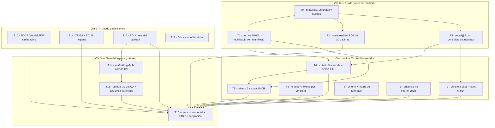

# Plan de implementación — Phase 6 (aceptación E2E de los 7 criterios)

<!-- markdownlint-disable MD036 -->

> **Fecha:** 2026-11-11 · **Autor:** Moctezuma (orquestador) · **Modo:** solo planificación (cero código)
> **Fase:** Phase 6 — E2E Acceptance (los 7 criterios de `docs/UH.md`) · **Gate de fase:** FTR de aceptación + gate v1 release
> **Fuente de verdad:** `docs/WORKFLOW.md` §Phase 6 (tabla §6.3) + `docs/TRD.md` §6 + `docs/UH.md` §criterios
> **Precedente:** D-P5-7 — `tasks/plan.md` y `tasks/todo.md` **se sobrescriben**; el plan de Phase 5 queda en el historial de git (`93d0060`). Los protocolos de Phase 5 sobreviven en `tasks/phase5-baseline.md` y `tasks/phase5-methodology-e2e.md`.

## 1. Objetivo y no-objetivos

**Objetivo:** cerrar la fase de aceptación: **medir** los 7 criterios de `docs/UH.md` contra el
sistema completo tal como lo tendría un usuario (vault instalado por el wizard + MCP `tepochcalli-rag`
real por stdio), **remediar** lo que impida un criterio o un gate, **cerrar** la deuda que esta fase
es dueña, y dejar la **evidencia medida** con la que se firma el gate de v1 release.

**Frontera de escritura (D-P6-1).** Dos cosas distintas conviven bajo `obsidian-workspace/`:

| Zona | Qué es | ¿Editable en Phase 6? |
| --- | --- | --- |
| **Contenido del harness** | `.opencode/` (5 agentes + 9 comandos + 40 skills), `AGENTS.md`, `opencode.json` | **NO.** Congelado en Phase 5 (D-P5-1/D-P5-2). Solo se **lee**. Si una referencia está equivocada, se reporta y se corrige en la spec del payload con enmienda fechada — **nunca** se reescribe el fichero del payload |
| **Código del motor** | `.tepochcalli/flow/`, `.tepochcalli/mcp/` (el motor que se distribuye dentro del payload) | **Sí.** Aquí vive la remediación (`verify.py --spot-check`, `require_local_model`) |
| Wizard | `crates/tepochcalli/` | **Sí.** |
| Tests y docs | `tests/`, `docs/`, `specs/`, `tasks/`, `SPEC.md`, `CHANGELOG.md` | **Sí.** |

**No-objetivos (fuera de Phase 6):**

| Fuera | Por qué |
| --- | --- |
| **M6 — ejecutar GitHub Actions y publicar una release de prueba** | Decisión de producto (publicar el repo), no de ingeniería. **No** seleccionado por el dueño (D-P6-4). La deuda sigue **abierta y declarada** |
| **TD-32 — extraer `installer.rs` (795) y `int_phase_f8_mcp_merge.rs` (854) a <500** | No seleccionado (D-P6-4). El refactor de T11 toca `embedder_menu.rs`, no esos ficheros |
| Modificar el contenido del harness del payload (agentes, comandos, skills, `AGENTS.md`, `opencode.json`) | D-P6-1 |
| Cambiar el contrato MCP (ADR-005), el motor (ADR-001) o el layout (D2) | `Accepted` ⇒ un ADR nuevo, nunca una edición |
| Optimizar el walk/index para que el Δ pase en fuseblk/NTFS-3G | D-P6-3: NTFS es **límite documentado**, no objetivo de optimización en v1 |
| Revertir ADR-011 (reintroducir Docling) sin dato que lo justifique | D-P6-5: primero se **mide** el impacto (T10) |
| OfficeCLI / feature 0.2.0 (TD-22) | Feature declarada fuera de v1 |
| Publicar el repo, hacer `push`, abrir PR | Fuera del encargo de planificación |

## 2. Decisiones tomadas (dueño, 2026-11-11)

| # | Decisión | Efecto en el plan |
| --- | --- | --- |
| **D-P6-1** | **Remediación permitida, payload de contenido congelado.** Se puede tocar código de producción (motor, wizard, tests, docs) cuando un criterio o un gate sale rojo. **Congelado:** `.opencode/` (agentes, comandos, skills), `AGENTS.md`, `opencode.json` del payload. **Editable:** `.tepochcalli/flow/`, `.tepochcalli/mcp/`, `crates/`, `tests/`, `docs/`, `specs/`. Si una referencia del payload es errónea: se reporta y se corrige en la spec, sin reescribir el payload | T7 y T11 escriben en `flow/`/`mcp/`/`crates/`; T12 solo **lee** el payload y su AC exige `git diff --stat -- obsidian-workspace` vacío |
| **D-P6-2** | **TD-31 (corrida D9 de los 9 comandos) la ejecuta el QA humano** en OpenCode: los comandos se activan por input del usuario y **no** son automatizables. Phase 6 entrega el scaffolding de evidencia y **verifica mecánicamente** lo verificable; no simula la corrida | T14 entrega runbook + script verificador + evidencia sintética de ejemplo; T15 es la corrida del QA y su verificación. Si no se ejecuta ⇒ se declara **NO EJECUTADO**, nunca verde |
| **D-P6-3** | **Referencia de medición = btrfs (`/tmp/opencode`, NVMe).** fuseblk/NTFS-3G (`/mnt/HDDFish`) se mide igual y se documenta como **límite conocido** con su cifra y su causa | T5 mide en ambos FS; el criterio 2 y el 6 se evalúan contra btrfs; NTFS va a la columna de límites de §6.3 |
| **D-P6-4** | **Deuda en alcance:** TD-2, TD-13, TD-15, TD-27, TD-28, TD-29, TD-34 y D-b. **Fuera (declarada, no silenciosamente):** M6, TD-32 y toda deuda sin plan de pago en Phase 6 (TD-3, TD-4, TD-6, TD-12, TD-30-cerrada, R5, CR-1…CR-8, Q-1…Q-3) | T2 (TD-2), T7 (TD-13), T3 (TD-15), T10 (TD-27), T11 (TD-28+TD-29), T12 (TD-34), T13 (D-b). M6 y TD-32 se **re-declaran abiertas** en T16 con su motivo |
| **D-P6-5** | **TD-27 (PDF sin jerarquía de headings, D54) se resuelve midiendo el impacto** en el criterio 5 y decidiendo con el dato. Revertir ADR-011 (reintroducir Docling: ≈225 MB y ≈2,0 GB RSS pico) solo si el dato lo justifica, y entonces con **ADR-013** que reemplace §4.3 de ADR-011 | T10: primero la medición, después la decisión. La opción elegida **no** reescribe el payload |
| **D-P6-6** | **D-b (Windows) se cierra como declaración honesta** del soporte en v1. Desde Linux no se puede ejecutar `install.ps1` ni `venv/Scripts/python.exe` | T13: documento de estado + decisión de soporte + propagación a `docs/TRD.md` §2 y `docs/APPFLOW.md`; **no** se declara «probado» |
| **D-P6-7** | **El cierre de Phase 6 es un FTR de aceptación** con la tabla §6.3 de `docs/WORKFLOW.md` rellena con **cifras medidas y su origen**, nunca con un «ok». Lo no verificado se escribe como no verificado | T16; convención de la columna «origen de la cifra» fijada en T0 |
| **D-P6-8** | **Los umbrales se fijan antes de medir.** El umbral de deriva FTS y el de recall se escriben en `docs/TRD.md` §6.2 en T0 (CP-0), no después de ver el resultado | T0 publica los umbrales; T3 y T4 los aplican sin poder ajustarlos |

## 3. Estado real verificado (2026-11-11, lectura del repo)

Cada línea está **medida**, no supuesta; el comando que la evidencia va en el calpulli que la usa.

| Hecho | Valor medido | Dónde |
| --- | --- | --- |
| Criterios de aceptación | **7**, textuales en `docs/UH.md` (líneas 55-60) + **1 gate adicional** (D9) que **no** es criterio 8 | `docs/UH.md` · `docs/WORKFLOW.md` §Phase 6 |
| Host de desarrollo | i7-8750H, **12 vCPU**, **15,5 GiB RAM** (≈8 GB disponibles), CPython 3.12.14, zram 7,9 GB | `free -g` · `nproc` |
| Filesystems | repo = **fuseblk/NTFS-3G** (`/mnt/HDDFish`) · `/tmp` = **btrfs/NVMe** | `df -T` |
| Baseline de escala (P-02) | btrfs **26 967 ms** (PASS, 90 % del budget) · NTFS-3G **39 501 ms** (FAIL) · walk-only 7,2 s (btrfs) vs **17,6 s** (NTFS) | `docs/TECH_DEBT.md` §Review 5-ejes Phase 3.5 |
| Baseline de Δ de texto | p95 **4 299 ms** (n=20, nearest-rank) | `docs/WORKFLOW.md` §Phase 3.5 (M11) |
| Baseline de `search` | p95 cliente **52 ms** / `took_ms` **49 ms** (n=20, corpus de 100 ficheros) | `docs/WORKFLOW.md` §Phase 2 (M2) |
| Benchmarks que ya existen | `bench_delta.py` (Δ, corpus 50 md/txt, 20 corridas) · `bench_delta_scale.py` (escala, 10 000 md + 1 000 PDF, 20 Δ + walk-only, `--dir`/`--keep`) · `bench_search.py` (`search` p95 por etapas, corpus 100 ficheros, 20 muestras) | `tests/benchmarks/` |
| Corpus de escala | 10 000 md en 10 subdirs + 1 000 PDF de 1 página reales (xref correcto), **seed determinista**, se **borra** al terminar salvo `--keep`; **sin manifiesto** de hash | `tests/benchmarks/bench_delta_scale.py` |
| Golden vault | `tests/fixtures/golden_vault/00-Resources/` = 1 md + 1 pdf | `tests/fixtures/` |
| E2E de citas | `tests/e2e/test_mcp_journey.py` ya afirma: `source_path` real, slice del original == `text` (md), `heading is None` (pdf, D54), `offsets_ref == "extract"` | `tests/e2e/` |
| Identidad de cita | `citation.verify_slice_identity(text, char_start, char_end, chunk_text)` **ya existe** y ya se usa; el CLI `verify.py` **no** la expone para re-verificar contra el archivo vivo (TD-13) | `flow/tepochcalli_flow/citation.py:263` · `verify.py` |
| `verify.py` | CLI de **solo lectura**: cuenta filas, consulta híbrida, imprime chunks citados. **Sin** `--spot-check` | `flow/tepochcalli_flow/verify.py` |
| Índice FTS | `table.declare_fts_index(column="text")` — **sin `language`** ⇒ stemming/stopwords solo en inglés sobre corpus ES+EN (hallazgo abierto del review 5-ejes de Phase 3.5) | `flow/tepochcalli_flow/app.py:341` |
| `require_local_model` | acepta `<models>/<slug>@<sha>/` si el directorio tiene **cualquier** entrada (TD-29) | `flow/tepochcalli_flow/model_store.py:5` |
| Tamaño del wizard | `embedder_menu.rs` **894** líneas (TD-28) · `installer.rs` 795 · `int_phase_f8_mcp_merge.rs` 854 (TD-32, fuera) | `crates/tepochcalli/` |
| Payload | **40 skills**, 5 agentes primarios + pack Códice, 9 comandos, `AGENTS.md`, `opencode.json` (30 KB) | `obsidian-workspace/.opencode/` |
| Suite y gates | **703 passed + 3 `slow`**, cobertura **97 %** (gate 95 %), `just ci` verde **local**; GitHub Actions **nunca ha corrido** (M6) | `docs/WORKFLOW.md` §Phase 3.5 (M14) |
| Debt register | TD-1…TD-34; **ninguna** asciende a blocker de Phase 6 | `docs/TECH_DEBT.md` §Revisión formato canónico |
| Runbook D9 | `tests/phase5-methodology-runbook.md` (214 líneas) — **escrito contra el formato anterior** a la ola canónica del 2026-11-12 (9 comandos endurecidos, `chilam` sin bandejas) | `tests/phase5-methodology-runbook.md` |

## 4. Grafo de dependencias

**Por qué este orden.** Cuatro reglas lo imponen:

- **T0 va primero porque fija los umbrales** (D-P6-8). Si el umbral de deriva FTS o de recall se eligiera después de ver el resultado, la medición no valdría como criterio. T0 publica el protocolo **y** los umbrales en `docs/TRD.md` §6.2; T3 y T4 los aplican sin poder ajustarlos.
- **T1 va antes de T4 y T5** porque ambos necesitan **el mismo corpus** (10 000 md + 1 000 PDF). Materializarlo dos veces cuesta dos indexaciones en frío de ~10 min cada una; con manifiesto, se materializa una vez y ambos miden sobre lo mismo (y el hash lo hace verificable).
- **T4 → T5 son secuenciales por economía, no por dependencia técnica.** Ambos miden sobre el corpus y el índice de btrfs ya construidos: compartirlos evita la segunda indexación en frío. T5 sí depende de T4 para el caso de que la deriva FTS obligue a cambiar la configuración del índice (entonces el Δ de T5 se mide sobre el índice final).
- **T12 → T14 → T15** es la cadena de la evidencia del agente: si un comando cita una skill que no existe, la corrida D9 falla por un motivo que no es del workflow. Se verifica **antes** de pedirle al QA que gaste la corrida.

**Paralelismo dentro de cada ola:** T1, T2 y T3 no se tocan entre sí (ficheros distintos, sin estado compartido) ⇒ **en paralelo**. T6, T7, T8 y T9 tampoco ⇒ **en paralelo**. T10, T11, T12 y T13 ⇒ **en paralelo**. Dentro de T11, los dos subagentes también ⇒ **en paralelo** (ficheros y lenguajes distintos). Lo que **no** puede ir en paralelo son los pares secuenciales declarados en §6.1.

## 5. Calpullis

Cada calpulli es una rebanada **vertical**: entrega un resultado completo y su prueba. «El criterio N se
puede declarar con esta cifra» — no «la capa Y está escrita».

---

### Task T0: Protocolo de aceptación, umbrales y auditoría de huecos

**Descripción:** medir el estado real contra los 7 criterios **antes** de tocar nada y fijar el
protocolo que todos los calpullis van a seguir: qué bench mide cada criterio, con qué n, con qué
método de percentil, en qué filesystem, contra qué host. Produce además la tabla de huecos (qué
existe hoy, qué falta, qué calpulli lo cierra) y **fija los umbrales** de recall y de deriva FTS
(D-P6-8). **Cero escrituras** fuera de `docs/diagnosis/` y `tasks/`.

**Criterios de aceptación:**

- [ ] `docs/diagnosis/phase6-protocol.md` declara el **host de referencia**: btrfs/NVMe en `/tmp/opencode`, 12 vCPU, 15,5 GiB RAM, CPython 3.12.14, y declara `/mnt/HDDFish` (fuseblk/NTFS-3G) como **filesystem de contraste** (D-P6-3).
- [ ] Los **7 criterios** de `docs/UH.md` copiados literalmente con su cota exacta, más el **gate adicional D9** marcado como *no criterio 8*.
- [ ] Por cada criterio: el bench o test que lo mide hoy (o `no existe`), la **cifra actual** si existe con su método, y el calpulli que lo cierra. La tabla §6.3 de `docs/WORKFLOW.md` aparece copiada con la columna `Result` vacía y una columna nueva **`origen de la cifra`** (convención de T16).
- [ ] **Umbrales fijados ANTES de medir** y escritos en `docs/TRD.md` §6.2: umbral de recall (propuesta: recall@5 = 1.0 sobre el golden vault) y umbral de deriva FTS (propuesta: caída de recall ES > 10 % relativo al detectar la pierna FTS).
- [ ] **Conflicto de numeración detectado y declarado**: `docs/TRD.md` §6 no tiene subsecciones; la casa cita «TRD §6.2» (TD-15) ⇒ se crean §6.1 «método» y §6.2 «umbrales» con este plan.
- [ ] **Deuda re-declarada** con su estado real: TD-2, TD-13, TD-15, TD-27, TD-28, TD-29, TD-34 y D-b **en alcance**; M6 y TD-32 **fuera** con su motivo (D-P6-4).
- [ ] `git status --short` muestra **solo** `docs/diagnosis/phase6-protocol.md`, `docs/TRD.md` y `tasks/`.

**Verificación:** cada afirmación del protocolo lleva el comando que la produce; el FTR lo revisa (CP-0). **Ningún bench se ejecuta aquí**: el protocolo se escribe antes de medir, o el criterio se ajusta al resultado.

**Dependencias:** — · **Scope:** S (1 documento nuevo + 1 enmienda de TRD)

**Ficheros probables:** `docs/diagnosis/phase6-protocol.md` · `docs/TRD.md` (§6.1/§6.2 nuevas)

---

### Task T1: Corpus de escala reutilizable con manifiesto (habilita criterios 3 y 6)

**Descripción:** el bench de escala ya sabe generar 10 000 md + 1 000 PDF deterministas, pero **borra
el vault** al terminar y no deja **man-manifiesto** verificable. Phase 6 necesita el mismo corpus dos
veces (criterio 3 y criterio 6) y necesita poder **reconstruirlo byte a byte** para que una cifra sea
reproducible. Extraer la materialización a un módulo reutilizable con manifiesto de hashes.

**Criterios de aceptación:**

- [ ] Corpus de **10 000 md** (10 subdirs × 1 000) + **1 000 PDF** de 1 página válidos (xref correcto, texto extraíble), determinista (seed fija) y materializado en `--dir` (btrfs por defecto).
- [ ] **Manifiesto** `corpus-manifest.json`: por fichero → ruta relativa, sha256, bytes, tipo; más `seed`, versión del generador y totales. **12 000+ líneas** de datos, pero **una** entrada por fichero (no por línea de prosa).
- [ ] **Reproducibilidad**: una segunda materialización desde el mismo seed produce un manifiesto **idéntico** (verificado por hash del árbol, no por comparación de carpetas).
- [ ] El corpus **nunca** toca `obsidian-workspace/.tepochcalli/{db,models}` — verificado al terminar (el bench ya lo garantiza; el AC lo hace explícito).
- [ ] Tamaño total en disco y **tiempo de materialización** publicados (con el método: reloj monótono).
- [ ] El corpus se puede **reutilizar sin reindexar**: un segundo proceso que encuentra el manifiesto verifica los hashes y salta la materialización.
- [ ] Sigue siendo **herramienta de medición, nunca gate**: no es un `test_*`, no entra en `just ci` (regla anti-flake + coste de ~10 min).

**Verificación:** dos ejecuciones → manifiestos idénticos; `sha256sum` del árbol coincide con el manifiesto; `just ci` sigue verde sin el bench.

**Dependencias:** T0 · **Scope:** M (módulo del corpus + bench de escala adaptado + test del manifiesto)

**Ficheros probables:** `tests/benchmarks/bench_delta_scale.py` · `tests/support/corpus.py` (nuevo) · `tests/support/test_corpus_manifest.py` (nuevo)

---

### Task T2: Coste real de un PDF de 30 páginas con markitdown (TD-2)

**Descripción:** la cifra **nunca medida**. La de Docling (49-51 s / 30 págs) **no se extrapola** a
markitdown (lección de Phase 3.5 (b): *lo no medido se escribe como no medido*). Sin ella, el
presupuesto de escala del criterio 6 **no se puede afirmar para PDFs de 30+ páginas**. Además, TD-2
deja una condición: *«si rompe la percepción de 30 s, límite de tamaño / cache de parse (Phase 6)»*.

**Criterios de aceptación:**

- [ ] Fixture **PDF de 30 páginas** válido (xref correcto, texto extraíble por pdfminer vía markitdown) generado **extendiendo `tests/fixtures/pdf/gen_fixture_pdf.py`** — **sin dependencia nueva** (R1).
- [ ] Medición con **n ≥ 3**: tiempo de extracción + indexación del PDF de 30 págs, con el **RSS pico** (`VmHWM`) al lado. Se publica n, método y host.
- [ ] La cifra va **separada** del Δ de texto (D51): el documento se mide aparte y **no** cuenta contra el presupuesto de 30 s. La tabla §6.3 lo refleja así.
- [ ] **Coste por página** publicado y contrastado con el corpus de 1 000 PDF de 1 página: la extrapolación se declara como *derivación*, no como medición.
- [ ] La cifra se etiqueta **`medido`** (jerarquía de D8: `medido > estimado > declarado`).
- [ ] **La condición de TD-2 se resuelve con dato**: si el PDF de 30 págs rompe la percepción del Δ ⇒ se **abre una tarea de remediación** (límite de tamaño de archivo o caché de parseo) con su propio ADR, y se registra como tal en `docs/TECH_DEBT.md`. Si no rompe ⇒ TD-2 se **cierra** con la cifra y su condición.
- [ ] El fixture de 30 págs **no** entra en el gate de `just ci` (marcado `slow` o fuera de la suite).

**Verificación:** el bench corre a mano y publica su JSON; el número aparece en `docs/TRD.md` §6 con su comando.

**Dependencias:** T0 · **Scope:** M (generador + bench + informe)

**Ficheros probables:** `tests/fixtures/pdf/gen_fixture_pdf.py` · `tests/benchmarks/bench_documents.py` (nuevo) · `docs/TRD.md` §6

---

### Task T3: Eval de relevancia con consultas etiquetadas (TD-15)

**Descripción:** la suite afirma **forma** (shapes, F1, presupuesto) y **tiempo** (p95), pero **ninguna
prueba pregunta «¿a la consulta X le corresponde el fichero Y en top-k?»**. Un cambio en el chunking,
en la fusión RRF o en el embedder podría empeorar las respuestas y el sistema seguiría verde. Este
calpulli cierra TD-15 con un golden etiquetado y un recall medido.

**Criterios de aceptación:**

- [ ] **10 consultas etiquetadas** (query → `source_path` esperado, + `heading` esperado cuando aplique) sobre `tests/fixtures/golden_vault/`, en **mix ES/EN** (para que el conjunto detecte también la deriva del FTS que T4 mide). Las etiquetas son **datos** (fichero en `tests/fixtures/`), no lógica.
- [ ] Test de integración **en subproceso** (patrón `index_vault` de `tests/support/mcp_server.py`): `search(top_k=5)` por consulta → **recall@5 = 1.0** sobre el fixture.
- [ ] **Sin** aserciones de latencia (regla anti-flake de la casa): el test afirma relevancia, no tiempo.
- [ ] El **umbral** (1.0) y su justificación quedan en `docs/TRD.md` §6.2 (fijado en T0, D-P6-8), junto al método y a n.
- [ ] **RED demostrado** antes de implementar (el commit del test en rojo, luego en verde).
- [ ] El test **falla** si el golden vault se vacía o si una etiqueta cambia ⇒ no es una tautología (lección de Phase 3.5 (c)).

**Verificación:** `just python-test` verde; el recall se publica con n = 10 y el nombre del fixture.

**Dependencias:** T0 · **Scope:** M (fixture de etiquetas + test de integración)

**Ficheros probables:** `tests/fixtures/golden_vault/queries.json` (nuevo) · `tests/integration/test_retrieval_relevance.py` (nuevo) · `docs/TRD.md` §6.2

---

### Task T4: Criterio 3 a escala (10k/1k) y deriva del índice FTS ES/EN

**Descripción:** el criterio 3 se ha medido **siempre** contra un corpus de 100 ficheros (p95 52 ms).
UH.md no pone tamaño al corpus, pero `docs/TRD.md` §6 sí: *«100 queries muestreadas del corpus
10k/1k»*. Además, el review 5-ejes de Phase 3.5 dejó un hallazgo **abierto**: el índice FTS se declara
sin `language` ⇒ stemming y stopwords **solo en inglés** sobre un corpus ES+EN. Ese es un mecanismo
concreto de deriva en la relevancia en español.

**Criterios de aceptación:**

- [ ] `search` medido sobre el corpus **10 000 md + 1 000 PDF** de T1 (índice estable), con **n = 100 queries** muestreadas del corpus, `top_k=5`, percentil **nearest-rank** declarado (`sorted[ceil(0.95·n)-1]`).
- [ ] Se publican **las dos cifras** que ya distingue el bench hermano: `p95_client_ms` (puerta del gate: incluye IPC, es lo que vive el usuario) y `p95_server_took_ms` (punto de medición de la spec). La que decide el criterio es `p95_client_ms`.
- [ ] La tabla **por etapa** (embed / ANN+FTS / ensamblado / IPC) se publica con su margen, como hoy: el presupuesto por etapa de `spec-mcp-server` §latencia es parte del diagnóstico si el p95 falla.
- [ ] **Deriva FTS medida**: recall@5 de las consultas ES con la pierna FTS activa vs **FTS desactivada** (solo ANN), sobre el mismo corpus y las mismas queries. El mecanismo queda demostrado con el número, no con la suposición.
- [ ] Si la deriva supera el umbral fijado en T0 ⇒ se evalúa la **configuración bilingüe del FTS** contra la **documentación de la versión pineada** de LanceDB (R3: leer la doc, no la memoria) y se implementa **o** se documenta el límite con su cifra y su impacto. La decisión queda escrita en `docs/TRD.md` §6.2 y `docs/TECH_DEBT.md`.
- [ ] La cifra que decide el criterio 3 va a la tabla §6.3 con su **origen** (bench + n + método).

**Verificación:** el JSON del bench se archiva como evidencia; `just python-bench-search` (variante de corpus) reproducible.

**Dependencias:** T0, T1, T3 · **Scope:** L (bench a escala + análisis de relevancia)

**Ficheros probables:** `tests/benchmarks/bench_search.py` (variante `--corpus`) · `tests/benchmarks/bench_search_scale.py` (nuevo) · `docs/TRD.md` §6.2

---

### Task T5: Criterio 6 — escala 10k/1k y comparación 10 % vs 100 %

**Descripción:** el criterio 6 dice *«sin degradación de rendimiento»* con 10 000 notas y 1 000 PDFs.
`docs/TRD.md` §6 lo operacionaliza: *«sin regresión >2× entre tamaños»*. El bench de escala ya mide
el Δ a 11 000 entradas y el walk-only; **falta** el brazo del 10 % (la comparación) y falta la
medición en el filesystem de contraste con su etiqueta de límite.

**Criterios de aceptación:**

- [ ] **Δ p95** (n=20, nearest-rank) sobre el corpus de 11 000 entradas, en **btrfs (referencia)**: cifra medida + método + diferencia declarada frente a la baseline P-02 (26 967 ms).
- [ ] **Comparación 10 % vs 100 %**: se mide el Δ **y** la latencia de `search` con el corpus al **10 %** (1 100 entradas) y al **100 %**; la regresión se publica como **ratio**, no como opinión. PASS = ratio ≤ 2× (la cota de TRD §6).
- [ ] **Walk-only** medido aparte (coste de `source.scan_items` sobre 11k entradas, sin embed y sin Δ) — es la cifra que explica el FS lento.
- [ ] **fuseblk/NTFS-3G**: la misma medición repetida en `/mnt/HDDFish` y el resultado publicado **como límite conocido** (D-P6-3), con la causa (walk de 11k entradas: 17,6 s medidos en Phase 3.5) y la recomendación al usuario (un vault en NTFS/OneDrive degrada el Δ; el presupuesto de 30 s es del FS local rápido).
- [ ] La cifra que decide el criterio es la de **btrfs**; la de NTFS va a la columna de límites de §6.3 — **no** se maquilla el FAIL.
- [ ] Los costes de **documentos** (D51) van aparte: los PDF de 30+ páginas no se mezclan con el Δ de texto (T2 aporta la cifra).
- [ ] El bench sigue **fuera** del gate de pytest (herramienta one-shot).

**Verificación:** JSON de resultados con ambos FS y los dos brazos; las cifras en `docs/TRD.md` §6 y `docs/WORKFLOW.md` §6.3.

**Dependencias:** T0, T1, T4 · **Scope:** M (extensión del bench + corrida larga + informe)

**Ficheros probables:** `tests/benchmarks/bench_delta_scale.py` · `tests/benchmarks/bench_scale_ratio.py` (nuevo, brazo 10 %) · `docs/TRD.md` §6

---

### Task T6: Criterio 4 — tokens por consulta (<2000 con contexto)

**Descripción:** el server **garantiza** ≤1600 tokens por la fórmula `chars/4 + 25` (spec-mcp-server), y
eso ya está testeado. Lo que UH.md pide es otra cosa: *«el consumo de tokens por consulta es inferior a
2000 tokens (incluyendo contexto)»* — la consulta completa vista por el LLM: query + payload + la
respuesta del agente con sus citas. Esa cifra **nunca se ha medido con un tokenizador real**.

**Criterios de aceptación:**

- [ ] Medición **e2e** del payload que ve el harness: `search` real (`top_k=5`) + query del usuario + esqueleto de la respuesta del agente con las citas, contado con un **tokenizador real** — no el estimador `chars/4`. El tokenizador se nombra con **versión** y se cita su fuente (R2/R3); si el del harness no es accesible desde el repo, se usa uno de referencia documentado y se declara cuál.
- [ ] Fixture **adverso**: unicode, CJK, emoji, tablas, listas largas — se reutiliza `tests/integration/test_mcp_budget_adversarial.py` como base.
- [ ] **Dos cifras** publicadas con su desglose: (a) **payload del server** (≤1600 por la fórmula — invariante del contrato) y (b) **total e2e** (**<2000**, el criterio de UH) = query + payload + envoltura de la respuesta.
- [ ] La cifra total se publica con n, tokenizador y método en `docs/TRD.md` §6.
- [ ] Si el total **excede** 2000 ⇒ el contrato MCP **no se toca** (ADR-005 congelado): el ajuste es del **techo del server** (p. ej. bajar 1600) y requiere decisión explícita del dueño + ADR si altera el contrato publicado. **Nunca** se maquilla la cifra recortando el corpus.
- [ ] Test e2e que **falla** si el total supera 2000 con el fixture adverso (guarda viva, no un número en un doc).

**Verificación:** el test corre en `just python-test` (es rápido) y la cifra publicada es reproducible.

**Dependencias:** T0 · **Scope:** M (test e2e + medidor + informe)

**Ficheros probables:** `tests/e2e/test_mcp_token_budget.py` (nuevo) · `tests/support/tokenizer.py` (nuevo) · `docs/TRD.md` §6

---

### Task T7: Criterio 5 — citas precisas y re-verificación contra el archivo vivo (TD-13)

**Descripción:** la identidad F1 (`text[char_start:char_end] == chunk.text`) se afirma **al indexar**,
en unit y en el e2e grabado — pero **nadie la re-comprueba contra el archivo vivo** después. Una
edición externa (otra app, sync) deja chunks con offsets exactos cuyo texto ya no está en el archivo:
la cita es estructuralmente válida y **falsa** respecto al vault ⇒ daño directo al criterio 5 (TD-13).
La función `citation.verify_slice_identity` **ya existe**: lo que falta es exponerla en el CLI de solo
lectura.

**Criterios de aceptación:**

- [ ] `verify.py` gana `--spot-check N`: para N filas muestreadas, relee el `source_path` desde el vault y afirma la identidad F1 **reusando** `citation.verify_slice_identity` (no se duplica la lógica). Informe por severidad + **exit ≠ 0** si hay fallos.
- [ ] `offsets_ref` respetado: `source` ⇒ el slice se hace contra el **archivo original**; `extract` ⇒ contra el **texto extraído** (documentos). El verificador distingue los dos casos.
- [ ] El verificador **conserva su carácter de solo lectura**: test de snapshot de `(mtime_ns, size)` de `db/` antes/después ⇒ **0** cambios (patrón ya existente en la suite de Phase 1).
- [ ] **Golden answers ampliado**: el conjunto cubre **md, txt y pdf** con `source_path` real + `heading` (nullable, D13) + offsets **reproducibles** (re-slice desde disco == `text`).
- [ ] Para **pdf**, `heading is None` (D54) se afirma **explícitamente**: el golden **no** exige heading en PDF — la ausencia es el contrato, no un fallo.
- [ ] Cobertura del gate intacta: el código nuevo del CLI entra en la superficie medida ⇒ `just coverage` ≥ 95 %.
- [ ] Si el spot-check encuentra citas rotas en el corpus real, se **documenta la tasa** (no se maquilla) y, si es > 0, se abre la remediación (re-index o aviso de obsolescencia, TD-4).

**Verificación:** un test **edita el archivo** post-indexación y espera **exit ≠ 0** del verificador (RED demostrado antes de implementar el flag).

**Dependencias:** T0, T3 · **Scope:** M (CLI + test + golden ampliado)

**Ficheros probables:** `obsidian-workspace/.tepochcalli/flow/tepochcalli_flow/verify.py` · `tests/unit/test_verify_spot_check.py` (nuevo) · `tests/e2e/test_mcp_journey.py` (ampliado)

---

### Task T8: Criterio 7 — matriz de conversión multi-formato

**Descripción:** el criterio 7 pide procesar *«distintos formatos de texto»* y, si no se puede, usar el
convertidor Markdown. Hoy el conversor cubre 8 formatos (ADR-011) y el índice acepta 8 extensiones
(D43), pero **no existe la matriz** que lo demuestra: formato → ¿se convierte? → ¿qué `doc_kind`? →
¿qué `offsets_ref`? → ¿indexable? El `.md` convertido **no** es la fuente citable (ADR-009) y eso
también hay que afirmarlo.

**Criterios de aceptación:**

- [ ] Matriz de **9 entradas**: `md`, `txt`, `pdf`, `docx`, `pptx`, `xlsx`, `xls` (índice) + `html` y `url` (convertidor). Por celda: resultado, `doc_kind`, `offsets_ref`, indexabilidad y el `source_path` resultante.
- [ ] La matriz se ejecuta como **test** (contract/e2e), no como tabla escrita a mano.
- [ ] Los formatos que markitdown **no** soporta (`.doc`, `.ppt`, PDF escaneado sin OCR) se declaran **GAP** con su mensaje accionable — **no** se simulan ni se inventan.
- [ ] `html` y `url` entran por el borde del conversor (resumen de 5 claves, ADR-009): se afirma que el `.md` **convertido no es la fuente citable** y que el original indexado sí lo es.
- [ ] La matriz publicada en `docs/TRD.md` §6 con el resultado de cada celda (incluidos los GAP).
- [ ] Sin dependencias nuevas (R1): los fixtures se generan con lo ya instalado (`markitdown[docx,pptx,xlsx,xls,pdf]`).

**Verificación:** el test e2e verde; la tabla de `docs/TRD.md` coincide con la salida del test.

**Dependencias:** T0 · **Scope:** M (fixtures + test + tabla)

**Ficheros probables:** `tests/e2e/test_format_matrix.py` (nuevo) · `tests/fixtures/formats/` (nuevo) · `docs/TRD.md` §6

---

### Task T9: Criterio 1 — no-interferencia con Obsidian

**Descripción:** el primer criterio de UH.md es *«el vault de Obsidian funciona normalmente sin
interferencias»*. `specs/spec-vault-structure.md` §Testing lo describe en prosa («`.obsidian/`
byte-idéntico, 0 procesos escuchando puertos nuevos, 0 archivos `.`-prefijados listados») pero **no
hay un checklist ejecutable**. Se ejecuta sobre un vault **instalado de verdad** por el wizard, no
sobre un directorio inventado.

**Criterios de aceptación:**

- [ ] Script ejecutable que, sobre un vault instalado (`install --non-interactive --skip-model`), comprueba y **publica**: (a) `.obsidian/` **byte-idéntico** antes/después de `index_refresh()` + `search` (hash de árbol, no `mtime`); (b) **0** puertos nuevos escuchando (captura `ss -ltnp` antes/después y **publica la lista**); (c) **0** ficheros con prefijo punto en el árbol visible del vault (`.tepochcalli/`, `.obsidian/`, `.git/` siguen ocultos); (d) el vault sigue siendo un vault válido (`opencode.json` parseable + `AGENTS.md` + bandejas presentes).
- [ ] El script corre contra el vault **real** instalado por el wizard (no un `tempfile` de tests).
- [ ] La evidencia de «0 puertos» se **archiva** (lista antes/después) — es la prueba de que el MCP es stdio y no expone nada (ADR-002/ADR-005).
- [ ] El script **falla** (exit ≠ 0) si `.obsidian/` cambia o si aparece un puerto nuevo ⇒ es una guarda, no un informe decorativo.
- [ ] El checklist de `spec-vault-structure.md` §Testing queda **ejecutado** y referenciado.

**Verificación:** el script verde sobre el vault instalado; su salida archivada como evidencia del criterio 1.

**Dependencias:** T0 · **Scope:** M (script + ejecución + evidencia)

**Ficheros probables:** `tests/e2e/verify_no_interference.py` (nuevo) · `docs/TRD.md` §6

---

### Task T10: TD-27 — el fate de la cita PDF sin heading (D54)

**Descripción:** con markitdown, `heading` es `null` en **toda** cita de PDF (y docx/pptx/xlsx/xls):
el agente no puede citar «sección 2.3» de un PDF. TD-27 lo acepta como coste explícito de ADR-011 y
**difiere la decisión a Phase 6**. La decisión se toma **con dato**: qué significa eso para el criterio 5
en la práctica. Revertir ADR-011 significa reintroducir Docling (≈225 MB de deps y ≈2,0 GB de RSS pico)
contra un presupuesto de dos librerías (ADR-011) — el coste solo se paga si el dato lo justifica.

**Criterios de aceptación:**

- [ ] **Medición del impacto**: sobre el corpus de T1, qué fracción de las citas de PDF en top-5 llega **sin** `heading`, y qué pasa con una query cuyo único material es un PDF (el agente no tiene a qué sección apuntar). Cifra con n y método.
- [ ] **Decisión con dato**, de dos vías: (a) **reafirmar D54** — markitdown sin jerarquía, con la cifra del impacto al lado y el coste de revertir documentado; o (b) **revertir ADR-011** — exige **ADR-013** que reemplace §4.3 de ADR-011 y re-sincroniza `spec-mcp-server`, `spec-rag-engine`, `spec-markitdown` y `spec-vault-structure`.
- [ ] La decisión queda **escrita** con su fecha: ADR-013 si es (b); si es (a), nota de cierre en `docs/TECH_DEBT.md` + `spec-mcp-server` §citas con la limitación y su cifra (TD-27 **cerrada** con evidencia).
- [ ] La opción elegida **no reescribe el payload** (D-P6-1) y **no** toca el contrato MCP sin ADR.
- [ ] La decisión es del **dueño** (cambia una decisión `Accepted`): el subagente **prepara** la opción con el dato; la firma es suya.

**Verificación:** la cifra es reproducible con el comando que la produce; el ADR (o la nota) tiene fecha y número.

**Dependencias:** T0, T1 · **Scope:** M (medición + documento de decisión)

**Ficheros probables:** `docs/adr/adr-013-*.md` (solo si la vía es (b)) · `docs/TECH_DEBT.md` · `specs/spec-mcp-server.md`

---

### Task T11: TD-28 + TD-29 — hygiene del wizard y del modelo local

**Descripción:** dos deudas pequeñas en **lenguajes distintos**, sin estado compartido ⇒ dos
subagentes **en paralelo**. (a) `embedder_menu.rs` tiene **894 líneas** (tramo 701-1000 de CODE_STYLE:
permitido solo con **advertencia** de refactorizar) y mezcla menú D7.1, gate test-embed y
materialización del snapshot. (b) `require_local_model` acepta un snapshot **a medias** porque solo
comprueba que el directorio no esté vacío ⇒ un snapshot de otra revisión pasa el chequeo y revienta más
tarde, donde `E_MODEL_INVALID` no se emite.

**Criterios de aceptación:**

- [ ] **(a)** `embedder_menu.rs` baja de 894 a **<500 líneas**, partiendo por responsabilidad (render del menú / gate test-embed / materialización del snapshot) **sin cambiar ni un mensaje** pinneado por `e2e_cli_help`/`int_*`.
- [ ] **(a)** `cargo fmt` limpio, `cargo clippy -D warnings` limpio, `cargo test` verde con el **mismo número de tests** (el refactor no puede perder cobertura).
- [ ] **(b)** `require_local_model` valida el snapshot **real** (ficheros esperados: `config.json` + pesos) en vez de «el directorio no está vacío»; un snapshot a medias o de otra revisión ⇒ `E_MODEL_INVALID` **donde hoy no se emite**.
- [ ] **(b)** Test que falla con un snapshot a medias y con el snapshot de otra revisión (RED demostrado antes).
- [ ] Cobertura Python ≥ 95 % tras el cambio (`just coverage`).
- [ ] `wc -l` de ambos ficheros y el recuento de tests publicados como evidencia (TD-28 y TD-29 **cerradas**).

**Verificación:** `just rust-ci` verde · `just python-test` + `just coverage` verde · `git diff --stat` reviewed.

**Dependencias:** T0 · **Scope:** M (dos ficheros de código + tests)

**Ficheros probables:** `crates/tepochcalli/src/application/embedder_menu.rs` (+ módulos nuevos) · `obsidian-workspace/.tepochcalli/mcp/tepochcalli_mcp/embedder.py` · tests correspondientes

---

### Task T12: TD-34 — refs a skills/subagentes del payload (solo lectura)

**Descripción:** la ola del formato canónico (12 commits `2072121..c815eb0`) cita skills por nombre
(`osint-skills`, `literature-search-engine`, `websearch-engine`, `tepochcalli-mcp`) **sin que ningún
gate verifique que existen**. Un comando que cargue un nombre inexistente falla en runtime del harness:
invisible para `just ci`. Se verifica **antes** de pedir la corrida D9 (T14/T15) para no gastar la
corrida del QA por un fallo de referencia.

**Criterios de aceptación:**

- [ ] `ls .opencode/skills` (40) cotejado con **todos** los nombres citados en los **9 comandos** y los **5 agentes** ⇒ **0 huérfanos**. Cada nombre citado va en una tabla con su fichero y su línea.
- [ ] `grep` de carga por comando: cada skill citada se carga **en el comando que la cita** (no en otro), y el `agent:` de cada comando resuelve a un primario existente.
- [ ] Verificación **de solo lectura**: `git diff --stat -- obsidian-workspace` **vacío** antes y después (D-P6-1).
- [ ] Si algún nombre está equivocado ⇒ **no se reescribe el payload**: se reporta y (a) se corrige en la spec del payload con **enmienda fechada**, o (b) se acepta como **GAP declarado** con su mensaje. En ambos casos, el gate de T15 queda desbloqueado con la decisión tomada.
- [ ] El informe se archiva como evidencia reutilizable por T15.

**Verificación:** la tabla nombre→fichero→presente; `git diff --stat -- obsidian-workspace` vacío.

**Dependencias:** T0 · **Scope:** S (script de barrido + informe)

**Ficheros probables:** `tests/e2e/verify_payload_refs.py` (nuevo) · `docs/diagnosis/phase6-payload-refs.md` (nuevo)

---

### Task T13: D-b — estado de soporte de Windows en v1

**Descripción:** el target `x86_64-pc-windows-msvc` compila y `install.ps1` existe, pero **nunca se
ejecutó** ni en `phase3.yml` (solo ubuntu+macos) ni a mano: ni `install.ps1`, ni
`venv/Scripts/python.exe`, ni el smoke path-5. Desde Linux **no se puede probar** (D-P6-6). La deuda se
cierra con una **declaración honesta** de soporte, no con un "verde".

**Criterios de aceptación:**

- [ ] Estado **verificado / no verificado** enumerado: qué existe (target compilable, `install.ps1`, layout `Scripts/`, merge de `opencode.json` por plataforma, D20) y qué **nunca** se ejecutó (instalador, smoke, CI).
- [ ] **Decisión de soporte para v1** escrita con su fecha: *Windows no soportado en v1* (recomendado) o *soportado con verificación pendiente* — con la **consecuencia para el usuario** (el camino `curl|sh` es POSIX; en Windows el camino documentado es manual) y qué habría que hacer para revertir la decisión.
- [ ] Propagación a: `docs/TRD.md` §2 (matriz de plataformas soportadas), `specs/spec-installer-wizard.md` (nota de plataforma), `docs/APPFLOW.md` (journey de instalación si existe) y `CHANGELOG.md`. **No** se toca `README.md` ni `LICENSE` (lista de «nunca» del `AGENTS.md`).
- [ ] `docs/TECH_DEBT.md` §D-b: **cerrada** con la decisión y su fecha.
- [ ] `just md-lint` 0 tras la edición.

**Verificación:** la decisión aparece citada en `docs/TRD.md` §2 y en `docs/APPFLOW.md`; enlaces relativos resuelven.

**Dependencias:** T0 · **Scope:** S (4 documentos)

**Ficheros probables:** `docs/TRD.md` · `specs/spec-installer-wizard.md` · `docs/APPFLOW.md` · `docs/TECH_DEBT.md` · `CHANGELOG.md`

---

### Task T14: Scaffolding de la corrida D9 (TD-31) — evidencia verificable

**Descripción:** la corrida la ejecuta el **QA humano** (D-P6-2), pero Phase 6 no puede entregar «se
ejecutó» sin una evidencia **comprobable**. Este calpulli entrega el andamiaje: un runbook actualizado
al formato canónico vigente (el de Phase 5 describe los comandos **antes** de la ola del 2026-11-12) y
un **script verificador** de la evidencia archivada que comprueba mecánicamente lo comprobable —sin
LLM—: el árbol de bandejas, los frontmatters, la presencia de las transcripciones y la regla MCP-first.

**Criterios de aceptación:**

- [ ] Runbook **nuevo** `tests/phase6-methodology-runbook.md` (el de Phase 5 se conserva como histórico, como su protocolo): los **9 comandos** con su formato vigente (Pre-Flight, `procedencia` de 4 estados, `/validate` en 4 fases, `/transform` A-G con `list_formats` antes de prometer, `/update` quirúrgico, `chilam` sin bandejas propias), los prompts por comando y el corpus.
- [ ] **Script verificador** `tests/e2e/verify_methodology_evidence.py`: dado el directorio de evidencia (transcripts + árbol del vault + checklist), comprueba (a) que cada artefacto aterriza en **su** bandeja única y que ninguna bandeja ajena tiene ficheros, (b) que el frontmatter de cada nota trae los campos que el formato vigente exige, (c) que existe transcripción de los **9** comandos, (d) la regla **MCP-first** (una llamada `search` antes de una lectura cruda de `00-Resources/` en el transcript). Salida: exit ≠ 0 + informe por punto.
- [ ] El script **no juzga la prosa** (el runbook lo dice): solo lo mecánico. Lo editorial queda como veredicto del QA.
- [ ] **Evidencia sintética de ejemplo** en `tests/fixtures/` (un vault con 9 artefactos en sus bandejas + transcripts falsos) que el script usa como **caso de prueba**: verde en la forma buena y **exit ≠ 0** ante cada defecto (bandeja ajena, frontmatter ausente, transcript faltante, MCP-first no observado).
- [ ] Plantilla de checklist con las columnas del formato vigente + la columna de evidencia.
- [ ] La corrida **no** se ejecuta aquí (D-P6-2): este calpulli entrega el instrumento, T15 lo usa.

**Verificación:** el script corre contra la evidencia sintética: verde en la forma buena, exit ≠ 0 en cada defecto.

**Dependencias:** T0, T12 · **Scope:** M (runbook + script + fixtures sintéticos)

**Ficheros probables:** `tests/phase6-methodology-runbook.md` (nuevo) · `tests/e2e/verify_methodology_evidence.py` (nuevo) · `tests/fixtures/methodology_evidence/` (nuevo)

---

### Task T15: Corrida D9 ejecutada por el QA + evidencia verificada

**Descripción:** el **QA humano** ejecuta los 9 comandos en el harness sobre un vault instalado, con el
corpus de fotosíntesis del runbook. Los subagentes **no ejecutan** la corrida (D-P6-2): recogen la
evidencia que el QA archive y **juzgan** si esa evidencia demuestra lo que dice. Si la corrida no se
ejecuta, el gate se firma con esa parte declarada **NO EJECUTADO** — nunca como verde.

**Criterios de aceptación:**

- [ ] Evidencia archivada en `tests/evidence/phase6/`: por comando `<NN>-<comando>-transcript.txt` + `<NN>-<comando>-artifact.md`, más `vault-tree.txt` y `checklist.md` (el transcript va **crudo**: nombres y argumentos de las tools, resultados resumidos).
- [ ] `python3 tests/e2e/verify_methodology_evidence.py tests/evidence/phase6` ⇒ **exit 0** (todo lo mecánico verde: bandejas, frontmatters, 9 transcripciones, MCP-first).
- [ ] El checklist del runbook **relleno** con la evidencia enlazada, y los puntos no mecánicos con el veredicto del QA.
- [ ] Lo **no verificado** se escribe como no verificado (lección de Phase 3.5 (b)): ningún «verde» sin método.
- [ ] Si la corrida **no** se ejecuta: la tabla §6.3 marca el gate adicional como `NO EJECUTADO` con el motivo, y TD-31 **sigue abierta** con su plan de pago intacto.

**Verificación:** el script verde sobre la evidencia real; el checklist con 45/45 puntos y evidencia enlazada.

**Dependencias:** T14 · **Scope:** L (corrida completa del QA + archivo + verificación)

**Ficheros probables:** `tests/evidence/phase6/**` (nuevo, datos de QA) · `docs/TECH_DEBT.md` (estado de TD-31)

---

### Task T16: Cierre documental + FTR de aceptación

**Descripción:** cerrar la fase con **cifras medidas** (nunca estimadas) y el FTR de `docs/WORKFLOW.md`.
Es el calpulli que convierte 16 resultados dispersos en **una tabla de 7 filas con su origen**.

**Criterios de aceptación:**

- [ ] `docs/WORKFLOW.md` §Phase 6: **tabla §6.3 rellena** — cada fila con su cifra medida, su **origen** (bench + n + método) y su veredicto; el **gate adicional D9** con su estado real; sección mantenida **< 700 líneas** (CODE_STYLE).
- [ ] `docs/TRD.md` §6: protocolo, **umbrales** y cifras de la fase publicados (§6.1 método, §6.2 umbrales).
- [ ] `docs/TECH_DEBT.md`: **re-revisión formal** — TD-2, TD-13, TD-15, TD-27, TD-28, TD-29, TD-34 y D-b con su estado medido; **M6** y **TD-32** **siguen abiertas** con su motivo (D-P6-4); ninguna deuda cerrada sin evidencia.
- [ ] `SPEC.md`: los 7 criterios de `docs/UH.md` pasan a **verificados** con fecha y enlace a la evidencia; el estado de las specs no cambia salvo enmienda autorizada.
- [ ] `CHANGELOG.md`: entrada de Phase 6.
- [ ] `docs/ARCHITECTURE.md`: **sin** diagrama nuevo salvo que T10 o T13 alteren el inventario (una línea si hace falta).
- [ ] **FTR de aceptación**: checklist de los 7 criterios + el gate D9, cada fila con su cifra y su comando reproducible.
- [ ] `just ci` verde (suite + cobertura ≥ 95 % + bench-smoke + rust-ci) y `just md-lint` 0 en el commit de cierre.
- [ ] **Revisión cruzada de cifras**: cada número citado en `docs/WORKFLOW.md`, `docs/TRD.md`, `docs/TECH_DEBT.md` y `SPEC.md` es el **mismo** y su comando está a mano (un número, una fuente).

**Verificación:** revisión cruzada por un segundo par de ojos (distinto del ejecutor) · `just ci` + `just md-lint` verdes.

**Dependencias:** T2, T4, T5, T6, T7, T8, T9, T10, T11, T12, T13, T15 · **Scope:** M (5 documentos)

**Ficheros probables:** `docs/WORKFLOW.md` · `docs/TRD.md` · `docs/TECH_DEBT.md` · `SPEC.md` · `CHANGELOG.md` · `docs/ARCHITECTURE.md`

## 6. Asignación de subagentes, skills y herramientas

### 6.1 Subagentes por calpulli

| Calpulli | Subagente principal | Subagente(s) de apoyo | Orden | Por qué |
| --- | --- | --- | --- | --- |
| T0 | `codebase-archaeologist` | `performance-benchmarker` | **secuencial**: huecos → protocolo | El arqueólogo lee el estado real y enumera qué falta por criterio; el especialista del rendimiento redacta el protocolo con n, método y umbrales — el que fija umbrales necesita ver primero los huecos |
| T1 | `performance-benchmarker` | — | — | Corpus determinista + manifiesto reproducible: es trabajo de instrumentación de medición, no de dominio |
| T2 | `performance-benchmarker` | — | — | Medición del coste de extracción con RSS pico; la cifra de TD-2 nunca existió y hay que publicarla con n y método |
| T3 | `search-relevance-engineer` | — | — | recall@5 con consultas etiquetadas: es relevancia, no forma ni tiempo — el dominio de este agente |
| T4 | `performance-benchmarker` | `search-relevance-engineer` | **secuencial**: bench a escala → deriva FTS | El bench establece la latencia p95 sobre 10k/1k; el análisis de relevancia necesita ese corpus y ese índice ya construidos para aislar la pierna FTS (solo ANN vs FTS+ANN) |
| T5 | `performance-benchmarker` | — | — | El brazo 10 % vs 100 % y la comparación de FS son la misma familia de medición de T4 (comparte corpus e índice) |
| T6 | `llm-architect` | `test-engineer` | **secuencial**: presupuesto → guarda e2e | El arquitecto de LLM define el desglose de tokens y el tokenizador de referencia; el tester lo convierte en una guarda viva que falla si el total supera 2000 |
| T7 | `rag-pipeline-engineer` | `test-engineer` | **secuencial**: `--spot-check` → guardas e2e | El flag del verificador y la identidad F1 son dominio del pipeline; el test e2e (edit-after-index ⇒ exit ≠ 0, golden ampliado) necesita el flag ya existente para ejercitarlo |
| T8 | `test-engineer` | — | — | La matriz de formatos es un contrato ejecutable con GAP declarados |
| T9 | `test-engineer` | `security-architect` | **secuencial**: checklist → juicio de no-interferencia | El checklist comprueba lo mecánico (hash, puertos, árbol); el arquitecto de seguridad juzga si la evidencia demuestra «sin interferencias» (0 puertos = MCP stdio) |
| T10 | `rag-pipeline-engineer` | `software-architect` | **secuencial**: medición → decisión | Primero el dato (impacto de la cita sin heading en el criterio 5); después el arquitecto decide y redacta el ADR o la nota — cambiar una decisión `Accepted` es suya |
| T11 | `rust-refactoring-specialist` | `python-pro` | **paralelo** (dos subagentes a la vez) | Ficheros, lenguajes y suites **distintos** (`embedder_menu.rs` vs `embedder.py`), cero estado compartido ⇒ el paralelismo es seguro y cada uno mantiene su toolchain |
| T12 | `codebase-archaeologist` | — | — | Barrido de referencias huérfanas: lectura y contraste, cero escritura |
| T13 | `technical-writer` | — | — | Una decisión de soporte que se propaga a 4 documentos con el mismo matiz; el que redacta la difunde sin diluirla |
| T14 | `technical-writer` | `test-engineer` | **secuencial**: runbook → verificador | El verificador comprueba exactamente lo que el runbook promete; si el verificador va primero, comprobará una lista imaginada |
| T15 | `testing-evidence-collector` | `testing-reality-checker` | **secuencial**: recoger → juzgar | La evidencia se recoge primero (transcripts + árbol); después se juzga si demuestra lo que dice — nunca al revés |
| T16 | `docs-writer` | `code-reviewer` | **secuencial**: cierre → revisión cruzada | El redactor consolida las cifras; el revisor comprueba que ninguna cifra es estimada y que ningún número aparece con dos valores distintos |

> **Ninguno de los subagentes ejecuta la corrida D9** (D-P6-2): la ejecuta el QA humano. T15 solo
> **recoge** lo que el QA archive y lo **verifica**.

### 6.2 Skills por calpulli

| Calpulli | Skills |
| --- | --- |
| T0 | `documentation-and-adrs`, `source-driven-development`, `planning-and-task-breakdown`, `context-engineering` |
| T1 | `performance-analysis`, `bash-defensive-patterns`, `test-driven-development`, `design-patterns` (el manifiesto es un *Value Object* del corpus: inmutable, con hash) |
| T2 | `performance-analysis`, `observability-and-instrumentation`, `bash-defensive-patterns` |
| T3 | `test-driven-development`, `source-driven-development`, `clean-code` |
| T4 | `performance-analysis`, `observability-and-instrumentation`, `source-driven-development` (la config del FTS se verifica contra la doc de la versión pineada: R3) |
| T5 | `performance-analysis`, `observability-and-instrumentation`, `documentation-and-adrs` |
| T6 | `source-driven-development`, `test-driven-development`, `error-handling-patterns` |
| T7 | `test-driven-development`, `incremental-implementation`, `debugging-and-error-recovery`, `clean-code` |
| T8 | `test-driven-development`, `api-and-interface-design`, `documentation-and-adrs` |
| T9 | `test-driven-development`, `bash-defensive-patterns`, `security-and-hardening`, `observability-and-instrumentation` |
| T10 | `documentation-and-adrs`, `source-driven-development`, `performance-analysis`, `doubt-driven-development` |
| T11 | `refactoring-patterns`, `clean-code`, `design-patterns`, `test-driven-development`, `incremental-implementation` |
| T12 | `codebase-memory`, `documentation-and-adrs`, `context-engineering` |
| T13 | `documentation-and-adrs`, `changelog-generate`, `technical-writer` |
| T14 | `documentation-and-adrs`, `test-driven-development`, `bash-defensive-patterns`, `doubt-driven-development` |
| T15 | `doubt-driven-development`, `document-verification`, `testing-evidence-collector` |
| T16 | `documentation-and-adrs`, `changelog-generate`, `code-review-and-quality`, `git-workflow-and-versioning` |

### 6.3 Herramientas (MCPs y plugins) por calpulli

MCPs **activos** en este workspace (raíz `opencode.json`): `codebase-memory-mcp`, `context7`, `vercel-grep`,
`gitmcp`. **Desactivados**: `chrome-devtools`, `excel`, `jupyter` (no se habilitan: abrirían superficie
nueva). Plugins: `opencode-rpc`, `opencode-navigator`, `opencode-skills-collection`,
`opencode-skill-creator`, `opencode-search-plugin`, `ponytail`.
El MCP **`tepochcalli-rag`** (7 tools) vive en el `opencode.json` del **payload**: en esta fase lo
ejercitan los benches y los tests e2e talking por stdio real (`python -m tepochcalli_mcp`), no el harness
del repo padre.

| Calpulli | Herramientas | Para qué |
| --- | --- | --- |
| T0 | `codebase-memory-mcp`, `vercel-grep` | Grafo del repo (qué benches/tests existen y qué miden) + barrido de literales (`declare_fts_index`, `spot-check`, `p95`) |
| T1 | — | Trabajo local determinista (generación + hashes); el corpus no se indexa desde el MCP |
| T2 | — | Trabajo local: extracción con el motor + RSS con `/proc` |
| T3 | `tepochcalli-rag` (payload, stdio) vía el helper de `tests/support/mcp_server.py` | El recall se mide sobre el **MCP real**, no sobre el lector interno |
| T4 | `tepochcalli-rag` (payload, stdio) · `context7` | Búsqueda real a escala; **`context7`** para la doc de la versión pineada de LanceDB (config `language` del FTS) — R3, no memoria |
| T5 | `tepochcalli-rag` (payload, stdio) | Refresh y búsqueda a escala por el camino real |
| T6 | `tepochcalli-rag` (payload, stdio) · `context7` | Payload real para el conteo de tokens; `context7` para el tokenizador de referencia y su versión |
| T7 | `tepochcalli-rag` (payload, stdio) · `codebase-memory-mcp` | Citas reales por el MCP; el grafo localiza los callers de `verify_slice_identity` antes de tocarlo |
| T8 | `tepochcalli-rag` (payload, stdio) | Conversión y posterior indexación por el camino real |
| T9 | `tepochcalli-rag` (payload, stdio) | Refresh + search reales mientras se comprueba que no aparece ningún puerto |
| T10 | `tepochcalli-rag` (payload, stdio) · `codebase-memory-mcp` | Citas de PDF reales para medir el impacto; el grafo muestra quién consume `heading` |
| T11 | — | Trabajo local: refactor Rust y endurecer el Python |
| T12 | `vercel-grep` · `codebase-memory-mcp` | Barrido de nombres de skill citados en los 9 comandos y 5 agentes (read-only) |
| T13 | `gitmcp` | Contrastar el estado de `install.ps1` / `phase3.yml` con el repo, sin afirmar nada que no esté verificado |
| T14 | `vercel-grep` | Localizar qué comandos del formato vigente citan skills (para el barrido de T12) |
| T15 | `tepochcalli-rag` (payload, stdio) | El QA corre en el harness del vault instalado; el verificador lee los transcripts archivados |
| T16 | `vercel-grep` · `codebase-memory-mcp` | Revisión cruzada de las cifras citadas entre los 4 documentos |

## 7. Checkpoints (puertas de calidad entre olas)

**Ningún checkpoint se avanza en rojo.** Cada CP lista lo que debe estar **verde** para pasar.

### CP-0 — Protocolo y umbrales aprobados (tras T0)

- [ ] `docs/diagnosis/phase6-protocol.md` publicado con host, filesystem de referencia, n y método por criterio.
- [ ] **umbrales de recall y de deriva FTS escritos en `docs/TRD.md` §6.2** y **aprobados por el dueño** (D-P6-8: se fijan antes de medir).
- [ ] Tabla de huecos completa: cada criterio tiene su calpulli.
- [ ] Tabla §6.3 copiada con la columna `origen de la cifra` (convención fijada para T16).

### CP-1 — Fundaciones de medición (tras T1, T2, T3)

- [ ] Corpus de 11 000 entradas reproducible **byte a byte** (manifiesto verificado dos veces).
- [ ] Coste del PDF de 30 páginas **medido** (n ≥ 3, RSS pico, etiqueta `medido`) y la condición de TD-2 resuelta.
- [ ] Recall@5 = 1.0 sobre 10 consultas etiquetadas (n = 10) con el **umbral de T0**, no ajustado.
- [ ] `just ci` verde (el trabajo de la ola no rompe el gate).

### CP-2 — Criterios 3 y 6 a escala (tras T4, T5)

- [ ] `search` p95 sobre 10k/1k con n = 100 nearest-rank; cifra de gate = `p95_client_ms`.
- [ ] Deriva FTS ES/EN medida contra el umbral de T0; decisión escrita (config bilingüe o límite documentado con su cifra).
- [ ] Δ p95 a escala + **ratio 10 % vs 100 %** ≤ 2× + walk-only.
- [ ] NTFS-3G medido y **declarado límite** con su cifra y su causa.
- [ ] Cifras de los dos criterios en la tabla §6.3 con su origen.

### CP-3 — Los 7 criterios con evidencia medida (tras T6, T7, T8, T9)

- [ ] Tokens: payload ≤1600 (fórmula) y **total e2e < 2000** con tokenizador real nombrado.
- [ ] Citas: 100 % con `source_path` real + offsets reproducibles; `--spot-check` exit 0 sobre el corpus sano y **exit ≠ 0** ante una edición posterior.
- [ ] Matriz de 9 formatos con resultado por celda y los GAP declarados.
- [ ] No-interferencia: `.obsidian/` byte-idéntico, **0** puertos nuevos (lista archivada).
- [ ] Las **7 filas** de §6.3 tienen cifra y origen.

### CP-4 — Deuda y decisiones cerradas (tras T10, T11, T12, T13)

- [ ] TD-27 decidido **con el dato** (ADR-013 o nota de cierre con la cifra).
- [ ] `embedder_menu.rs` **<500** líneas con el mismo número de tests; `require_local_model` valida el snapshot real.
- [ ] TD-34: **0** skills huérfanas; `git diff --stat -- obsidian-workspace` vacío.
- [ ] D-b: decisión de soporte de Windows escrita y propagada; `just md-lint` 0.
- [ ] M6 y TD-32 **siguen abiertas** y declaradas (no se cierran por descuido).

### CP-5 — Gate del agente (tras T14, T15)

- [ ] El verificador de evidencia pasa en la forma buena y **falla** en cada defecto (bandaja ajena, frontmatter ausente, transcript faltante, MCP-first no observado).
- [ ] Corrida D9: **9/9** comandos con transcript archivado y checklist firmado, **o** estado `NO EJECUTADO` con motivo (nunca verde sin evidencia).

### CP-6 — FTR de aceptación (tras T16)

- [ ] Checklist de los 7 criterios + el gate D9 con **cifra y comando** en cada fila.
- [ ] `docs/WORKFLOW.md`, `docs/TRD.md`, `docs/TECH_DEBT.md`, `SPEC.md` y `CHANGELOG.md` con **cifras medidas**; cada número, un valor (revisión cruzada hecha).
- [ ] `just ci` verde + `just md-lint` 0.
- [ ] Decisión del dueño sobre el **gate de v1 release** (release o rollback con nota en `docs/WORKFLOW.md`).

## 8. Riesgos y mitigaciones (omens)

| Omen | Prob. | Impacto | Mitigación | Contingencia |
| --- | --- | --- | --- | --- |
| La deriva del FTS ES/EN degrada el recall en español y la versión pineada de LanceDB no admite config bilingüe | media | **alto** | Medir antes de decidir (T4) y verificar la doc de la versión pineada (R3, `context7`); el umbral está fijado en T0 | Si no hay soporte: se documenta el límite con su cifra y se ajusta el presupuesto de relevancia — **no** se cambia el motor |
| El corpus de 11 000 entradas y su índice en frío dominan el tiempo de la fase (~10 min de materialización + indexación) | alta | medio | **Una** materialización reutilizada con manifiesto (T1) y **compartida** entre T4 y T5 | Si el tiempo no da: se reduce a la mitad del corpus y se declara el corpus reducido en §6.3 (nunca sin declarar) |
| El QA no ejecuta la corrida D9 | media | **alto** | El gate de T15 **no se firma verde** sin evidencia; el runbook y el verificador quedan entregados como mitigación | Phase 6 se firma con esa parte **NO EJECUTADO** (como D-P5-10); TD-31 sigue abierta con su plan de pago |
| La evidencia D9 archivada no encaja con el formato que el verificador espera | media | medio | El script valida el **árbol** (formato estable) y trata el transcript como texto libre con regex tolerante; la evidencia sintética de ejemplo fija el formato de referencia | Se ajusta el verificador (no la evidencia) y se documenta la tolerancia |
| El refactor de `embedder_menu.rs` cambia un mensaje pinneado | media | medio | Los pines de `e2e_cli_help`/`int_*` son la red; el AC prohíbe cambiar un solo mensaje y exige el mismo número de tests | `git checkout` del fichero y refactor por fases más pequeñas |
| El tokenizador real del harness no es accesible desde el repo | media | medio | Se usa un tokenizador de referencia **nombrado con versión** y se declara cuál (R2/R3); la cifra se publica con esa salvedad | Si tampoco hay tokenizador de referencia offline: se publica el desglose en **caracteres** y se marca como *derivación*, no como medición de tokens |
| NTFS-3G falla el criterio 2 (ya lo hace: 39 501 ms) | **alta** | medio | D-P6-3 lo declara **límite conocido** de antemano; el criterio se evalúa contra la referencia (btrfs) | Se publica la cifra de NTFS con su causa y la recomendación al usuario; no se maquilla ni se optimiza en v1 |
| Tocar `flow/` para `--spot-check` baja la cobertura del gate 95 % | media | medio | Test propio del CLI + `just coverage` en cada commit de la ola | Se sube la cobertura del módulo tocado antes de cerrar la ola |
| La cifra de TD-2 (PDF de 30 págs) sale tan alta que invalida el criterio 6 | baja | **alto** | Se mide **aparte** (D51) y no cuenta contra el Δ de texto; TD-2 preveía la condición | Se abre la tarea de remediación (límite de tamaño / caché de parseo) con su ADR, registrada como tal |
| Un criterio sale rojo y la remediación toca un contrato `Accepted` | media | **alto** | D-P6-1 + la regla §8 de `docs/WORKFLOW.md`: cambiar un contrato exige ADR nuevo | Se detiene el calpulli, se documenta el desvío y el dueño decide |
| El plan crece y la fase se diluye | media | medio | 16 calpullis con tamaño S/M (solo T4, T7 y T15 son L) y 7 checkpoints | Un calpulli que se desborda se parte en dos commits, no en dos fases |

## 9. Métricas de cierre (se miden; no se estiman)

| # | Métrica | Cómo se mide | Gate |
| --- | --- | --- | --- |
| **M1** | Protocolo publicado: host, FS de referencia, n y método por criterio, **umbrales fijados** | `docs/diagnosis/phase6-protocol.md` + `docs/TRD.md` §6.2 | CP-0 |
| **M2** | Corpus de 11 000 entradas **reproducible byte a byte** (manifiesto verificado 2×) | `sha256sum` del árbol vs `corpus-manifest.json` | CP-1 |
| **M3** | Coste del PDF de 30 págs **medido** (n ≥ 3, RSS pico, etiqueta `medido`) | bench de documentos | CP-1 |
| **M4** | **recall@5 = 1.0** sobre 10 consultas etiquetadas (n = 10) | test de integración en subproceso | CP-1 |
| **M5** | `search` p95 sobre 10k/1k con **n = 100** (nearest-rank), gate = `p95_client_ms` | bench a escala | CP-2 |
| **M6** | Deriva FTS ES/EN medida contra el umbral de T0 | recall con FTS vs solo ANN | CP-2 |
| **M7** | Δ p95 a escala (n=20) + **ratio 10 % vs 100 % ≤ 2×** + walk-only | bench de escala, ambos brazos | CP-2 |
| **M8** | Tokens: payload **≤1600** (fórmula) y **total e2e < 2000** (tokenizador real nombrado) | test e2e con fixture adverso | CP-3 |
| **M9** | Citas: **100 %** con `source_path` real + offsets reproducibles; `--spot-check` exit 0 (sano) / ≠0 (editado) | verificador CLI + e2e | CP-3 |
| **M10** | Matriz de **9 formatos** con resultado por celda (y GAP declarados) | test de contrato | CP-3 |
| **M11** | No-interferencia: `.obsidian/` byte-idéntico, **0** puertos nuevos (lista archivada) | checklist ejecutable | CP-3 |
| **M12** | Gate D9: **9/9** con evidencia verificada, **o** `NO EJECUTADO` declarado | verificador de evidencia | CP-5 |
| **M13** | Deuda: TD-2, TD-13, TD-15, TD-27, TD-28, TD-29, TD-34 y D-b **cerradas con evidencia**; M6 y TD-32 **abiertas y declaradas** | `docs/TECH_DEBT.md` | CP-4 |
| **M14** | Gates de repo: `just ci` verde, cobertura **≥ 95 %**, `just md-lint` **0** | recetas del Justfile | CP-6 |
| **M15** | Tabla §6.3: **7 filas** con cifra medida + origen + el gate D9 | `docs/WORKFLOW.md` §Phase 6 | CP-6 |

## 10. Open Questions

Ninguna abierta que bloquee la planificación: las decisiones D-P6-1…D-P6-8 se tomaron con el dueño el
2026-11-11 y registradas en §2. Quedan **dos decisiones que el plan toma con dato, no por opinion**
— se resuelven dentro de la fase, con el dueño firmando:

1. **T10 — TD-27 (PDF sin heading):** reafirmar D54 o revertir ADR-011. La reversión **exige** ADR-013
   (ADR-011 es `Accepted` y no se re-edita). El dato que la justifica se produce en T10.
2. **T13 — D-b (Windows):** soporte declarado en v1 o no. Se resuelve por escrito, sin ejecución
   (imposible desde este host).

Y **un punto que el plan deja explícito**, no abierto: **M6** (GitHub Actions + release de prueba)
queda **fuera** de Phase 6 por decisión del dueño (D-P6-4). La deuda sigue **abierta** y se
re-declara en T16 con su motivo: no se firmará «CI verde» ni «release publicada» en ningún documento.

## 11. Referencias

- `docs/WORKFLOW.md` §Phase 6 (objetivo, tabla §6.3, gate v1 release) y §4 (FTRs) · `docs/TRD.md` §6 (protocolos) · `docs/UH.md` (los 7 criterios)
- `docs/TECH_DEBT.md` (TD-2, TD-13, TD-15, TD-27, TD-28, TD-29, TD-34, D-b, M6, TD-32) · `docs/ARCHITECTURE.md` · `docs/CODE_STYLE.md` (umbrales de líneas) · `docs/SECURITY.md`
- `specs/spec-mcp-server.md` (presupuesto de latencia y de tokens) · `specs/spec-rag-engine.md` (escala) · `specs/spec-vault-structure.md` §Testing (criterio 1) · `specs/spec-markitdown.md` (formatos) · `specs/spec-embeddings.md`
- `specs/adr/adr-009-*.md` (conversor summary-only) · `adr-010` (multi-raíz) · `adr-011` (dos librerías + D54) · `adr-005` (frontera MCP) · `adr-002` (sin daemon)
- `tests/benchmarks/bench_delta.py` · `bench_delta_scale.py` · `bench_search.py` · `tests/support/mcp_server.py` · `tests/e2e/test_mcp_journey.py` · `tests/e2e/verify_payload_install.py` · `tests/phase5-methodology-runbook.md`
- `obsidian-workspace/.tepochcalli/flow/tepochcalli_flow/{verify.py,citation.py,app.py,model_store.py}` · `crates/tepochcalli/src/application/embedder_menu.rs` · `obsidian-workspace/.tepochcalli/mcp/tepochcalli_mcp/embedder.py`
- Plan de Phase 5 (histórico): commit `93d0060`
