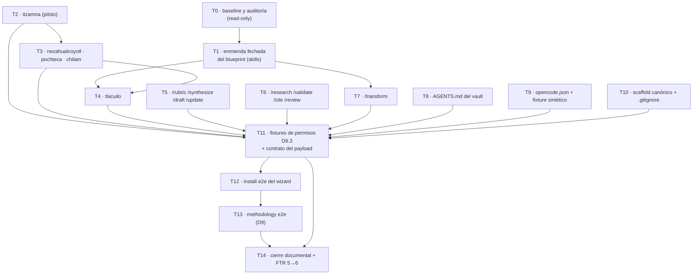

# Plan de implementación — Phase 5 (ejecución del blueprint del payload)

<!-- markdownlint-disable MD036 -->

> **Fecha:** 2026-11-09 · **Autor:** Moctezuma (orquestador) · **Modo:** solo planificación (cero código)
> **Fase:** Phase 5 — Payload + Skills audit (ejecución) · **Gate de fase:** FTR Phase 5→6
> **Fuente de verdad:** `docs/WORKFLOW.md` §Phase 5 · `specs/spec-payload-{vault,skills,permissions,agents,commands}.md` (Approved 2026-11-09)
> **Precedente:** D-P4-5 — `tasks/plan.md` y `tasks/todo.md` se sobrescriben; el plan de Phase 4 queda en el historial de git (`337c012`).

## 1. Objetivo y no-objetivos

**Objetivo:** ejecutar **literalmente** el blueprint Approved de Phase 4 sobre `obsidian-workspace/`:
materializar los 15 artefactos de texto (5 agentes + 9 comandos + `AGENTS.md` del vault), limpiar la
configuración del payload, completar el scaffold canónico del vault y cerrar los dos gates de la
fase — **permission fixtures D9.3** y **methodology e2e (D9)** — con la evidencia medida.

**Idioma (D-P4-6):** los 15 artefactos del payload se escriben en **inglés**; la prosa del repo
(`specs/`, `docs/`, `tasks/`) sigue en **español**. Las muestras del instalador (`ejemplo.md`,
`ejemplo.pdf`) conservan nombre y contenido en español (D-P4-7 revocada).

**No-objetivos (fuera de Phase 5):**

| Fuera | Por qué |
| --- | --- |
| Modificar, añadir o eliminar skills de `obsidian-workspace/.opencode/skills/` | Las 40 son **definitivas** (D-P4-12, decisión del dueño 2026-11-09); Phase 5 **verifica presencia** (40/40) y nada más |
| Cambiar los contratos MCP, los ADRs o el motor | D1–D11 están `Accepted`; tocarlos exige ADR nuevo |
| Ejecutar la metodología de 9 comandos con LLM automatizada | Decisión del dueño: contrato estático automatizado + corrida manual con evidencia (D-P5-3) |
| Tocar `docs/UH.md`, `README.md`, `LICENSE`, `opencode.json` (raíz) | Pre-commit checklist del `AGENTS.md` del repo |
| Cambiar las muestras del instalador (`ejemplo.md`/`ejemplo.pdf`) | D-P4-7 revocada; las crea el wizard en F3, no el payload |
| Instalar OfficeCLI / retirar la entrada `excel` del MCP | TD-22 es **feature 0.2.0**, fuera de v1 |
| Retirar o consolidar skills del pack Códice | Congelado: 40 conservadas, 0 retiradas, 0 consolidadas |

## 2. Decisiones tomadas (dueño, 2026-11-09)

| # | Decisión | Efecto en el plan |
| --- | --- | --- |
| **D-P5-1** | **Las 40 skills del payload son definitivas.** Phase 5 verifica que las 40 estén en `.opencode/skills/` y **no modifica, añade ni elimina ninguna** | T11 asserta el inventario nombre a nombre (40/40, 0 diff de contenido); ninguna ola toca `skills/` |
| **D-P5-2** | **Enmienda fechada al blueprint Approved:** `/transform` y Tlacuilo citaban 8 skills que el congelado de 40 eliminó (`xlsx-official`, `excel-analysis`, `scientific-slides`, `pptx-official`, `matplotlib`, `scientific-visualization`, `infographics`, `markitdown`). Se sustituyen por las **reales** del `ls` de 40. `.opencode/skills/` intacto | **T1** (gate previo, bloquea T4 y T7) — vuelve a Phase 4 con enmienda fechada, como manda `docs/WORKFLOW.md` §Phase 5 |
| **D-P5-3** | **Gate D9 = contrato estático automatizado + corrida manual con evidencia** (no e2e automático con LLM) | T11 = contrato ejecutable; T13 = protocolo + corrida manual con checklist y evidencia |
| **D-P5-4** | **`opencode.json` del payload:** se borra el array global de 313 reglas `permissions` (D-P4-2/D-P4-3) y `instructions` se corrige a rutas **relativas al vault** (`.opencode/skills/<skill>/SKILL.md`); `references` se conserva | T9 |
| **D-P5-5** | **Scaffold:** `01-Tasks/` se **renombra** a `01-tasks/` (TD-8: renombrar, nunca crear) y sus 3 ficheros de 0 bytes se eliminan; se crean `01-tasks/research/`, `02-drafts/`, `03-citations/`, `04-review/`, `05-outputs/` con `.gitkeep` | T10 |
| **D-P5-6** | **`.gitignore` del vault** nuevo en el payload con las 5 rutas de `specs/spec-vault-structure.md` §Estrategia gitignore | T10 |
| **D-P5-7** | **`tasks/plan.md` y `tasks/todo.md` se sobrescriben** (precedente D-P4-5); el plan de Phase 4 queda en git (`337c012`) | Este commit |
| **D-P5-8** | **No se crean muestras en `00-Resources/` del repo:** el blueprint Approved (`spec-payload-skills.md` §Inventario de muestras) fija que las crea el instalador en F3; el texto de `docs/WORKFLOW.md` §Phase 5 («muestras en `00-Resources/`») queda precisado por el blueprint, más reciente | T10 (`.gitkeep` solo) + T12 (el install las materializa) |
| **D-P5-9** | **El fixture del merge conservador se sustituye por un merge sintético** (cierra TD-30): el test deja de comparar el payload consigo mismo y demuestra el merge sobre una entrada fabricada | T9 |

## 3. Estado real verificado (2026-11-09, lectura del repo)

Cada línea de esta tabla está medida, no supuesta; el comando que la evidencia va en el calpulli que la usa.

| Hecho | Valor medido | Dónde |
| --- | --- | --- |
| Skills del payload | **40 dirs** | `ls obsidian-workspace/.opencode/skills \| wc -l` |
| Agentes del payload | **170 `.md`** (5 primarios + 165 del pack Códice) | `find obsidian-workspace/.opencode/agents -name '*.md' \| wc -l` |
| Comandos del payload | **9 `.md`**, todos de **4 líneas** (stub: `description:` vacío + `agent:`) | `wc -l obsidian-workspace/.opencode/commands/*.md` |
| Agentes primarios actuales | 83–135 líneas; permisos **distintos** del blueprint (`subagent * allow`, `edit * ask`/`allow`, sin `external_directory` deny, sin denies de `*.env` ni de `.tepochcalli/config/**`, sin superficies por bandeja) | lectura de los 5 `.md` |
| `AGENTS.md` del vault | **79 líneas**, template genérico con placeholders (`[Describe the project's purpose…]`) | `obsidian-workspace/AGENTS.md` |
| `opencode.json` del payload | array global `permissions` de **313 reglas**; `instructions` = rutas **relativas al repo** (`obsidian-workspace/.opencode/skills/…`); `default_agent` = `itzamna` (correcto); `agents` con 5 primarios + `build/plan/explore/general` | `python -c "json.load(...)"` |
| Scaffold | `00-Resources/` (vacía), `01-Tasks/` con 3 ficheros de 0 bytes; **faltan** `01-tasks/`, `01-tasks/research/`, `02-drafts/`, `03-citations/`, `04-review/`, `05-outputs/`; **no hay `.gitignore`** en el payload | `ls -la obsidian-workspace/` |
| `.gitignore` del repo | ya ignora `obsidian-workspace/.tepochcalli/{venv,db,models,bin,config}/` | `.gitignore:206-210` |
| Blueprint vs payload | 8 skills citadas en las specs **no existen** en el `ls` de 40 | `test -d` por nombre |
| Asset de release | el tar del payload = **árbol completo** `obsidian-workspace/` con raíz = contenido del vault, excluyendo `venv/db/models/bin/config` y caches | `.github/workflows/release.yml:186-217` |
| Merge del wizard | `merge_tree` copia **sin sobrescribir** (lo existente gana); F8 solo toca `mcp.servers.tepochcalli-rag` | `crates/tepochcalli/src/adapters/payload.rs:326-388` · `phase8.rs` |
| Baseline de linters | `just md-lint` → **0 issues** en `docs specs AGENTS.md SPEC.md` | medido 2026-11-09 |
| Tests | 703 passed + 3 `slow`, cobertura 97 % (gate 95) | `docs/WORKFLOW.md` §Phase 3.5 (M14) |

## 4. Grafo de dependencias

**Por qué este orden.** El grafo sube desde el texto (T1→T4/T7) al artefacto (T2-T10), y solo
después se miden (T11-T13). Dos reglas lo imponen:

- **T1 bloquea a T4 y T7** porque son los dos artefactos que citan skills inexistentes:
  materializarlos antes de enmendar escribiría en el payload un cuerpo que el blueprint veta.

- **T11 (el contrato) va antes que T12/T13 (la ejecución)** porque un e2e sobre un payload que no
  pasa el contrato estático produce evidencia no comparable (lección de Phase 3.5 (c): un golden
  se valida por cómo se genera, no por su color).

**Paralelismo dentro de cada ola:** las olas 1, 2, 3 y 4 no tienen dependencia entre sí más allá de
lo dibujado; T2-T10 se reparten por artefacto (fichero), no por capa. T8, T9 y T10 son
independientes entre sí y pueden solaparse con las olas 1 y 2.

## 5. Calpullis

Cada calpulli es una rebanada **vertical**: entrega un artefacto completo y su prueba. «El usuario
puede X» — no «la capa Y está escrita».

---

### Task T0: Baseline del payload y auditoría de divergencias

**Descripción:** medir el estado real del payload contra el blueprint Approved antes de escribir
nada. Produce la evidencia de los 4 hallazgos que activan D-P5-1..D-P5-9 y los números base que
comparan las olas siguientes. **Cero escrituras** en `obsidian-workspace/`.

**Criterios de aceptación:**

- [ ] Las 4 divergencias quedan documentadas con el comando que las evidencia (no con prosa): 8 skills inexistentes (un `test -d` por nombre), permisos divergentes de los 5 agentes (diff bloque a bloque contra `spec-payload-permissions.md`), array global de 313 (`json.load` + `len`), `instructions` rotas, scaffold incompleto.
- [ ] Baseline numérico registrado: `wc -l` de los 15 artefactos (5 agentes, 9 comandos, `AGENTS.md`), `ls .opencode/skills | wc -l` = 40, `len(opencode.json["permissions"])` = 313, `just md-lint` = 0.
- [ ] Hash del árbol de skills (`find .opencode/skills -type f | sort | xargs sha256sum`) guardado para demostrar en T11 que las 40 no cambiaron (D-P5-1).
- [ ] `git status --short` y `git diff --stat -- obsidian-workspace` vacíos al cerrar.

**Verificación:** los comandos y su salida cruda quedan en el informe del calpulli (commit o `tasks/`); nadie firma un AC sin el número al lado.

**Dependencias:** — · **Scope:** S (lectura + informe)

**Ficheros probables:** ninguno escrito en `obsidian-workspace/`; el informe va al cuerpo del commit y a `tasks/todo.md`.

---

### Task T1: Enmienda fechada del blueprint (skills inexistentes)

**Descripción:** cerrar la divergencia D-1 antes de materializar. Es el regreso a Phase 4 que
`docs/WORKFLOW.md` §Phase 5 exige cuando el blueprint y la realidad divergen: **enmienda fechada a
la spec, no parche en el payload**. Corrige dos ficheros de spec para que los cuerpos citen solo
skills reales del `ls` de 40, **sin tocar `.opencode/skills/`** (D-P5-1).

**Criterios de aceptación:**

- [ ] `specs/spec-payload-commands.md` §`/transform` paso 2: las 8 skills inexistentes sustituidas por reales del congelado — CSV/Excel → `spreadsheet-analysis` + `data-analysis`; presentaciones → `posters-generator`; figuras → `data-plotting`; mind map → `markdown-mermaid-writing`; conversión ad-hoc → `pdf` + `image-prompt-generator` — y la lista de **GAP** (Jupyter, R, Graphviz/PlantUML, LaTeX de manuscrito) se conserva literal.
- [ ] `specs/spec-payload-agents.md` §Tlacuilo CAPABILITIES: `xlsx-official`/`excel-analysis` sustituidos por los reales; el resto de las skills citadas en los 5 cuerpos verificadas contra el `ls` de 40.
- [ ] Ambas specs llevan marca de enmienda fechada **2026-11-09** y conservan `Status: Approved` (es una enmienda, no una decisión nueva ⇒ sin ADR).
- [ ] La tabla 9×4 de `spec-payload-skills.md` sigue siendo coherente con los cuerpos enmendados (ninguna skill citada allí que no exista).
- [ ] Invariante verificada por script: **todo** nombre de skill citado en las 5 specs del payload existe en `ls .opencode/skills` — 0 huérfanos.
- [ ] `git diff --stat -- obsidian-workspace/.opencode/skills` **vacío** (D-P5-1).
- [ ] Reglas de formato V2 re-verificadas contra el tag vigente de OpenCode (≥ v2.1.2) con fecha y URL; si el tag cambió, la desviación se registra antes de escribir nada (R2, cero asunción).

**Verificación:** barrido de nombres de skill con 0 huérfanos; `git diff --stat -- obsidian-workspace/.opencode/skills` vacío; `just md-lint` 0; revisión del dueño (CP-0) antes de T4/T7.

**Dependencias:** T0 · **Scope:** M (2 specs + 1 script de barrido)

**Ficheros probables:** `specs/spec-payload-commands.md` · `specs/spec-payload-agents.md` · `specs/spec-payload-skills.md` (solo si la tabla 9×4 cita skills inexistentes)

---

### Task T2: Agente `itzamna` (piloto vertical)

**Descripción:** materializar **el primer agente completo** — frontmatter + bloque `permissions` +
cuerpo de 56 líneas — y el verificador que lo prueba. Es la rebanada vertical que valida el método
(orden last-match-wins, budgets, idioma) antes de escalar a los otros cuatro.

**Criterios de aceptación:**

- [ ] `obsidian-workspace/.opencode/agents/itzamna.md` = frontmatter (`description: "Itzamna - Supreme Orchestrator"`, `mode: primary`, bloque `permissions` de 16 reglas de `spec-payload-permissions.md` §Itzamná, **sin `model`**) + cuerpo literal de `spec-payload-agents.md`.
- [ ] `wc -l` ≤ 60 (objetivo 56).
- [ ] Cero campos legacy: `temperature|top_p|prompt:|permission:|tools:|disable|maxSteps`.
- [ ] Los 6 elementos del contrato T5 presentes: persona UH, propósito + bandeja, MCP-first, no-contaminación, formato de cita `source_path » heading (chars x–y)`, cláusula «the vault's `AGENTS.md` governs and is editable».
- [ ] Cero marcadores del español (D-P4-6): `ñ`, `¿`, `¡` y palabras sueltas `el|la|los|las|para|con|por|una|del|que|cómo|según` — exentos nombres propios y tokens de enum.
- [ ] Simulador last-match-wins verde: `edit *` → deny · `read 00-Resources/x.md` → allow · `read .env` → deny · `read sub/.env.local` → deny · `read .tepochcalli/config/tepochcalli.toml` → deny.

**Verificación:** el simulador corre como test (T11 lo aterriza; T2 lo deja escrito y ejecutable a mano) · `npx --yes markdownlint-cli2 obsidian-workspace/.opencode/agents/itzamna.md` (si el bloque congelado no pasa el lint, la desviación se corrige **en la spec**, no en el payload).

**Dependencias:** T0 · **Scope:** S (1 fichero de payload + verificador)

**Ficheros probables:** `obsidian-workspace/.opencode/agents/itzamna.md`

---

### Task T3: Agentes `nezahualcoyotl`, `pochteca`, `chilam`

**Descripción:** los tres agentes limpios del blueprint (sin skills inexistentes). Cada uno con su
bloque `permissions` —deny-list de `external_directory` + secretos, y superficie de escritura
acotada a su bandeja— y su cuerpo congelado.

**Criterios de aceptación:**

- [ ] `nezahualcoyotl.md` (54 líneas), `pochteca.md` (58), `chilam.md` (58): frontmatter + bloque de permisos + cuerpo, todos ≤ 60 líneas.
- [ ] Probes D9.3 verdes: Pochteca `edit 01-tasks/research/x.md` → allow, `edit 02-drafts/x.md` → deny, `edit 01-tasks/x.md` → deny; Nezahualcóyotl `edit 01-tasks/plan.md` → allow, `edit 01-tasks/research/x.md` → deny; Chilam `edit 03-citations/x.md` → allow, `edit 04-review/x.md` → allow, `edit 02-drafts/x.md` → deny.
- [ ] Nezahualcóyotl sin `webfetch`/`websearch`; Chilam sin `webfetch`/`websearch`; Pochteca con web permitida (desviación D9.3 del UH, ya documentada).
- [ ] Los 5 `subagent * deny` presentes en los 5 bloques (los ~165 subagentes Códice quedan catalogados pero inertes).
- [ ] Cero marcadores del español; cero campos legacy.

**Verificación:** simulador last-match-wins con los probes por agente · markdownlint del payload en verde · diff contra el bloque de la spec, línea a línea.

**Dependencias:** T2 (patrón probado) · **Scope:** M (3 ficheros)

**Ficheros probables:** `obsidian-workspace/.opencode/agents/{nezahualcoyotl,pochteca,chilam}.md`

---

### Task T4: Agente `tlacuilo`

**Descripción:** el quinto agente, con deny-list completa (12 denies detrás de `edit * allow`) y el
cuerpo corregido según la enmienda de T1 (CAPABILITIES citaba skills inexistentes).

**Criterios de aceptación:**

- [ ] `tlacuilo.md`: 56 líneas, frontmatter con `description: "Tlacuilo - The Engineer"`, `mode: primary`, sin `model`.
- [ ] Deny-list **entera y en orden**: `.obsidian/**`, `.opencode/**`, `.tepochcalli/**`, `00-Resources/**`, `01-tasks/**`, `03-citations/**`, `04-review/**`, `.git/**`, `AGENTS.md`, `opencode.json`, `tepochcalli.toml` — todos detrás de `edit * allow`.
- [ ] Probes D9.3 verdes: `edit 05-outputs/x.csv` → allow · `edit 02-drafts/x.md` → allow · `edit 00-Resources/x.md` → deny · `edit AGENTS.md` → deny · `edit opencode.json` → deny · `edit .git/config` → deny.
- [ ] Sin `webfetch`/`websearch`; `subagent * deny`; `shell * deny`.
- [ ] CAPABILITIES cita **solo** skills del `ls` de 40 (enmienda de T1 aplicada).
- [ ] Cero marcadores del español; cero campos legacy.

**Verificación:** simulador last-match-wins · markdownlint del payload · barrido de nombres de skill sobre el fichero (0 huérfanos).

**Dependencias:** T1 + T3 · **Scope:** S (1 fichero)

**Ficheros probables:** `obsidian-workspace/.opencode/agents/tlacuilo.md`

---

### Task T5: Comandos `/rubric`, `/synthesize`, `/draft`, `/update`

**Descripción:** los cuatro comandos de fase lineal (una fase, una bandeja, una nota). Materializar
el cuerpo congelado de `spec-payload-commands.md` con su frontmatter mínimo.

**Criterios de aceptación:**

- [ ] Los 4 `.md` con frontmatter `{description, agent}` y cuerpo literal de la spec: `/rubric` (agent `nezahualcoyotl`, 24 líneas), `/synthesize` (`nezahualcoyotl`, 24), `/draft` (`tlacuilo`, 24), `/update` (`tlacuilo`, 24).
- [ ] `wc -l` ≤ 35 cada uno.
- [ ] Esqueleto de casa completo: `## Pre-Flight` · `## Phase …` · `## Escalation` · `## Suggested Next Step` con cita en bloque.
- [ ] Cero `model`, cero `subtask`, cero `subagent:`, cero bloques `` !`cmd` ``, cero `@paths`.
- [ ] Bandeja y frontmatter de salida exactos: `/rubric` → `01-tasks/` `{command, agent, date}`; `/synthesize` → `01-tasks/` `{command, agent, phase, date}`; `/draft` → `02-drafts/` `{command, agent, outline, date}`; `/update` → `02-drafts/` `{command, agent, date, revision_note}`.
- [ ] `E_*` → `rag_status()` + `fix_hint` (nunca el error crudo) presente en los 4.
- [ ] Cero marcadores del español.

**Verificación:** barrido de los 4 ficheros (líneas, frontmatter, prohibiciones, idioma) · diff contra la spec bloque a bloque.

**Dependencias:** T0 · **Scope:** M (4 ficheros)

**Ficheros probables:** `obsidian-workspace/.opencode/commands/{rubric,synthesize,draft,update}.md`

---

### Task T6: Comandos `/research`, `/validate`, `/cite`, `/review`

**Descripción:** la cadena de evidencia y sus gates deterministas —el corazón de TD-14—: la
`procedencia` de 4 estados, el chequeo claim↔índice de 4 clases y el gate de compilación sin red.

**Criterios de aceptación:**

- [ ] Los 4 `.md` con frontmatter `{description, agent}` y cuerpo literal: `/research` (`pochteca`, 30 líneas), `/validate` (`chilam`, 26), `/cite` (`chilam`, 24), `/review` (`chilam`, 24). Todos ≤ 35.
- [ ] `/research`: `procedencia` **siempre serializada** (aunque `[]`) de `{fuente, estado, url_o_doi, fecha_consulta}`; los 4 estados (`verificada`, `web_search_unconfirmed`, `no_encontrada`, `inaccesible`); `web_search_unconfirmed` nunca se presenta como `verificada`.
- [ ] `/validate`: las 4 clases (`respaldada`, `sin_ancla`, `cita_ajena`, `sin_cita`); la ambigüedad **nunca** cuenta como `respaldada`; `verdict` ∈ {`ok`, `ok_con_avisos`, `rechazado`}; `ok` imposible con `sin_ancla`/`sin_cita`.
- [ ] `/cite`: gate determinista **sin red y sin juicio de modelo**; referencia sin `procedencia` ⇒ falla **nombrando el culpable** con cero salida parcial; 0 supervivientes ⇒ fallo, nunca bibliografía vacía; `web_search_unconfirmed` se compila **marcado**.
- [ ] `/review`: no edita el borrador del autor; todo hallazgo nombra su ubicación.
- [ ] Cero `model`/`subtask`/`subagent:`/`` !`cmd` ``/`@paths`; cero marcadores del español.

**Verificación:** barrido de los 4 ficheros · comprobación de que los nombres de campo en español (`fuentes`, `método`, `procedencia`, `estado`, `fuente`, `url_o_doi`, `fecha_consulta`) están **intactos** (son contrato de datos) · tokens de enum intactos.

**Dependencias:** T0 · **Scope:** M (4 ficheros)

**Ficheros probables:** `obsidian-workspace/.opencode/commands/{research,validate,cite,review}.md`

---

### Task T7: Comando `/transform`

**Descripción:** el único comando con conversor y con gaps declarados. Depende de la enmienda de T1
porque su paso 2 es el que citaba las 8 skills inexistentes.

**Criterios de aceptación:**

- [ ] `transform.md`: frontmatter `{description, agent: tlacuilo}`, cuerpo de 25 líneas, ≤ 35.
- [ ] Paso 2 cita **solo** skills reales del congelado de 40 (enmienda T1 aplicada) y **declara** los gaps (Jupyter, R, Graphviz/PlantUML, LaTeX de manuscrito) como pendientes, sin inventar nombres ni simular artefactos.
- [ ] `list_formats` se llama antes de prometer un formato; `convert_document`/`convert_base64` producen un `.md` en disco que **no** es la fuente citable (el original sigue indexado vía `index_refresh`).
- [ ] Bandeja `05-outputs/` + nota de manifiesto con frontmatter `{command, agent, source_draft, formats, date}`.
- [ ] Cero `model`/`subtask`/`subagent:`/`` !`cmd` ``/`@paths`; cero marcadores del español.

**Verificación:** barrido del fichero · barrido de nombres de skill (0 huérfanos) · diff contra la spec enmendada.

**Dependencias:** T1 · **Scope:** S (1 fichero)

**Ficheros probables:** `obsidian-workspace/.opencode/commands/transform.md`

---

### Task T8: `AGENTS.md` del vault

**Descripción:** el system prompt distribuido que gobierna los 5 agentes y los 9 comandos. Sustituye
el template genérico de 79 líneas por el bloque congelado de 67 líneas.

**Criterios de aceptación:**

- [ ] `obsidian-workspace/AGENTS.md` = bloque congelado de `spec-payload-vault.md` §Blueprint, literal.
- [ ] 7 secciones: *What this vault is* · *Ownership zones* · *MCP-first rule* · *Command → agent → tray map* · *Citations, traceability and sources* · *Note format* · *Editability clause*.
- [ ] `wc -l` ≤ 120 (objetivo 67).
- [ ] El formato de cita `source_path » heading (chars x–y)`, los 4 estados de `procedencia` y las 4 clases de claim coinciden **token a token** con `spec-payload-commands.md` y `spec-payload-agents.md` (verificado por script de coincidencia literal, no a ojo).
- [ ] El mapa comando→agente→bandeja de §4 coincide con D9.2 y con los 9 `agent:` de los comandos.
- [ ] Cero marcadores del español; cero placeholders `[...]` residuales del template.

**Verificación:** script de coincidencia token a token de los 3 vocabulario compartidos (cita, 4 estados, 4 clases) contra las 3 specs · barrido de placeholders · markdownlint.

**Dependencias:** T0 · **Scope:** S (1 fichero)

**Ficheros probables:** `obsidian-workspace/AGENTS.md`

---

### Task T9: `opencode.json` del payload + fixture sintético del merge

**Descripción:** limpiar la configuración del harness en el payload y **cerrar TD-30**: el test del
merge conservador deja de comparar el payload consigo mismo y demuestra el merge sobre una entrada
fabricada.

**Criterios de aceptación:**

- [ ] Array global `permissions` (313 reglas) **eliminado** (D-P4-2/D-P4-3): la política efectiva de cada agente pasa a ser su bloque, auditable.
- [ ] `instructions` corregidas a rutas **relativas al vault**: `.opencode/skills/obsidian-markdown/SKILL.md`, `.opencode/skills/obsidian-cli/SKILL.md`, `.opencode/skills/obsidian-vault/SKILL.md`, `.opencode/skills/markdown-mermaid-writing/SKILL.md` (D-P5-4) — y cada ruta **existe** dentro del vault construido.
- [ ] `agents` conserva los 5 primarios con `model`/`color`/`request`/`steps` y **sin** arrays de permisos; `default_agent` = `"itzamna"`; `mcp.servers` intacto (lo gestiona F8).
- [ ] `references` conservado sin cambios.
- [ ] `tests/fixtures/opencode_payload_before_t9.json` **sustituido** por una entrada **sintética** (`opencode_payload_synthetic.json`): un `opencode.json` fabricado con `permissions`, `agents`, `mcp.servers` sin `tepochcalli-rag` y otras claves.
- [ ] `tests/unit/test_opencode_payload_registration.py` demuestra sobre esa entrada sintética que (a) el resto del documento es **byte-idéntico** tras el merge y (b) solo se inserta `tepochcalli-rag` con la forma exacta del contrato (D17: `python -m`, nunca console script) y (c) `markitdown` no se registra (D29).
- [ ] Segundo test sobre el payload real: parseable, **sin** array global `permissions`, `default_agent` == `itzamna`, `instructions` resolubles.
- [ ] `just python-test` verde.

**Verificación:** los 2 tests nuevos en rojo antes de implementarlos (RED demostrado) y en verde después · `just python-lint` + `just python-fmt-check` verdes.

**Dependencias:** T0 · **Scope:** M (1 payload + 1 fixture + 1 test)

**Ficheros probables:** `obsidian-workspace/opencode.json` · `tests/fixtures/opencode_payload_synthetic.json` · `tests/unit/test_opencode_payload_registration.py`

---

### Task T10: Scaffold canónico del vault + `.gitignore`

**Descripción:** completar el árbol del vault que `spec-vault-structure.md` §Árbol canónico declara y
que el payload hoy no cumple. Resuelve **TD-8** (alias de carpeta) y el *Action Item* de
`04-review/`/`05-outputs/`.

**Criterios de aceptación:**

- [ ] `01-Tasks/` **renombrada** a `01-tasks/` con `git mv` (TD-8: renombrar, **nunca crear** — en FS case-insensitive `create_dir_all` adoptaría la carpeta existente y dejaría dos ortografías).
- [ ] Los 3 ficheros de 0 bytes (`outline.md`, `rubric.md`, `todo.md`) **eliminados**: no portan información y un artefacto vacío en la bandeja confunde al pipeline (decisión registrada en D-P5-5).
- [ ] Creadas `01-tasks/research/`, `02-drafts/`, `03-citations/`, `04-review/`, `05-outputs/` con `.gitkeep` (git no trackea carpetas vacías ⇒ sin `.gitkeep` el asset publicado no las lleva).
- [ ] `00-Resources/` con `.gitkeep` (la carpeta y las 2 muestras las crea el wizard en F3; el payload la declara vacía — D-P5-8).
- [ ] `obsidian-workspace/.gitignore` **nuevo** con las 5 rutas de `spec-vault-structure.md` §Estrategia gitignore: `.tepochcalli/venv/`, `.tepochcalli/bin/`, `.tepochcalli/db/`, `.tepochcalli/models/`, `.tepochcalli/config/`.
- [ ] `git ls-files obsidian-workspace` muestra las 6 bandejas representadas (con `.gitkeep`) y `01-Tasks` **no** aparece.

**Verificación:** `git ls-files` + `ls -la obsidian-workspace/` + `git status --short` (solo los ficheros intencionados) · el `ls` post-install de T12 confirma la capitalización canónica en el vault real.

**Dependencias:** T0 · **Scope:** S (renombre + 6 `.gitkeep` + 1 `.gitignore`)

**Ficheros probables:** `obsidian-workspace/01-tasks/**` · `obsidian-workspace/{02-drafts,03-citations,04-review,05-outputs,00-Resources}/.gitkeep` · `obsidian-workspace/.gitignore`

---

### Task T11: Fixtures de permisos D9.3 + contrato estático del payload

**Descripción:** el **gate D9 ejecutable**. Dos piezas: el simulador last-match-wins con los 42
probes de la spec, y el contrato de los 15 artefactos. Es lo que permite que T12 y T13 Produzcan
evidencia comparable.

**Criterios de aceptación:**

- [ ] `tests/unit/test_payload_permissions.py`: intérprete last-match-wins (glob `*` cruza `/`, `?` = un carácter, sin coincidencia ⇒ `ask`) + los **42 probes** de `spec-payload-permissions.md` §Verificación → **42/42 esperado == real**.
- [ ] Los 5 agentes declaran `subagent * deny`; lectura de secretos denegada en los 5 (`.env`, `sub/.env`, `.env.local`, `config/.env`, `secrets.env`, `.tepochcalli/config/tepochcalli.toml`); cero reglas muertas.
- [ ] `tests/unit/test_payload_contract.py`: inventario de skills **exactamente** las 40 del congelado, nombre a nombre, y **hash de contenido idéntico** al de T0 (D-P5-1: 0 modificadas, 0 añadidas, 0 eliminadas).
- [ ] Todo nombre de skill citado en los 15 artefactos **existe** en el `ls` (0 huérfanos).
- [ ] Presupuestos: cada agente ≤ 60 líneas, cada comando ≤ 35, `AGENTS.md` ≤ 120 (`wc -l` por fichero).
- [ ] Higiene de frontmatter: cero `temperature|top_p|prompt:|permission:|tools:|disable|maxSteps`; cero `subtask`/`subagent:` en comandos; cero `` !`cmd` `` y cero `@paths` en los 9 cuerpos.
- [ ] Idioma: 0 marcadores del español en los 15 artefactos, con las exenciones de D-P4-6 (nombres propios y tokens de enum como `ok_con_avisos`).
- [ ] Config: `default_agent` resuelve a `itzamna` y `itzamna.md` declara `mode: primary`; `model` **no** se repite en ningún `.md`.
- [ ] `just python-test` verde y cobertura ≥ 95 % (los tests nuevos no tocan `flow/`/`mcp/` ⇒ no pueden bajar el gate) · `just python-lint` y `just python-fmt-check` verdes.

**Verificación:** los tests en **RED** antes de existir (RED demostrado en el commit) y en verde después · `just ci` completo verde.

**Dependencias:** T2, T3, T4, T5, T6, T7, T8, T9, T10 · **Scope:** M (2 ficheros de test + soporte)

**Ficheros probables:** `tests/unit/test_payload_permissions.py` · `tests/unit/test_payload_contract.py`

---

### Task T12: Install e2e del wizard sobre el payload final

**Descripción:** instalar el payload con el wizard real sobre un vault efímero y comprobar que el
árbol resultante cumple el contrato del vault y del harness. Es el `install` que exige el gate de
Phase 5.

**Criterios de aceptación:**

- [ ] El payload se **empaqueta igual que el asset de release**: `tar -czf` con la misma lista de exclusiones de `.github/workflows/release.yml` (`.obsidian`, `venv`, `db`, `models`, `bin`, `config`, caches, `__pycache__`, `*.pyc`, `target`), raíz del tar = contenido del vault.
- [ ] `cargo run --locked --manifest-path crates/tepochcalli/Cargo.toml -- install --non-interactive --skip-model --vault <tmp> --payload <tmp>/payload` → **0 errores**.
- [ ] Árbol del vault instalado = el canónico: `00-Resources/`, `01-tasks/research/`, `02-drafts/`, `03-citations/`, `04-review/`, `05-outputs/`, `.opencode/{agents,commands,skills}/`, `AGENTS.md`, `opencode.json`, `.gitignore` — **con la capitalización correcta** (riesgo FS case-insensitive, TD-8).
- [ ] Los 5 agentes instalado llevan su bloque `permissions`; los 9 comandos su cuerpo; `AGENTS.md` sus 7 secciones.
- [ ] `opencode.json` instalado **sin** array global `permissions` y con `mcp.servers.tepochcalli-rag` inyectado por F8 con la forma exacta del contrato.
- [ ] Las 2 muestras del wizard presentes en `00-Resources/` (`ejemplo.md` + `ejemplo.pdf`).
- [ ] `.gitignore` instalado con las 5 rutas.
- [ ] **Idempotencia:** 2ª corrida → 0 duplicados, 0 diffs (el merge no sobrescribe).
- [ ] `just rust-ci` verde.

**Verificación:** el árbol se asserta con un script (no a ojo) y el resultado se pega en el informe · `just rust-smoke` sigue verde (el crate no cambia, pero el gate corre).

**Dependencias:** T11 · **Scope:** M (script de assert + ejecución)

**Ficheros probables:** `tests/e2e/test_payload_install_contract.py` (o script equivalente) — el crate Rust no se modifica.

---

### Task T13: Methodology e2e (D9) — corrida manual con evidencia

**Descripción:** el segundo gate de la fase. Decisión D-P5-3: **contrato estático automatizado**
(ya en T11) **+ corrida manual con evidencia** de los 9 comandos sobre el vault instalado por T12.

**Criterios de aceptación:**

- [ ] Protocolo escrito y versionado (`docs/diagnosis/` o `tasks/`): vault instalado, corpus mínimo (las 2 muestras del wizard), orden `/rubric → /research → /validate → /synthesize → /cite → /draft → /review → /transform → /update`, y qué se asserta por comando.
- [ ] Checklist assertado **por comando**: (a) aterrizaje en **su** bandeja única (mapa D9.2, total y único); (b) frontmatter exacto (`{agent, timestamp, fuentes, método, procedencia}` en `01-tasks/research/`; `{command, agent, target_doc, verdict}` en `04-review/`); (c) **cero contaminación cruzada** entre bandejas; (d) regla MCP-first observada (`search` antes de leer crudo de `00-Resources/`); (e) no-contaminación (el agente avisa si encuentra archivos del usuario en las bandejas 01-05).
- [ ] Evidencia capturada: transcript de tool-calls + árbol final del vault, referenciados en el informe de cierre.
- [ ] Lo **no verificado** se escribe como no verificado (lección de Phase 3.5 (b)); ningún "verde" sin método.

**Verificación:** el checklist se rellena con la salida real; el FTR lo revisa. Si el dueño no ejecuta la corrida, Phase 5 **no se cierra** y la Fase queda abierta con el motivo declarado.

**Dependencias:** T12 · **Scope:** L (corrida completa, 9 comandos)

**Ficheros probables:** `docs/diagnosis/phase5-methodology-e2e.md` (protocolo + evidencia)

---

### Task T14: Cierre documental + FTR Phase 5→6

**Descripción:** cerrar la fase con las métricas **medidas** (no estimadas) y el FTR de `docs/WORKFLOW.md` §4.

**Criterios de aceptación:**

- [ ] `docs/WORKFLOW.md` §Phase 5: estado **COMPLETADA**, métricas medidas con su método (n + percentil si aplica), y la lista explícita de lo **no** verificado (CI nunca ejecutada — M6; suite `slow`; Windows; release).
- [ ] `docs/TECH_DEBT.md`: TD-6, TD-7, TD-8, TD-14 y TD-30 actualizados con la evidencia de cierre.
- [ ] `SPEC.md`: las 5 specs del payload siguen `Approved` con la marca de enmienda fechada; los estados de las demás specs no cambian.
- [ ] `CHANGELOG.md`: entrada de Phase 5.
- [ ] `docs/ARCHITECTURE.md`: **sin** diagrama nuevo (Phase 5 no cambia las capas; sólo el harness del vault) — como mucho una línea si el payload altera algún inventario.
- [ ] FTR Phase 5→6 con el checklist de `docs/WORKFLOW.md` §4: Anexo A ejecutadas (40 presentes, 0 retiros) · permission fixtures D9.3 verdes · methodology e2e verdes · coherencia blueprint ↔ archivos generados.
- [ ] `just ci` verde y `just md-lint` 0 en el commit de cierre.

**Verificación:** revisión cruzada de las 4 specs del payload contra los 15 artefactos generados (mismo diff que en T11, ejecutado por persona distinta del ejecutor — *pair review*).

**Dependencias:** T11, T13 · **Scope:** M (5 documentos)

**Ficheros probables:** `docs/WORKFLOW.md` · `docs/TECH_DEBT.md` · `SPEC.md` · `CHANGELOG.md` · `docs/ARCHITECTURE.md`

## 6. Asignación de subagentes, skills y herramientas

### 6.1 Subagentes por calpulli

| Calpulli | Subagente principal | Subagente(s) de apoyo | Orden | Por qué |
| --- | --- | --- | --- | --- |
| T0 | `codebase-archaeologist` | — | — | Auditoría de divergencias entre blueprint y estado real; lectura, no escritura |
| T1 | `technical-writer` | `prompt-engineer` | **secuencial**: texto → revisión de coherencia | Enmienda de spec: el texto lo escribe quien redacta; la coherencia con la tabla 9×4 la revisa quien conoce los cuerpos |
| T2 | `security-architect` | `prompt-engineer` | **secuencial**: permisos → cuerpo | El bloque `permissions` es la frontera de seguridad (orden last-match); el cuerpo lo escribe quien redacta prompts |
| T3 | `security-architect` | `prompt-engineer` | **secuencial** (por agente) | Ídem T2, 3 pares |
| T4 | `security-architect` | `prompt-engineer` | **secuencial** | Ídem T2; depende de T1 |
| T5 | `technical-writer` | — | — | 4 cuerpos de comando, un único estilo; sin gates de seguridad nuevos |
| T6 | `technical-writer` | `prompt-engineer` | **secuencial**: gate → prosa | `/validate` y `/cite` llevan gates deterministas: el que define la regla escribe, el que la redacta la hace legible sin suavizarla |
| T7 | `technical-writer` | — | — | 1 fichero; depende de T1 |
| T8 | `prompt-engineer` | — | — | Es un system prompt distribuido, no un documento de repo |
| T9 | `python-pro` | — | — | Cambio de config + fixture + test: uno solo, para que el test y el fixture no se desincronicen |
| T10 | `minimal-change-engineer` | — | — | Renombrar y crear lo mínimo; cero rediseño del scaffold |
| T11 | `test-engineer` | `python-pro` | **secuencial**: test → revisión | El simulador y el contrato se escriben y luego se revisan contra la spec |
| T12 | `rust-engineer` | — | — | El e2e pasa por el crate del wizard; nadie más tiene el contexto de F3/F8 |
| T13 | `testing-evidence-collector` | `testing-reality-checker` | **secuencial**: captura → juicio | Primero se recoge la evidencia; después se juzga si demuestra lo que dice |
| T14 | `docs-writer` | `code-reviewer` | **secuencial**: cierre → revisión | El redactor cierra; el revisor comprueba que ninguna cifra es estimada |

### 6.2 Skills por calpulli

| Calpulli | Skills |
| --- | --- |
| T0 | `codebase-memory`, `context-engineering` |
| T1 | `documentation-and-adrs`, `prompt-engineering`, `source-driven-development` |
| T2, T3, T4 | `prompt-engineering`, `security-and-hardening`, `design-patterns` (el intérprete last-match-wins es *Chain of Responsibility*), `clean-code` |
| T5, T6, T7 | `prompt-engineering`, `documentation-and-adrs` |
| T8 | `prompt-engineering`, `obsidian-markdown` |
| T9 | `test-driven-development`, `incremental-implementation`, `api-and-interface-design` |
| T10 | `git-workflow-and-versioning`, `bash-defensive-patterns` |
| T11 | `test-driven-development`, `design-patterns`, `clean-code`, `doubt-driven-development` |
| T12 | `bash-defensive-patterns`, `test-driven-development`, `doubt-driven-development` |
| T13 | `doubt-driven-development`, `document-verification` |
| T14 | `documentation-and-adrs`, `changelog-generate`, `git-workflow-and-versioning`, `code-review-and-quality` |

### 6.3 Herramientas (MCPs y plugins) por calpulli

MCPs disponibles en el workspace (raíz `opencode.json`): `codebase-memory-mcp`, `context7`,
`chrome-devtools`, `excel`, `jupyter`, `vercel-grep`, `gitmcp`. Plugins: `opencode-rpc`,
`opencode-navigator`, `opencode-skills-collection`, `opencode-skill-creator`,
`opencode-search-plugin`, `ponytail`.

| Calpulli | Herramientas | Para qué |
| --- | --- | --- |
| T0 | `codebase-memory-mcp`, `vercel-grep` | Grafo del repo y barrido de literales (`permissions`, `01-Tasks`, `instructions`) |
| T1 | `gitmcp`, `context7` | Re-verificar las reglas de formato V2 contra el tag vigente (`agents.mdx`, `permissions.mdx`, `commands.mdx`) |
| T2–T8 | `gitmcp` | Contrastar cada artefacto con la spec y con la doc oficial |
| T9 | — | Trabajo local: JSON, fixture y test |
| T10 | `vercel-grep` | Barrido de referencias a `01-Tasks` en el crate y los tests |
| T11 | — | Tests locales; el MCP `tepochcalli-rag` no interviene (los artefactos son texto) |
| T12 | — | Ejecución local del crate |
| T13 | MCP `tepochcalli-rag` del **payload** (stdio local) | La metodología e2e ejercita las 7 tools reales: es el contrato lo que se valida |
| T14 | `vercel-grep` | Revisión cruzada de números citados entre docs |

## 7. Checkpoints (puertas de calidad entre olas)

**Ningún checkpoint se avanza en rojo.** Cada CP lista lo que debe estar **verde** para pasar.

### CP-0 — Enmienda aprobada (tras T1)

- [ ] Enmienda fechada aplicada a las specs del blueprint y **aprobada por el dueño**.
- [ ] 0 nombres de skill inexistentes en las 5 specs del payload.
- [ ] `git diff --stat -- obsidian-workspace/.opencode/skills` vacío.

### CP-1 — Los 5 agentes materializados (tras T4)

- [ ] 5 `.md` con frontmatter + bloque `permissions` + cuerpo, ≤ 60 líneas cada uno.
- [ ] Simulador last-match-wins verde en los 5 (probes de D9.3 por agente).
- [ ] 0 campos legacy; 0 marcadores del español; 0 skills inexistentes citadas.
- [ ] `git diff --stat -- obsidian-workspace` muestra **solo** los 5 ficheros de agente.

### CP-2 — Los 9 comandos materializados (tras T7)

- [ ] 9 `.md` con frontmatter + cuerpo, ≤ 35 líneas cada uno.
- [ ] 0 `subtask`, 0 `subagent:`, 0 `` !`cmd` ``, 0 `@paths`.
- [ ] Los 9 `agent:` resuelven a un primario del mapa D9.2; cada `agent:` coincide con el de la spec.
- [ ] 0 marcadores del español; los nombres de campo en español del frontmatter intactos.

### CP-3 — Vault y config coherentes (tras T8 + T9 + T10)

- [ ] `AGENTS.md` con sus 7 secciones, ≤ 120 líneas, vocabulario compartido token a token con las specs.
- [ ] `opencode.json` sin array global de permisos; `instructions` resolubles en el vault; `default_agent` = `itzamna`.
- [ ] Scaffold: 6 bandejas con capitalización canónica y `.gitkeep`; `.gitignore` con las 5 rutas.
- [ ] `git ls-files obsidian-workspace` sin `01-Tasks` y con las 6 bandejas presentes.

### CP-4 — Contrato estático verde (tras T11)

- [ ] `just ci` verde (suite completa + cobertura ≥ 95 % + bench-smoke + rust-ci).
- [ ] 42/42 probes de permisos; 40/40 skills con hash idéntico al de T0; 0 huérfanos de skill.
- [ ] `just md-lint` 0.

### CP-5 — Gates de la fase verdes (tras T12 + T13)

- [ ] Install e2e verde: árbol canónico, capitalización correcta, `tepochcalli-rag` inyectado por F8, 2 muestras presentes, idempotencia.
- [ ] Methodology e2e: 9/9 comandos con checklist assertado y evidencia capturada.
- [ ] Lo no verificado, escrito como no verificado.

### CP-6 — FTR Phase 5→6 (tras T14)

- [ ] Checklist de `docs/WORKFLOW.md` §4 (fila Phase 5→6) verde.
- [ ] `docs/WORKFLOW.md`, `docs/TECH_DEBT.md`, `SPEC.md` y `CHANGELOG.md` actualizados con **cifras medidas**.
- [ ] Revisión cruzada blueprint ↔ artefactos por un segundo par de ojos.

## 8. Riesgos y mitigaciones (omens)

| Omen | Prob. | Impacto | Mitigación | Contingencia |
| --- | --- | --- | --- | --- |
| El texto congelado en las specs no pasa markdownlint | media | bajo | Verificación por calpulli; la desviación se corrige **en la spec** (fuente única), nunca en el payload | Registrar la desviación y aplicarla en la enmienda |
| El simulador last-match-wins no reproduce el intérprete real de OpenCode | media | **alto** | T1 re-verifica la doc oficial con fecha y tag; 42 probes contrastados; T13 lo detecta en vivo | Si difieren, se amendan los bloques de permisos y se repite CP-1 |
| La corrida manual (T13) no la ejecuta el dueño | media | **alto** | El FTR no se cierra sin evidencia; el bloqueo queda declarado | Phase 5 queda **abierta** con el motivo — no se declara verde |
| Borrar el array de 313 rompe el fixture byte-idéntico | alta | medio | T9 sustituye el fixture por un **merge sintético** (TD-30) antes de tocar el payload | Revisar el fixture congelado original en git |
| El rename `01-Tasks`→`01-tasks` choca con un FS case-insensitive | media | medio | Renombrar (nunca crear) y `ls` tras el install | Corrección manual del vault instalado |
| Las carpetas vacías no llegan al asset publicado | baja | medio | `.gitkeep` en las 6 bandejas | Verificación en T12 sobre el tar real |
| F8 reintroduce permisos globales en el vault | baja | **alto** | T12 asserta que el `opencode.json` instalado no tiene array global | Auditar el merge de F8 |
| La enmienda de T1 es rechazada | baja | **alto** | T1 es gate previo (CP-0) | Phase 5 vuelve a Phase 4 (WORKFLOW §Phase 5) |
| El payload y el repo se desincronizan tras 15 ficheros | media | medio | Un commit por calpulli + `git diff --stat -- obsidian-workspace` en cada CP | `git checkout` del fichero afectado |
| La suite `slow` (3 tests) no corre | alta | bajo | Se declara en «lo no verificado»; `just python-test-slow` separado | Registrar la cifra |

## 9. Métricas de cierre (se miden; no se estiman)

| # | Métrica | Cómo se mide | Gate |
| --- | --- | --- | --- |
| M1 | Skills: **40 presentes, 0 modificadas, 0 añadidas, 0 eliminadas** | `ls` + `sha256sum` del árbol antes (T0) y después (T11) | D-P5-1 |
| M2 | Agentes: 5 bloques de permisos + 5 cuerpos, **≤ 60 líneas** cada uno | `wc -l` por fichero | CP-1 |
| M3 | Permisos: **42/42 probes** con esperado == real | Simulador last-match-wins | CP-4 |
| M4 | Comandos: 9 cuerpos, **≤ 35 líneas**, 0 inline shell, 0 `@paths` | `wc -l` + barrido | CP-2 |
| M5 | `AGENTS.md`: 7 secciones, **≤ 120 líneas**, vocabulario compartido token a token | `wc -l` + script de coincidencia literal | CP-3 |
| M6 | `opencode.json`: **0** reglas de permisos globales; `instructions` resolubles | `json.load` + aserción sobre el vault instalado | CP-3 / CP-5 |
| M7 | Scaffold: **6 bandejas** con capitalización canónica + `.gitignore` con 5 rutas | `git ls-files` + `ls` del vault instalado | CP-3 / CP-5 |
| M8 | Install e2e: **0 errores**, idempotencia sin duplicados | Script de aserción sobre el vault efímero | CP-5 |
| M9 | Methodology e2e: **9/9** comandos con checklist y evidencia | Checklist firmado + transcript | CP-5 |
| M10 | Gates de repo: `just ci` verde, cobertura **≥ 95 %**, `just md-lint` **0** | Recetas del Justfile | CP-4 |

## 10. Open Questions

Ninguna abierta. Las 4 divergencias detectadas en T0 se resolvieron con el dueño el 2026-11-09
(D-P5-1..D-P5-9). Si T13 no puede ejecutarse, se declara como bloqueo abierto — no como verde.

## 11. Referencias

- `docs/WORKFLOW.md` §Phase 5 (objetivo, gate, validación D9) y §4 (FTR Phase 5→6)
- `specs/spec-payload-vault.md` (reglas de formato V2, blueprint del `AGENTS.md`) · `specs/spec-payload-skills.md` (inventario de 40, tabla 9×4, muestras) · `specs/spec-payload-permissions.md` (5 bloques, 42 probes) · `specs/spec-payload-agents.md` (5 cuerpos) · `specs/spec-payload-commands.md` (9 cuerpos)
- `specs/spec-agent-workflow.md` (D9.2 mapa de bandejas, D9.3 desviación, Anexo A) · `specs/spec-vault-structure.md` (árbol canónico, gitignore)
- `docs/TECH_DEBT.md` (TD-6, TD-7, TD-8, TD-14, TD-22, TD-30) · `docs/ARCHITECTURE.md` · `docs/CODE_STYLE.md`
- `crates/tepochcalli/src/adapters/payload.rs` (merge sin sobrescribir) · `application/phase8.rs` (F8) · `.github/workflows/release.yml` (empaquetado del asset)
- Plan de Phase 4 (histórico): commit `337c012`
