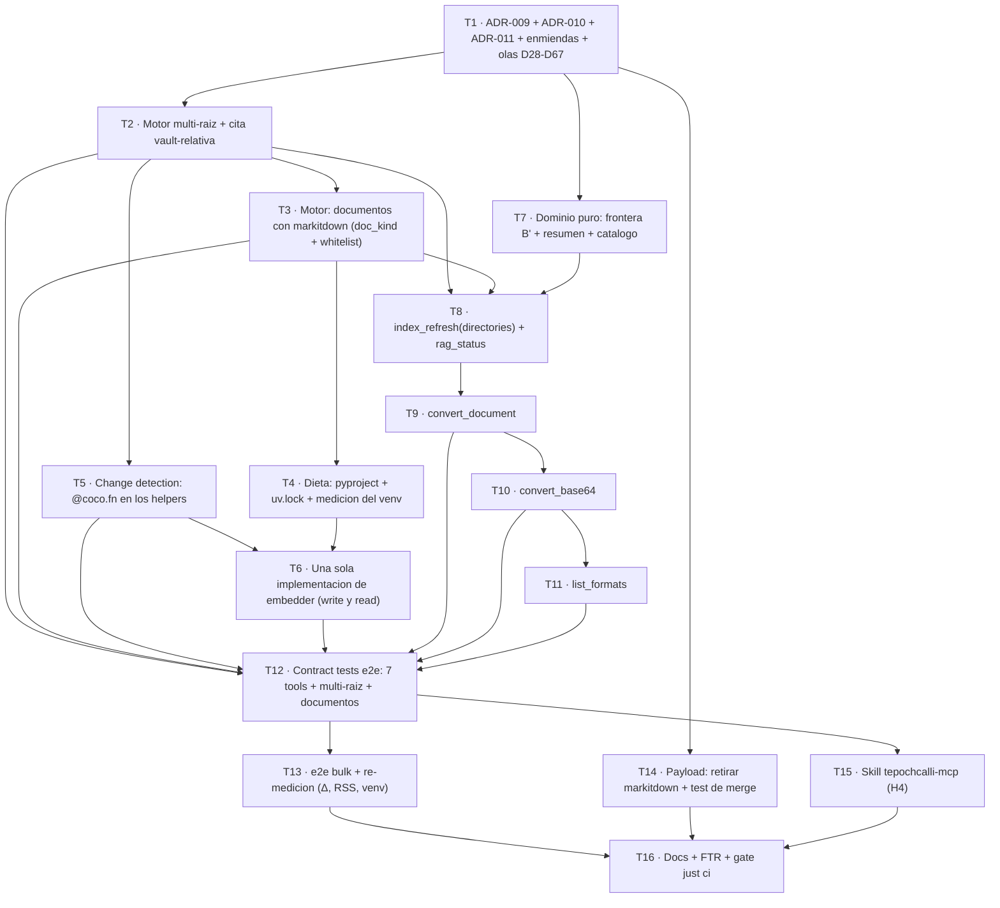

# Plan de implementación — Phase 3.5: conversor summary-only + índice multi-raíz + RAG de documentos + dieta de dependencias + skill `tepochcalli-mcp`

> **Rama de trabajo:** `feat/workspace-obsidian`.
> **Fuentes de verdad:** [docs/WORKFLOW.md](../docs/WORKFLOW.md) §Phase 3.5 ·
> [docs/diagnosis/fix01-conversor-satura-contexto-llm.md](../docs/diagnosis/fix01-conversor-satura-contexto-llm.md) ·
> [docs/UH.md](../docs/UH.md) §Historias de conversión Markdown (anexo 2026-10-30, H1-H4) ·
> [specs/spec-markitdown.md](../specs/spec-markitdown.md) · [specs/spec-mcp-server.md](../specs/spec-mcp-server.md) ·
> [specs/spec-rag-engine.md](../specs/spec-rag-engine.md) · [specs/spec-vault-structure.md](../specs/spec-vault-structure.md) ·
> ADR-005 (frontera MCP y contrato de cita) · ADR-004 (uv + venv) · ADR-009/010/011 (nuevos, esta fase).
> **Alcance:** SOLO Phase 3.5. Entra el **motor** (índice multi-raíz + parseo de documentos + una sola
> implementación de embedder), la **capa MCP** (3 tools del conversor + `index_refresh(directories=…)`),
> la **dieta de dependencias** (regla de oro: dos librerías) y la **skill H4**.
> **No** toca el wizard Rust (Phase 3) ni el blueprint de Phase 4-5 más allá de registrar el asset nuevo.
> **No** modifica `docs/UH.md` (inmutable): las desviaciones se registran como olas en `docs/WORKFLOW.md` §8.
> **Autorización de escritura:** crear `specs/adr/adr-009-*.md`, `adr-010-*.md`, `adr-011-*.md` · enmendar
> `specs/spec-markitdown.md`, `spec-mcp-server.md`, `spec-rag-engine.md`, `spec-vault-structure.md` · editar
> `docs/WORKFLOW.md` · editar `obsidian-workspace/.tepochcalli/flow/tepochcalli_flow/**` (motor) y
> `obsidian-workspace/.tepochcalli/mcp/tepochcalli_mcp/**` (server) · editar
> `obsidian-workspace/.tepochcalli/pyproject.toml` + `uv.lock` (dieta) · editar
> `obsidian-workspace/opencode.json` (retirar `markitdown`) · crear
> `obsidian-workspace/.opencode/skills/tepochcalli-mcp/**` · editar `docs/ARCHITECTURE.md`, `docs/SECURITY.md`,
> `docs/TECH_DEBT.md`, `docs/TRD.md`, `SPEC.md`, `CHANGELOG.md` · tests en `tests/{unit,integration,e2e,benchmarks}/`.
> **Historial:** sustituye al plan de Phase 3, íntegro en el historial (`git show a10706e:tasks/plan.md`).

## 1. Objetivo y criterio de éxito

**Objetivo:** (a) el conversor **escribe a disco y devuelve solo el resumen** (H1/H2) con la frontera B′
del vault (H3); (b) el motor **indexa cualquier directorio del vault**, elegido por llamada y
recursivamente, con `00-Resources/` como convención (D32); (c) el RAG **lee los documentos en su forma
original** (D49); (d) **una sola implementación de embedder** y **change detection real** sobre nuestra
propia lógica (D56/D57 — cierran dos bugs vivos); (e) **la dieta de dependencias**: solo `cocoindex` y
`markitdown` como librerías principales (D52); (f) la skill `tepochcalli-mcp` con el catálogo de tools (H4);
(g) el MCP standalone `markitdown` —la causa del defecto— deja de existir en el payload.

| # | Métrica de cierre | Verificada en |
| --- | --- | --- |
| M1 | Las 3 tools del conversor están **registradas y operativas** por stdio en `tepochcalli-rag` | T9, T10, T11 |
| M2 | **Ninguna tool devuelve el artefacto convertido**: respuesta = resumen H2 (5 claves) | T9, T10, T12 |
| M3 | Presupuesto del resumen: `preview` ≤ 500 chars, respuesta ≤ 1 400 chars (≈200 tokens ES/EN) | T7, T12 |
| M4 | Frontera B′: entrada **y** salida dentro del vault; fuera ⇒ `VALIDATION_ERROR` | T7, T9, T12 |
| M5 | **Índice multi-raíz recursivo**: `index_refresh(directories=["materiales","documentos"])` indexa a cualquier profundidad; raíz = fichero suelto admitido; `source_path` **relativo al vault**; sin `directories` ⇒ `00-Resources/` | T2, T8, T12 |
| M6 | **RAG de documentos**: `.pdf/.docx/.pptx/.xlsx/.xls` se indexan **en su forma original** (sin pasar por `.md`), con `doc_kind` propio y `offsets_ref="extract"` | T3, T12 |
| M7 | **Una sola implementación de embedder**: el binario que indexa y el que incrusta la query es **el mismo fichero**, verificado por path resuelto (D56) | T6, T12 |
| M8 | **Change detection real**: editar el parser o el troceo **invalida** el índice (test que lo demuestra) (D57) | T5, T12 |
| M9 | **Dieta**: venv 2,3 GB → **≤ 1,95 GB** medido; `uv.lock` regenerado; `uv sync --frozen` verde; `docling`/`torchvision`/`markitdown-mcp` fuera | T4, T13 |
| M10 | e2e bulk ~1 000 páginas: 21 conversiones summary-only, presupuesto verificado, contenido íntegro en disco | T13 |
| M11 | **Métricas del motor re-medidas**: Δ p95 < 30 s, metadatos de cita al 100 %, **RSS pico del Δ** (el perfil de TD-2 cambia) | T13, T16 |
| M12 | Payload sin `mcp.servers.markitdown`; `anydoc` `disabled: true`; test de merge verde | T14 |
| M13 | Skill `tepochcalli-mcp` en el payload con catálogo de 7 tools, tabla de decisión, fallback y summary-only | T15 |
| M14 | ADR-009/010/011 + enmiendas a 4 specs + `just ci` verde (cobertura ≥95 %) + `just md-lint` sin errores | T1, T16 |
| M15 | FTR con el usuario + registro explícito de lo que **no** se pudo verificar | T16 |

> **Lo que este plan NO promete:** OCR (H1: «documento escaneado ⇒ OCR no soportado» es una respuesta);
> que el MCP **recuerde** entre sesiones la raíz indexada (D42: sin estado); que los documentos binarios
> entren en el presupuesto Δ de 30 s (D51: se miden aparte); ni **jerarquía de headings en los PDF**
> (D54: `heading` nulo ⇒ el criterio 5 se apoya en `source_path` + offsets).

## 2. Decisiones

### 2.1 Decisiones del dueño (2026-10-30, question tool)

| # | Decisión | Valor | Consecuencia |
| --- | --- | --- | --- |
| **D28** | **Dónde viven las 3 tools de H1** | DENTRO de `tepochcalli-rag` (paquete `tepochcalli_mcp`), markitdown **en proceso** (D-b) | Un solo MCP, un proceso, costuras y contract tests existentes, cero dependencias nuevas ⇒ **ADR-009** |
| **D29** | **Entrada `markitdown` del payload** | **RETIRADA** (cierra la pugna de `31cfe34`) | Estado D19; `spec-markitdown.md:58` coherente; test `MANAGED_KEYS` verde. T14 |
| **D30** | **anydoc** | Fallback **del agente** (skill H4); entrada del payload `disabled: true`; nunca in-server | Un server in-server lanzaría `npx` como subproceso (contradice D-b). T15 |
| **D31** | **Frontera B′ (H3)** | Entrada **y** salida dentro del vault; fuera ⇒ `VALIDATION_ERROR` | Extiende D16 al output y a las raíces ⇒ ADR-009/010 + §Security |
| **D32** | **Índice multi-raíz, por llamada, sin estado** | `index_refresh(directories=["materiales","documentos"])`; sin argumento ⇒ `["00-Resources"]` | Amplía la fase al motor y cambia el **contrato de cita** ⇒ ADR-010. T2, T8 |
| **D33** | **Dónde aterriza la skill H4** | **En el payload** | Desvía «aterriza local-first» de H4; `docs/UH.md` inmutable ⇒ se registra en WORKFLOW §8. T15 |
| **D49** | **El RAG indexa los ofimáticos EN SU FORMA ORIGINAL** | «No convertir a markdown, es un RAG» | El motor gana parseo nativo de documentos; el conversor es el camino del **artefacto `.md`**. T3 |
| **D52** | **Regla de oro: dos librerías** | `cocoindex` (RAG) + `markitdown` (documento→markdown) y **lo que arrastran**; nada más por cuenta propia | Elimina `docling`/`torchvision`/`markitdown-mcp` y el `[all]`; cierra la puerta a nuevas librerías ⇒ **ADR-011** |
| **D53** | **Docling fuera** | El motor parsea con **markitdown** | −225 MB y un solo camino de parseo; el PDF pierde headings (D54) ⇒ ADR-011 |
| **D56** | **LiteLLM se queda como feature, pero dejamos de depender de él directamente**: la op `cocoindex.ops.litellm.LiteLLMEmbedder` lo aporta (`cocoindex[litellm]`) y **nuestro código deja de llamarlo**; el pin de seguridad (GHSA-92x9-889m-jgmw) se expresa como **constraint de uv**, no como dependencia directa | El extra de cocoindex es `litellm>=1.81.0` **sin techo** ⇒ quitar nuestra declaración a secas dejaría a uv resolver la serie comprometida. `[tool.uv] constraint-dependencies` restringe la resolución de **toda** la gráfica sin declarar la dependencia ⇒ **los 129 MB siguen** (el paquete lo necesita la op) pero nuestra declaración y nuestro código desaparecen. La op además aporta **reintentos con backoff** (1 s, x2, tope 30 s) dentro de una ventana de `timeout` (10 min) ⇒ **cierra TD-16**; y **batching** de 64 textos | pyproject + `mcp/embedder.py` (T4, T6) |
| **D57** | **La dieta va dentro de Phase 3.5** | Un solo hito | 16 calpullis, 8 checkpoints |
| **D60** | **`@coco.fn.as_async`** + batching de embeddings según la op | La op ya ofrece thread-pool y batching (64 con `runner=coco.GPU`): es el backend, no código nuestro | parsers/app (T5, T13) |

### 2.2 Decisiones derivadas (con suoletad de registro)

| # | Decisión | Razón | Dónde |
| --- | --- | --- | --- |
| **D34** | **Contratos:** ADR-009 (conversor) · ADR-010 (índice multi-raíz + cita vault-relativa) · ADR-011 (política de dependencias + embedder único + change detection) | WORKFLOW §8: un contrato Accepted cambia con ADR nuevo, nunca re-edición | T1 |
| **D35** | **El conversor NO indexa** | Una responsabilidad por tool; el motor es dueño del Δ | spec-mcp-server (T1) |
| **D36** | **Resumen de 5 claves exactas** `{written_to, source_uri, bytes, chars, preview, truncated}`, sin `ok` | H2 literal («devuelve solo {...}») | spec-markitdown (T1) |
| **D37** | **`output_path` omitido ⇒ `00-Resources/<slug>.md`** | H3 («`00-Resources/` es el convenio default»); reusa `paths.available_name` | spec-markitdown (T1) |
| **D38** | **`convert_base64` exige `format` o `filename`** | Semántica de `local-doc-to-markdown` | spec-markitdown (T1) |
| **D39** | **Errores**: `VALIDATION_ERROR` (ruta fuera, `..`, formato, base64 sin pista, raíz inexistente) · `SOURCE_UNREACHABLE` (conversión fallida, escaneado sin texto ⇒ guía OCR) · `INTERNAL` | H2; la taxonomía **no** crece | errors.py (T9) + spec (T1) |
| **D40** | **anydoc**, clave gestionada del test de merge** | Existe en el payload pero no en el fixture pre-T9 ⇒ el test está rojo hoy | test del payload (T14) |
| **D41** | **`source_path` relativo al VAULT** (no a la raíz) | Con varias raíces, la cita debe localizar el fichero sin ambigüedad: dos raíces distintas pueden tener el **mismo** relativo ⇒ el relativo-a-la-raíz no basta. Es **superior** al modelo de CocoIndex (`FilePath` = `base_dir` + relativo) y hereda su propiedad de memo estable | citation.py + ADR-010 (T1, T2) |
| **D42** | **`index_refresh(directories=…)` sin estado**; `roots` **aditivo**; `rag_status` reporta las raíces de la última indexación **de la sesión** | Elegido por el dueño: sin config, sin escribir `tepochcalli.toml`, sin tocar el wizard | spec (T1, T8) |
| **D43** | **Whitelist del motor ampliada** a los documentos (`.pdf` ya; + `.docx/.pptx/.xlsx/.xls`) | Consecuencia de D49 | spec-rag-engine (T1, T3) |
| **D44** | **Raíz inexistente ⇒ `VALIDATION_ERROR`** con los directorios existentes | El caso que motiva D32 (el usuario borró `00-Resources/`) | paths.py (T7, T8) |
| **D45** | **`add_source` conserva `00-Resources/`** | Es el camino de ingesta del producto (criterio 7) | spec (T1) |
| **D46** | **Raíces recursivas**; una raíz puede ser un **fichero suelto**; **dedup** de raíces solapadas | El walk ya es recursivo (`localfs.walk_dir(recursive=True)` + `**/*`): la multi-raíz lo preserva. Sin dedup, `scanned == indexed + skipped` mentiría | source.py (T1, T2) |
| **D47** | **Frontera de symlinks = el VAULT** (no la raíz) | El límite de confianza del sistema es el vault (D16/B′) | source.py (T1, T2) |
| **D48** | **El motor convierte con markitdown** (el mismo que el conversor) | Una sola librería documento→markdown en el sistema ⇒ el texto indexado y el `.md` del artefacto **coinciden**; `parsers.py` pierde el pipeline de Docling | parsers.py (T3) |
| **D50** | **`offsets_ref="extract"`** para todo documento binario | El binario nunca es el espacio de cita (decisión T7 del PDF, extendida) | citation.py (T1, T3) |
| **D51** | **Documentos binarios fuera del presupuesto Δ de 30 s**, medidos aparte | TD-2 ya lo hace con los PDF; prometer 30 s para todo sería mentir | spec-rag-engine (T1, T13) |
| **D54** | **El PDF pierde la jerarquía de headings** ⇒ `heading` nulo en sus citas | Consecuencia directa de D53: markitdown extrae texto plano. D13 ya permite `heading` nulo | spec-rag-engine §Target (T1, T3) |
| **D55** | **`markitdown-mcp` fuera**; `markitdown[all]` → extras granulares (`docx,pptx,xlsx,xls,pdf`) | Nuestro código solo usa la **librería**; upstream tiene extras granulares ⇒ −125 MB y cero formatos que no usamos | pyproject (T4) |
| **D58** | **Change detection sobre nuestra lógica**: `extract_text`, `chunk_document` y los helpers de cita se decoran con `@coco.fn` (sin `memo=True`) | La doc lo dice literal: *«A bare helper is invisible: editing it will not invalidate any memoized caller, leading to silently stale results»*. Hoy, cambiar el parser **no** invalida el índice (bug cerrado en T5) | parsers/citation (T5) |
| **D59** | **Una sola implementación de embedder**: write y read usan `cocoindex.ops.sentence_transformers.SentenceTransformerEmbedder`, y el modelo se referencia por **ruta local materializada** (`.tepochcalli/models/<slug>@<sha>/`) | Cierra el bug vivo: hoy write usa «main» (cocoindex no acepta `revision`) y read usa un SHA pineado ⇒ **pueden ser modelos distintos**. La op acepta «name **or path**» ⇒ la ruta local es el pin, sin inventar nada | flow + mcp + wizard (T6) |
| **D60** | **`@coco.fn.as_async`** en vez del salto a hilo manual; **batching** de embeddings según la op | La op ya ofrece thread-pool (`as_async`) y batching (64 con `runner=coco.GPU`): es el backend, no código nuestro | parsers/app (T5, T13) |
| **D61** | **Sin memo de embeddings por chunk** (el memo por fichero ya cubre el caso estable) | La doc cuantifica el coste del memo por chunk: ~6 KB/vector ⇒ ~600 MB por 100k chunks para cubrir reruns raros. No compensa | ADR-011 (T1) |
| **D62** | **Cada raíz indexada es una `ContextKey[Path]` de cocoindex** (clave estable por raíz) ⇒ la identidad de memo de una raíz es su **clave**, no su ruta ⇒ mover el vault no invalida el índice | El conector `localfs` acepta `FilePath`, `Path` o `ContextKey[Path]`; la doc recomienda la `ContextKey` para que la memoización sobreviva al traslado del árbol. Con N raíces eso significa N claves estables | source.py/app.py + ADR-010 (T1, T2) |
| **D64** | **Existencia y tipo se validan en el BORDE MCP** (`paths.py`, puro), no en el motor: ruta inexistente · tipo equivocado · extensión fuera ⇒ **`VALIDATION_ERROR`** con `details.suggestions`; **la taxonomía no crece** (D39) | Verificado en el cocoindex pineado: `localfs.walk_dir` lanza `ValueError("Path is not a directory: …")` si la raíz no es un directorio ⇒ si el motor lo dejara pasar, el `internal_guard` lo convertiría en **`INTERNAL`** («fallo interno» cuando el usuario solo escribió mal la carpeta). El chequeo va **antes** de tocar el disco y en un módulo puro y testeable | paths.py (T7, T8, T9) + spec-mcp-server §Errores (T1) |
| **D65** | **Multi-raíz fail-fast atómico**: si **una** de las N raíces falla la validación, **no se indexa ninguna**; el error nombra la raíz mala, las que sí existen y las sugerencias | Decidido por el dueño (2026-10-30). Un índice parcial que nadie pidió es peor que un error: el usuario corrige la lista y reintenta **una** vez. Garantiza que `scanned == indexed + skipped` describe una operación completa | paths.py + tools/index_refresh.py (T7, T8) |
| **D66** | **Destino existente ⇒ idempotencia**: el conversor **no** sobrescribe material del usuario; si el destino existe con **contenido idéntico** ⇒ **la misma respuesta de éxito** (las 5 claves de D36 con el mismo `written_to`; sin clave `ok`, el éxito es la ausencia de error) (reintentar la misma conversión no falla); si el contenido **difiere** ⇒ `VALIDATION_ERROR` («el destino existe, elige otro») | Decidido por el dueño (2026-10-30). Es la única semántica que hace seguro reintentar sin añadir un parámetro `overwrite` (YAGNI) ni pisar lo del usuario | writer.py + tools/convert_*.py (T7, T9, T10) |
| **D67** | **`rag_status` expone `index.available_roots`**: los directorios de primer nivel del vault que son indexables | Decidido por el dueño (2026-10-30). El agente **pregunta** en vez de adivinar el nombre de la carpeta; cabe en el presupuesto <200 tokens (son unas pocas rutas) | tools/rag_status.py (T8) + spec-mcp-server (T1) |
| **D63** | **Ledger de «no reinvención»** en ADR-011: lo que delegamos a cocoindex/markitdown y lo que conservamos **con su razón** | Para que ninguna revisión futura «optimice» lo nuestro hacia el backend sin saber por qué: el lector ANN+FTS+RRF (el conector es solo de escritura), `heading_before` (CocoIndex no da heading), los skips tipados (el conector se traga rotos/ilegibles en silencio), `paths` (frontera D16), `write_atomic` (`declare_file` es target state, exige componente), el estimador de tokens (no existe equivalente) y la ausencia de watchers (ADR-002 los prohíbe) | ADR-011 (T1) |

## 3. Omens mayores (fail-fast)
>
> **OM-1 — El conversor puede reintroducir el defecto que viene a arreglar.**
> `markitdown_mcp/__main__.py:24` devuelve el markdown **completo** por el wire. Si el handler nuevo
> devuelve el markdown, el gate queda verde y el defecto sigue vivo.
> **Mitigación fail-fast (T9):** el resumen se construye desde el **fichero escrito**; test que afirma
> que el cuerpo no aparece en `content[0].text`.
>
> **OM-2 — La frontera B′ abre una puerta nueva: OUTPUT y RAÍCES.**
> Escribir fuera del vault es *arbitrary file write*; una raíz fuera del vault filtra contenido ajeno al
> índice. **Mitigación (T2/T7):** validación de raíces y de salida **antes** de tocar el disco, con
> `ensure_within` como defensa en profundidad.
>
> **OM-3 — markitdown cambia de API entre versiones.** `MarkItDown().convert(source, *, stream_info=None)`
> admite `str | Path | BinaryIO`; el resultado activo es `result.markdown`; los bytes en memoria exigen
> `StreamInfo(extension=…, filename=…)`. **Mitigación:** anclaje contra la **fuente instalada**
> (`markitdown==0.1.9`), nunca contra memoria ni contra la doc de PyPI.
>
> **OM-4 — El catálogo de formatos se desincroniza del motor.** `list_formats` es dato curado y markitdown
> no expone una API de formatos aceptados. **Mitigación:** catálogo en módulo puro + test que ata cada
> extensión a una conversión real.
>
> **OM-5 — El payload arrastra al wizard y al test de merge.** T14 toca `opencode.json`: F8 ya borra
> `markitdown` (D19) ⇒ sin cambios en Rust; pero el test `MANAGED_KEYS` compara con un fixture que no
> tiene `anydoc` ⇒ está rojo hoy.
>
> **OM-6 — Una skill nueva en el payload rompe la matriz de Phase 4.** El gate exige cubrir el 100 % del
> inventario real. **Mitigación:** T15+T16 registran la skill en `spec-payload-vault.md` §inventario.
>
> **OM-7 — `convert_base64` escribe material no confiado.** **Mitigación:** el markdown es **dato**, nunca
> instrucción; la skill H4 lo dice.
>
> **OM-8 — Cambiar el contrato de cita rompe cosas verdes.** `source_path` deja de llevar el prefijo
> `00-Resources/`: lo tocan `citation`, `source.py` (4 puntos), `app.py`, `parsers.py`, `verify.py`, el
> adaptador de lectura, las fixtures del golden-vault y las aserciones de `search`.
> **Mitigación fail-fast (T2):** T2 cierra con el golden-vault **re-verificado**.
>
> **OM-9 — El motor entra en una fase cuyo gate se midió en otra.** **Mitigación (T13):** re-medición con
> el protocolo de TRD §6.2 (n=20, nearest-rank), publicando n y método; si el Δ se degrada, se reporta.
>
> **OM-10 — Multi-raíz × exclusiones globales × symlinks × solapamiento.** Las exclusiones (`**/.*`,
> `**/.git/**`) son globales en todas las raíces (el D9.1 se replantea como responsabilidad de la raíz
> elegida); con N raíces aparecen el **solapamiento** (D46) y la **frontera del symlink** (D47).
>
> **OM-11 — Un extractor da una interpretación, no el documento.** Con markitdown, una tabla puede perderse,
> una fórmula sin valor cacheado queda como fórmula, una imagen no tiene texto. **Mitigación:** el texto
> extraído se guarda en la fila (`text`) ⇒ la cita es **reproducible**; cada extractor documenta lo que
> **no** captura; un documento **sin texto** se reporta como `skipped` con motivo tipado, nunca vacío.
>
> **OM-12 — Bajar a dos librerías cuesta la jerarquía de headings del PDF (D54).** El criterio 5 («citas
> precisas») se apoya en `source_path` + offsets + texto; el `heading` de un PDF pasa a nulo.
> **Mitigación:** se **mide** (cuántas citas de PDF pierden `heading`) y se reporta en el FTR; si el
> criterio se resiente, la reversión es un ADR (no un parche).
>
> **OM-13 — La dieta puede romper el modo `--offline` del wizard (D-b).** El venv se instala desde el
> `uv.lock`; cambiar el lock cambia el conjunto que el wizard debe tener en caché.
> **Mitigación (T4):** `uv sync --frozen` verificado con el lock nuevo + el import-check del wizard (F5)
> ampliado a `import markitdown`; el modo `--offline` se prueba con el lock nuevo.
>
> **OM-14 — La unificación del embedder toca el wizard (D59).** Materializar el modelo como ruta local
> exige que el wizard lo deje en un directorio **estable y con nombre** (no el layout interno de la caché
> de HF, que es un detalle de implementación).
> **Mitigación (T6):** el wizard materializa `<models>/<slug>@<sha>/` y la config registra `model` + `revision`;
> test que afirma que **write y read resuelven el mismo path**; si el snapshot no está, el read path **falla
> con `E_MODEL_INVALID`** en vez de descargar otro modelo.
>
> **OM-15 — Un path mal escrito se confunde con un bug nuestro.** `localfs.walk_dir` lanza
> `ValueError("Path is not a directory: …")` (verificado en el cocoindex pineado) ⇒ sin un pre-chequeo en el
> borde, ese `ValueError` lo traga el `internal_guard` y el usuario recibe **`INTERNAL`** («fallo interno»)
> cuando lo único que pasa es que escribió mal la carpeta. Y al revés: un `file:` inexistente en
> `add_source` muere hoy como `SOURCE_UNREACHABLE` con un mensaje que culpa al documento.
> **Mitigación (D64, T7):** existencia y tipo se validan en `paths.py` (**puro, antes de tocar el disco**)
> ⇒ `VALIDATION_ERROR` con `details.suggestions` (similitud sin distinguir mayúsculas: `Documentos` →
> `documentos`) y `vault_dirs`. **Mitigación (D65):** multi-raíz fail-fast atómico — una raíz mala ⇒ **no se
> indexa ninguna**. **Mitigación (D67):** `rag_status.index.available_roots` ⇒ el agente pregunta en vez de
> adivinar. **Test que lo demuestra (T12):** `index_refresh` con una raíz inexistente **no** devuelve
> `INTERNAL`; y `add_source(file:)` inexistente **no** devuelve `SOURCE_UNREACHABLE`.

## 4. Grafo de dependencias



**Por qué este orden:** T1 fija los contratos (3 ADR) que T2-T15 implementan. T2 (multi-raíz) antes que T3
(documentos) porque los documentos también necesitan la cita vault-relativa y el walk recursivo. T4 (dieta)
después de T3: si el motor ya no usa Docling, el pyproject puede quitarlo en el mismo commit logical. T5
(change detection) antes que T6: si editamos el parser, el índice **debe** invalidarse — y eso es justo lo
que T5 arregla (si T3 landing antes de T5, el índice quedaría stale). T6 después de T4: el embedder único
depende del lock nuevo. T8 después de T2/T3/T7: `index_refresh(directories=…)` necesita el motor multi-raíz y
el dominio puro. T9-T11 son **caminos verticales** (una tool completa cada uno). T12 fija el contrato en el
wire; T13 es la carga y la re-medición. **T14 es independiente** (toca el payload). T15 va tras T12 (la skill
indexa el catálogo). T16 cierra.

## 5. Arquitectura

### 5.1 Layout de ficheros (nuevos y tocados)

```text
obsidian-workspace/.tepochcalli/flow/tepochcalli_flow/     # MOTOR
├── citation.py        (TOCADO)  # source_path vault-relativo (D41) + doc_kind de documentos (D50)
├── source.py          (TOCADO)  # walk_sources(vault_root, roots): multi-raiz + recursivo + dedup
├── parsers.py         (TOCADO)  # extract_text con markitdown (D48) + @coco.fn (D58)
├── app.py             (TOCADO)  # refresh_blocking(directories) + @coco.fn.as_async + roots
├── models.py          (TOCADO)  # RefreshReport.roots (aditivo)
└── verify.py          (TOCADO)  # CLI de solo lectura con paths vault-relativos

obsidian-workspace/.tepochcalli/mcp/tepochcalli_mcp/        # SERVER MCP
├── convert.py            (TOCADO)  # + convert_local(), convert_bytes()
├── embedder.py           (TOCADO)  # + usar la op de cocoindex (D59) detrás de la costura
├── formats.py            (NUEVO)   # catalogo de formatos (dato puro)
├── paths.py              (TOCADO)  # + validate_vault_path() + validate_roots()
├── summary.py            (NUEVO)   # build_summary(): el resumen de H2
├── writer.py             (NUEVO)   # write_atomic(): escritor atomico compartido
├── errors.py             (TOCADO)  # + guia OCR
├── server.py             (TOCADO)  # + 3 @server.tool() + index_refresh(directories=?) + costuras
└── tools/
    ├── index_refresh.py   (TOCADO)  # + `directories` y `roots`
    ├── rag_status.py      (TOCADO)  # + `index.last_refresh_roots`
    ├── convert_document.py (NUEVO)
    ├── convert_base64.py   (NUEVO)
    └── list_formats.py     (NUEVO)
```

### 5.2 El motor multi-raíz y de documentos (D32, D41, D43, D46-D48, D50, D51, D54)

- Cada raíz se valida (dentro del vault, sin `..`, sin symlink fuera) y se escanea **recursivamente**
  (el walk ya lo es); una raíz puede ser un **fichero suelto**; las raíces solapadas se **deduplican**.
- `source_path` = **ruta relativa al vault** — el mismo modelo que `FilePath` de CocoIndex (`base_dir` +
  ruta relativa): estable aunque el árbol se mueva.
- El motor convierte con **markitdown** (D48): `.md/.markdown/.txt` se leen en UTF-8 estricto (offsets
  `source`); el resto (`pdf`, `docx`, `pptx`, `xlsx`, `xls`) vía markitdown (offsets `extract`).
- `doc_kind` gana los tipos nuevos (columna de texto, aditiva) y `offsets_ref_for` queda:
  `{md, markdown, txt} → "source"`, resto → `"extract"`.
- Los documentos binarios quedan **fuera del presupuesto Δ** (D51) y se miden aparte.
- **El PDF pierde headings** (D54): `heading` nulo en sus citas.

**Lo que el conector YA resuelve (R1 — verificado en el cocoindex pineado `1.0.25` del payload):**

| Hecho verificado | Dónde | Consecuencia para el plan |
| --- | --- | --- |
| `walk_dir` lanza `ValueError("Path is not a directory: …")` si la raíz no es un directorio | `connectors/localfs/_source.py:109-110` | La raíz-suelta de D46 **no** se implementa pasando el fichero a `walk_dir`: el motor lo entrega aparte. Y el chequeo de existencia va en el **borde** (D64), no aquí |
| El walk **poda** los directorios excluidos (no baja a ellos) | `_source.py:136-138` + `resources/file.py` (docstring de `PatternFilePathMatcher`) | `**/.*` excluye el **subárbol** ⇒ indexar la raíz del vault **no** barre `.tepochcalli/venv/` (2,4 GB), ni `.obsidian/`, ni `.trash/` de Obsidian. **No hacen falta patrones nuevos** |
| Los bucles de symlink ya se cortan (cadena de ancestros `(dev, ino)`) | `_source.py:113-145` | **No** hay que escribir un visited-set: sería reinventar (R1) |
| `to_file_path(Path)` usa el **CWD** como base; `ContextKey[Path]` fija la clave | `connectors/localfs/_common.py:69-75` | T2 debe construir el `FilePath` con `base_dir=ContextKey` **explícito** (D62): un `Path` pelado haría depender la clave de memo del CWD del proceso |

### 5.3 El embedder: una sola implementación (D59)

Hoy hay **dos** y no coinciden: write usa la op de cocoindex (sin `revision` ⇒ «main») y read usa nuestro
`SentenceTransformer` (con `revision=MODEL_REVISION`) ⇒ **el binario que indexa puede no ser el que
incrusta la query**. El arreglo usa el backend como está:

- **Una clase**: `cocoindex.ops.sentence_transformers.SentenceTransformerEmbedder` en **ambos** caminos.
  La op acepta «name **or path** to a local model directory» ⇒
- **Una referencia inequívoca**: la config lleva `[embedding].model` (id, para mostrar) y
  `[embedding].revision` (SHA, la provenance); el wizard materializa el modelo en
  `.tepochcalli/models/<slug>@<sha>/` ⇒ **ambos caminos resuelven el mismo path local** ⇒ el mismo binario
  por construcción, sin red, sin ambigüedad de «main».
- Si el snapshot no está ⇒ el read path responde `E_MODEL_INVALID` con guía («ejecuta
  `tepochcalli config embedder`»), **nunca** descarga otro modelo en silencio.
- El `model` de la fila y el de la config siguen comparándose (detección de drift) y ahora **sí** significan
  lo mismo.

### 5.4 Change detection sobre nuestra propia lógica (D58, D60)

La doc de CocoIndex: *«A bare helper is invisible: editing it will not invalidate any memoized caller,
leading to silently stale results. Add `@coco.fn` so its fingerprint propagates»*. Hoy `extract_text`,
`chunk_document` y los helpers de cita son funciones planas ⇒ editar el parser **no** invalida el índice
memorizado por contenido. Con `@coco.fn` (sin `memo=True`) el cambio de lógica invalida el memo, y
`@coco.fn.as_async` sustituye el salto a hilo manual. **Sin** memo de embeddings por chunk (D61): la doc
cuantifica su coste (~600 MB por 100k chunks) y el memo por fichero ya cubre el caso estable.

### 5.5 Contrato de las 3 tools (wire)

```jsonc
// convert_document(path, output_path?, format?)
{ "written_to": "00-Resources/informe-anual.md",
  "source_uri": "00-Resources/fuentes/informe-anual.docx",
  "bytes": 48213, "chars": 47120,
  "preview": "# Informe anual 2026\n\n…", "truncated": true }

// convert_base64(data, output_path?, format?, filename?)  → el MISMO resumen
// list_formats()  — catálogo VERIFICADO contra markitdown==0.1.9 (no estimado):
// sin .doc/.ppt (no hay convertidor para los binarios legacy) ni .zip/.epub/.msg/.ipynb/.xml
{ "formats": [".pdf", ".docx", ".pptx", ".xlsx", ".xls", ".html", ".htm", ".csv",
              ".txt", ".md", ".markdown", ".json", ".jsonl"],
  "count": 13, "notes": "…sin OCR: un PDF escaneado no tiene capa de texto…" }
```

### 5.6 La dieta (D52, D53, D55)

| Dependencia directa | Antes | Después | Ahorro |
| --- | --- | --- | --- |
| `cocoindex[lancedb,sentence-transformers]==1.0.25` | ✔ | ✔ (intocable: el RAG) | — |
| `markitdown-mcp==0.0.1a8` | ✔ | **FUERA** (solo usábamos la librería) | ~2 MB + starlette/uvicorn |
| `markitdown` (implícito) | `[all]` (vía `markitdown-mcp`) | **`markitdown[docx,pptx,xlsx,xls,pdf]==0.1.9`** | **−125 MB** (azure stack 63, speech_recognition 43, youtube 3, pydub/olefile, `markitdown[all]`) |
| `docling>=2,<3` | ✔ | **FUERA** (el motor usa markitdown) | **−225 MB** (opencv 153, docling_parse 33, rapidocr 32) + **−2,0 GB de RSS pico** en el Δ |
| `torchvision==0.29.1` | ✔ | **FUERA** (solo lo traía docling-ibm-models) | −7 MB |
| `torch==2.14.1` | ✔ | ✔ (pin del índice CPU: sin él uv arrastra el stack CUDA de 5 GB) | — |
| `mcp==2.3.0` | ✔ | ✔ (el protocolo del wire) | — |
| `litellm>=1.106.2,<1.107.0` | ✔ (declaración directa) | **FUERA como dependencia directa**; pasa por `cocoindex[litellm]` + `[tool.uv] constraint-dependencies` (el pin de seguridad sigue, D56) | 0 MB (el paquete lo necesita la op) − nuestra declaración |

**Total esperado: 2,3 GB → ≈1,95 GB (−350 MB) y 624 → ~560 paquetes.** La cifra se **mide** (T4/T13).

> **Medido en T4 (2026-11-02) — sustituye a la estimación de arriba.** Método: venv canónico
> `venv/` (el `.venv/` paralelo es artefacto local del quirk de uv), `du -sh`/`du -sb`,
> `*.dist-info` y `grep -c '^name = '` del lock. **184 → 135 paquetes** y **193 → 140 entradas de
> lock** (la línea base del repo **no** era 624: la estimación contaba otro conjunto/entorno);
> **2,4 G → 2,1 G** en `du -sh` sobre NTFS, **1,92 GiB** de tamaño aparente. El objetivo ≤1,95 GB
> se cumple en GiB y **no** en GB decimales (2,06 GB) — se publica la cifra real, no la que
> cuadra. Lo que no bajó y por qué: `torch` CPU 737 MB (pin obligatorio del índice), `lancedb`
> 180 MB y `pyarrow` 163 MB (el almacén, ADR-002), y `litellm` 129 MB (lo exige la op, D56:
> desaparece la
> declaración, no el paquete). Retirado lo previsto: Docling (~225 MB), extras `[all]` (~125 MB),
> `torchvision` y el server MCP standalone. Efecto secundario detectado: `python-docx` venía
> **transitivamente de Docling**, no del extra de markitdown ⇒ el fixture `.docx` de los tests se
> genera con `zipfile` de la stdlib.

### 5.7 Reparto de responsabilidades (siete tools, ocho intenciones)

| Intención | Tool | Escribe | Indexa |
| --- | --- | --- | --- |
| «Ingesta esto como fuente» | `add_source` | `00-Resources/<subdir>/` | sí |
| «Indexa este directorio» | `index_refresh(directories=[…])` | — | sí (las raíces pedidas) |
| «¿QuéDirs indexé?» | `rag_status` | — | — |
| «Convierte esto a markdown» | `convert_document` | `output_path` | no |
| «Tengo los bytes en contexto» | `convert_base64` | `output_path` | no |
| «¿Qué formatos soportas?» | `list_formats` | — | — |
| «Busca esto en mis fuentes» | `search` | — | — |
| «Reindexa lo nuevo» | `index_refresh()` | — | sí (default) |

### 5.8 Patrones aplicados (por qué)

| Patrón | Dónde | Por qué |
| --- | --- | --- |
| **Ports & adapters** | costuras del server; `ChunkReader` del flow | El motor no se importa desde los handlers; el test de arquitectura lo fija |
| **Command / DTO** | `summary.py` | El resumen es un contrato de wire, no un dict en tres sitios |
| **Facade** | `convert_document` | El agente pide una intención, no cinco pasos |
| **Adapter** | `parsers.extract_text` sobre markitdown | El flow no «entiende» Word: delega la extracción y conserva su contrato de citas |
| **Anti-pattern evitado: God module** | `writer.py`, `summary.py`, `formats.py` | El umbral de 500 líneas por fichero (CODE_STYLE) |
| **Anti-pattern evitado: constant hiding** | las raíces son **datos** | La raíz hardcodeada es el bug que D32 elimina |
| **Anti-pattern evitado: doble implementación** | un solo embedder (D59) | Dos implementaciones que no coinciden = el bug de revisión |

### 5.9 Frontera de existencia y tipo (D64-D67)

**Tres cubos, cero códigos nuevos** (D39 se mantiene: la taxonomía no crece):

| Situación | Código | Dónde se decide | Qué lleva el error |
| --- | --- | --- | --- |
| La ruta **no existe** | `VALIDATION_ERROR` | **borde MCP** (`paths.py`, puro, antes de tocar el disco) | `details: {requested, exists: false, suggestions[], vault_dirs[]}` — sugerencias por similitud sin distinguir mayúsculas (`Documentos` → `documentos`) |
| Existe pero **no es del tipo pedido** (un directorio donde un documento, un documento donde un directorio) | `VALIDATION_ERROR` | borde MCP | `details: {requested, exists: true, expected, found}` |
| **Extensión** no soportada | `VALIDATION_ERROR` | borde MCP | la lista de formatos (la de `list_formats`) |
| Fuera del vault · `..` · symlink que escapa | `VALIDATION_ERROR` / `SYMLINK_ESCAPE` (skip tipado) | borde / motor | el path y el motivo |
| **N raíces y una mala** | `VALIDATION_ERROR` — **fail-fast atómico**: no se indexa ninguna (D65) | borde MCP | la raíz mala, las que sí existen, las sugerencias |
| Existe pero **no se puede leer o convertir** (escaneado, corrupto, sin permiso) | `SOURCE_UNREACHABLE` | motor / conversor | la guía de OCR (OM-11) |
| **Directorio vacío** | **no es error** | motor | `{scanned: 0, indexed: 0, skipped: 0}` + `roots` — el agente no debe leerlo como fallo |
| Destino ya existe, contenido **idéntico** | la **misma respuesta de éxito** (las 5 claves de D36, sin clave `ok`) | escritor | nada que hacer: la conversión ya está |
| Destino ya existe, contenido **distinto** | `VALIDATION_ERROR` | escritor | «el destino existe, elige otro `output_path`» — **nunca** se sobrescribe material del usuario |
| Nuestro bug | `INTERNAL` | `internal_guard` | el detalle vive en el log, nunca en el payload |

**Por qué en el borde y no en el motor:** verificado en el cocoindex pineado — `walk_dir` lanza
`ValueError("Path is not a directory: …")`; si el motor lo dejara pasar, el `internal_guard` lo convertiría
en **`INTERNAL`** («fallo interno» por escribir mal una carpeta). El borde lo convierte en `VALIDATION_ERROR`
con una lista de lo que **sí** existe: el error deja de ser un callejón y pasa a ser una corrección.

**Lo que el `details` compra:** el agente puede **corregirse solo** en un reintento (elegir `documentos` en
vez de `Documentos`) sin preguntar al usuario. Es el criterio 5 del UX de `docs/APPFLOW.md`: el error dice
qué hacer, no sólo qué pasó.

## 6. Tareas

### Sub-fase A — Contratos (fail-fast)

| # | Tarea | Tamaño |
| --- | --- | --- |
| T1 | ADR-009 + ADR-010 + ADR-011 + enmiendas a 4 specs + olas D28-D67 | L |

### Sub-fase B — El motor

| # | Tarea | Tamaño |
| --- | --- | --- |
| T2 | Motor multi-raíz + `source_path` vault-relativo + `verify.py` | L |
| T3 | Motor: documentos con markitdown (`doc_kind`, whitelist, skips tipados) | M |
| T4 | Dieta: pyproject + `uv.lock` + medición del venv | M |
| T5 | Change detection: `@coco.fn` en los helpers + `as_async` | M |
| T6 | Una sola implementación de embedder (write y read) + modelo local | L |

### Sub-fase C — Dominio puro y MCP del índice

| # | Tarea | Tamaño |
| --- | --- | --- |
| T7 | Dominio puro: frontera B′, resumen, catálogo, escritor atómico | M |
| T8 | `index_refresh(directories=…)` + `rag_status` con las raíces | M |

### Sub-fase D — Los tres caminos verticales del conversor

| # | Tarea | Tamaño |
| --- | --- | --- |
| T9 | `convert_document` | L |
| T10 | `convert_base64` | M |
| T11 | `list_formats` | S |

### Sub-fase E — El contrato en el wire

| # | Tarea | Tamaño |
| --- | --- | --- |
| T12 | Contract tests e2e: 7 tools, multi-raíz, documentos, change detection, embedder único | L |
| T13 | e2e bulk ~1 000 páginas + re-medición (Δ, RSS, venv, métricas) | M |

### Sub-fase F — Payload y skill

| # | Tarea | Tamaño |
| --- | --- | --- |
| T14 | Payload: retirar `markitdown` + test de merge | S |
| T15 | Skill `tepochcalli-mcp` (H4) en el payload | M |

### Sub-fase G — Cierre

| # | Tarea | Tamaño |
| --- | --- | --- |
| T16 | Docs (ARCHITECTURE, SECURITY, TECH_DEBT, TRD, SPEC, WORKFLOW, CHANGELOG, spec-payload-vault) + FTR + `just ci` | M |

## 7. Checkpoints (gates entre sub-fases)

### CP-A · Contratos — 6/6

- [ ] ADR-009, ADR-010 y ADR-011 escritos (MADR, *Proposed*)
- [ ] `spec-markitdown`: H1/H2, B′, standalone retirado, catálogo, y que el conversor **no** indexa
- [ ] `spec-mcp-server`: 3 tools + `index_refresh(directories=?)` + taxonomía + §Security (wording estricto de D16 **más** B′)
- [ ] `spec-rag-engine`: raíces recursivas, whitelist ampliada, `source_path` vault-relativo, `offsets_ref="extract"`, documentos fuera del Δ, **y el PDF sin headings (D54)**
- [ ] `spec-vault-structure`: `00-Resources/` = convención, no imposición
- [ ] WORKFLOW §8 con D28-D67; `docs/UH.md` intacto; `just md-lint` sin errores

### CP-B · Motor multi-raíz — 6/6

- [ ] `source_path` relativo al vault; `walk_sources(vault_root, roots)` recursivo y con dedup
- [ ] Raíz fuera / con `..` / inexistente ⇒ error tipado **antes** de tocar el disco; symlink fuera ⇒ `SYMLINK_ESCAPE`
- [ ] El walk **no baja** a los directorios excluidos: un `.md` dentro de `.tepochcalli/` **no** se indexa (la exclusión poda el subárbol)
- [ ] Golden-vault **re-verificado** (md + PDF) con el `source_path` nuevo
- [ ] `RefreshReport.roots` aditivo; `index_refresh` devuelve las 5 claves + `roots`
- [ ] `just typecheck` y `just coverage` verdes; test de arquitectura verde
- [ ] ▶️ **Desbloquea T3-T16.**

### CP-C · Documentos + dieta + embedder — 6/6

- [ ] `.docx/.pptx/.xlsx/.xls` se indexan en su forma original (markitdown), `doc_kind` propio, `offsets_ref="extract"`
- [ ] `uv.lock` regenerado; `uv sync --frozen` verde; `docling`/`torchvision`/`markitdown-mcp` **fuera** del pyproject; venv ≤ 1,95 GB **medido**
- [ ] Editar `extract_text`/`chunk_document` **invalida** el índice (test que lo demuestra)
- [ ] Write y read resuelven **el mismo path** de modelo (test); sin snapshot ⇒ `E_MODEL_INVALID`, no descarga silenciosa
- [ ] El wizard (F5) importa el modelo materializado en `<models>/<slug>@<sha>/`; el import-check cubre `markitdown`
- [ ] `just ci` verde en este punto

### CP-D · Dominio puro y MCP del índice — 8/8

- [ ] `validate_vault_path`/`validate_roots` cubren todas las formas de escape
- [ ] Existencia **y tipo** en el borde: ruta inexistente, tipo equivocado y N-raíces-con-una-mala ⇒ `VALIDATION_ERROR` con `details.suggestions`; **fail-fast atómico** (no se indexa ninguna)
- [ ] `build_summary`: 5 claves en orden fijo, `preview` ≤500, ≤1 400 chars
- [ ] `write_atomic` es la MISMA función que usa `add_source`
- [ ] `index_refresh(directories=…)` indexa lo pedido; `None` ⇒ `00-Resources/`; raíz inexistente ⇒ `VALIDATION_ERROR`; **directorio vacío no es error**
- [ ] `rag_status` reporta las raíces de la sesión **y** `index.available_roots`
- [ ] Test de arquitectura verde sin excepciones

### CP-E · Las tres tools — 7/7

- [ ] `convert_document`, `convert_base64`, `list_formats` operativas (7 tools)
- [ ] El cuerpo del documento no aparece en el wire (test nuclear)
- [ ] Entrada/salida fuera del vault ⇒ `VALIDATION_ERROR`; formato no soportado ⇒ `VALIDATION_ERROR`
- [ ] Path **inexistente** o que **es un directorio** ⇒ `VALIDATION_ERROR` (nunca `INTERNAL`); destino existente ⇒ **idempotente** (idéntico ⇒ `ok`, distinto ⇒ `VALIDATION_ERROR`, nunca se sobrescribe)
- [ ] Documento escaneado ⇒ `SOURCE_UNREACHABLE` con guía de OCR
- [ ] `opencode mcp list` ⇒ 7 tools
- [ ] ▶️ **Desbloquea T12-T16.**

### CP-F · Cierre de fase — 6/6

- [ ] Contract tests e2e verdes (formas, presupuesto, transversal, multi-raíz, documentos)
- [ ] Test transversal: ninguna de las 7 tools devuelve un artefacto
- [ ] e2e bulk 1000 páginas + métricas del motor re-medidas y publicadas (n, método)
- [ ] Payload sin `markitdown`; `anydoc` `disabled: true`; skill en el payload
- [ ] `just ci` verde (cobertura ≥95 %) + `just md-lint` sin errores
- [ ] **FTR con el usuario** (y lo no verificado, escrito)

## 8. Asignación de subagentes y skills

| Tarea | Subagente lead | Subagentes de apoyo | Skills |
| --- | --- | --- | --- |
| T1 | `technical-writer` | `software-architect`, `code-reviewer` | `documentation-and-adrs`, `api-and-interface-design`, `spec-driven-development` |
| T2 | `rag-pipeline-engineer` | `python-pro`, `code-reviewer` | `clean-ddd-hexagonal`, `test-driven-development`, `incremental-implementation` |
| T3 | `rag-pipeline-engineer` | `python-pro` | `source-driven-development`, `test-driven-development`, `design-patterns` |
| T4 | `dependency-manager` | `devops-engineer`, `build-engineer` | `dependency-audit`, `bash-defensive-patterns`, `ci-cd-and-automation` |
| T5 | `rag-pipeline-engineer` | `python-pro` | `source-driven-development`, `test-driven-development`, `performance-analysis` |
| T6 | `rag-pipeline-engineer` | `python-pro`, `mcp-builder` | `source-driven-development`, `test-driven-development`, `debugging-and-error-recovery` |
| T7 | `python-pro` | `security-auditor`, `test-engineer` | `clean-ddd-hexagonal`, `test-driven-development`, `security-and-hardening` |
| T8 | `mcp-builder` | `rag-pipeline-engineer` | `api-and-interface-design`, `test-driven-development` |
| T9 | `mcp-builder` | `python-pro`, `security-auditor` | `api-and-interface-design`, `test-driven-development`, `error-handling-patterns` |
| T10 | `mcp-builder` | `python-pro` | `test-driven-development`, `error-handling-patterns`, `security-and-hardening` |
| T11 | `mcp-developer` | `technical-writer` | `source-driven-development`, `clean-code` |
| T12 | `test-engineer` | `mcp-builder`, `code-reviewer` | `test-driven-development`, `api-and-interface-design` |
| T13 | `test-automation-engineer` | `performance-benchmarker` | `test-driven-development`, `performance-analysis` |
| T14 | `mcp-builder` | `code-reviewer` | `git-workflow-and-versioning`, `clean-code` |
| T15 | `prompt-engineer` | `technical-writer`, `obsidian-vault-writer` | `opencode-skill-creator`, `crafting-effective-readmes`, `documentation-and-adrs` |
| T16 | `technical-writer` | `code-reviewer`, `git-workflow-manager` | `documentation-and-adrs`, `changelog-generate`, `architecture-diagrams` |

### Tabla de MCPs y herramientas por tarea

| Tarea | MCP / herramienta | Para qué |
| --- | --- | --- |
| T1 | `gitmcp` | el README/contrato de `mcp-server-anydoc` como precedente del shape summary-only |
| T1-T8 | `codebase-memory-mcp` | localizar `walk_sources`, `normalize_source_path`, `DocKind`, `RefreshReport`, `build_embedder` y los seams sin releer el repo a ciegas |
| T3-T6 | `context7` | docs de CocoIndex v1 (`@coco.fn`, `as_async`, `batching`, `SentenceTransformerEmbedder`, `FilePath`) y de markitdown (extracción, `StreamInfo`) — **la fuente, no la memoria** |
| T3 | `gitmcp` | fuente de markitdown (`MarkItDown.convert`, conversores por formato) |
| T6 | `context7` | `SentenceTransformerEmbedder` (acepta «name **or path**») y `LiteLLMEmbedder` (`api_key`, `timeout`) |
| T9-T10 | `context7` | SDK MCP v2 (`MCPServer`, `@server.tool`, `CallToolResult`) |
| T12-T13 | `codebase-memory-mcp` | patrón de `tests/e2e/test_mcp_contract.py`, `tests/support/mcp_server.py` y el bench de Δ |
| T14 | `opencode` (MCP) | `worktree`/`session` para la ola del payload |
| T15 | `opencode-skill-creator` (plugin) | formato y metadatos de `SKILL.md` |
| T16 | `architecture-diagrams` (skill) | diagramas de la capa MCP (7 tools) y del motor (raíces + documentos) |

> **Honestidad:** el MCP `markitdown` disponible aquí **no** debe usarse en las calpullis automatizadas:
> su respuesta es el artefacto completo (es el defecto). `codebase-memory-mcp` puede estar desfasado
> respecto al working tree: es atajo de localización, no fuente de verdad.

## 9. Riesgos (omens) y mitigación

| Riesgo | Prob. | Impacto | Mitigación |
| --- | --- | --- | --- |
| El handler devuelve el markdown y el defecto sobrevive | media | **crítico** | OM-1: el resumen se construye desde el fichero escrito (T9, T12) |
| Escritura o raíz fuera del vault | media | **crítico** | OM-2: frontera probada antes del primer writer (T7) |
| Una raíz fuera del vault filtra contenido ajeno | media | **crítico** | OM-2: validación de raíces en T2 y T8 |
| El cambio de cita deja citas que no reproducen | **alta** | alto | OM-8: golden-vault re-verificado en T2; afirmarlo en el wire (T12) |
| **Query e índice con modelos distintos** | **alta** (verificado) | alto | D59/T6: un solo embedder y una referencia local inequívoca; test que compara paths |
| **El índice queda stale al cambiar el parser** | **alta** (verificado) | alto | D58/T5: `@coco.fn` en los helpers + test que lo demuestra |
| El PDF pierde headings | **alta** (consecuencia de D53) | medio | OM-12: se mide cuántas citas lo pierden y se reporta en el FTR |
| La dieta rompe `--offline` o el wizard | media | alto | OM-13/OM-14: `uv sync --frozen` + import-check + materialización estable del modelo |
| Los documentos binarios degradan el Δ | media | medio | D51: fuera del presupuesto de 30 s, medidos aparte (T13) |
| El catálogo de formatos miente | alta | medio | OM-4: test que ata cada extensión a una conversión real |
| El payload rompe el wizard o el test de merge | **alta** (detectada) | medio | OM-5: sin cambios en Rust (D19); el test excluye `anydoc` (T14) |
| La skill nueva rompe la matriz de Phase 4 | **alta** (detectada) | medio | OM-6: se registra en `spec-payload-vault.md` (T16) |

## 10. Nota sobre la rama, el payload y el alcance

- Todo Phase 3.5 se desarrolla en `feat/workspace-obsidian`.
- **El payload se toca en tres puntos**, todos autorizados: `opencode.json` (retirar `markitdown`),
  `.opencode/skills/tepochcalli-mcp/` (la skill H4) y `.tepochcalli/pyproject.toml` + `uv.lock` (la dieta).
- **El motor de Phase 1 entra en la fase** (D32, D49, D58, D59): es lo más delicado ⇒ calpullis y
  checkpoints propios, y **re-medición** de sus métricas (OM-9).
- **El wizard Rust se toca en un punto**: la materialización del modelo en `<models>/<slug>@<sha>/` (D59).
  El resto del wizard no cambia (D19 ya borra `markitdown`; D42 evita secciones nuevas en el toml).
- **No se edita** `docs/UH.md` (inmutable): las desviaciones de H3/H4 (D32, D33) y las decisiones D28-D67
  se registran en `docs/WORKFLOW.md` §8.

## 11. Referencias

- [docs/diagnosis/fix01-conversor-satura-contexto-llm.md](../docs/diagnosis/fix01-conversor-satura-contexto-llm.md) — el defecto
- [docs/UH.md](../docs/UH.md) §Historias de conversión Markdown (2026-10-30) — H1-H4 (inmutable)
- [docs/WORKFLOW.md](../docs/WORKFLOW.md) §Phase 3.5 — el hito y su gate
- [specs/spec-markitdown.md](../specs/spec-markitdown.md) · [specs/spec-mcp-server.md](../specs/spec-mcp-server.md)
- [specs/spec-rag-engine.md](../specs/spec-rag-engine.md) · [specs/spec-vault-structure.md](../specs/spec-vault-structure.md)
- [specs/adr/adr-005-mcp-ports-adapters.md](../specs/adr/adr-005-mcp-ports-adapters.md) — el contrato que ADR-009/010/011 amendarán
- [docs/CODE_STYLE.md](../docs/CODE_STYLE.md) · [docs/SECURITY.md](../docs/SECURITY.md) · [docs/TRD.md](../docs/TRD.md)
- **Docs de CocoIndex v1** (fuente, no memoria): [core_concepts](https://cocoindex.io/docs/programming_guide/core_concepts/) ·
  [function](https://cocoindex.io/docs/programming_guide/function/) · [data_types](https://cocoindex.io/docs/common_resources/data_types/) ·
  [connectors/lancedb](https://cocoindex.io/docs/connectors/lancedb/) · [ops/text](https://cocoindex.io/docs/ops/text/) ·
  [ops/sentence_transformers](https://cocoindex.io/docs/ops/sentence_transformers/) · [ops/litellm](https://cocoindex.io/docs/ops/litellm/) ·
  [connectors/localfs](https://cocoindex.io/docs/connectors/localfs/) ·
  [llms.txt](https://cocoindex.io/docs/llms.txt) (índice; las páginas tienen gemelo `.md`)
- **MarkitDown**: [microsoft/markitdown](https://github.com/microsoft/markitdown) (extras granulares `docx/pptx/xlsx/xls/pdf`)
