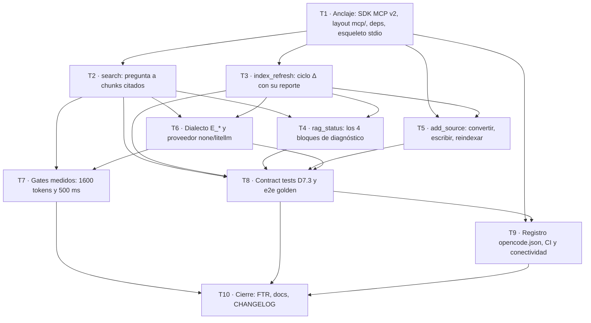
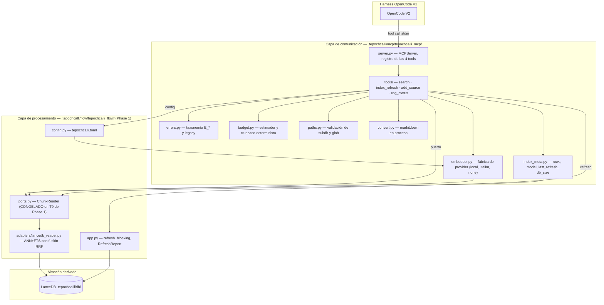

# Plan de implementación — Phase 2: MCP Server `tepochcalli-rag`

> **Rama de trabajo:** `feat/workspace-obsidian` (creada por el usuario).
> **Fuente de verdad:** [docs/WORKFLOW.md](../docs/WORKFLOW.md) §Phase 2 ·
> [specs/spec-mcp-server.md](../specs/spec-mcp-server.md) ·
> [specs/spec-markitdown.md](../specs/spec-markitdown.md) ·
> [specs/spec-embeddings.md](../specs/spec-embeddings.md) · ADR-005 · ADR-007 · ADR-008.
> **Alcance de este plan:** SOLO Phase 2 (server MCP). No toca el wizard (Phase 3), ni el
> payload de agents/commands/skills (Phase 4-5), ni `docs/UH.md`.
> **Autorización de escritura:** crear `obsidian-workspace/.tepochcalli/mcp/` (código nuevo) y
> añadir las entradas `mcp.servers.tepochcalli-rag` y `mcp.servers.markitdown` a
> `obsidian-workspace/opencode.json` (config del payload). `obsidian-workspace/.opencode/`
> (agents/commands/skills) sigue **VEDADO** — eso es Phase 4-5.
> **Historial:** el plan de Phase 1 se archivó en [tasks/phase1-plan.md](phase1-plan.md) y
> [tasks/phase1-todo.md](phase1-todo.md) (`git mv`; el original queda en el historial de git).

## 1. Objetivo y criterio de éxito

**Objetivo:** que `.tepochcalli/mcp/` sea un servidor MCP stdio **real** con las 4 tools del
contrato congelado, hablando con el flow de Phase 1 **sin tocar su motor**, y que OpenCode V2
lo pueda invocar desde el `opencode.json` real del workspace.

**El gate de Phase 2 (WORKFLOW §2) se cumple cuando:**

| # | Métrica de cierre | Verificada en |
|---|---|---|
| M1 | OpenCode lista las 4 tools desde el `opencode.json` real del workspace | T9 |
| M2 | `search` < 500 ms p95 en fixture 100× (criterio 3 de UH.md) | T2, T7 |
| M3 | Payload de `search` ≤ 1600 tokens con fixtures adversos (criterio 4) | T7 |
| M4 | Taxonomía `E_*` completa (5 códigos) + precedencia `INDEX_EMPTY` | T6, T8 |
| M5 | `rag_status` con shape exacto de 4 bloques y < 200 tokens | T4, T8 |
| M6 | Instalación degradada (salida 5 de D7.1) → `search` = `E_NO_EMBEDDER` + `rag_status` = `degraded` con `fix_hint` | T6, T8 |
| M7 | e2e «pregunta → tool-call → JSON citado» **grabado como fixture** | T8 |
| M8 | FTR Phase 2→3 con el usuario + docs al día + `just ci` verde | T10 |

> **Aviso de homonimia (heredado de WORKFLOW §Phase 2):** esta «Phase 2» es la del plan por
> fases del **producto**; no es la «fase 2: TDD» interna de los comandos `/test`, ya entregada
> dentro de Phase 1.

## 2. Decisiones tomadas en la entrevista (2026-10-26)

| # | Decisión | Valor | Consecuencia en el plan |
|---|---|---|---|
| D-a | Alcance del proveedor de embeddings | **LiteLLM completo en Phase 2** (lectura + escritura) | T6 implementa `provider = "litellm"` en ambos caminos; los 5 códigos `E_*` son **reales**, no simulados; el menú del wizard (Phase 3, salidas 2-4) queda testeable de extremo a extremo |
| D-b | Integración de markitdown en `add_source` | **Biblioteca markitdown en proceso** (mismo venv, mismo conversor que el MCP `markitdown`) | T5 no lanza subproceso ni habla MCP; `markitdown-mcp` se instala igual (lo exige spec-vault-structure §Layout y `--offline`) ⇒ **coste cero adicional** |
| D-c | Empaquetado de `tepochcalli_mcp` | **Un solo `pyproject.toml`, dos paquetes** (`package-dir` mapeando `tepochcalli_mcp` → `mcp/`) | `uv.lock`, venv, Justfile y CI intactos; mypy pasa a `files = ["flow", "mcp"]` (lo que CODE_STYLE ya anuncia) |
| D-d | Autorización de escritura | **`mcp/` + registro en `obsidian-workspace/opencode.json`** | T9 añade las dos entradas `mcp.servers.*`; `.opencode/` del vault sigue vedado |

### Decisiones derivadas (con suoletad de registro)

| # | Decisión | Razón | Dónde se registra |
|---|---|---|---|
| **D15** | `provider = "none"` es el 3.er valor válido de `[embedding].provider` | `rag_status` degradado y `E_NO_EMBEDDER` lo exigen (ADR-007 salida 5), pero el loader solo acepta `local|litellm`. Un config **ausente** sigue por defecto `local` (comportamiento de Phase 1 intacto) | Enmienda a `spec-embeddings.md` §`tepochcalli.toml` + `docs/WORKFLOW.md` §8 (**sin ADR**: es corrección de hechos — ADR-007 ya decidió el estado «none») |
| **D16** | `add_source` **rechaza** `file:` fuera de la raíz del vault | Conflicto entre specs: `spec-mcp-server` §Security lo permite («salvo `file:` explícito») y `spec-markitdown` §Testing lo exige rechazado. Se aplica la **versión estricta**: el riesgo de markitdown leyendo rutas arbitrarias es justo lo que avisa `docs/SECURITY.md`, y la tool la invoca un agente | `docs/WORKFLOW.md` §8 (ratificado por el usuario 2026-10-26) + nota en `docs/SECURITY.md` |
| **D17** | El servidor se invoca como `python -m tepochcalli_mcp`, no como console script | Lección (f) de Phase 1: en NTFS/fuseblk el bit de ejecución se pierde y `venv/bin/tepochcalli-mcp` no arranca | `obsidian-workspace/opencode.json` + `docs/WORKFLOW.md` §8 |
| **D18** | `markitdown-mcp` se instala **tal cual** (`markitdown[all]`, +142 MB, 49 paquetes) | Lo exige el layout congelado (`spec-vault-structure` §Layout) y `--offline` (`spec-markitdown`). Lo que pesa de más (PDF, audio, YouTube, Azure AI) está fuera de alcance v1: el PDF lo cubre Docling | Coste registrado en `docs/TECH_DEBT.md` (TD-12) |

## 3. Omen mayor detectado (fail-fast en T1)

> **El SDK oficial de MCP para Python renombró su API justo en la v2, y el camino "fácil" de
> reportar errores NO sirve para nuestro contrato.**

Verificado contra la fuente de `mcp==2.3.0` (PyPI, 2026-10-26):

1. **`FastMCP` → `MCPServer`**, y el módulo se movió: `mcp.server.fastmcp.*` →
   `mcp.server.mcpserver.*`. Importar `mcp.server.fastmcp` **levanta `ModuleNotFoundError`**.
   El transporte se configura ahora en `run()` (`MCPServer(..., port=…)` es `TypeError`).
2. **`ToolError` no puede llevar nuestro payload.** `ToolError` mete **texto libre** en
   `content` y deja `structured_content = None`. El contrato congelado exige
   `content[0].text` = **JSON canónico** con `{error:{code,message,fix_hint}}` — *nunca texto
   libre* (`spec-mcp-server` §Manejo de errores). Por eso los handlers **no** lanzan
   `ToolError`: construyen el `CallToolResult` **explícitamente** (`content=[TextContent(text=json)]`,
   `is_error=True` en el fallo) — la forma que la v2 documenta para el servidor de bajo nivel.
3. **stdout es el canal JSON-RPC.** Cualquier `print` al `stdout` corrompe el protocolo ⇒
   **todo log a `stderr`** (la spec ya lo pide: «log local rotativo en flujo stderr»).

Por eso **T1 va primero y es un spike**: si la v2 difiere en algo más (forma del
`CallToolResult`, `output_schema`, nombres de los tipos), el resto del plan se reescribe con el
dato real en vez de con una suposición.

**Segundo omen (menor, aislado):** `markitdown[all]` engorda el venv del vault en **+142 MB y
+49 paquetes** (medido con `uv pip install --dry-run` contra PyPI, CPython 3.12). Es el precio
de D18; el venv ya lleva torch/Docling (~2 GB), así que es marginal en el conjunto.

## 4. Grafo de dependencias



**Orden impuesto por el grafo:** T1 → {T2, T3, T5} · T2+T3 → T4, T6 · T2+T6 → T7 ·
{T2,T3,T4,T5,T6} → T8 → T9 → T10.

**Paralelizables:** T2, T3 y T5 se pueden tacklear en paralelo (T5 necesita T3 solo para el
refresh interno; puede empezar con el stub). T4 depende de T2+T3. T6 depende de T2+T3.
T8 depende de los cuatro caminos.

## 5. Arquitectura del módulo (hexagonal, ADR-005)



**Regla de dependencia (clean-ddd-hexagonal):** los módulos **de dominio del server**
(`errors.py`, `budget.py`, `paths.py`) no importan `mcp`, `cocoindex`, `lancedb`, `markitdown`
ni `litellm` — es dominio puro, testeable sin infraestructura. El **test de arquitectura** de
Phase 1 (`tests/unit/test_architecture.py`) se **extiende** para cubrir `tepochcalli_mcp` (T1 lo
deja preparado; T2 lo cierra).

**Puertos que se reutilizan (no se reimplementan):** `tepochcalli_flow.ports.ChunkReader` y
`tepochcalli_flow.ports.CitedChunk` (los 7 campos, congelados en Phase 1) y
`tepochcalli_flow.models.RefreshReport` (`scanned/indexed/skipped/elapsed_ms/locked`).
**El server NO toca el motor**: llama a los puertos y a `app.refresh_blocking()`; el motor
sigue sin saber que existe un MCP.

### Layout de ficheros (nuevo)

```text
obsidian-workspace/.tepochcalli/
├── pyproject.toml                    # AHORA con 2 paquetes + el script tepochcalli-mcp
├── uv.lock                           # regenerado con las deps nuevas
├── flow/tepochcalli_flow/             # Phase 1 — NO SE TOCA (salvo app.py en T6)
└── mcp/tepochcalli_mcp/               # Phase 2 — NUEVO
    ├── __init__.py
    ├── __main__.py                   # python -m tepochcalli_mcp  (D17)
    ├── server.py                     # MCPServer + registro de las 4 tools
    ├── errors.py                     # taxonomía: legacy + E_* → payload canónico
    ├── budget.py                     # estimador de tokens + truncado determinista
    ├── paths.py                      # subdir/glob: normalización y anti-traversal
    ├── embedder.py                   # fábrica de provider (local | litellm | none)
    ├── index_meta.py                 # rows, model, last_refresh, db_size_bytes
    ├── convert.py                    # markitdown en proceso + frontmatter
    └── tools/
        ├── __init__.py
        ├── search.py
        ├── index_refresh.py
        ├── add_source.py
        └── rag_status.py
```

Tests nuevos: `tests/unit/test_mcp_errors.py`, `test_mcp_budget.py`, `test_mcp_paths.py`,
`tests/integration/test_mcp_search.py`, `test_mcp_refresh.py`, `test_mcp_rag_status.py`,
`test_mcp_add_source.py`, `tests/e2e/test_mcp_contract.py`, `tests/benchmarks/bench_search.py`
+ extensión de `tests/unit/test_architecture.py`.

### Contrato de datos (congelado — la forma EXACTA que emits)

| Tool | Firma | Response (JSON canónico en `content[0].text`) |
|---|---|---|
| `search` | `search(query: str, top_k: int = 5, path_filter: str \| None = None)` | `{query, took_ms, truncated, results: [{text, source_path, heading, char_start, char_end, score, offsets_ref}]}` — los **7 campos siempre presentes**; `heading` nullable (D13); `score` ∈ [0,1] descendente |
| `index_refresh` | `index_refresh()` | `{scanned, indexed, skipped, elapsed_ms, locked}` — serializado **tal cual** desde `RefreshReport` |
| `add_source` | `add_source(uri: str, subdir: str \| None = None)` | `{ok: true, written_to, indexed: {scanned, indexed, skipped, elapsed_ms}}` |
| `rag_status` | `rag_status()` | `{embedder: {mode, model, dims, provider}, index: {rows, model_matches_config, last_refresh, db_size_bytes}, config: {path, valid}, health: {state, reason, fix_hint}}` |

### Taxonomía de errores (forma única, sin texto libre)

| Código | Forma del payload | Cuándo |
|---|---|---|
| `VALIDATION_ERROR` | `{error:{code,message,details}}` (legacy) | args inválidos: `top_k` fuera de [1,20], glob absoluto o con `..`, `subdir` fuera de `00-Resources/` |
| `INDEX_EMPTY` | legacy + `details` | tabla `chunks` inexistente **con embedder configurado** |
| `INDEX_STALE_MODEL` | legacy + `details` | alias heredado de `E_MODEL_MISMATCH` (viaja en `details.legacy_code`) |
| `ENGINE_LOCKED` | legacy + `details` | el refresh quedó bloqueado por otro proceso **en `add_source`** (la forma de `index_refresh` sí tiene sitio: el campo `locked`) |
| `SOURCE_UNREACHABLE` | legacy + `details` | fetch/convert falló |
| `INTERNAL` | legacy + `details` | inesperado (traceback al log, **nunca** al cliente) y fallos de API **no** cubiertos por un `E_*` (rate limit, timeout, red) |
| `E_NO_EMBEDDER` | `{error:{code,message,fix_hint}}` | sin modelo local ni API configurada (mode `none`) |
| `E_API_AUTH` | `E_*` | clave rechazada (401/403) al primer embed — se nombra el proveedor, la clave **nunca** se loggea |
| `E_MODEL_MISMATCH` | `E_*` (+ `details.legacy_code = "INDEX_STALE_MODEL"`) | `config.model` ≠ modelo del índice — `search` **no** cruza dims |
| `E_MODEL_INVALID` | `E_*` | modelo no materializable (no está en cache y la descarga falla; o no es embedding model) |
| `E_OFFLINE_NO_CACHE` | `E_*` | `provider = "local"`, modelo sin cachear y entorno offline (`HF_HUB_OFFLINE=1` / `TRANSFORMERS_OFFLINE=1`) |

**Precedencia (escrita para que nadie la adivine):** `E_NO_EMBEDDER` > `INDEX_EMPTY` >
`E_MODEL_MISMATCH` > `E_API_AUTH`. Es decir: sin embedder no se mira el índice; con embedder
pero sin índice, el índice; con índice pero de otro modelo, el modelo; y solo después, la
credencial.

### Presupuesto de tokens (determinista, criterio 4)

```text
coste(resultado) = len(text) // 4  +  25 tokens de citación
top_k efectivo   = 5 por omisión; tope duro 8; top_k ∈ [1,20] (fuera → VALIDATION_ERROR)
techo de payload = 1600 tokens  →  si se excede: se descartan los de menor score y truncated = true
margen restante  = ≥400 tokens para la pregunta y la respuesta del agente (cota 2000 de UH.md)
```

`rag_status` se mantiene **< 200 tokens por construcción** (su shape es fijo).

## 6. Tareas

### Sub-fase A — Anclaje (fail-fast)

#### T1 · Spike del SDK MCP v2, layout del paquete `mcp/` y esqueleto que anuncia las 4 tools

* **Descripción:** anclar la API real del SDK de MCP v2 (el *omen mayor* de §3), decidir y
  probar el empaquetado de los dos paquetes en un solo `pyproject.toml`, y dejar un servidor
  que arranca por stdio y **declara** las 4 tools con sus schemas — sin lógica todavía, para
  que el contrato quede congelado antes de implementarlo.
* **AC:**
  * `mcp==2.3.0`, `markitdown-mcp==0.0.1a8` y `litellm>=1.106,<2` pineados en
    `.tepochcalli/pyproject.toml`; `uv.lock` regenerado y commiteado; `uv sync --frozen`
    reproducible; **la suite de Phase 1 sigue verde** (el lock no se rompió).
  * `pyproject.toml`: `packages = ["tepochcalli_flow", "tepochcalli_flow.adapters",
    "tepochcalli_mcp", "tepochcalli_mcp.tools"]` + `package-dir = {"": "flow",
    "tepochcalli_mcp": "mcp"}`; `[project.scripts] tepochcalli-mcp = "tepochcalli_mcp.__main__:main"`;
    `[tool.mypy] files = ["flow", "mcp"]`.
  * El editable install expone **ambos** paquetes (probado con `import tepochcalli_flow` **y**
    `import tepochcalli_mcp`, con y sin subpaquete).
  * Layout nuevo `obsidian-workspace/.tepochcalli/mcp/tepochcalli_mcp/` con `__init__.py`,
    `__main__.py` y `server.py`.
  * El server arranca por **stdio**, responde `initialize` y `tools/list` con las **4 tools** y
    sus schemas (`search(query, top_k=5, path_filter=None)`, `index_refresh()`,
    `add_source(uri, subdir=None)`, `rag_status()`).
  * Cada handler devuelve ya el **placeholder con la forma EXACTA** declarada en §5 (sin
    lógica): el contrato queda congelado antes de llenarlo.
  * **Hallazgos del spike documentados** en el docstring de `server.py`: `FastMCP`→`MCPServer`,
    `mcp.server.mcpserver.*`, `ToolError` insuficiente ⇒ `CallToolResult` explícito, transporte
    en `run()`.
  * **stdout reservado al JSON-RPC**: todo log a `stderr` (test que comprueba que stdout sólo
    contiene JSON-RPC).
  * `.gitignore`: `mcp/` **versionado** — verificado con `git check-ignore -v` en **ambos**
    sentidos (como en T2/T3 de Phase 1).
* **Verificar:** `uv run python -m tepochcalli_mcp` + cliente del SDK por stdio ⇒ `tools/list`
  con 4 tools; `just ci` verde (suite Phase 1 incluida).
* **Dep.:** — · **Tamaño:** M

### Sub-fase B — Los cuatro caminos

#### T2 · `search`: de la pregunta a los chunks citados

* **Descripción:** el camino caliente del producto. El agente pregunta; el server vectoriza la
  query, busca por el puerto de lectura de Phase 1, recorta al presupuesto y devuelve citas
  exactas.
* **AC:**
  * `search(query, top_k=5, path_filter=None)` → `{query, took_ms, truncated, results:[…]}` con
    los **7 campos** por resultado, `heading` nullable (D13) y `score` descendente en [0,1].
  * Consume el puerto `ChunkReader` de Phase 1; el server **no** importa `cocoindex` ni
    `lancedb` (test de arquitectura extendido a `tepochcalli_mcp`).
  * Embedder `local` vía la fábrica de provider (T6 la generaliza; T2 solo `local`).
  * `took_ms` medido **desde la entrada del handler hasta serializar la respuesta** (incluye el
    embed de la query; excluye el arranque del proceso).
  * `top_k`: por omisión 5; fuera de [1,20] → `VALIDATION_ERROR`; efectivo = `min(solicitado, 8)`.
  * `path_filter`: glob relativo al vault; absoluto o con `..` → `VALIDATION_ERROR` (reutiliza
    `path_filter_to_like_predicate` de Phase 1, que ya valida).
  * Presupuesto determinista: `len(text)//4 + 25` por resultado; se acumulan por score
    descendente mientras el total ≤1600; al cortar, `truncated: true`.
  * Errores: índice inexistente → `INDEX_EMPTY`; `model` del índice ≠ config →
    `E_MODEL_MISMATCH` (+ `details.legacy_code`), **sin** cruzar dims.
  * **Cero** llamadas de red y **cero** LLM (guard con canario, como el M3 de Phase 1).
* **Verificar:** test de integración contra un vault fixture real (100 chunks) + test de
  arquitectura + `just quality`.
* **Dep.:** T1 · **Tamaño:** M

#### T3 · `index_refresh`: el ciclo Δ con su reporte honesto

* **Descripción:** exponer el Δ de Phase 1 como tool, serializando `RefreshReport` **tal cual**
  (sin recalcular cuentas) y exponiendo el estado del candado.
* **AC:**
  * `index_refresh()` → `{scanned, indexed, skipped, elapsed_ms, locked}` desde
    `RefreshReport`, sin recalcular ni redondear.
  * `locked: true` cuando otro proceso retiene el candado ⇒ el reporte va con las tres cuentas
    a cero y **no** se ejecuta update.
  * `E_NO_EMBEDDER` cuando no hay embedder configurado (mode `none`) — **precede** a
    `INDEX_EMPTY`.
  * `indexed` sale del data plane (nunca de `stats.total`); `skipped = scanned - indexed`;
    `elapsed_ms` con reloj monótono.
  * Idempotencia: una segunda llamada consecutiva ⇒ `indexed: 0`, `skipped == scanned`.
* **Verificar:** test de integración con vault fixture (crea → modifica → borra → idempotencia)
  + prueba del candado (dos refresh concurrentes ⇒ uno con `locked: true`).
* **Dep.:** T1 · **Tamaño:** S

#### T4 · `rag_status`: el diagnóstico que el agente puede llamar sin coste

* **Descripción:** la tool que D7.3/ADR-007 hacen obligatoria ante cualquier `E_*`: dice qué
  embedder hay, qué estado tiene el índice, si la config vale y qué hacer para arreglarlo.
* **AC:**
  * Exactamente **4 bloques**: `embedder {mode, model, dims, provider}`,
    `index {rows, model_matches_config, last_refresh, db_size_bytes}`,
    `config {path, valid}`, `health {state, reason, fix_hint}`.
  * `state ∈ {ok, degraded}`; `reason` **exclusivamente** de la taxonomía `E_*`;
    `fix_hint` = la solución exacta (texto de la spec).
  * `mode ∈ {local, api, none}`.
  * `model_matches_config` = (conjunto de `model` de las filas) == {`config.embedding.model`};
    si no ⇒ `state: degraded` + `reason: E_MODEL_MISMATCH`.
  * `last_refresh` = `max(indexed_at)` de las filas — **derivado, sin estado nuevo** — o `null`
    si el índice está vacío; la semántica («última indexación efectiva») se declara en la
    `description` de la tool.
  * `db_size_bytes` = suma de tamaños de `.tepochcalli/db/`.
  * `config.path` **relativa** (`.tepochcalli/config/tepochcalli.toml`) — nunca absoluta (no
    filtra el home del usuario).
  * Modo degradado: `mode: none` ⇒ `state: degraded`, `reason: E_NO_EMBEDDER`,
    `fix_hint: "Ejecuta `tepochcalli config embedder` y luego `index_refresh()`"`.
  * Coste **< 200 tokens** verificado con el estimador.
* **Verificar:** test de integración con 3 estados (sano / sin embedder / modelo distinto) +
  assert de tokens <200.
* **Dep.:** T2, T3 · **Tamaño:** S

#### T5 · `add_source`: convertir, escribir y reindexar en una llamada

* **Descripción:** el camino de entrada de material nuevo: el usuario da una URL o un archivo,
  el server lo convierte a Markdown, lo deja citado en `00-Resources/` y reindexa.
* **AC:**
  * `add_source(uri, subdir=None)` → `{ok: true, written_to, indexed: {scanned, indexed,
    skipped, elapsed_ms}}`.
  * `uri` acepta `http(s):` y `file:`; `subdir` normalizado (sin `..`, sin absolutos) y
    destino **siempre** dentro de `00-Resources/`; por omisión `_inbox`.
  * Conversión con la **biblioteca markitdown en proceso** (`markitdown==0.1.9`); el archivo
    escrito lleva frontmatter de trazabilidad (`source_uri`, `converted_at`).
  * Nombre derivado del URI (slug) + `.md`; colisión ⇒ sufijo numérico.
  * Escritura **atómica** (temporal + `rename`) dentro de `00-Resources/`.
  * Tras escribir, invoca `index_refresh` **internamente** y serializa el reporte en `indexed`.
  * Si ese refresh quedó bloqueado ⇒ error `ENGINE_LOCKED` (la forma de `add_source` no tiene
    sitio para `locked`).
  * Fallo de fetch/convert ⇒ `SOURCE_UNREACHABLE` con la guía («guárdalo manualmente en
    `00-Resources/` y ejecuta `index_refresh`»).
  * **`file:` fuera del vault ⇒ RECHAZADO** (D16) con `VALIDATION_ERROR`.
  * **Nunca** escribe fuera de `00-Resources/` (test adversarial de `subdir`).
* **Verificar:** tests de integración con `http(s):` (servidor local) y `file:`; negativos:
  traversal, `subdir` absoluto, formato no convertible, `file:` fuera del vault.
* **Dep.:** T1, T3 · **Tamaño:** M

### Sub-fase C — Dialecto de errores, proveedor API y presupuestos

#### T6 · Dialecto `E_*` y el proveedor `none | litellm`

* **Descripción:** cerrar el contrato de errores (los 5 códigos `E_*` + la precedencia) y
  habilitar el camino de API externo, que hoy el flow rechaza con
  `EmbeddingProviderNotImplementedError`.
* **AC:**
  * `provider = "none"` aceptado por el loader (**3.er valor**, D15); un config **ausente**
    sigue por defecto `local` (comportamiento de Phase 1 intacto).
  * Fábrica de provider (`embedder.py`): `local` → `SentenceTransformer` pineado a
    `MODEL_REVISION`; `litellm` → `litellm.embedding` con la clave de `api_key_env` (leída del
    entorno, **nunca** loggeada); `none` ⇒ `E_NO_EMBEDDER`.
  * **Camino de escritura** con litellm: `app.py` construye
    `cocoindex.ops.litellm.LiteLLMEmbedder(model, api_key=…)` cuando `provider == "litellm"`
    (en vez de lanzar el error tipado).
  * **Camino de lectura** con litellm: la query se vectoriza con la misma API (mismo modelo y
    dims que el índice); si el modelo no coincide ⇒ `E_MODEL_MISMATCH` **antes** de cruzar dims.
  * Los **5** códigos `E_*` emitidos con el payload **exacto** `{error:{code,message,fix_hint}}`
    (tabla de §5).
  * Fallos de API **no** cubiertos por un `E_*` (rate limit, timeout, red) ⇒ `INTERNAL`
    (forma legacy con `details`); el traceback va al log con la clave **redactada** y nunca al
    cliente.
  * Precedencia verificada: `E_NO_EMBEDDER` > `INDEX_EMPTY` > `E_MODEL_MISMATCH` >
    `E_API_AUTH`.
  * Enmienda de spec: `spec-embeddings.md` §`tepochcalli.toml` acepta `provider = "none"`
    (corrección de hechos, sin ADR) + entrada en `docs/WORKFLOW.md` §8.
* **Verificar:** contract test por código `E_*` (con proveedor falso inyectado) + test que
  afirma que la clave **no** aparece en logs, `repr` ni payload + suite Phase 1 verde (el
  cambio en `app.py` no rompe el flow local).
* **Dep.:** T2, T3 · **Tamaño:** M

#### T7 · Los dos gates numéricos: ≤1600 tokens y <500 ms

* **Descripción:** medir, no estimar. Los criterios 3 y 4 de UH.md son números y este plan los
  convierte en benchmarks reproducibles.
* **AC:**
  * Fixtures **adversas**: query unicode (CJK/emoji), query sobredimensionada (>10 000 chars →
    `VALIDATION_ERROR`), chunk de 1536 bytes, PDF con tablas, chunk multibyte.
  * Assert: payload serializado de `search` **≤1600 tokens** en **todas** las fixtures; cuando
    hay corte ⇒ `truncated: true` y el orden por score se respeta.
  * `rag_status` **<200 tokens**.
  * Bench de `search`: **p95 < 500 ms** sobre fixture de 100 archivos. Se publica **n y método
    de percentil** junto al número (lección (c) de Phase 1: n=20, *nearest-rank*, p95 = 19.º
    valor ordenado).
  * El bench vive en `tests/benchmarks/bench_search.py`, se marca `slow` (no corre en la suite de
    corrección) y deja un *smoke* con umbral generoso para CI.
  * Presupuesto por etapa **medido** y publicado: embed ≤120 ms · ANN+FTS ≤200 ms ·
    ensamblado/truncado ≤30 ms · margen IPC ≤150 ms.
* **Verificar:** `just bench-search` (local, documentado) + `just bench-search --smoke` (CI).
* **Dep.:** T2, T6 · **Tamaño:** M

### Sub-fase D — Contrato, e2e, registro y cierre

#### T8 · Contract tests D7.3 y e2e «pregunta → tool-call → JSON citado»

* **Descripción:** el gate de Phase 2: las formas exactas y una prueba real de proceso a
  proceso, con el fixture **grabado**.
* **AC:**
  * Contract tests de las 4 tools: shape **exacto** (claves y orden) de request/response;
    en error, `is_error = true` y `content[0].text` es **JSON parseable** (nunca texto libre);
    `structured_content` coherente con el shape.
  * Los 5 `E_*` con `{error:{code,message,fix_hint}}`; `rag_status` con los 4 bloques exactos y
    <200 tokens; instalación degradada ⇒ `search` = `E_NO_EMBEDDER` y `rag_status` =
    `degraded` con `fix_hint`.
  * `path_filter`: globs válidos e inválidos (`..`, absoluto) y el prefijo `00-Resources/`.
  * **e2e real**: el test lanza el proceso `tepochcalli-mcp` por stdio (cliente del SDK),
    indexa un vault golden (md + PDF) y comprueba que cada resultado trae `source_path` real,
    `heading` y **offsets reproducibles** (el slice del archivo original reproduce `text` para
    md; `offsets_ref == "extract"` para PDF).
  * El fixture golden queda **grabado** en `tests/fixtures/` (no se regenera en cada corrida).
  * Cero red, cero LLM.
* **Verificar:** `uv run python -m pytest ../../tests/e2e -v` + `just test` verde.
* **Dep.:** T2, T3, T4, T5, T6 · **Tamaño:** M

#### T9 · Registro en `opencode.json`, CI y conectividad real con OpenCode V2

* **Descripción:** que el harness del vault real encuentre el server — el criterio «OpenCode V2
  conecta vía `opencode.json` real del workspace».
* **AC:**
  * `obsidian-workspace/opencode.json` gana `mcp.servers.tepochcalli-rag` (`type: "local"`,
    `command: [".tepochcalli/venv/bin/python", "-m", "tepochcalli_mcp"]`, `cwd: "."`,
    `environment: {"TEPOCHCALLI_ROOT": "."}`) y `mcp.servers.markitdown`
    (`command: [".tepochcalli/venv/bin/python", "-m", "markitdown_mcp"]`).
  * Forma `python -m`, **no** console script (D17: el bit de ejecución se pierde en NTFS).
  * Merge **conservador**: solo se tocan las claves `mcp.servers.*` gestionadas; el resto del
    JSON se preserva byte a byte (spec-installer-wizard §merge).
  * `TEPOCHCALLI_ROOT` (el nombre del contrato MCP) se traduce a `TEPOCHCALLI_VAULT_ROOT` (el
    del flow) en el composition root del server: **un solo** nombre para el vault.
  * `.github/workflows/phase1.yml` gana un job `mcp`; `just ci` incluye los pasos del server
    (mypy sobre `flow` + `mcp`, suite con los tests nuevos). El nombre del workflow queda
    histórico → anotado en `docs/TECH_DEBT.md`.
  * Conectividad real: el harness **lista las 4 tools** de `tepochcalli-rag` (M1). El workflow
    sigue sin poder ejecutarse en GitHub Actions (M6 de Phase 1, sin cambio) — **no** se
    declara CI verde.
* **Verificar:** listado de tools desde el harness + `just ci` verde.
* **Dep.:** T1, T8 · **Tamaño:** S

#### T10 · Cierre de fase: FTR, docs y CHANGELOG

* **Descripción:** dejar la fase como se dejó Phase 1 — medidas, no estimadas; deuda
  re-revisada; gate cerrado con el usuario.
* **AC:**
  * **FTR Phase 2→3** (WORKFLOW §4) ejecutado con el usuario: shapes = `spec-mcp-server`.
  * `docs/WORKFLOW.md` §Phase 2: estado + **métricas medidas** (con n y método de percentil) +
    entradas §8 nuevas (D15 `provider=none`, D16 `file:` fuera del vault rechazado, D17
    invocación `python -m`, D18 peso de markitdown).
  * `SPEC.md` (índice): `spec-mcp-server` → **Approved**; `spec-markitdown` → **Approved** si
    T5 cumple su §Testing.
  * `docs/ARCHITECTURE.md`: inventario del componente nuevo + diagrama de la capa MCP.
  * `docs/TECH_DEBT.md`: re-review de TD-1…TD-11 (**TD-1 y TD-3 pagan su deuda aquí**) +
    TD-12 (peso del venv) + cualquier deuda nueva.
  * `docs/CODE_STYLE.md`: la superficie tipada pasa a `flow` + `mcp`.
  * `docs/SECURITY.md`: nota del límite de `file:` (D16) y de la clave de API.
  * `CHANGELOG.md`: entrada de la fase.
  * **Cero** cambios en `docs/UH.md`, `README.md`, `LICENSE`, `CODE_OF_CONDUCT.md`,
    `opencode.json` (raíz) ni `obsidian-workspace/.opencode/`.
* **Verificar:** `just md-lint` sin errores nuevos + revisión del diff + `git status --short`
  sin artefactos (`venv/`, `db/`, `models/`, `config/`).
* **Dep.:** T7, T8, T9 · **Tamaño:** S

## 7. Checkpoints (gates de calidad entre sub-fases)

### ✅ CP-A · Anclaje — 5/5

- [ ] El servidor arranca por stdio y `tools/list` devuelve las **4 tools** con sus schemas
- [ ] `uv sync --frozen` reproducible; **suite de Phase 1 verde** (el lock no se rompió)
- [ ] Ambos paquetes importables desde el editable install (`tepochcalli_flow` y `tepochcalli_mcp`)
- [ ] `git check-ignore` en ambos sentidos para `mcp/` (versionado, no ignorado)
- [ ] stdout del proceso contiene **solo** JSON-RPC (todo log a stderr)
- ▶️ **Desbloquea** T2, T3 y T5.

### ✅ CP-B · Los cuatro caminos — 5/5

- [ ] Las 4 tools responden con la **forma exacta** de §5 contra un vault fixture real
- [ ] `search` devuelve citas verificables (offsets reproducibles) y `rag_status` los 4 bloques
- [ ] `add_source` escribe dentro de `00-Resources/` y reindexa
- [ ] `just quality` verde (lint + fmt + mypy `flow`+`mcp` + tests)
- [ ] **`code-reviewer` aprueba el diff de la sub-fase** (como el CP-B de Phase 1)
- ▶️ **Desbloquea** T6 y T7.

### ✅ CP-C · Errores, API y presupuestos — 5/5

- [ ] Los **5** códigos `E_*` emitidos con su payload exacto + precedencia verificada
- [ ] El camino `litellm` funciona en lectura **y** escritura (o queda registrado por qué no)
- [ ] Payload de `search` **≤1600 tokens** en todas las fixtures adversas
- [ ] `search` **p95 < 500 ms** **medido** (n y método publicados)
- [ ] La suite de Phase 1 sigue verde tras tocar `app.py`
- ▶️ **Desbloquea** T8.

### ✅ CP-D · Gate Phase 2 → Phase 3 — 6/6

- [ ] Contract tests D7.3 verdes (shapes, `E_*`, `rag_status`, globs)
- [ ] e2e «pregunta → tool-call → JSON citado» **grabado como fixture** y verde
- [ ] OpenCode **lista las 4 tools** desde el `opencode.json` real del workspace
- [ ] `just ci` verde
- [ ] **FTR Phase 2→3** ejecutado con el usuario
- [ ] Docs al día (WORKFLOW, SPEC, ARCHITECTURE, TECH_DEBT, CODE_STYLE, SECURITY, CHANGELOG)
- ▶️ **Desbloquea** Phase 3 (wizard).

## 8. Asignación de subagentes y skills

> Solo subagentes (nunca los agentes principales). Skills del inventario del repo.

| Tarea | Subagentes | Skills |
|---|---|---|
| **T1** · Anclaje | `mcp-builder` (lead), `python-pro`, `dependency-manager` | `source-driven-development`, `api-and-interface-design`, `dependency-audit`, `clean-code`, `spec-driven-development` |
| **T2** · `search` | `mcp-developer` (lead), `rag-pipeline-engineer`, `search-relevance-engineer` | `test-driven-development`, `clean-ddd-hexagonal`, `design-patterns`, `api-and-interface-design`, `clean-code`, `performance-analysis` |
| **T3** · `index_refresh` | `mcp-developer` (lead), `python-pro` | `test-driven-development`, `solid`, `error-handling-patterns`, `clean-code` |
| **T4** · `rag_status` | `mcp-developer` (lead), `api-tester` | `api-and-interface-design`, `test-driven-development`, `observability-and-instrumentation`, `clean-code` |
| **T5** · `add_source` | `mcp-developer` (lead), `python-pro`, `security-auditor` | `test-driven-development`, `security-and-hardening`, `error-handling-patterns`, `incremental-implementation`, `clean-code` |
| **T6** · `E_*` y `litellm` | `mcp-developer` (lead), `rag-pipeline-engineer`, `security-auditor`, `error-detective` | `error-handling-patterns`, `security-and-hardening`, `test-driven-development`, `source-driven-development`, `clean-code` |
| **T7** · Gates numéricos | `performance-benchmarker` (lead), `test-engineer` | `performance-analysis`, `performance-optimization`, `test-driven-development`, `observability-and-instrumentation` |
| **T8** · Contrato y e2e | `test-automation-engineer` (lead), `api-tester`, `testing-reality-checker` | `test-driven-development`, `api-spec-generation`, `doubt-driven-development`, `clean-code` |
| **T9** · Registro y CI | `build-engineer` (lead), `devops-engineer` | `ci-cd-and-automation`, `source-driven-development`, `incremental-implementation` |
| **T10** · Cierre | `docs-writer` (lead), `technical-writer`, `code-reviewer` | `documentation-and-adrs`, `changelog-generate`, `code-review-and-quality`, `git-workflow-and-versioning` |
| **CP-B** (gate) | `code-reviewer` | `code-review-and-quality`, `clean-code`, `solid` |
| **CP-D** (gate) | `code-reviewer`, `testing-reality-checker` | `code-review-and-quality`, `doubt-driven-development`, `documentation-and-adrs` |

**Patrones que aplica cada tarea** (design-patterns, sin sobreingeniería):

| Tarea | Patrón | Por qué |
|---|---|---|
| T1 | **Composition Root** | `server.py` es el único sitio que conoce SDK, flow y config |
| T2/T3/T4/T5 | **Ports & Adapters** + **DTO** | los handlers dependen de `ChunkReader`/`RefreshReport`, no del motor |
| T6 | **Strategy** (por provider) + **Factory** | `local`/`litellm`/`none` son algoritmos intercambiables de embedding |
| T5 | **Facade** (`add_source`) | una llamada para convertir+escribir+reindexar |
| T7 | **Strategy** de medición | bench con y sin smoke |
| T9 | **Adapter** (el JSON del harness) | `mcp.servers.*` es el formato de OpenCode, no el nuestro |

## 9. Riesgos (omens) y mitigación

| Omen | Prob | Impacto | Mitigación | Contingencia |
|---|---|---|---|---|
| El SDK MCP v2 es reciente (2.3.0) y renombró su API | alta | alto | **T1 es un spike fail-fast**; `mcp==2.3.0` pineado exacto | Si la v2 no sirve: usar el servidor de bajo nivel (`mcp.server.Server`) o fijar `mcp==1.30.0` (API v1 estable) — se registra en §8 |
| `litellm` rompe la resolución de `uv.lock` (pesado, muchas deps) | media | alto | T6 lo aísla; `litellm>=1.106,<2` con pin superior | Caer a `litellm` en pin exacto o diferir el camino API a Phase 3 (registrado en §8, con los `E_*` emitidos por proveedor falso) |
| `markitdown[all]` engorda el venv (+142 MB, +49 paquetes) | alta | bajo | D18 (decidido y medido); el wizard descarga el venv una vez | Si molesta: `override-dependencies` para recortar a `[docx,xlsx,pptx]` (−51 MB), documentado |
| El bit de ejecución perdido en NTFS rompe el entrypoint | alta | medio | D17: invocación `python -m` | — |
| Un `print` al `stdout` corrompe el JSON-RPC | media | alto | Regla «logs a stderr» + test que comprueba que stdout es JSON-RPC puro | — |
| El traceback de litellm filtra la clave de API | media | **crítico** | Mapeo a `E_API_AUTH` con mensaje sanitizado; el traceback va al log con la clave redactada | Revocar y rotar la clave; nunca se escribe el valor en disco |
| `rag_status` leyendo el índice completo se ralentiza con 100k filas | media | medio | Proyección de columnas con tope + `max(indexed_at)` | Muestreo del primer N y标注 «aproximado» en la descripción |
| La API de `markitdown` cambia entre versiones | baja | medio | Pin exacto `markitdown==0.1.9` | Fijar la versión anterior en el lock |
| Los `E_*` se mapean distinto de lo escrito en §5 | media | alto | La tabla de §5 es **la** especificación del mapping + contract test por código | — |
| Los PDFs grandes rompen la latencia percibida de `add_source` | media | bajo | El flow solo reprocesa lo que cambia; TD-2 (coste de Docling) ya lo mide | Fuera del presupuesto Δ por protocolo (como en Phase 1) |

## 10. Nota sobre la rama de trabajo

* Rama: **`feat/workspace-obsidian`** (la de Phase 1). Los commits son **atómicos, uno por
  tarea**, en Conventional Commits (≤72 columnas, español) con el trailer
  `Co-Authored-By: Moctezuma <dev@fisherk2.com>`.
* Phase 1 sigue **sin pushear** (decisión del usuario 2026-10-23: no publicar los commits en un
  repo público) ⇒ el workflow de GitHub Actions **nunca ha corrido** (M6). Phase 2 se verifica
  **en local** con el mismo orden de pasos (`just ci`), y no se declara CI verde.
* Nunca se commitean `.tepochcalli/{venv,db,models,bin,config}` — `mcp/` y `flow/` **sí** son
  código fuente versionado (spec-vault-structure §gitignore).

## 11. Referencias

* [docs/WORKFLOW.md](../docs/WORKFLOW.md) §Phase 2, §4 (FTR), §8 (Change Control)
* [specs/spec-mcp-server.md](../specs/spec-mcp-server.md) — contrato congelado de las 4 tools
* [specs/spec-markitdown.md](../specs/spec-markitdown.md) — `add_source` y cadena de fallback
* [specs/spec-embeddings.md](../specs/spec-embeddings.md) — config, provider, matriz local/API
* [specs/spec-vault-structure.md](../specs/spec-vault-structure.md) — layout `.tepochcalli/` y gitignore
* [specs/spec-rag-engine.md](../specs/spec-rag-engine.md) — el motor que Phase 2 **no** toca
* [docs/ARCHITECTURE.md](../docs/ARCHITECTURE.md) · [docs/CODE_STYLE.md](../docs/CODE_STYLE.md) ·
  [docs/SECURITY.md](../docs/SECURITY.md) · [docs/TECH_DEBT.md](../docs/TECH_DEBT.md)
* ADR-005 (ports/adapters) · ADR-007 (provider + `rag_status` + `E_*`) · ADR-008 (swap atómico)
* MCP Python SDK v2.3.0 — https://github.com/modelcontextprotocol/python-sdk
  (`FastMCP`→`MCPServer`, `mcp.server.mcpserver.*`, `CallToolResult` explícito)
* [tasks/phase1-plan.md](phase1-plan.md) · [tasks/phase1-todo.md](phase1-todo.md) — plan de Phase 1
