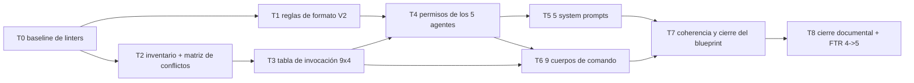

# Plan de implementación — Phase 4 (blueprint del payload del vault)

<!-- markdownlint-disable MD036 -->
<!-- Los rótulos de bloque (`**Criterios de aceptación**`) son pseudo-encabezados
     deliberados: 9 calpullis repetirían el mismo título real (MD024). -->

> **Fecha:** 2026-11-04 · **Autor:** Moctezuma (orquestador) · **Modo:** solo planificación (cero código)
> **Fase:** Phase 4 — Diseño del agent workflow (blueprint) · **Gate de fase:** BLUEPRINT APPROVED por el usuario
> **Fuente de verdad:** `docs/WORKFLOW.md` §Phase 4 · `specs/spec-payload-vault.md` (lienzo vivo, hoy `Proposed`)
> **Alcance de verificación:** SOLO linters (markdownlint + mermaid render + greps de no-regresión).
> **La suite de pruebas NO se ejecuta en esta fase** (decisión del dueño, 2026-11-04): Phase 4 no toca código.

## 1. Objetivo y no-objetivos

**Objetivo:** cerrar el *blueprint* del payload — los 5 system prompts de agente, los 9 cuerpos de comando, los 5
bloques de permisos, la tabla de invocación 9×4 y la matriz de conflictos — hasta estado **Approved**, para que
Phase 5 pueda ejecutarlo **literal** (sin reinterpretación).

**Idioma (D-P4-6):** el blueprint se redacta en español, pero **todo lo que se materializa dentro de
`obsidian-workspace/` va en inglés** — los 5 `.opencode/agents/*.md`, los 9 `.opencode/commands/*.md` y el
`AGENTS.md` del vault (incluidos sus `description`). La documentación del repo (`specs/`, `docs/`, `tasks/`)
permanece en español. Los **nombres propios** (agentes, bandejas, tools, estados de `procedencia`, el formato de
cita) son contrato y no se traducen.

**No-objetivos (fuera de Phase 4):**

| Fuera | Por qué |
| --- | --- |
| Escribir en `obsidian-workspace/**` | Phase 4 es documentación pura; la prohibición ES un entregable verbal de la fase |
| Tocar `obsidian-workspace/opencode.json` | La decisión sobre el array `permissions` se **documenta** aquí y se **ejecuta** en Phase 5 |
| Traducir al inglés la documentación del repo (`specs/`, `docs/`, `tasks/`) | D-P4-6 solo alcanza al payload; la prosa del repo sigue en español (CODE_STYLE) |
| Modificar código Python/Rust, contratos MCP, ADRs | Los contratos D1-D11 están `Accepted`; cambiarlos exige ADR nuevo |
| Tocar `docs/UH.md`, `README.md`, `LICENSE`, `opencode.json` (raíz) | Pre-commit checklist del `AGENTS.md` del repo |
| Instalar/retirar skills del payload | Es la acción de Phase 5 (Anexo A), no el diseño de Phase 4 |

## 2. Decisiones tomadas (dueño, 2026-11-04)

| # | Decisión | Efecto en el plan |
| --- | --- | --- |
| D-P4-1 | **Congelar los 9 comandos verbatim en Phase 4** (no solo 3) | T6 reescribe los 6 restantes; Phase 5 = copiar y verificar |
| D-P4-2 | **Eliminar el array global `permissions`** (313 reglas) del payload | T4 decide y documenta; la ejecución es Phase 5 |
| D-P4-3 | **Solo corregir el vocabulario** de acciones V2 (fuera `todowrite`); **sin** reglas MCP por agente | T1 corrige; T4 no añade acciones `tepochcalli_rag_*` |
| D-P4-4 | **Dividir el blueprint en 4 specs** (<500 líneas cada una) | T2/T5/T6 crean las 3 nuevas; T8 actualiza índices |
| D-P4-5 | **Sobrescribir `tasks/plan.md` y `tasks/todo.md`** | El plan de Phase 3.5 queda solo en el historial de git; WORKFLOW §Phase 3.5 pasa a apuntar al commit |
| D-P4-6 | **Los artefactos del payload se redactan en INGLÉS** (5 system prompts, 9 cuerpos de comando, `AGENTS.md` del vault, `description` de los agentes); la prosa del repo (specs, docs, `tasks/`) sigue en español | T5, T6 y T7 redactan en inglés; T1 fija el criterio y el chequeo; el gate CP-C verifica 0 marcadores del español en los bloques del payload. Precedente: la skill `tepochcalli-mcp` del payload ya está en inglés |

## 3. Estado real verificado (2026-11-04, lectura del repo)

Evidencia de partida — cada línea se cita en el calpulli que la usa:

| Hecho | Valor medido | Dónde |
| --- | --- | --- |
| Blueprint actual | 528 líneas (umbral `specs/` = **<500**) | `specs/spec-payload-vault.md` |
| Skills del payload | **209** dirs (208 + `tepochcalli-mcp` de Phase 3.5) | `ls obsidian-workspace/.opencode/skills/` |
| Agentes del payload | **170** `.md` (5 primarios + 165 del pack Códice) | `ls obsidian-workspace/.opencode/agents/` |
| Comandos del payload | **9** `.md`, **4 líneas** cada uno, `description:` **vacía**, sin cuerpo | `obsidian-workspace/.opencode/commands/` |
| Array global de permisos | **313** reglas heredadas del pack Códice | `obsidian-workspace/opencode.json` → `permissions` |
| MCP del payload | `tepochcalli-rag` activo; `anydoc`, `excel`, `jupyter` en `disabled: true` | ídem → `mcp.servers` |
| `default_agent` | `"itzamna"` (primary, visible) | ídem |
| Bug heredado | `tlacuilo.md` lleva el título «# CHILAM — THE AUDITOR»; `chilam.md` tiene `edit * allow` | `obsidian-workspace/.opencode/agents/` |
| Stubs con `todowrite` | los 5 agentes primarios usan `action: todowrite` (no existe en V2) | ídem |
| Formato OpenCode V2 | `permissions` (lista `action`/`resource`/`effect`, last-match-wins), `mode: primary\|subagent\|all`, `hidden`, `color`; comandos: `description`/`agent`/`model`/`subagent` (`template` solo en JSON); `default_agent` debe ser primary · **fuente:** docs oficiales `v2.1.2` (ctx7, 2026-11-04) | T1 |

## 4. Grafo de dependencias

- **Paralelizables:** `T1 ‖ T2` (ficheros distintos, sin dependencia) → `T3 ‖ T4` (ficheros distintos) → `T5 ‖ T6`
  (ficheros distintos). Dentro de una tarea con varios subagentes el orden es **secuencial** (ver §6).
- **Secuenciales obligatorios:** `T5 → T7 → T8` y `T6 → T7 → T8` (T7 reconcilia a los dos autores paralelos).

## 5. Los calpullis

Cada calpulli deja el blueprint **completo y coherente** en su parte (slicing vertical: un artefacto entero +
su checklist, no una capa horizontal). Verificación: **solo linters**.

---

### T0 — Baseline del gate de linters

**Objetivo:** fijar números, no impresiones. El gate de markdownlint **no está verde** (deuda D12: 422 errores
históricos en `docs specs AGENTS.md SPEC.md`); sin baseline, «cero errores nuevos» no es verificable.

**Entregable:** reporte al orquestador con (a) total de errores de markdownlint en HEAD + desglose por fichero,
(b) número de bloques mermaid en `docs/` + `specs/`, (c) `wc -l` de `specs/*.md`, (d) `git status --short` vacío.
El orquestador vuelca los números en `tasks/todo.md` §Baseline.

**Criterios de aceptación**

- [ ] `just md-lint` ejecutado en HEAD y su recuento reportado (no se arregla el baseline: D12 lo permite)
- [ ] Bloques mermaid contados y lista de ficheros que los contienen
- [ ] `wc -l specs/*.md` con los 4 ficheros objetivo marcados (>500 = rojo)
- [ ] Ningún fichero del repo modificado

**Verificación:** `just md-lint 2>&1 | tail -3` (salida legible) · `npx -y @mermaid-js/mermaid-cli --version`
(disponibilidad, sin render todavía) · `git status --short` vacío.

**Dependencias:** ninguna. **Ficheros tocados:** ninguno (solo lectura).
**Subagente:** `developer-tooling-engineer` · **Skills:** `bash-defensive-patterns` (recuentos fiables),
`context-engineering` · **Tools/MCP:** shell, npx.

---

### T1 — Reglas de formato OpenCode V2 (re-verificadas) + vocabulario de acciones

**Objetivo:** reemplazar la sección de formato del blueprint (verificada 2026-10-21) por una versión
**re-verificada hoy contra la documentación oficial `v2.1.2`**, con la discrepancia entre las dos páginas de docs
resuelta y citada.

**Entregable:** §Reglas de formato OpenCode V2 en `specs/spec-payload-vault.md`, reescrita.

**Criterios de aceptación**

- [ ] Cada regla (frontmatter de agente; `permissions` como **lista** `action`/`resource`/`effect`; last-match-wins;
      `mode: primary|subagent|all`; `hidden`; `color`; `steps`; frontmatter de comando `description`/`agent`/`model`/`subagent`;
      `template` solo en JSON; `default_agent` debe ser primary) lleva **URL oficial + versión + fecha**
- [ ] Tabla del **vocabulario de acciones V2** (`read`, `edit`, `glob`, `grep`, `shell`, `subagent`, `skill`,
      `question`, `webfetch`, `websearch`, `external_directory`, `doom_loop`, `<server>_<tool>`, `execute`) con la
      nota explícita: **`todowrite` no existe** (lo usan los 5 stubs) y **`permission:` singular es V1 legacy**
      (prohibido; los stubs tampoco deben reintroducirlo)
- [ ] Discrepancia entre `agents.mdx` (mapa singular) y `permissions.mdx` (lista) **resuelta a favor de la lista**,
      con la fuente canónica citada y el razonamiento
- [ ] Checklist de no-regresión de frontmatter (los 7 campos legacy + `todowrite` + `subagent` en comandos)
- [ ] **Regla de idioma del payload** (D-P4-6) fijada por escrito: los artefactos que se materializan en
      `obsidian-workspace/` (`.opencode/agents/*.md`, `.opencode/commands/*.md`, `AGENTS.md` del vault) van en
      **inglés**; la documentación del repo (`specs/`, `docs/`, `tasks/`) va en español — con la **lista de marcadores
      del español** para el chequeo mecánico (`ñ`, `¿`, `¡`, y una lista corta de palabras inequívocas) y la
      excepción de los **nombres propios** (agentes, bandejas, tools, estados de `procedencia`, que son contrato)
- [ ] Cero referencias a APIs no verificadas (R2/R3: sin cita no hay decisión)

**Verificación:** grep de `http` + `v2.1.2` en la sección (≥1 URL por grupo de reglas) · `just md-lint` sin errores
nuevos vs T0 · revisión del orquestador contra la fuente.

**Dependencias:** T0. **Fichero:** `specs/spec-payload-vault.md` (§Reglas de formato).
**Subagente:** `developer-tooling-engineer` · **Skills:** `opencode` (comportamiento real de OpenCode V2),
`source-driven-development` (todo va con cita), `find-docs` · **Tools/MCP:** `context7` (docs oficiales),
`gitmcp` (repo `anomalyco/opencode@dev` para el schema), `vercel-grep`.

---

### T2 — Inventario real del payload + matriz de conflictos 1:1

**Objetivo:** la matriz actual se construyó contra el `ls` del 2026-10-21 (208 dirs) y hoy hay 209. La métrica de
WORKFLOW es «recuento `ls` vs filas = 100 %». Este calpulli la vuelve verdad.

**Entregable:** NUEVO `specs/spec-payload-skills.md` con §Inventario real + §Matriz de conflictos.

**Criterios de aceptación**

- [ ] Recuento con comando y fecha: **209** skills, **170** agentes, **9** comandos
- [ ] Cada skill citada en la matriz **existe** en el `ls` → **cero skills inventadas** (grep 1:1, 0 huérfanas)
- [ ] Cada skill del inventario queda **clasificada** (CONSERVAR / CONSOLIDAR con ganadora / RETIRAR / INSTALAR-GAP)
      o barrida por la fila 15 con el criterio escrito → cobertura **100 %** de los 209
- [ ] Gaps (Jupyter, R, Graphviz/PlantUML, LaTeX de manuscrito) declarados **sin inventar nombres**
- [ ] `tepochcalli-mcp` (fila 17) y el estado de TD-22 / OfficeCLI reflejados **sin contradecir** `docs/TECH_DEBT.md`
- [ ] Recuento derivado (no estimado) de las skills que quedarían en el payload base → contraste con el objetivo **<60**
- [ ] El archivo queda **<500 líneas**

**Verificación:** script de cobertura (conjunto citado vs `ls`: faltantes = 0, huérfanos = 0) · `wc -l` ·
`just md-lint` sin errores nuevos.

**Dependencias:** T0. **Fichero:** NUEVO `specs/spec-payload-skills.md`.
**Subagentes (secuenciales):** `codebase-archaeologist` (recuento + trazabilidad del inventario) **→**
`knowledge-synthesizer` (redacción de la matriz de 17 filas con veredicto y acción de Phase 5).
**Skills:** `codebase-memory` (grafo para el repo, no para el payload), `context-engineering`, `documentation-and-adrs`.
**Tools/MCP:** `codebase-memory-mcp`, `vercel-grep`, shell (`ls` del payload — **solo lectura**).

---

### T3 — Tabla de invocación por comando (9×4)

**Objetivo:** cerrar la columna que WORKFLOW §Phase 4 nombra como agenda: skills concretas del inventario real,
herramientas nativas, MCPs a ejecutar (las 7 de `tepochcalli-rag`, incluidas las 3 del conversor; `anydoc` solo
como fallback disabled) y subagentes permitidos.

**Entregable:** §Tabla de invocación en `specs/spec-payload-skills.md`.

**Criterios de aceptación**

- [ ] 9 filas × 4 columnas; los 9 comandos del payload con su `agent:` correcto
- [ ] Cada skill citada existe en el `ls` (0 huérfanas) y marca `⟵G` solo donde la matriz consolidó
- [ ] Herramientas nativas con **vocabulario V2** (`read`, `glob`, `grep`, `edit`, `webfetch`, `websearch`, `question`)
- [ ] MCPs: solo las **7** de `tepochcalli-rag`; las 3 del conversor (`convert_document`, `convert_base64`,
      `list_formats`) asignadas al comando que las usa; `anydoc` marcado **fallback disabled** (no disponible por
      defecto, se usa solo si el conversor falla con formato fuera de catálogo, con permiso del usuario)
- [ ] `excel` y `jupyter` siguen `disabled: true` → declarados **GAP**, no tools usables
- [ ] Columna de subagentes = **ninguno** en las 9 filas (los 5 primarios llevan `subagent * deny`)
- [ ] `officecli` **no** se cita como skill ni MCP (es binario del wizard, decisión 0.2.0 de TD-22)

**Verificación:** los 7 nombres de tool extraídos de `server.py` (`.tepochcalli/mcp/tepochcalli_mcp/server.py`)
contrastados contra la tabla (0 diferencias) · grep de nombres de skill contra el `ls` (0 huérfanas) · md-lint.

**Dependencias:** T2. **Fichero:** `specs/spec-payload-skills.md`.
**Subagente:** `workflow-architect` · **Skills:** `api-and-interface-design` (contrato de tools),
`opencode`, `context-engineering` · **Tools/MCP:** `context7`, `codebase-memory-mcp` (contrato MCP real), `gitmcp`.

---

### T4 — Blueprint de permisos de los 5 agentes + decisión sobre el array global

**Objetivo:** los 5 YAML de permisos son la **frontera de seguridad** de la metodología (separación de poderes).
Hoy están escritos contra un formato viejo y el payload arrastra 313 reglas globales que los contradicen.

**Entregable:** §Blueprint de permisos + §Nota de fusión en `specs/spec-payload-vault.md`.

**Criterios de aceptación**

- [ ] 5 bloques YAML con **vocabulario V2**: fuera `todowrite`, fuera `permission:` singular, sin los 7 campos legacy
- [ ] **last-match-wins respetado**: reglas amplias primero, excepciones al final (ej. Nezahualcóyotl:
      `edit * deny` → `edit 01-tasks/** allow` → `edit 01-tasks/research/** deny` **último**)
- [ ] Superficies efectivas por agente: Pochteca `01-tasks/research/**`; Nezahualcóyotl `01-tasks/` (sin research);
      Chilam `03-citations/` + `04-review/`; Tlacuilo `02-drafts/` + `05-outputs/` (+ 10+ a petición) con deny-list
      (sin shell, sin web, deny de `.obsidian/**`, `.opencode/**`, `.tepochcalli/**`, `00-Resources/**`);
      Itzamná sin `edit`, sin `subagent`, sin `shell`
- [ ] **D-P4-2 registrada**: el array global `permissions` (313 reglas) de `obsidian-workspace/opencode.json`
      **se elimina en Phase 5** → permisos SOLO en los `.md`; §Nota de fusión reescrita con el porqué
- [ ] Normas de frontmatter: `mode: primary`, `description` **in English** (1 line), **sin `model`** (`model`/`steps`/`color`
      viven en el bloque `agents` de `opencode.json`); `default_agent` → `itzamna` (primary, visible) como
      verificación de Phase 5
- [ ] Nota de riesgo asumido (D-P4-3): sin reglas MCP por agente, `add_source`/`convert_*` quedan accesible para
      todos → el control es de prompt, no de permiso → declarado en §Trade-offs

**Verificación:** los 5 YAML parsean y una simulación de última-coincidencia (guion de ~20 líneas, en el informe)
contrasta resultado esperado vs real en ≥3 reglas por agente · grep de campos legacy = 0 · md-lint.

**Dependencias:** T1 (vocabulario), T3 (qué tools usa cada agente) · **Fichero:** `specs/spec-payload-vault.md`.
**Subagente:** `security-architect` · **Skills:** `security-and-hardening`, `design-patterns` (patrón *policy/guard*:
deny-list frente a allow-list), `opencode` · **Tools/MCP:** `context7`, `gitmcp`.

---

### T5 — Los 5 system prompts (verbatim, congelados)

**Objetivo:** hoy solo existen las **descripciones** de qué debe contener cada cuerpo; Phase 5 no puede copiar lo
que no está escrito. Este calpulli redacta los 5 prompts definitivos.

**Entregable:** NUEVO `specs/spec-payload-agents.md` (5 cuerpos + contrato de los `.md` de agente).

**Criterios de aceptación**

- [ ] 5 cuerpos, **≤60 líneas** cada uno, **in English** (D-P4-6); la spec que los surrounds sigue en español
- [ ] La persona de cada agente es la **traducción fiel** de su fila en `docs/UH.md` (fuente inmutable en español):
      mismo rol, mismo alcance, mismo nombre propio; la traducción no reinterpretan la metodología
- [ ] Cada cuerpo incluye los 6 elementos obligatorios: persona UH (1-2 líneas) · propósito + **su bandeja exacta** ·
      MCP-first (`search` antes de leer crudo de `00-Resources/`; `index_refresh()` si duda de frescura; ante `E_*` →
      `rag_status()` + `fix_hint`, nunca el error crudo) · no-contaminación (WARN si hay archivos del usuario en
      bandejas 01-05) · formato de cita `source_path » heading (chars x–y)` · «el `AGENTS.md` del vault manda y es editable»
- [ ] Itzamná: enruta y resume, **no** ejecuta el pipeline y **no** delega en subagentes
- [ ] Cada prompt nombra solo herramientas y skills **existentes** (grep 1:1 contra el `ls`)
- [ ] Frontmatter de cada `.md` conforme a §Reglas de formato (T1) y coherente con los YAML de T4
- [ ] Fichero **<500 líneas**

**Verificación:** `wc -l` por bloque (≤60) · grep de los 6 elementos por agente (6/6) · grep de skills inexistentes = 0 ·
chequeo de idioma: 0 marcadores del español (`ñ`, `¿`, `¡`, lista de palabras) en los 5 bloques · md-lint.

**Dependencias:** T4 · **Fichero:** NUEVO `specs/spec-payload-agents.md`.
**Subagente:** `prompt-engineer` · **Skills:** `context-engineering` (presupuesto de prompt),
`obsidian-markdown` (formato del vault), `opencode` · **Tools/MCP:** `context7`, `codebase-memory-mcp`.

---

### T6 — Los 9 cuerpos de comando (verbatim, congelados)

**Objetivo:** hacer literal la ejecución de Phase 5 (D-P4-1). Los 3 cuerpos ya congelados se **traducen al inglés
con fidelidad semántica** (el español de la spec queda como contrato de referencia; el bloque inglés es el que se
congela para Phase 5); los 6 restantes se redactan hoy, también en inglés (D-P4-6).

**Entregable:** NUEVO `specs/spec-payload-commands.md` (9 cuerpos + tabla de contratos + esqueleto obligatorio).

**Criterios de aceptación**

- [ ] 9 cuerpos, **≤35 líneas** cada uno, **in English** (D-P4-6), con frontmatter `{description (1 line, English), agent: <id>}` (sin `model`,
      sin `subagent`) y cuerpo con: fase metodológica UH nombrada · uso explícito de `$ARGUMENTS` y/o `$1` ·
      MCP-first con las **7** tools (catálogo único: la skill `tepochcalli-mcp`) · protocolo `E_*` → `rag_status` ·
      **destino de escritura = su bandeja** (D9.2) + contrato de frontmatter cuando aplique · formato de cita ·
      no-contaminación donde lee bandejas
- [ ] `/research`, `/validate`, `/cite`: el español original se conserva en la spec como **contrato de referencia** y
      el bloque inglés se congela para Phase 5 — traducción **fiel** (mismos estados de `procedencia`, mismo gate
      determinista, mismas clasificaciones `respaldada`/`sin_ancla`/`cita_ajena`/`sin_cita`); cualquier divergencia
      semántica se anota como enmienda fechada
- [ ] Prohibido `!`cmd`` y `@paths`; cero menciones a `model`/`subagent` en el frontmatter
- [ ] `/transform` cita solo skills **existentes hoy** y declara los gaps (Jupyter/R/Graphviz/LaTeX) sin inventar nombres
- [ ] Fichero **<500 líneas**

**Verificación:** `wc -l` por bloque (≤35) · grep de `!` y `@` = 0 · los 9 `agent:` resuelven a los 5 primarios
válidos · chequeo de idioma: 0 marcadores del español en los 9 bloques · md-lint.

**Dependencias:** T3 (tools por comando), T4 (permisos) · **Fichero:** NUEVO `specs/spec-payload-commands.md`.
**Subagente:** `technical-writer` · **Skills:** `context-engineering`, `obsidian-markdown`, `opencode`,
`documentation-and-adrs` · **Tools/MCP:** `context7`, `codebase-memory-mcp`.

---

### T7 — Coherencia del blueprint y cierre de las preguntas abiertas

**Objetivo:** dos autores en paralelo (T5 ‖ T6) más los calpullis previos dejan un blueprint que hay que
**reconciliar** antes de pedir el visto bueno: un solo estilo, una sola regla MCP-first, cero preguntas abiertas.

**Entregable:** `specs/spec-payload-vault.md` (§AGENTS.md del vault revisado, §Testing, §Open Questions,
§Decisiones) + `specs/spec-agent-workflow.md` (enlaces y estado).

**Criterios de aceptación**

- [ ] §Blueprint `AGENTS.md` del vault **reescrito en inglés** (D-P4-6; hoy está en español en la spec) y revisado:
      **≤120 líneas**, 7 secciones, coherente con T5/T6 (mismo formato
      de cita, mismos 4 estados de procedencia, misma regla MCP-first)
- [ ] §Testing del blueprint con criterios **ejecutables** por Phase 5 (los greps ya listados + los nuevos:
      cero `todowrite`, cero campos legacy, todo nombre de skill citado existe, `default_agent` resuelve a `itzamna`,
      ningún `.md` duplica `model` que ya define `opencode.json`, todo `.md` de agente ≤60 líneas y todo comando ≤35,
      **cero marcadores del español en los bloques del payload**)
- [ ] §Open Questions: la del array global **resuelta** (D-P4-2) y la de `default_agent` de
      `spec-agent-workflow.md` resuelta por evidencia (`default_agent: "itzamna"` es primary y visible)
- [ ] Enlaces entre specs resueltos tras la división (→ `spec-payload-skills.md`, `-agents.md`, `-commands.md`)
- [ ] §Decisiones con fecha y autor (D-P4-1..D-P4-5 + las de Phase 4 que surjan)
- [ ] §Trade-offs incluye el riesgo asumido de D-P4-3 (control de tools MCP por prompt, no por permiso)

**Verificación:** script de enlaces relativos (0 rotos) · grep de las secciones referenciadas ·
`just md-lint` sin errores nuevos · `wc -l` de las 4 specs (<500).

**Dependencias:** T5, T6 · **Ficheros:** `specs/spec-payload-vault.md`, `specs/spec-agent-workflow.md`.
**Subagente:** `docs-writer` · **Skills:** `documentation-and-adrs`, `agent-md-refactor` (progressive disclosure
del `AGENTS.md` del vault), `context-engineering` · **Tools/MCP:** `codebase-memory-mcp`, `vercel-grep`.

---

### T8 — Cierre documental + FTR Phase 4→5

**Objetivo:** dejar el blueprint **Approved** y la documentación del repo coherente con él.

**Entregable:** `SPEC.md` (índice), `AGENTS.md` (índice de documentación), `docs/WORKFLOW.md` (§Phase 4 + §4 FTR),
`docs/TECH_DEBT.md`, `CHANGELOG.md`, commits atómicos.

**Criterios de aceptación**

- [ ] Las 4 specs en el índice de `SPEC.md` con su estado; `spec-payload-vault.md` → **Approved** tras el FTR
- [ ] `AGENTS.md` (repo): índice de documentación con las 3 specs nuevas, sin superar su línea guía de 200 líneas
- [ ] `docs/WORKFLOW.md` §Phase 4: estado **COMPLETADA** con **métricas reales** (209/170/9; 5 prompts; 9 cuerpos;
      líneas por fichero; nº de skills tras la matriz) + entrada del FTR Phase 4→5 en §4 con checklist
- [ ] `docs/WORKFLOW.md` §Phase 3.5: la referencia «plan y detalle en `tasks/plan.md` y `tasks/todo.md» pasa a apuntar
      al commit (D-P4-5: el contenido anterior vive en el historial)
- [ ] `docs/TECH_DEBT.md`: TD-7 (diseño hecho → ejecución en Phase 5), TD-8 (alias `00-resources` decidido →
      remediación Phase 5), TD-14a/TD-14b (regla de cita y gate determinista documentados → ejecución Phase 5),
      TD-22 (OfficeCLI 0.2.0, sin skill en el payload v1), TD-6 (MCP-first ya redactado en el `AGENTS.md` del vault)
- [ ] `CHANGELOG.md`: entrada de Phase 4
- [ ] Cero escrituras en `obsidian-workspace/**` (verificado con `git diff --stat -- obsidian-workspace`)
- [ ] Commits atómicos Conventional Commits (≤72 columnas) con trailer `Co-Authored-By: Moctezuma <dev@fisherk2.com>`

**Verificación:** `just md-lint` (cero errores **nuevos** vs T0) · render mermaid de los bloques nuevos (0 fallos) ·
`wc -l` de las 4 specs (<500) · enlaces relativos (0 rotos) · FTR con el usuario (**gate**).

**Dependencias:** T7 · **Ficheros:** `SPEC.md`, `AGENTS.md`, `docs/WORKFLOW.md`, `docs/TECH_DEBT.md`, `CHANGELOG.md`.
**Subagentes (secuenciales):** `code-reviewer` (revisión de 5 ejes del blueprint: cobertura, coherencia,
permisos, no-regresión, honestidad de las métricas) **→** `git-workflow-manager` (commits atómicos).
**Skills:** `code-review-and-quality`, `git-workflow-and-versioning`, `changelog-generate`.
**Tools/MCP:** `codebase-memory-mcp`, `gitmcp`.

## 6. Asignación de subagentes, skills y tools

| Calpulli | Subagente(s) | Skills | Tools / MCPs | Ficheros |
| --- | --- | --- | --- | --- |
| T0 | `developer-tooling-engineer` | `bash-defensive-patterns`, `context-engineering` | shell, npx (mermaid-cli) | — (solo lectura) |
| T1 | `developer-tooling-engineer` | `opencode`, `source-driven-development`, `find-docs` | `context7`, `gitmcp`, `vercel-grep` | `specs/spec-payload-vault.md` |
| T2 | `codebase-archaeologist` → `knowledge-synthesizer` | `codebase-memory`, `context-engineering`, `documentation-and-adrs` | `codebase-memory-mcp`, `vercel-grep`, shell | NUEVO `specs/spec-payload-skills.md` |
| T3 | `workflow-architect` | `api-and-interface-design`, `opencode`, `context-engineering` | `context7`, `codebase-memory-mcp`, `gitmcp` | `specs/spec-payload-skills.md` |
| T4 | `security-architect` | `security-and-hardening`, `design-patterns`, `opencode` | `context7`, `gitmcp` | `specs/spec-payload-vault.md` |
| T5 | `prompt-engineer` | `context-engineering`, `obsidian-markdown`, `opencode` | `context7`, `codebase-memory-mcp` | NUEVO `specs/spec-payload-agents.md` |
| T6 | `technical-writer` | `context-engineering`, `obsidian-markdown`, `opencode`, `documentation-and-adrs` | `context7`, `codebase-memory-mcp` | NUEVO `specs/spec-payload-commands.md` |
| T7 | `docs-writer` | `documentation-and-adrs`, `agent-md-refactor`, `context-engineering` | `codebase-memory-mcp`, `vercel-grep` | `specs/spec-payload-vault.md`, `specs/spec-agent-workflow.md` |
| T8 | `code-reviewer` → `git-workflow-manager` | `code-review-and-quality`, `git-workflow-and-versioning`, `changelog-generate` | `codebase-memory-mcp`, `gitmcp` | `SPEC.md`, `AGENTS.md`, `docs/WORKFLOW.md`, `docs/TECH_DEBT.md`, `CHANGELOG.md` |

**MCPs/plugins disponibles en el workspace** (raíz `opencode.json`): `codebase-memory-mcp` ✅, `context7` ✅,
`vercel-grep` ✅, `gitmcp` ✅, `chrome-devtools` ⛔ (disabled), `excel` ⛔ (disabled), `jupyter` ⛔ (disabled).
Plugins: `opencode-rpc`, `opencode-navigator`, `opencode-skills-collection`, `opencode-skill-creator`,
`opencode-search-plugin`, `ponytail` — ninguno interviene en Phase 4 (no se ejecuta código del payload).

**Por qué estos subagentes y no otros:** T1/T0 son verificación de tooling y hechos verificables →
`developer-tooling-engineer`; T2 es arqueología de inventario → `codebase-archaeologist`, y la síntesis de la
matriz → `knowledge-synthesizer`; T3 es un mapeo de flujo command→herramientas → `workflow-architect`;
T4 es superficie de escritura y separación de poderes → `security-architect`; T5/T6 son redacción de prompts →
`prompt-engineer` y `technical-writer` (paralelos, ficheros distintos); T7 es reconciliación editorial →
`docs-writer`; T8 es veredicto y publicación → `code-reviewer` + `git-workflow-manager`.

**Orden dentro de una tarea con dos subagentes (secuencial):** primero quien **recoge los hechos**
(arqueólogo, reviewer), después quien **redacta el artefacto** (sintetizador, git). Al revés, el redactor
trabajaría sobre inventario no verificado.

## 7. Checkpoints (gates) — solo linters

| Gate | Momento | Criterios de paso |
| --- | --- | --- |
| **CP-A** | fin de T1+T2 | Reglas de formato citadas (URL + versión + fecha) · inventario contado 1:1 (209/170/9) · **0 skills inventadas** · 4 specs <500 líneas |
| **CP-B** | fin de T3+T4 | Los 7 nombres de tool del servidor MCP coinciden con la tabla 9×4 · cada skill citada existe · **0** campos legacy y **0** `todowrite` · YAMLs parsean y la simulación last-match-wins coincide con lo esperado |
| **CP-C** | fin de T5+T6 | 5 prompts ≤60 líneas con los 6 elementos obligatorios · 9 comandos ≤35 líneas con los 7 elementos obligatorios · **0** ocurrencias de `!`cmd``/`@paths` · cada destino de escritura = su bandeja D9.2 · **0 marcadores del español en los 14 bloques del payload (D-P4-6)** |
| **CP-D** | fin de T7 | `AGENTS.md` del vault ≤120 líneas y coherente con T5/T6 · enlaces relativos 0 rotos · preguntas abiertas 0 · md-lint sin errores nuevos |
| **CP-E** | fin de T8 | **BLUEPRINT APPROVED** por el usuario (FTR Phase 4→5) · status `Approved` en `SPEC.md` · md-lint sin errores nuevos · mermaid render 0 fallos · `git diff --stat -- obsidian-workspace` vacío |

## 8. Omens (riesgos) y mitigación

| # | Omen | Prob. | Impacto | Mitigación en el plan |
| --- | --- | --- | --- | --- |
| O-1 | La división en 4 specs deja referencias rotas (WORKFLOW §Phase 3.5 → `tasks/plan.md`; `spec-agent-workflow.md` → blueprint) | alta | medium | T7 corrige enlaces; T8 actualiza la referencia de §Phase 3.5 (D-P4-5) |
| O-2 | `spec-payload-skills.md` puede pasar de 500 líneas (matriz de 209 skills) | media | medium | Contingencia: dividir en `-skills.md` (invocación) + `-inventory.md` (matriz). T2 avisa si supera 450 líneas |
| O-3 | T5 ‖ T6 con dos autores → deriva de estilo y de reglas | media | medium | T7 reconcilia con checklist explícito; los greps de CP-C son mecánicos y no dependen del estilo |
| O-4 | El gate de markdownlint **no está verde** (D12) → «verde» es imposible como criterio | alta | bajo | T0 fija el baseline; el criterio real es **cero errores nuevos** (D12 lo permite) |
| O-5 | Dos páginas de docs oficiales muestran sintaxis de permisos distinta (lista vs `permission:` singular) | media | alto | T1 lo resuelve citando la fuente canónica y lo deja escrito en el blueprint; T4 usa la lista |
| O-6 | Sin reglas MCP por agente (D-P4-3), `add_source`/`convert_*` quedan llamables por cualquiera | alta | medio | Riesgo **asumido y documentado** en §Trade-offs (T7); el control pasa a ser de prompt (T5/T6) |
| O-7 | Los stubs heredados traen errores (`tlacuilo.md` con título de Chilam, `chilam.md` con `edit * allow`, `todowrite`) que el blueprint no puede propagar | alta | medium | T1/T4 fijan el vocabulario y las superficies; T5/T6 no heredan nada del stub |
| O-8 | `default_agent: "itzamna"` solo resuelve si el `.md` es primary y visible | baja | alto | T4 lo normiza (`mode: primary`, sin `hidden`) y T8 lo verifica como criterio de Phase 5 |
| O-9 | Al sobrescribir `tasks/plan.md`, se pierde el plan de Phase 3.5 salvo en git | alta | bajo | D-P4-5 (decisión del dueño); T8 actualiza la referencia de WORKFLOW al commit |
| O-10 | La traducción al inglés (D-P4-6) puede **perder semántica**: `docs/UH.md` es la fuente inmutable en español y los estados de `procedencia`/el formato de cita son contrato | media | alto | El español original **se conserva** en la spec como contrato de referencia y el inglés es el bloque congelado; T5/T6 exigen fidelidad explícita (mismos estados, mismo gate, mismas clasificaciones) y T7 reconcilia bloque inglés ↔ bloque español; el chequeo de idioma excluye los nombres propios |

## 9. Trazabilidad blueprint ↔ fuentes

| Sección del blueprint | Origen | Calpulli |
| --- | --- | --- |
| Reglas de formato OpenCode V2 | Docs oficiales `v2.1.2` (ctx7, 2026-11-04) | T1 |
| Permisos de los 5 agentes | `spec-payload-vault.md` §Blueprint (existente) + `spec-agent-workflow.md` D9.3 | T4 |
| Tabla de invocación 9×4 | `spec-payload-vault.md` (existente) + inventario real | T3 |
| Matriz de conflictos | `spec-payload-vault.md` §Matriz + `spec-agent-workflow.md` Anexo A + TECH_DEBT TD-7/TD-22 | T2 |
| 5 system prompts | `docs/UH.md` (tabla Agentes Primarios) + D9.2 + TD-14 · **traducción fiel al inglés** (D-P4-6) | T5 |
| 9 cuerpos de comando | `docs/UH.md` (9 comandos) + D9.2 + bodies ya congelados · **traducción fiel al inglés** (D-P4-6) | T6 |
| `AGENTS.md` del vault | `spec-agent-workflow.md` §Requisitos (9 requisitos) + TD-14a + TD-6 · **reescrito en inglés** (D-P4-6) | T7 |
| Decisión del array global | Pregunta al dueño 2026-11-04 (D-P4-2) | T4 |

## 10. Cierre

Plan sin código. Cuando el FTR Phase 4→5 sea verde (CP-E) y el dueño apruebe el blueprint, Phase 5 queda
liberada: se ejecuta **literal** este blueprint sobre `obsidian-workspace/`, sin reinterpretación.

> «let it be recorded in `tasks/`» — dependencias, criterios de aceptación y gates quedan en `tasks/plan.md`
> (este documento) y `tasks/todo.md` (lista ejecutable).
